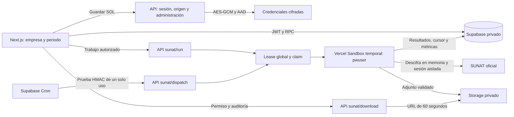

# Buzón SUNAT — implementación y operación de H10

Actualizado el **30/10/2026, America/Lima**. [Hito](hitos/h10-buzon-sunat.md) · [Cierre y aceptación](hitos/evidencias/h10-cierre.md) · [Evidencia productiva](hitos/evidencias/h10-production.json).

## Estado y alcance

El conector está integrado con **Next.js en Vercel Hobby y Supabase Cloud**. La empresa real autorizada verifica su conexión, consulta meses y recupera mensajes y adjuntos. Su revisión diaria está habilitada a las **08:00 de Lima**. La aplicación conserva la cobertura parcial de Mensajes que SUNAT devuelve también en SOL: una consulta incompleta no certifica ausencia de mensajes ni adelanta la última consulta correcta.

Los diagnósticos y autorizaciones anteriores permanecen en sus [evidencias históricas](hitos/evidencias/h10.md), [piloto local](hitos/evidencias/h10-implementacion.md) y [corrección de acceso](hitos/evidencias/h10-correccion-autenticacion.md). El usuario solicitó posteriormente completar la puesta en marcha, confirmó empresa/perfil y autorizó usar el último piloto. No se eluden CAPTCHA, verificaciones humanas, TLS ni el sandbox del navegador.

## Recorrido del administrador y del equipo

1. Abrir **Buzón SUNAT** y seleccionar una empresa; no se elige automáticamente.
2. Pulsar **Configurar conexión**. El RUC procede de la empresa. Introducir usuario y clave SOL y aceptar que consultar puede marcar mensajes como leídos.
3. **Guardar y verificar conexión** cifra los accesos y encola un trabajo. Loading y bloqueo permanecen hasta terminar o informar el resultado.
4. Elegir año y mes. Cambiar el periodo consulta la caché; **Consultar periodo** solicita una actualización real. Un periodo no consultado se distingue de uno vacío o incompleto.
5. **Abrir** muestra el registro guardado; recuperar el contenido y descargar el adjunto son acciones independientes bajo demanda. La copia privada disponible se reutiliza.
6. En **Usuarios → Gestionar usuario → Buzón SUNAT**, conceder acceso a contadores/supervisores internos ya asignados a esa empresa.
7. Configurar la revisión diaria en el panel de conexión. Su horario usa Lima. Desconectar cancela trabajos, elimina las credenciales operativas y deshabilita el diario, conservando mensajes, archivos e historia.

Ser responsable documental o tener acceso a Tributario no concede acceso al buzón. Los clientes quedan excluidos. Solo el administrador administra conexiones y accesos. Buzón no modifica obligaciones ni cumplimiento documental.

## Arquitectura



Las lecturas y operaciones habituales usan Supabase directamente. Guardar credenciales, firmar descargas y despertar el ejecutor requieren API por los secretos implicados. Las rutas de usuario exigen origen propio, sesión, permisos y límites; la ruta del programador usa HMAC y nonce. Todas devuelven respuestas `private, no-store`.

El programador despierta el despachador cada minuto. Solo prepara el diario de conexiones habilitadas cuyo horario ya corresponde, una vez por fecha de Lima. Sin trabajos elegibles no crea una VM. Cada trabajo se ejecuta secuencialmente; un lease global evita solapamientos y uno por conexión evita trabajos incompatibles.

La VM usa imagen inmutable, 1 vCPU, 2 GB asignados, cuatro minutos máximos, sin persistencia ni puertos públicos. La red permite únicamente SUNAT y el proyecto Supabase. El worker procesa un claim, valida nuevamente su lease antes de SOL, elimina las entradas privadas y cierra el navegador. Usa el usuario `pwuser` de la imagen y valida UID 1001; no ejecuta cambios de usuario mediante `sudo`.

## Cifrado y firma

AES-256-GCM usa IV aleatorio de 12 bytes, tag de 16 y AAD con estudio, empresa, conexión y versión. El keyring en texto claro se mantiene fuera de PostgreSQL, Storage y navegador. Su copia de recuperación se cifra con una clave de respaldo independiente conservada fuera de la base y del bucket. Retirar una clave antes de recifrar sus credenciales impide recuperarlas.

La firma del programador usa el texto `v1:<nonce>:<issued_at>:sunat.dispatch`, con HMAC-SHA256 y la clave literal UTF-8. El JSON estricto contiene `schema_version`, `action`, `nonce` e `issued_at`; caduca en 90 segundos. PostgreSQL consume el nonce una sola vez. La cola HTTP contiene esa prueba, no una clave reutilizable ni datos de la empresa. Se conservan los nonces técnicos hasta su limpieza por caducidad.

Las descargas usan el bucket privado `sunat-mailbox`, rutas por estudio/conexión/adjunto/hash y límite de 20.000.000 bytes. Cada firma verifica otra vez sesión y permiso y se audita. Revocar acceso evita nuevas firmas; una URL ya emitida conserva como máximo sus 60 segundos.

## Persistencia y contratos

Se publicaron **quince migraciones H10**, 98 totales, con lint remoto correcto y trece huellas históricas preservadas antes del alta real. [Publicación](hitos/evidencias/h10-cloud-migrations.json) · [Esquema](tablas-db.md#extensión-h10--buzón-sunat).

| Recurso | Propósito y conservación |
|---|---|
| `sunat_connections` | Empresa única, estado, versión, consentimiento, horario, fechas de consulta y línea base; soft delete. |
| `sunat_access_grants` | Permiso independiente por empresa/membresía, revisión y soft delete. |
| `sunat_jobs` | Trabajo, solicitud idempotente, lease, fechas, progreso, error y cursor; historial conservado. |
| `sunat_messages` | ID estable del origen, bandeja, fecha de publicación, asunto, lectura y contenido solicitado. |
| `sunat_attachments` | Clave estable de adjunto, nombre, estado, objeto privado, tamaño, MIME y SHA-256. El localizador externo permanece en la tabla privada. |
| `sunat_month_queries` | Estado por empresa, bandeja y mes; separa intento de consulta correcta. |
| `sunat_notifications` | Avisos por destinatario y evento, deduplicados y con lectura independiente. |
| `private.sunat_credentials` | Solo sobre cifrado y versión; se reemplaza al rotar y se retira al desconectar. |
| `private.sunat_attachment_sources` | Localizador validado por adjunto; necesario para recuperar los archivos aún no cacheados. Se incluye en el respaldo. |
| `private.sunat_worker_runtime` | Diagnóstico del procesador. |
| `private.sunat_dispatch_runtime` | Lease global, trabajo y resultado de ejecución/cierre. |
| `private.sunat_dispatch_settings` | Programación, endpoint fijo y referencia a Vault, sin devolver el secreto. |
| `private.sunat_dispatch_nonces` | Consumo único y caducidad de pruebas de despacho; ciclo técnico. |

Las tablas públicas tienen RLS por estudio, empresa, perfil y sesión. No hay cascadas físicas. Las versiones y resultados previos permanecen tras fallos o desconexión.

`h10_query` y `h10_command` conservan las consultas y operaciones de la interfaz. `h10_store_credentials` requiere servicio, actor y sesión administrativa verificados. `h10_dispatch_authorize` comprueba el trabajo solicitado; `h10_dispatch_claim` y `h10_dispatch_finish` administran el lease global. Los RPC del worker revalidan contexto al recibir cada lote. `h10_download_authorize` comprueba la copia y prepara la auditoría antes de firmar.

Un reintento reutiliza la intención y el trabajo compatible. Si el despachador está ocupado, el cliente puede volver a despertar el mismo trabajo, con un intervalo limitado; no crea otra obligación ni otra solicitud de consulta. Un cierre incierto mantiene el lease y requiere conciliación o su límite de expiración. Nunca se presenta como cierre confirmado.

## Consulta diaria y fallos

El motor diario limita páginas, llamadas de lectura y duración. Mantiene cursor y ancla; las solicitudes de activos y login se contabilizan aparte en las métricas reales del navegador. Si cambia el ancla, reinicia dentro del presupuesto restante. Los adjuntos no se descargan automáticamente.

La primera lectura establece una línea base de avisos. Los IDs nuevos posteriores se notifican a usuarios autorizados sin duplicar destinatario/evento. La cobertura completa y la línea base son marcas distintas: una consulta parcial conserva datos y puede detectar nuevos IDs, pero no adelanta la última consulta diaria completa.

Los errores muestran su fecha y conservan la información anterior. Credenciales rechazadas y verificaciones humanas detienen los reintentos; no se prueban contraseñas erróneas contra empresas reales. Los errores de cuota, preparación, cierre o servicio se muestran al administrador. WhatsApp y creación automática de actividades quedan fuera de H10.

## Entorno y mantenimiento

El export consolidado es `.env.vercel`, ignorado por Git. **Secret:** `SUNAT_CREDENTIALS_KEYS`, `SUNAT_DISPATCH_SECRET`, clave administrativa, HMAC de idempotencia y token de receipts existente. **Config:** URLs y clave pública, `SUNAT_CREDENTIALS_CURRENT_KEY`, `SUNAT_EXECUTION_MODE`, `SUNAT_SOURCE_VALIDATED`, `SUNAT_SANDBOX_IMAGE` y `SUNAT_DAILY_ENABLED`.

`SUNAT_EXECUTION_MODE=vercel` y `SUNAT_SOURCE_VALIDATED=true` habilitan el adaptador comprobado; esto no declara íntegro el contenido que SUNAT omite. La imagen usa un digest, nunca un tag mutable para ejecución. Para pausar el diario de una empresa se cambia su programación; para detener el programador global se usa `h10_dispatch_configure(..., false)` desde el ejecutor administrativo, manteniendo el secreto fuera de comandos e historial.

La copia incluye DB, `private.sunat_credentials`, `private.sunat_attachment_sources`, adjuntos de `sunat-mailbox` y keyring cifrado. Conservar la clave de respaldo fuera de ese paquete. La restauración exige un Docker vacío, comprueba FK y hashes y desactiva cron/sesiones antes de usar los datos. El destino temporal en Storage fue elegido por el usuario; los pendientes globales de respaldo permanente y destino independiente continúan en H08.

## Laboratorio y validación

La presentación permanece en **4003** con el build aislado existente. API/DB Docker H09: **54431/54432**. Una instancia independiente 4004 sirve para pruebas visuales; no reconstruir su build mientras se utiliza.

```powershell
yarn h10:worker:build
yarn h10:app verify
yarn test:h10:dispatch:sql
yarn tsx scripts/verify-h10-one-job.ts
yarn h10:app bundle
```

`verify` comprueba acceso por los cuatro perfiles sin detener el consumidor. `verify:foreground` conserva la regresión original de veinte casos y rechaza ejecutarse si el simulador continuo está activo. No pausarlo durante una presentación. El simulador rechaza destinos remotos; las pruebas ficticias y negativas nunca usan Cloud.

`yarn tsx scripts/verify-h10-ui.mts` comprueba login, loading, foco, Escape y móvil contra **4004/54431**, bloqueando destinos remotos. Las [capturas y resultados](hitos/evidencias/h10-ui-final.json) contienen únicamente datos ficticios. Los [resultados reales](hitos/evidencias/h10-production.json), [Sandbox](hitos/evidencias/h10-sandbox-operacion.json) y [recuperación](hitos/evidencias/h10-recovery.json) se registran separadamente, sin identidad ni contenido fiscal.
