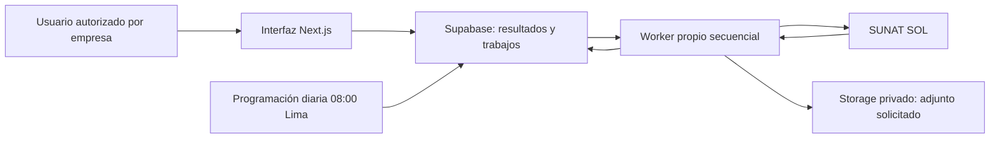

# Buzón SUNAT — factibilidad y diseño de H10

**Estado vigente, 30/10/2026:** [H10 cerrado operativamente](hitos/evidencias/h10-cierre.md), con puesta en marcha Vercel Hobby/Supabase y diario comprobados. [Manual actual](buzon-sunat-implementacion.md). La cobertura de Mensajes del origen permanece parcial explícita. El contenido que sigue conserva la investigación inicial del 27/10 y sus condiciones en aquella fecha; las referencias a funciones no implementadas o servidor por confirmar pertenecen a esa etapa.

## Investigación inicial — 27/10/2026

**Actualización: 27/10/2026. Estado: implementación local comprobada; integración real pendiente de completar el piloto.** [Hito](hitos/h10-buzon-sunat.md), [implementación y operación](buzon-sunat-implementacion.md), [evidencias nuevas](hitos/evidencias/h10-implementacion.md), [piloto anterior](hitos/evidencias/h10.md) y [kit local](../integrations/sunat/README.md).

El usuario autorizó posteriormente desarrollar y probar el conector propio como parte del piloto. Se construyeron las funciones y pantallas en Docker sin activar Cloud. El contenedor recibió HTTP 403 al abrir la entrada pública; se detuvo antes de transmitir credenciales. Esta implementación no aprueba la factibilidad real ni sustituye la conciliación pendiente descrita abajo.

## Qué está confirmado y qué falta demostrar

Se acordó un módulo por empresa, bandeja y adjuntos, conector propio, revisión manual y diaria, equipo interno autorizado y consulta mensual bajo demanda. Se autorizaron dos empresas piloto y se comprobó su acceso mediante SOL.

La primera empresa mostró **`1-0 de 0`** en ambas bandejas; el usuario confirmó que estaba vacía. La segunda aportó el caso positivo: listados de notificaciones y mensajes, registros de octubre/septiembre, un PDF válido de 88.793 bytes y 25 identificadores que se conservaron tras actualizar. Se verificó también la navegación de la primera a la segunda página. Esto demuestra acceso a contenido real mediante el portal; todavía no acredita consulta mensual completa, sincronización incremental ni recursos del worker.

En Mensajes se detectó una discrepancia: el contador de la segunda página indicaba `26-40 de 40`, pero la vista no renderizó filas. Su causa sigue sin determinarse. Antes de ofrecer una consulta mensual completa, el prototipo debe detectar y resolver esa inconsistencia mediante carga/reintentos acotados o informar consulta parcial; no presentar el mes como vacío.

**Lectura confirmada:** al entrar en Mensajes se abrió automáticamente un registro y el indicador bajó de 12 a 11. El usuario autorizó que la consulta pueda marcar mensajes como leídos, con advertencia al configurar la conexión. En una apertura posterior autorizada se verificó que un registro perdió su marca de nuevo y el indicador pasó de 11 a 10. El conector no prometerá conservar la lectura de SUNAT; la revisión local permanecerá independiente. Falta comprobar por separado el listado y la descarga en el prototipo.

SUNAT describe el acceso al buzón mediante SOL y aplicaciones oficiales en su [guía de canales](https://centrovirtual.sunat.gob.pe/tramites/buzon-electronico). La documentación examinada no aportó un contrato público de API específico del buzón; es una limitación de la investigación, no una afirmación de inexistencia de cualquier servicio. La [API oficial SIRE](https://cpe.sunat.gob.pe/node/158) corresponde a registros de compras/ventas y no acredita una API de buzón. Fuentes verificadas el 26/10/2026.

## Información del administrador

| Solicitud | Uso y manejo |
|---|---|
| Empresa piloto y RUC | Reutilizar identidad existente. No crear una empresa productiva para probar el acceso. UUID de TaxSkill opcional durante el piloto; vinculación necesaria para el módulo posterior. |
| Usuario SOL autorizado | Verificar permiso de buzón. Preferir secundario limitado si resulta compatible; [SUNAT permite asignar opciones concretas](https://orientacion.sunat.gob.pe/6618-06-creacion-de-usuarios-secundarios). |
| Clave SOL | Introducir por el mecanismo privado acordado; no incluir en JSON de solicitud, evidencia, Git ni logs. |
| Autorización del titular/empresa | Delimitar inicio de sesión, lectura, descarga de referencia y conservación de evidencia sin contenido sensible publicado. |
| Mes y asunto/adjunto de referencia | Contrastar el mes actual y uno anterior conocido sin adivinar contenido ni generar obligaciones. |
| Operadores por empresa | Elegir contadores/supervisores autorizados. Credenciales y conexiones solo administrables por el administrador. |
| Servidor privado | Confirmar disponibilidad de contenedor y presupuesto de CPU/RAM; no asumir capacidad libre porque n8n esté publicado. |
| Responsable de accesos | Resolver cambios de clave, permisos y verificaciones humanas. |

El kit privado guarda únicamente metadatos y observaciones. La custodia cifrada de claves del producto **todavía no está implementada**. En el piloto actual las credenciales se utilizaron en el formulario oficial, sin persistirlas en el repositorio ni en archivos del kit.

## Experiencia propuesta después de validar el conector

- Nueva entrada **Buzón SUNAT** con selector de empresa, año/mes, búsqueda y filtro Mensajes/Notificaciones. Permisos propios; no heredar automáticamente Tributario.
- Abre el mes actual de Lima. El mes se interpreta por depósito/publicación SUNAT. Otros meses solo se recuperan al solicitarlos.
- Estados explícitos: sin conexión, mes no consultado, en consulta, consulta parcial, completa sin mensajes, completa con mensajes, desactualizada por fallo y requiere intervención.
- Botón **Consultar novedades** con progreso y bloqueo. Repetir el clic reutiliza el trabajo pendiente.
- Página de 25 registros. Datos resumidos y adjuntos bajo demanda; aprovechar las composiciones y controles existentes.
- Un fallo conserva el resultado anterior con su fecha, sin presentar una respuesta vacía como consulta satisfactoria.
- Lectura SUNAT y revisión local separadas. Un mensaje antiguo recuperado por primera vez como histórico no se anuncia automáticamente como recién depositado.
- Al configurar la conexión, advertir: **«Consultar el buzón desde TaxSkill puede marcar mensajes como leídos en SUNAT».** La advertencia debe estar antes de confirmar la conexión; su confirmación quedará auditada. La consulta no constituye aprobación documental ni cálculo de efectos legales.

Este diagrama es el diseño posterior al piloto; no representa servicios H10 ya desplegados. La consulta de resultados usa Supabase directo. El acceso externo y descifrado pertenecen al servidor/worker. No añadir el buzón al catálogo de entregables, plantillas por régimen, obligaciones o cálculo de cumplimiento.

## Consumo, sesiones y seguridad

Un worker secuencial y un trabajo activo por empresa. Revisión diaria incremental a las **08:00, America/Lima**, configurable, únicamente para empresas activas y conectadas. Controlar solapamientos, reutilizar caché y continuar lotes sin repetir meses completos. Los adjuntos solo se obtienen al solicitarlos y se reutilizan con autorización vigente.

El piloto debe medir duración, memoria máxima, CPU, solicitudes, páginas y bytes del adjunto, y compararlos con presupuestos explícitos. Esos valores permanecen pendientes: no se deducen de tiempos del navegador ni de métricas de Docker de otra aplicación.

Se implementó y midió por separado el núcleo del prototipo con un simulador HTTP en Docker: [41 comprobaciones y correcciones](hitos/evidencias/h10-correcciones.md). El núcleo conserva continuidad, detecta páginas incompletas y limita sesión/reintentos/recursos. Su transporte solo admite loopback del laboratorio; falta el adaptador SUNAT. Las métricas sintéticas no sustituyen las del conector real.

Aislar credenciales, cookies y sesiones por empresa. Acceso a datos por estudio/empresa/sesión, Storage privado y auditoría. La autorización futura ampliará capacidades de buzón, manteniendo los tipos documentales restringidos a los tres módulos existentes.

CAPTCHA o verificación humana → detener y avisar; no eludir controles. Clave rechazada o falta de permisos → incidencia explícita y sin bucle de reintentos. El cambio de lectura fue autorizado, pero debe advertirse y registrarse; no ejecutar acciones para restaurar marcas ni inferir plazos legales del estado leído/no leído.

## Etapas y resultados

1. **Preparación:** acuerdos, requisitos, protocolo, ejemplos y evaluador local. Implementada.
2. **Piloto:** acceso real y contraste de los ocho casos. Acceso, PDF, IDs de la muestra y cambio de lectura observados; faltan consulta mensual completa, sesiones/fallos y worker medido.
3. **Revisión de viabilidad:** presupuesto y evidencias revisados; continuar o registrar bloqueo concreto.
4. **Implementación:** persistencia, permisos, cifrado, worker y pantalla. Condicionada a la etapa 3.
5. **Publicación:** despliegue autorizado, conexiones reales y programación diaria supervisada.

El resultado del evaluador no sustituye la revisión de las evidencias ni activa funciones productivas. Las pruebas sintéticas del evaluador no validan acceso a SUNAT. Consultar [el registro actual](hitos/evidencias/h10.md).
