# Diagrama de flujo de la aplicación

- **Versión:** 1.0 — 10 de octubre de 2026.
- **Estado:** procesos de la primera versión por implementar.
- **Fuentes:** [diseño técnico](diseno-tecnico.md), [análisis funcional](analisis_completo_sistema_documental_contable.md) y [resumen ejecutivo](resumen_ejecutivo_sistema_documental_contable.md).
- **Relacionados:** [tablas DB](tablas-db.md), [navegación](flujo-navegacion.md) y [carpetas](estructura-carpetas.md).

## 1. Lectura y decisiones

El flujo cubre Tributario, Laboral por trabajador, Laboral general y Actividades. Las obligaciones de las tres áreas y las actividades adicionales usan el mismo motor de entregables, versiones y revisión; sus indicadores se separan.

**CONFIRMADO:** acceso directo a Supabase desde frontend como Plan A; cada archivo se revisa individualmente; vencimiento controla entrega, aprobación controla cumplimiento; correcciones y reaperturas tienen nuevo plazo; versiones se conservan; soft delete administrativo con restauración. **BASE TÉCNICA:** orden transaccional, manejo de conflictos, claves de recuperación y horarios iniciales del diseño central.

RLS continúa como T01/F05. Los nodos de autorización describen el comportamiento objetivo y controles de operación; no afirman que las políticas estén desplegadas.

## 2. Mermaid principal

```mermaid
flowchart TD
    Inicio["Administrador prepara el estudio"] --> Cuentas["Cuentas Auth, empresas, permisos y responsables"]
    Cuentas --> Config["Catálogo y reglas versionadas"]
    Config --> Fuente{"Origen de obligación"}
    Fuente -->|"Periodo o evento"| Motor["Generar desde periodo vigente o cursor de recuperación"]
    Fuente -->|"Adicional única"| Manual["Administrador define alcance, plazo, responsable y archivos"]
    Fuente -->|"Adicional recurrente"| Motor
    Laboral["Ingreso, cese o reingreso: etapa laboral independiente"] --> Motor
    Motor --> Vigente{"Estudio, empresa y origen operables"}
    Vigente -->|"No"| Pausa["Pausar; conservar expediente e historial"]
    Pausa --> Restaurar["Restauración administrativa: sin activar hijos ni cuentas"]
    Restaurar --> Retomar["Retomar periodo vigente; excluir pausas deliberadas"]
    Retomar --> Motor
    Vigente -->|"Sí"| Instancia["Crear una sola instancia por destino y ocurrencia"]
    Manual --> Vigente
    Instancia --> Slots["Snapshot, responsable, entregables y ciclos iniciales"]
    Slots --> Bandeja["Actividades: vencidas, próximas, pendientes y por revisar"]
    Bandeja --> Excluir{"No aplica o cancelación autorizada"}
    Excluir -->|"Sí"| Historia["Motivo y auditoría; conservar archivos; excluir exigibles"]
    Excluir -->|"No"| Entrega["Responsable selecciona un archivo requerido"]
    Entrega --> Reserva["RPC directa: intención con request_id y revisión esperada"]
    Reserva --> Storage["Carga directa y reanudable a Storage de recepción"]
    Storage --> Transferencia{"Transferencia completa"}
    Transferencia -->|"No"| Reanudar["Reanudar misma intención vigente"]
    Reanudar --> Storage
    Transferencia -->|"Sí"| Validar["Edge Function valida bytes, formato y tamaño"]
    Validar --> Valido{"Archivo válido"}
    Valido -->|"No"| Rechazo["Mostrar motivo; no crear versión"]
    Rechazo --> Entrega
    Valido -->|"Sí"| Confirmar["Promover objeto y confirmar versión mediante RPC interna"]
    Confirmar --> Conflicto{"Revisión esperada coincide"}
    Conflicto -->|"No"| Recargar["Conflicto: consultar estado y decidir nueva carga"]
    Recargar --> Entrega
    Conflicto -->|"Sí"| Recibido["Versión inmutable; primera entrega del ciclo; por revisar"]
    Recibido --> Revisor["Revisor autorizado selecciona versión vigente"]
    Revisor --> Decision{"Decisión individual con revisión esperada"}
    Decision -->|"Observar"| Observar["RPC: comentario, nuevo plazo y ciclo de corrección"]
    Observar --> Entrega
    Decision -->|"Aprobar"| Aprobar["RPC: aprobación de esa versión y auditoría"]
    Aprobar --> Todos{"Todos los archivos requeridos aprobados"}
    Todos -->|"No"| Parcial["Avance parcial; otros archivos pendientes o por revisar"]
    Parcial --> Bandeja
    Todos -->|"Sí"| Completa["Obligación completa"]
    Completa --> Reabrir{"Reapertura autorizada"}
    Reabrir -->|"Sí"| Reapertura["Motivo y nuevo plazo; conservar aprobación histórica"]
    Reapertura --> Entrega
    Reabrir -->|"No"| Indicadores["Actualizar indicadores y reportes"]
    Historia --> Indicadores
    Parcial --> Indicadores
    Recibido --> Puntualidad["Entrega puntual o tardía del ciclo; revisión no genera atraso"]
    Puntualidad --> Indicadores
    Indicadores --> Separados["Cumplimiento documental y actividades adicionales separados"]
    Slots --> Eventos["Avisos internos persistidos"]
    Recibido --> Eventos
    Observar --> Eventos
    Aprobar --> Eventos
    Reapertura --> Eventos
    Eventos --> Diario["09:00 Lima: plazos abiertos y observaciones pertinentes"]
    Diario --> Pendientes{"Hay avisos y destinatario elegible"}
    Pendientes -->|"No"| SinEnvio["No enviar WhatsApp"]
    Pendientes -->|"Sí"| Resumen["Congelar resumen único por usuario y día"]
    Resumen --> N8N["Webhook autenticado; deduplicar delivery_id"]
    N8N --> Recepcion{"Webhook recibido"}
    Recepcion -->|"No o respuesta perdida"| Reintento{"Quedan intentos HTTP; máximo 3"}
    Reintento -->|"Sí: mismo delivery_id"| N8N
    Reintento -->|"No"| Incidencia["Registrar fallo o resultado incierto; conciliar"]
    Recepcion -->|"Sí"| Accepted["accepted: no implica entrega de WhatsApp"]
    Accepted --> Proveedor["n8n llama al proveedor una sola vez por entrega"]
    Proveedor --> Resultado["Callback autenticado: sent, delivered, failed o unknown"]
    Resultado --> Registrar["Registrar resultado sin duplicar ni degradar delivered"]
    Registrar --> Incierto{"Resultado unknown"}
    Incierto -->|"Sí"| Conciliar["Conciliar antes de intentar otro envío"]
    Incierto -->|"No"| Fin["Seguimiento disponible en la aplicación"]
```

## 3. Preparación, configuración y generación

1. El administrador crea empresas y cuentas mediante la excepción de servidor de Auth, luego configura membresías, roles, permisos y responsables elegibles.
2. Catálogo y reglas establecen frecuencia, destinos, formatos, tamaño, posiciones requeridas, aplicabilidad y vencimiento. Activar exige configuración completa.
3. Crear una nueva rule_versions para cualquier cambio; aplicar desde el siguiente ciclo no iniciado o vigencia posterior. Las instancias conservan snapshot.
4. Empresa nueva empieza en el periodo vigente. No generar pendientes de periodos anteriores; si el plazo vigente ya pasó, informar al administrador.
5. Cron 00:05 Lima genera ocurrencias y recupera ciclos omitidos por indisponibilidad desde el cursor, sin retroceder antes del inicio de control.
6. La clave estudio/regla/destino/ocurrencia evita duplicados incluso al cambiar versión. Cada lote confirma avance junto con los registros.
7. Heredar responsable de empresa/módulo o usar responsable explícito. Si perdió elegibilidad, conservar obligación y mostrar incidencia; no conceder acceso por ser responsable.
8. Soft delete, empresa inactiva/suspendida o pausa deliberada impiden generación pertinente. Restaurar/activar retoma el periodo vigente y excluye intervalos deliberadamente pausados.

### 3.1 Documentación laboral

| Evento | Operación y efecto |
|---|---|
| Ingreso | Crear employment_periods separado y emitir documentos de ingreso/aplicables. |
| Durante relación | Generar documentos periódicos de etapas elegibles, conservando periodos y boletas. |
| Cese | Registrar fecha/motivo y emitir documentación de cese. Carta de renuncia se exige cuando aplica. |
| Reingreso | Abrir nueva etapa sin reutilizar fechas ni documentos de la anterior. |
| Soft delete de trabajador | Impedir nuevos usos operativos; no inventar cese ni borrar etapas. |

### 3.2 Actividades adicionales

Solo el administrador crea actividades únicas/recurrentes. Siempre exigen al menos un archivo, revisión y aprobación. Destino empresa o Interna del estudio; un cliente no recibe alcance interno. Tienen un responsable de entrega, sin revisor fijo. La única crea obligación directamente; la recurrente crea regla y ocurrencias independientes.

## 4. Entrega y archivos

1. La página entrega a su hook entregable/ciclo y revisión vigente. El repositorio llama CreateUploadIntent por RPC directa.
2. La intención reserva identidad/rutas nuevas; los bytes se transfieren a Storage con SDK/TUS. Interrupción conserva intención vigente y progreso recuperable.
3. La Edge Function finaliza de manera confiable: verifica tamaño real, firma y formato, incluyendo contenedores Office. No confiar en MIME declarado ni en una afirmación del navegador.
4. Promover objeto final y confirmar transaccionalmente versión, cabecera, primera entrega del ciclo, auditoría y avisos. Si falla SQL tras promoción, reintentar la misma intención; el objeto no confirmado aún no es descargable.
5. Éxito devuelve versión estable. Fallo conserva el estado documental anterior y explica rechazo/conflicto; no sobreescribir una revisión nueva.
6. Una versión aprobada no se sustituye por carga normal; requiere reapertura. La fecha de entrega es finalización válida, no inicio de transferencia.

La primera finalización de un ciclo determina puntualidad. Reemplazar antes de aprobación crea otra versión, sin reescribir esa primera fecha. Hasta terminar T01, acceso privado de Storage y rechazo de lecturas ajenas siguen pendientes de validación.

## 5. Revisión y cumplimiento

| Acción | Condiciones | Cambio confirmado |
|---|---|---|
| Aprobar | Permiso approve, perfil revisor, versión vigente y expected_revision coincidente. | Cabecera aprobado, evento inmutable y avisos. |
| Observar | Permiso observe, comentario y nueva fecha no anterior al día local de la acción. | Cabecera observado; cerrar ciclo anterior y abrir corrección. |
| Corregir | Permiso upload y ciclo actual. | Nueva versión por_revisar, conservando anterior. |
| Reabrir | Permiso reopen, aprobado, motivo y nuevo plazo. | Evento de reapertura; cabecera pendiente sin versión vigente; nuevo ciclo. |
| No aplica | Permiso waive y motivo. | Excluir obligación completa de exigibles/avisos, sin borrar archivos. |
| Cancelar | Administrador y motivo. | Anulación explícita con historial intacto. |

Las decisiones reciben request_id, version_id y expected_revision. Una sola confirma ante revisión concurrente; la otra recibe CONFLICT y debe refrescar. Los cambios de estado, ciclos, auditoría y avisos pertenecen a la misma transacción. No aplicar aprobación visual definitiva antes del resultado.

Obligación completa solo cuando todos los entregables están aprobados. Por ejemplo, dos archivos y una aprobación muestran avance 1/2 y cero obligaciones aprobadas.

Entrega puntual pendiente de revisión no es atraso del cliente y no suma aún al cumplimiento. Una observación crea un plazo diferente; reapertura conserva aprobación histórica pero retira cumplimiento actual hasta aprobar la nueva versión.

Los vencimientos se calculan al cierre del día de Lima, sin ajuste por feriados/fines de semana. El atraso operativo termina al entregar; atraso histórico del ciclo permanece. Sin exigibles mostrar Sin obligaciones. Reportes globales ponderan por número de obligaciones; additional se mide aparte.

## 6. Avisos y WhatsApp

Los eventos principales generan avisos internos inmediatamente: asignación, entrega, observación, aprobación, reapertura y umbrales de plazo. Realtime se limita a avisos propios; no transmite todas las tablas.

09:00 Lima: preparar resumen de vencimientos dentro de siete días, ciclos atrasados y nuevas observaciones pertinentes. Reevaluar perfil, membresía, permiso, teléfono, soft delete y estado del recurso. Sin avisos elegibles no hay mensaje. WhatsApp no envía una notificación por cada cambio ni incluye aprobaciones/cargas/asignaciones.

Una fila por estudio/usuario/fecha local; contenido y delivery_id congelados. n8n deduplica antes de llamar al proveedor y conserva el resultado tras reinicios. Cada lote transporta hasta 50 resúmenes.

| Situación | Comportamiento |
|---|---|
| Error de conexión, 429 o 5xx | Hasta tres intentos HTTP totales; pausas 1 y 3 segundos, timeout 5 segundos. |
| Respuesta perdida | Mismo delivery_id; consultar/devolver estado persistido, sin segundo envío efectivo. |
| 4xx de configuración | Registrar incidencia; no repetir indefinidamente. |
| HTTP aceptado | Estado accepted; no afirmar sent/delivered. |
| Proveedor confirma envío/entrega | Registrar sent/delivered con evidencia correspondiente. |
| Resultado ambiguo | unknown y conciliación; no reenvío ciego. |
| Callback repetido/fuera de orden | Deduplicar receipt_id; no degradar delivered. |
| Pending no aceptado al día siguiente | Caducar y recalcular elementos pertinentes para el nuevo día. |
| Observación accepted/unknown en curso | No liberarla a otro resumen hasta resolver fracaso/resultado. |

Secreto de salida en Edge Function y secreto independiente de callback en Route Handler. Enlaces a páginas autenticadas; sin archivos, URLs firmadas, contraseñas, salarios o comentarios médicos en el webhook. La falla externa no revierte la operación documental.

## 7. Transporte y responsabilidades

| Operación | Transporte |
|---|---|
| Consulta de datos/listados/indicadores | SDK Data API o RPC directa, con filtros y paginación. |
| Configuración, generación manual y cambios documentales | RPC transaccional directa. |
| Transferencia, previsualización y descarga | Storage directo; autorización de intento por RPC y URL breve mediante SDK. |
| Validación binaria/promoción/confirmación final | Edge Function confiable; RPC interna no invocable como afirmación del cliente. |
| Crear cuenta, cambiar contraseña, inhabilitar | Route Handlers administrativos: credencial Auth protegida. |
| Excel/PDF básicos | Consultar todos los lotes autorizados y generar en navegador; no solo página visible. |
| Resumen programado | Cron + Edge Function con secreto de n8n. |
| Callback n8n | Route Handler autenticado e idempotente. |

Atomic Design separa interfaz y transporte: páginas/contenedores usan hooks; repositorios usan Supabase; organismos reciben datos/callbacks. No hay APIs Next.js para intermediar listados, reservar/cargar/consultar intenciones, descargar ni exportar reportes básicos.

## 8. Escenarios de aceptación

- Dos ejecuciones de generación producen una sola ocurrencia, con snapshot original.
- Dos archivos requeridos con aprobación parcial conservan estado incompleto.
- Todos entregados puntualmente, aún por revisar: sin atraso ni recordatorio de entrega.
- Observación abre corrección con nuevo plazo y conserva puntualidad original.
- Reapertura exige motivo/fecha y nueva versión; no modifica decisión histórica.
- Cese y reingreso conservan etapas separadas.
- Soft delete detiene operación pertinente y restauración no activa cuentas/hijos ni genera backlog de pausa.
- Interrupción o fallo entre Storage/SQL se recupera sin versión duplicada ni archivo prematuramente disponible.
- Resumen vacío no se envía; repetición de delivery_id/receipt_id no crea mensajes/eventos nuevos.
- Permisos e aislamiento de lecturas directas se cierran en T01/F05.

## 9. Referencias

[Mermaid flowchart](https://mermaid.js.org/syntax/flowchart.html); [Supabase RPC](https://supabase.com/docs/reference/javascript/rpc); [carga reanudable](https://supabase.com/docs/guides/storage/uploads/resumable-uploads); [webhook n8n](https://docs.n8n.io/integrations/builtin/core-nodes/n8n-nodes-base.webhook/). Reglas, horarios y transacciones proceden del diseño técnico y las decisiones del usuario.
