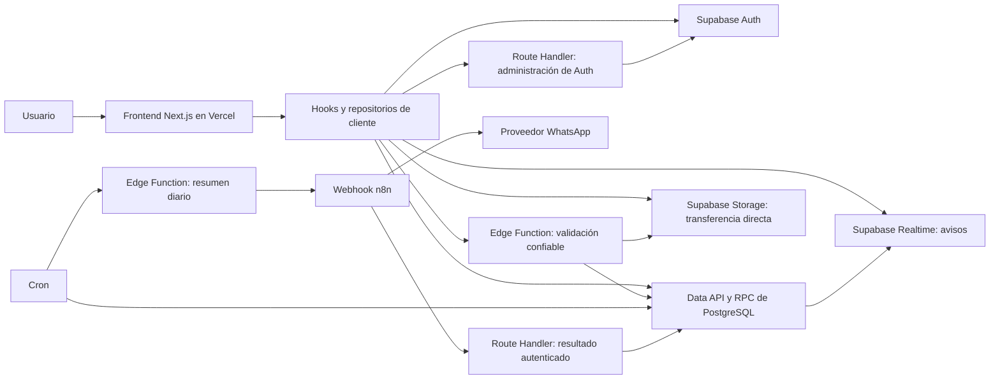
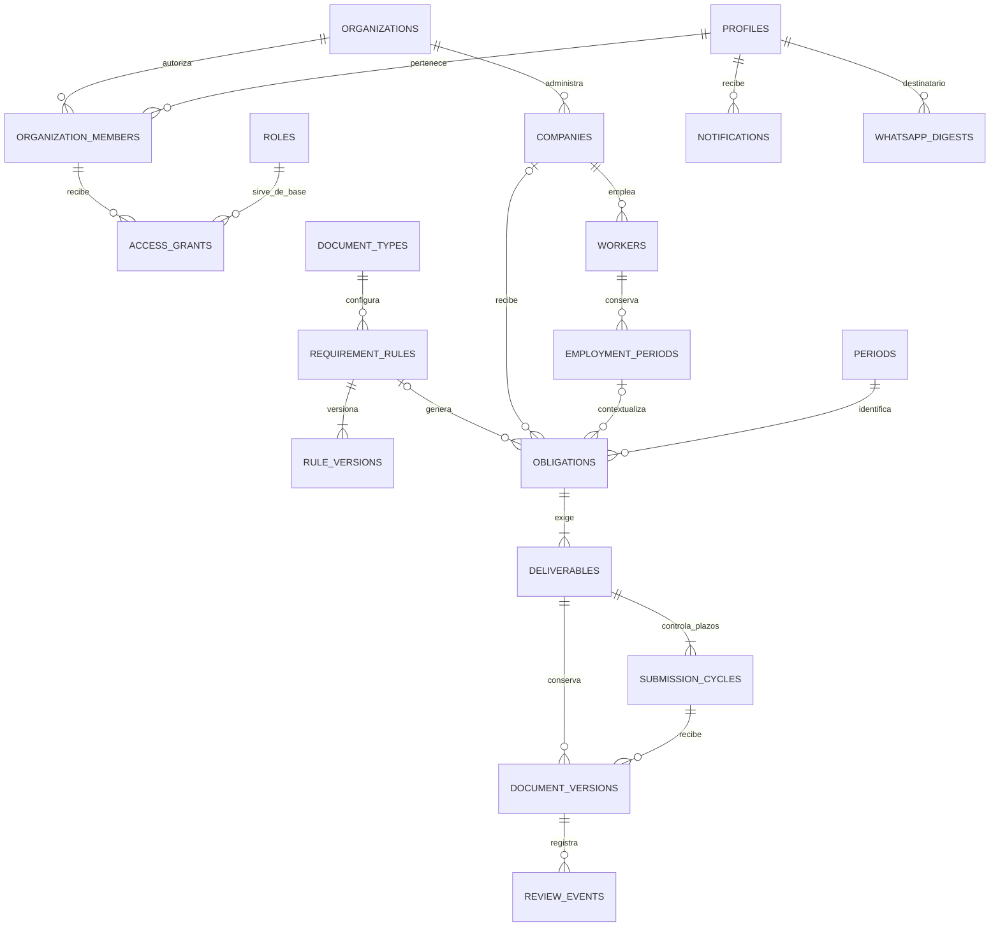
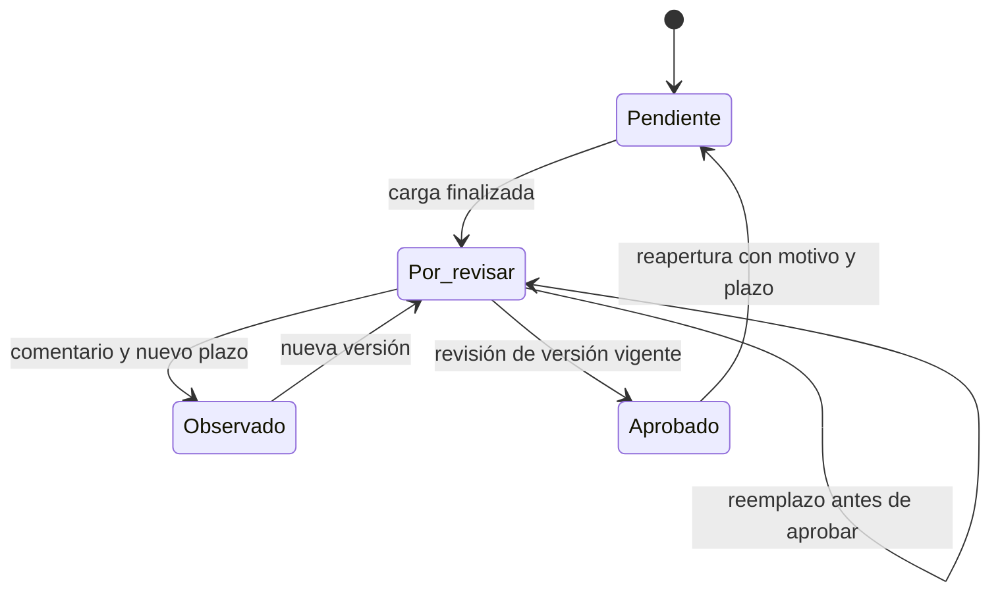

# Diseño técnico del sistema documental contable y laboral

- **Versión:** 1.1
- **Fecha:** 10 de octubre de 2026
- **Proyecto:** tax-skill / SGD Contable
- **Estado actualizado al 17 de octubre de 2026:** H01–H07 implementados; REV-01–REV-05 cerradas. [Cierre complementario](hitos/evidencias/h07-cierre-complementario.md): 57 versiones local/Cloud coincidentes y 13 huellas históricas conservadas, con pruebas únicamente en Docker. Base lista para comenzar H08; preparación productiva y aceptación formal pendientes.
- **Operación inicial:** un estudio contable en Perú, zona horaria America/Lima.

**Ampliación H09 — 25/10/2026:** [Entregables, plantillas por régimen y empresas](hitos/h09-entregables-plantillas-empresa.md). Esta especificación reciente prevalece sobre las referencias anteriores a reglas y alta sin perfil documental. Implementación y pruebas exclusivamente locales; [estado de validación](hitos/evidencias/h09.md). H08 conserva sus pendientes operativos.

### Índice

- [Decisiones confirmadas](#2-registro-de-decisiones-confirmadas) y [alcance y valores iniciales](#3-alcance-y-valores-de-partida).
- [Arquitectura](#4-arquitectura-general), [modelo de información](#5-modelo-de-información) y [permisos](#6-usuarios-permisos-y-aislamiento).
- [Catálogo y calendario](#7-catálogo-reglas-y-calendario), [estados y revisiones](#8-estados-plazos-y-revisiones) y [expediente laboral](#9-expediente-laboral).
- [Archivos](#10-carga-acceso-y-conservación-de-archivos), [Actividades e indicadores](#11-actividades-búsqueda-e-indicadores) y [contratos](#12-contratos-de-operaciones).
- [Notificaciones y n8n](#13-notificaciones-y-whatsapp-mediante-n8n), [navegación](#14-navegación-y-flujos-de-usuario), [auditoría](#15-auditoría-y-observabilidad) y [rendimiento](#16-rendimiento-y-consumo).
- [Despliegue y recuperación](#17-entornos-despliegue-y-recuperación), [etapas](#18-etapas-de-implementación) y [funciones posteriores](#19-funcionalidades-posteriores).
- [Antes de publicar](#20-configuraciones-necesarias-antes-de-publicar), [aceptación](#21-criterios-de-aceptación-y-plan-de-pruebas), [referencias](#22-referencias-técnicas) y [trazabilidad](#23-matriz-de-trazabilidad).

## 1. Propósito, fuentes y lectura

Este documento transforma el análisis funcional y las decisiones de la conversación en una base para implementar la aplicación. Describe arquitectura, información, autorización, ciclos documentales, actividades, automatizaciones, operación y aceptación.

Concreción H06 entregada: [contratos de Actividades y notificaciones](actividades-notificaciones.md), [evidencias](hitos/evidencias/h06.md) y [workflow n8n](../integrations/n8n/README.md). Se completan las 29 tablas sin tareas duplicadas; las reservas técnicas de transporte/gateway y las dos fases inmutables por intento se detallan en el [diccionario](tablas-db.md#tabla-26). RLS y canal productivo conservan su cierre en H08.

Las fuentes funcionales son:

- **A1:** analisis_completo_sistema_documental_contable.md, entregado por el usuario desde su carpeta Downloads; especialmente las secciones 61–74, 77 y 82–83.
- **A2:** resumen_ejecutivo_sistema_documental_contable.md, entregado desde la misma carpeta.
- **Conversación:** aclaraciones y respuestas del usuario que originaron el plan aprobado.
- **Repositorio:** package.json, next.config.ts, src/app y AGENTS.md, revisados durante esta etapa.

Los archivos de análisis describen necesidades y propuestas del producto. Sus propuestas se ajustan cuando una decisión expresa del usuario establece otra regla. Las referencias técnicas sustentan capacidades de las herramientas; las reglas de este producto se especifican aquí.

### 1.1 Categorías de decisión

| Categoría | Significado |
|---|---|
| CONFIRMADO | Decisión expresa del usuario; forma parte del alcance acordado. |
| BASE TÉCNICA | Valor o mecanismo adoptado para concretar el diseño; no se presenta como una respuesta adicional del usuario. |
| POSTERIOR | Funcionalidad fuera de la primera versión, registrada en la matriz de pendientes. |
| PREPUBLICACIÓN | Configuración o validación operativa necesaria para publicar; no equivale a una función aplazada. |
| TÉCNICO DIFERIDO | Trabajo técnico que se implementará en una etapa posterior del MVP; no se desarrolla ahora ni se considera una función comercial futura. |

### 1.2 Estado de partida y avance del repositorio

Al redactar este diseño, el repositorio contenía la plantilla inicial de Next.js, sin integración de Supabase ni lógica del dominio. Esa descripción corresponde al punto de partida: H01–H07 ya tienen implementación y el [índice de hitos](hitos/README.md) registra el avance y los pendientes vigentes. Las versiones declaradas son Next.js 16.4.0, React 19.3.0, TypeScript 5 y Tailwind CSS 4. La configuración activa Cache Components y Partial Prefetching.

Antes de implementar código de Next.js deben consultarse los manuales incluidos en node_modules/next/dist/docs, conforme a AGENTS.md. Se revisaron las guías de componentes de servidor/cliente y autenticación con Cache Components. Las versiones anteriores del framework no son una referencia suficiente para este proyecto.

Este diseño define los contratos; por sí solo no acredita migraciones aplicadas, servicios desplegados ni aceptación funcional. Para ello deben consultarse las evidencias de cada hito y la revisión vigente.

### 1.3 Actualización del diseño

**Terminología confirmada el 24/10/2026:** Tributario, Laboral por trabajador y Laboral general se denominan módulos. Las menciones anteriores a «área documental» son equivalentes; se conserva la identidad de requisitos y archivos históricos. Documentos es un buscador transversal de archivos entregados y versiones, distinto de los listados de obligaciones de cada módulo. Ver [recorridos y responsabilidades](flujo-navegacion.md#36-módulos-y-buscador-documentos).

**Navegación confirmada e implementada localmente el 24/10/2026:** accesos directos a módulos con una empresa a la vez y barra móvil Inicio/Actividades/Módulos/Más. Se reutiliza la ruta de empresa con `tab`; `module` en el listado de empresas activa la selección explícita. No se añaden rutas, tablas ni endpoints. Ver [contratos de contexto, pruebas y evidencias](plan-navegacion-modulos.md).

La versión 1.1 incorpora las últimas aclaraciones del usuario: acceso directo a Supabase desde el frontend como Plan A, Route Handlers solo por necesidad concreta, configuración de RLS aplazada y Atomic Design obligatorio. Estas decisiones sustituyen el enfoque anterior de consultas de negocio desde componentes de servidor, mutaciones mediante Server Actions y políticas desarrolladas junto con cada módulo.

## 2. Registro de decisiones confirmadas

Los identificadores D se utilizan en la matriz de trazabilidad final.

| ID | Tema | Decisión CONFIRMADA |
|---|---|---|
| D01 | Plataforma | Next.js para la aplicación y Supabase para backend, autenticación, PostgreSQL y archivos. |
| D02 | Alojamiento | Next.js en Vercel y Supabase Cloud. |
| D03 | Organización | Un estudio al inicio, con una base que permita incorporar estudios independientes después. |
| D04 | Módulos documentales | Tributario, laboral por trabajador y laboral general desde la primera versión. |
| D05 | Administración de usuarios | Módulo para crear cuentas y asignar empresas y permisos. |
| D06 | Contraseñas y bloqueo | El administrador establece y cambia contraseñas y puede inhabilitar cuentas. Sin contraseña temporal ni cambio obligatorio al primer ingreso. |
| D07 | Recuperación de acceso | Solo por el administrador. Sin recuperación de contraseña por correo en la primera versión. |
| D08 | Permisos | Varían por empresa y módulo para un mismo usuario. |
| D09 | Información laboral | El permiso de consulta laboral incluye remuneraciones y exámenes médicos; sin permiso adicional específico. |
| D10 | Varios archivos | Revisión individual de cada archivo requerido; la obligación se completa cuando todos están aprobados. |
| D11 | Vencimiento | La fecha límite controla la entrega del cliente; la aprobación controla el cumplimiento. |
| D12 | Corrección | Al observar, el revisor establece una nueva fecha límite. |
| D13 | Aprobados | Su modificación requiere reapertura por contador o supervisor autorizado, motivo y nueva versión. El administrador actúa con esos permisos de revisión. |
| D14 | Frecuencias | Todas las del análisis: única, diaria, semanal, quincenal, mensual, trimestral, semestral, anual, eventual y personalizada. |
| D15 | Frecuencia personalizada | Intervalos de días, semanas o meses, como cada 10 días o cada 2 meses. |
| D16 | Cambio de reglas | Afecta a nuevas obligaciones; las existentes mantienen condiciones e historial. |
| D17 | Inicio de control | Empresas nuevas comienzan con el periodo vigente; sin pendientes automáticos de periodos anteriores. |
| D18 | Reingresos | Nuevo periodo laboral por contratación, conservando las etapas anteriores del expediente. |
| D19 | Archivos | Límite inicial configurable de 20 MB por archivo. |
| D20 | Actividades | Bandeja central de obligaciones de los tres módulos y actividades adicionales creadas por el administrador. |
| D21 | Actividades adicionales | Siempre requieren archivos y revisión; pueden ser de una empresa o internas del estudio. |
| D22 | Responsable | Solo se asigna responsable de entrega; cualquier contador o supervisor autorizado puede revisar. |
| D23 | Recurrencia de actividades | Actividades adicionales únicas o recurrentes. |
| D24 | Herencia de responsables | Obligaciones automáticas heredan el responsable configurado por empresa y módulo; el administrador puede reasignar. |
| D25 | Urgencia | Vencimiento y prioridad alta, media o baja; se destacan primero las vencidas. |
| D26 | Indicadores | Actividades adicionales separadas del cumplimiento documental de los tres módulos. |
| D27 | Notificaciones internas | Los eventos principales producen avisos dentro de la aplicación. |
| D28 | WhatsApp | Integración mediante webhook hacia n8n para vencimientos, atrasos y observaciones. |
| D29 | Ahorro de recursos | Resumen diario por usuario, incluyendo nuevas observaciones; solo cuando haya avisos pendientes. |
| D30 | Reportes | Básicos con filtros por empresa, módulo y periodo; exportación a Excel y PDF. |
| D31 | Contexto | Perú, zona horaria America/Lima. |
| D32 | Dimensión inicial | Referencia de hasta 30 empresas, 100 usuarios y 1.000 trabajadores; no son límites comerciales. |
| D33 | Acceso a datos | Consultas directas a Supabase desde el frontend como Plan A. API routes solo cuando sean estrictamente necesarias, por ejemplo, para proteger secretos. |
| D34 | RLS | Su diseño detallado y configuración se realizarán después; no son trabajo de la etapa actual. |
| D35 | Componentes | Atomic Design obligatorio. Componentes pequeños, componibles y con responsabilidades delimitadas en todos los módulos. |

### 2.1 Cambios respecto al análisis original

Actividades, asignación de responsables, recordatorios por WhatsApp mediante n8n y todas las periodicidades pasan a la primera versión. No deben seguir apareciendo como funcionalidades íntegramente aplazadas.

El vencimiento de entrega y el cumplimiento por aprobación se separan. El acceso se administra mediante contraseñas definidas por el administrador, sin invitación ni recuperación por correo. Las actividades internas introducen una excepción explícita a RN-02 de A1: no requieren empresa cliente, pero siempre pertenecen al estudio.

Los permisos funcionales acordados se conservan. D34 cambia cuándo se implementan las políticas que harán efectivo el aislamiento de datos. D33 cambia el transporte de las operaciones, sin trasladar las transacciones críticas ni las decisiones de revisión a componentes visuales.

## 3. Alcance y valores de partida

### 3.1 Primera versión

- Acceso, sesiones, administración de usuarios, roles configurables y permisos.
- Empresas, trabajadores y periodos laborales.
- Catálogo, configuración por empresa, generación de obligaciones y documentos por eventos.
- Carga, revisión individual, observaciones, correcciones, aprobación, reapertura y versiones.
- Actividades consolidadas y adicionales, responsables y prioridades.
- Dashboard, búsqueda por metadatos, indicadores, reportes y exportaciones.
- Notificaciones internas, resumen diario de WhatsApp mediante n8n y auditoría.
- Respaldo, recuperación, monitoreo y validaciones antes de publicar.

### 3.2 BASE TÉCNICA inicial

| Parámetro | Valor inicial y comportamiento |
|---|---|
| Próximos vencimientos | Dentro de los siguientes 7 días calendario, configurable por el administrador. |
| Resumen WhatsApp | 09:00 America/Lima, configurable. Incluye vencimientos, atrasos y nuevas observaciones aún pertinentes. |
| Generador diario | 00:05 America/Lima; también se ejecuta al activar una configuración o registrar un evento pertinente. |
| Semana | Lunes a domingo; usar semana ISO y su año ISO para identificar periodos. |
| Quincena | Días 1–15 y 16–último día del mes. |
| Periodos largos | Trimestres enero–marzo, abril–junio, julio–septiembre y octubre–diciembre; semestres enero–junio y julio–diciembre; año enero–diciembre. |
| Corte de vencimiento | Fin del día indicado en Lima. Una entrega está atrasada cuando su fecha local supera la fecha límite. |
| Fines de semana y feriados | Sin desplazamiento automático. El administrador puede establecer la fecha requerida. |
| Tamaño inicial | 20.000.000 bytes por archivo. El límite efectivo es el menor entre el configurado y el permitido por el servicio contratado. |
| Formatos generales | PDF, XLS, XLSX, DOC, DOCX, JPG, JPEG y PNG; cada regla puede restringirlos. |
| Paginación | 25 filas inicialmente; opciones 25, 50 y 100. |
| Semáforo de cumplimiento | Verde desde 90 %, amarillo desde 70 % hasta menos de 90 %, rojo por debajo de 70 %; configurable. |
| Sin obligaciones exigibles | Mostrar “Sin obligaciones”, no inventar un porcentaje de cumplimiento. |
| Prioridad inicial | Media, modificable por el administrador. |
| Conservación | Sin eliminación automática de versiones, revisiones ni auditoría en la primera versión. |

Estos valores concretan el diseño y son diferentes de las decisiones CONFIRMADAS. Los plazos de cada documento son configurados por el administrador; el sistema no deduce obligaciones legales ni fechas de SUNAT.

## 4. Arquitectura general

### 4.1 Componentes y responsabilidades

| Componente | Responsabilidad |
|---|---|
| Next.js App Router | Rutas, layouts y composición de páginas. El negocio consulta Supabase directamente desde los contenedores de cliente. |
| Componentes de servidor | Estructura estática y composición inicial cuando corresponda. No forman una capa obligatoria para consultar datos del negocio. |
| Componentes de cliente | Formularios, consultas y mutaciones directas mediante hooks y repositorios, filtros, archivos y avisos. |
| Supabase JS en navegador | Auth, Data API, RPC, Storage y Realtime con clave publicable y sesión del usuario. |
| TanStack Query | BASE TÉCNICA para estado remoto: caché en memoria, consultas, mutaciones e invalidación; dependencia por incorporar. |
| Route Handlers de Next.js | Excepciones que requieren credenciales administrativas, secretos de integración o una operación confiable que no pueda ejecutarse directamente. |
| Supabase Auth | Inicio/cierre y renovación de sesión desde el SDK; administración de cuentas exclusivamente en servidor. |
| PostgreSQL / funciones RPC | Restricciones, transacciones, reglas de negocio, generación e indicadores. El frontend invoca RPC directamente. |
| Supabase Storage | Transferencia directa. Diseño de buckets privados y controles de acceso completado en la etapa posterior de RLS. |
| Supabase Cron | Ejecución programada de generación y preparación de recordatorios. |
| Supabase Edge Functions | Validación confiable de archivos, entrega de resúmenes a n8n y trabajos operativos con secretos. No duplican el CRUD ordinario. |
| Supabase Realtime | Un canal de notificaciones por usuario; no retransmitir todas las tablas del negocio. |
| n8n | Recibir resúmenes, deduplicar envíos, comunicarse con el proveedor WhatsApp y devolver resultados. |

El Plan A es navegador → Supabase, usando el SDK. Una función SQL invocada mediante `supabase.rpc(...)` sigue siendo acceso directo a Supabase y permite confirmar varias modificaciones en una transacción. La lógica reutilizable vive en operaciones de PostgreSQL y módulos de dominio. [RPC oficial](https://supabase.com/docs/reference/javascript/rpc).



El diagrama describe la arquitectura objetivo. La protección de las lecturas y de Storage quedará completa al configurar RLS posteriormente. Las cargas transfieren los bytes directamente a Storage y se incorporan al negocio tras validación confiable y finalización.

La URL de Supabase y su clave publicable son configuración pública del cliente; no requieren una API para esconderlas. Las claves secretas/administrativas y los tokens de n8n permanecen en servidor. [Claves de Supabase](https://supabase.com/docs/guides/getting-started/api-keys).

### 4.2 Organización del código futuro

**CONFIRMADO: Atomic Design es obligatorio**, tanto en componentes compartidos como en la presentación de cada funcionalidad. Se usará su jerarquía de átomos, moléculas, organismos, templates y páginas. [Metodología original](https://atomicdesign.bradfrost.com/chapter-2/).

### 4.2.1 Niveles y responsabilidades

| Nivel | Responsabilidad en este proyecto | Ejemplos |
|---|---|---|
| Átomos | Unidad visual mínima con significado, propiedades tipadas y accesibilidad propia. | Button, Input, Label, Icon, Badge, Spinner, ProgressBar, Checkbox. |
| Moléculas | Combinación pequeña para una función concreta. | FormField, SearchField, FilePicker, PaginationControls, PrioritySelector, DeadlineLabel. |
| Organismos | Sección funcional compuesta; recibe datos, permisos de presentación y callbacks. | ActivitiesTable, ActivitiesFilters, DeliverableList, FileUploadPanel, VersionReviewPanel, CompanySwitcher. |
| Templates | Distribución de la pantalla mediante slots; resuelve estructura y adaptación responsive. | AuthTemplate, AppTemplate, ListTemplate, DetailTemplate, ReportTemplate. |
| Páginas | Conecta sesión, empresa, consultas, acciones y presentación para un recorrido concreto. | ActivitiesPage, ActivityDetailPage, WorkerFilePage, UsersPage, ReportsPage. |

Los átomos no consultan Supabase ni conocen tablas, roles o empresas. Moléculas y organismos tampoco incorporan consultas ni autorizaciones de negocio. Pueden gestionar estado visual local, como un desplegable o un formulario; reciben las acciones persistentes desde la página o un contenedor de funcionalidad.

Una página no concentra toda la interfaz en un archivo. Compone templates y organismos, y utiliza hooks para obtener datos y ejecutar operaciones. Un organismo puede ser específico del dominio; no se fuerza un único componente universal de tablas, revisiones y cargas.

### 4.2.2 Estructura propuesta

```text
src/
  app/
    (public)/login/page.tsx
    (app)/layout.tsx
    (app)/actividades/page.tsx
    (app)/actividades/[id]/page.tsx
    api/                           # Solo excepciones justificadas
  components/
    atoms/
    molecules/
    organisms/                     # Composición compartida
    templates/
  features/
    auth/
    empresas/
    usuarios/
    documental/
    laboral/
    actividades/
      pages/
      components/
        molecules/                 # Cuando exista una composición propia
        organisms/
      hooks/
      repositories/
      contracts/
      mappers/
    notificaciones/
    reportes/
  lib/
    supabase/
      browser.ts
      admin.server.ts
      database.types.ts
    query/
      provider.tsx
      keys.ts
    errors/
    validation/
  domain/                          # Reglas y cálculos puros compartidos
  styles/                          # Tokens semánticos compartidos
supabase/
  migrations/
  functions/                       # Trabajos confiables y programados
  tests/                           # Al implementar los contratos
```

La ruta `src/app/(app)/actividades/page.tsx` delega la funcionalidad a `features/actividades/pages/ActivitiesPage.tsx`. La carpeta pages del dominio expresa el último nivel de Atomic Design; App Router conserva su responsabilidad de enrutamiento.

Los átomos reutilizables se crean en components/atoms. Una molécula u organismo propio de Actividades vive en su funcionalidad; se mueve a components solo cuando tenga uso compartido real. Los tipos de base de datos se generan desde el esquema; los organismos reciben modelos de presentación mínimos mediante mappers.

### 4.2.3 Reglas de composición obligatorias

1. Dependencias hacia niveles inferiores: moléculas usan átomos; organismos componen átomos, moléculas u organismos menores; templates distribuyen secciones; páginas conectan la funcionalidad. Ningún nivel inferior importa una página.
2. Supabase se importa en adaptadores/repositorios. Hooks coordinan consultas y mutaciones. Las páginas o contenedores usan hooks y pasan props/callbacks a la presentación.
3. Un átomo no importa repositorios, contexto de empresa, hooks de negocio ni adaptadores de Auth. Ningún componente visual importa credenciales o módulos administrativos.
4. Un componente tiene una responsabilidad identificable. Si mezcla filtros, tabla, carga y revisión, se divide en organismos independientes.
5. Estados visuales se expresan mediante props: loading, disabled, error, value y callbacks. Estado remoto, reintentos e invalidación pertenecen a hooks.
6. Se comparten tokens de color, tipografía, espacios, bordes, foco y estados. Un estado incorpora etiqueta o icono además de color.
7. Botones conservan semántica nativa; campos vinculan label, control y mensaje de error. La composición mantiene teclado, foco y anuncios accesibles.
8. Al implementar, las restricciones de importación se incorporan a ESLint y a la revisión de componentes.

“Lo más atómicos posibles” significa dividir hasta la unidad funcional reutilizable más pequeña. No se crea un archivo por cada span o div sin responsabilidad propia, ni wrappers que solo reenvíen props. Evitar componentes enormes y APIs con decenas de variantes ajenas entre sí.

### 4.2.4 Ejemplo: bandeja de Actividades

ActivitiesPage obtiene empresa, filtros y permisos de presentación; useActivities consulta el repositorio directamente en Supabase. El mapper transforma filas a ActivityListItem. ListTemplate distribuye ActivitiesFilters, ActivitiesTable y PaginationControls.

Cada fila usa DeadlineLabel, Badge y controles de acción. Abrir una obligación carga ActivityDetailPage; DeliverableList y VersionReviewPanel reciben la versión y callbacks. Aprobar llama al hook de mutación, este invoca la RPC y luego invalida detalle, bandeja, indicadores y avisos afectados. El botón y el panel no conocen SQL ni el SDK.

### 4.2.5 Catálogo mínimo de componentes

| Composición | Reutilización prevista | Estados mínimos |
|---|---|---|
| FormField + Input/Label | Empresas, trabajadores, usuarios, configuración. | Normal, foco, error, disabled. |
| SearchField + PaginationControls | Listados y reportes. | Carga, vacío, error, datos. |
| DeadlineLabel + Badge | Actividades, obligaciones, expediente y dashboard. | Pendiente, próximo, vencido, entregado. |
| FilePicker + FileUploadPanel | Tributario, ambos módulos laborales y actividades adicionales. | Selección, transfiriendo, interrumpido, validando, confirmado, rechazado. |
| DeliverableList + VersionReviewPanel | Todos los recorridos de revisión. | Por revisar, observado, aprobado, conflicto, reapertura. |
| ListTemplate + DetailTemplate | Páginas de los diferentes módulos. | Adaptación móvil, acceso limitado, carga y recuperación de error. |

### 4.2.6 Frontera servidor/cliente

Los componentes con consultas, formularios, eventos o Realtime son de cliente y declaran la frontera correspondiente. Los átomos estáticos no requieren `use client` por defecto; esa decisión depende de sus capacidades y del árbol de composición. Una página de servidor puede montar el contenedor de cliente sin consultar antes el negocio.

Se mantiene un adaptador público de navegador y otro administrativo marcado para uso exclusivo del servidor. No hay adaptador de servidor para consultas ordinarias como requisito del MVP. Server Actions no se usan como transporte habitual ni como sustituto de una API que simplemente reenvíe consultas.

### 4.3 Transacciones y servicios externos

Los cambios de estado, revisión, apertura de un nuevo ciclo, auditoría y creación de notificaciones se confirman en una transacción. El envío a n8n ocurre después, a partir de registros persistidos. Una caída de WhatsApp no revierte una observación ni impide cargar documentos.

Auth y Storage no comparten una transacción SQL con las tablas de negocio. Sus operaciones requieren estados intermedios e idempotencia para reanudar o compensar fallos; no se supone atomicidad entre servicios.

### 4.4 Consultas directas y estado remoto

Como BASE TÉCNICA se adopta TanStack Query para coordinar datos remotos en los contenedores de cliente. Supabase JS realiza el transporte. No se añade un segundo backend de consulta. [Documentación de TanStack Query](https://tanstack.com/query/latest/docs/framework/react/overview).

Dependencias previstas para esa implementación: @supabase/supabase-js, @tanstack/react-query y @supabase/ssr cuando se incorpore la coordinación de cookies. Este diseño no instala paquetes ni fija versiones distintas de las declaradas actualmente en el repositorio.

- Un cliente de navegador compartido por contexto; repositorios tipados por funcionalidad.
- Seleccionar columnas explícitas y filtrar/paginar en Supabase, evitando descargar todo para filtrar en el navegador.
- Claves de caché incluyen usuario, estudio, empresa o alcance, módulo, recurso, filtros, orden y página. Filtros normalizados para evitar claves diferentes de una misma consulta.
- Caché en memoria, sin persistir documentos privados en localStorage ni compartirlos entre usuarios. Al cerrar sesión, cambiar de usuario o estudio se limpian consultas y canales; al cambiar empresa se cancelan peticiones pendientes y se descartan selecciones del contexto anterior.
- BASE TÉCNICA: staleTime de 30 segundos para listados, detalle revisable con refresco al volver a foco y antes de una decisión; permisos e identidad se refrescan al volver a foco. La caché mejora interacción y no concede autoridad.
- Consultas pueden reintentar una vez ante un fallo transitorio. Mutaciones críticas no se reintentan ciegamente; un reintento conserva request_id y expected_revision.
- Tras una mutación se invalida el recurso afectado y sus consultas dependientes. Aprobaciones no se muestran como confirmadas antes del resultado de la RPC.
- El SDK, errores de transporte y códigos de dominio se normalizan en el repositorio/hook. Los componentes reciben mensajes comprensibles y opciones de recuperación.
- URL conserva filtros compartibles de listado; el formulario mantiene su estado local ante un fallo. No incluir tokens ni información sensible en parámetros.
- Realtime actualiza avisos e invalida datos pertinentes; no sustituye la validación de concurrencia.

Las políticas definitivas validarán el alcance de estas consultas en la etapa posterior. Filtrar por company_id en el frontend ayuda a consultar el contexto correcto, pero no implementa aislamiento por sí mismo.

### 4.5 Criterio para una excepción de servidor

Antes de añadir un Route Handler o Edge Function se registra la operación y la necesidad: secreto, privilegio administrativo, validación confiable de bytes, recepción autenticada de integración o ejecución programada. Si la operación puede resolverse mediante Data API, RPC o Storage con sesión del usuario, se ejecuta directamente.

En App Router, las API routes se implementan como Route Handlers en archivos route.ts. Para el MVP se proponen administración de Auth y retorno autenticado de n8n en Next.js; validación binaria de archivos y envío programado a n8n en Edge Functions. Una misma responsabilidad no se implementa en ambos lugares.

## 5. Modelo de información

### 5.1 Conceptos centrales

- **Tipo documental:** definición del catálogo, como Registro de compras.
- **Regla:** aplicación configurada a una empresa, periodo laboral o actividad interna.
- **Obligación:** instancia concreta exigida para un periodo o evento.
- **Entregable:** posición de archivo requerido dentro de la obligación; por ejemplo, PDT 1 y PDT 2.
- **Versión:** archivo inmutable cargado para un entregable.
- **Ciclo de entrega:** plazo inicial o nuevo plazo de corrección/reapertura.
- **Revisión:** decisión de un revisor sobre una versión identificada.
- **Actividad:** elemento de la bandeja de trabajo; puede ser una obligación documental o una obligación adicional.

Actividades es una bandeja sobre el motor de obligaciones. Crear una actividad adicional crea una obligación de clase adicional y sus entregables; no se duplica cada obligación en una tabla de tareas paralela.

### 5.2 Entidades y campos principales

Los nombres son una BASE TÉCNICA para las migraciones. Todas las tablas del negocio pertenecen a un estudio mediante organization_id. profiles representa la identidad global de Auth y es la excepción a esa regla; su acceso se restringe por membresías.

| Entidad | Campos y finalidad |
|---|---|
| organizations | id, nombre, país, zona horaria, estado y parámetros generales. Un registro inicial. |
| profiles | user_id de Auth, nombre, correo sincronizado, número WhatsApp, enabled y estado de aprovisionamiento. No contiene contraseñas. |
| organization_members | Estudio, usuario, tipo internal/client, activo e indicador de administrador del estudio. |
| app_sessions | Estudio, usuario, session_id de Auth, fecha de registro y revocación. Registro previsto para control de revocación; su aplicación a lecturas directas se completará junto con el control de acceso diferido. |
| companies | Estudio, RUC, razón social, nombre comercial, dirección, correo, teléfono, representante, régimen, estado, contador, supervisor y fecha de inicio de control. |
| roles / permissions | Perfiles del estudio y catálogo de acciones admitidas por el sistema. |
| role_permissions | Permisos concedidos por un perfil. |
| access_grants | Usuario, estudio, alcance company/organization, empresa opcional, módulo, rol y estado. |
| grant_permission_overrides | Permisos concedidos o denegados explícitamente sobre una asignación. |
| company_module_settings | Responsable habitual por empresa y módulo; solo usuarios con permiso de entrega vigente. |
| workers | Estudio, empresa, tipo y número de identificación, nombres, apellidos, contactos y observaciones. |
| employment_periods | Trabajador, empresa, ingreso, cese, motivo, estado, cargo, área, contrato, remuneración y moneda. |
| document_types | Código, nombre, módulo, categoría, descripción, formato sugerido y estado. |
| requirement_rules | Destino, tipo documental, activo, responsable o herencia y referencia a configuración vigente. |
| rule_versions | Versiones inmutables de frecuencia, vigencia, plazo, entregables, formatos, tamaño máximo y condiciones de aplicabilidad. |
| periods | Tipo, clave, inicio y fin locales. Eventos y entregas únicas usan periodos de identificación propios. |
| obligations | Clase documentary/additional, empresa opcional, periodo laboral opcional, módulo, periodo, regla, snapshot, título, responsable, prioridad y disposición active/no_aplica/cancelled. |
| deliverables | Obligación, código de posición, etiqueta, versión vigente y estado de revisión. |
| submission_cycles | Entregable, número de ciclo, motivo, fecha límite, primera entrega finalizada y estado open/submitted/closed/cancelled. |
| upload_intents | Usuario, entregable, ciclo, objeto reservado, metadatos declarados, estado y vencimiento de reserva. |
| document_versions | Entregable, ciclo, número de versión, objeto, nombre original, tamaño validado, MIME validado, usuario, fecha y comentario. |
| review_events | Tipo de decisión, versión, revisor, comentario, fecha, nuevo plazo cuando aplica y cambios anteriores/posteriores. |
| notifications | Destinatario, evento, obligación, texto de interfaz, fecha y lectura. |
| notification_events | Eventos de negocio persistidos usados para preparar resúmenes; identificador único y destinatarios. |
| whatsapp_digests | Usuario, fecha local, contenido congelado, delivery_id, estado, intentos y resultados del proveedor. |
| integration_attempts | Lote o entrega, hora, resultado HTTP, error resumido y correlación. |
| audit_events | Actor humano/sistema, acción, estudio, empresa, recurso, momento y metadatos permitidos. |
| operation_requests | Clave de idempotencia, actor, operación, recurso, estado y resultado; recuperación de operaciones entre servicios. |

El modelo físico normalizará claves, tipos y restricciones siguiendo estas relaciones; esta documentación no aplica SQL al proyecto.

### 5.3 Relaciones principales



Una obligación manual única puede no tener regla recurrente. Las actividades internas tienen empresa nula; los demás documentos requieren empresa. Un periodo laboral solo puede asociarse a obligaciones de su propia empresa.

### 5.4 Integridad e índices

- Identificadores UUID, fechas civiles como date y momentos como timestamptz almacenados en UTC.
- RUC único por estudio; identificación de trabajador única por empresa. Una persona puede tener fichas independientes en empresas diferentes.
- Claves foráneas que comprueben estudio y empresa de los recursos vinculados. No basta con comprobar únicamente un UUID.
- Una asignación efectiva por estudio, usuario, alcance y módulo; un override por asignación y acción. Normalizar el alcance interno para que una empresa nula no permita duplicar asignaciones.
- Fecha de cese igual o posterior al ingreso. Como BASE TÉCNICA, una sola etapa laboral activa por trabajador dentro de la misma empresa.
- Cada entregable tiene una posición única dentro de su obligación y versiones numeradas únicas.
- La versión vigente debe pertenecer al entregable; una revisión debe referenciar esa misma relación.
- Clave de generación única: estudio, regla, destino y ocurrencia. Destino y ocurrencia se normalizan a claves no nulas.
- Una actividad manual única utiliza su identificador de solicitud para evitar duplicaciones al reintentar.
- Índices para empresa/periodo, responsable/fecha límite, entregable/estado, usuario/notificación no leída y estudio/fecha de auditoría.
- Baja lógica y restricciones de borrado para entidades con historial. Las limpiezas técnicas solo eliminan objetos temporales no finalizados y sin versión asociada.

## 6. Usuarios, permisos y aislamiento

### 6.1 Gestión de cuentas

El administrador crea un usuario con correo, nombre, contraseña inicial, tipo de membresía y asignaciones. No hay registro público ni invitación por correo. La contraseña se entrega fuera de la aplicación por el procedimiento operativo del estudio; nunca queda guardada en perfiles, auditoría ni logs.

Auth almacena las credenciales. El correo sirve como identificador de acceso, aunque la aplicación no envíe correos. La creación administrativa deberá dejar la cuenta apta para iniciar sesión sin un flujo de confirmación por correo.

Crear cuenta y asignaciones es una operación recuperable: primero se reserva la solicitud, luego se crea la identidad y finalmente se habilita el perfil con sus permisos. Si falla una etapa, la cuenta queda sin acceso al negocio hasta que se complete o el administrador resuelva el fallo.

El cambio administrativo de contraseña se registra sin incluir su valor y revoca las sesiones admitidas de la cuenta. Inhabilitar impide nuevos accesos al negocio y revoca las sesiones existentes. Rehabilitar permite un nuevo inicio de sesión; no reactiva sesiones revocadas.

La aplicación no expone recuperación por correo ni edición propia de contraseña en la primera versión. La gestión de contraseña pertenece al administrador. Las capacidades directas de Supabase Auth fuera de esta interfaz deben revisarse al configurar Auth; los controles de acceso al negocio no dependen únicamente de esconder botones.

### 6.2 Sesiones

El navegador inicia y cierra sesión directamente mediante el SDK de Supabase Auth y utiliza esa sesión para Data API, RPC, Storage y Realtime. No se introduce una API de Next.js para intermediar el login. El cliente de navegador podrá usar @supabase/ssr para coordinar cookies con App Router; el cliente de servidor se limita a las excepciones que necesiten verificar al actor. Ajustar la renovación a las guías locales de Next.js y verificar tokens antes de una operación privilegiada. [Cliente SSR oficial](https://supabase.com/docs/guides/auth/server-side/creating-a-client?framework=nextjs).

Supabase identifica sesiones mediante session_id. Como BASE TÉCNICA, app_sessions permite conservar revocaciones de negocio. El mecanismo confiable de registro, revocación y comprobación en consultas directas se completará con T01, junto con RLS. Hasta entonces no se considera demostrada la revocación inmediata de acceso a todas las lecturas. [Sesiones de Auth](https://supabase.com/docs/guides/auth/sessions).

Los hooks ofrecen estado de sesión, perfil, membresía y alcance visual. Al cerrar sesión limpian la caché y canales. El rechazo efectivo de lecturas por cuenta inhabilitada o sesión revocada se validará en la etapa posterior de control de acceso; esconder pantallas no lo sustituye.

Las respuestas autenticadas no se comparten mediante caché pública. Cache Components puede mantenerse para contenido estático; su activación no obliga a cachear datos del negocio. Los componentes de servidor no precargan datos privados como flujo habitual.

### 6.3 Alcances y precedencia

Las siguientes reglas describen el comportamiento objetivo y los permisos de la interfaz. Su protección ante consultas directas se verificará al completar T01.

1. Una cuenta inhabilitada, membresía inactiva o sesión revocada no tiene acceso.
2. El administrador activo tiene acceso administrativo dentro de su estudio.
3. Para los demás usuarios se exige asignación activa a la empresa y al módulo correspondiente.
4. Un override explícito de la asignación prevalece sobre el permiso del rol; sin concesión el resultado es denegado.
5. Las actividades internas requieren membresía internal y permisos de Actividades a nivel del estudio. Un cliente no recibe ese alcance.

La asignación como responsable no concede permisos automáticamente. Los formularios solo permiten seleccionar responsables elegibles. Si un usuario pierde permisos o es inhabilitado, el historial conserva su identidad y el administrador recibe una incidencia de reasignación.

### 6.4 Perfiles iniciales y catálogo de acciones

Los perfiles son plantillas configurables. Administrador es una facultad del estudio y no se concede mediante un permiso de módulo.

| Acción | Administrador | Contador | Supervisor | Cliente |
|---|---|---|---|---|
| Empresas, usuarios, roles y asignaciones | Sí | No inicialmente | No | No |
| Consultar documentos del alcance | Sí | Sí | Sí | Sí |
| Cargar y corregir | Sí | Sí | Configurable, no inicialmente | Sí |
| Descargar | Sí | Sí | Sí | Sí |
| Aprobar y observar | Sí | Sí | Sí | No |
| Reabrir aprobado | Sí | Sí | Sí | No |
| Marcar No aplica, con motivo | Sí | Configurable | Configurable | No |
| Gestionar trabajadores y periodos | Sí | Configurable | No inicialmente | No inicialmente |
| Configurar reglas y crear actividades adicionales | Sí | No inicialmente | No | No |
| Reportes y exportación | Sí | Sí | Sí | Configurable, no inicialmente |
| Consultar auditoría | Sí | Configurable | Configurable | No |

Acciones de módulo: view, upload, download, approve, observe, reopen, waive, reports.view, reports.export, workers.manage y audit.view. La interfaz ofrece solo acciones que el dominio admite; no permite conceder aprobación a un perfil de cliente mediante overrides.

### 6.5 Control de acceso técnico diferido

**CONFIRMADO: no diseñar en detalle ni configurar políticas RLS en la etapa actual.** Se mantiene el modelo de empresas, estudios, módulos y permisos para incorporarlas después. Este documento no prescribe ahora SQL de políticas ni una configuración provisional de producción.

En F01–F04 se desarrolla la funcionalidad y se verifica con datos sintéticos en entornos aislados. No se da por implementado el aislamiento multiempresa mientras falten sus controles. La etapa posterior F05 completará RLS de tablas, vistas y Storage y verificará bloqueo de cuentas y revocación de sesiones antes de publicar datos reales. [RLS oficial](https://supabase.com/docs/guides/database/postgres/row-level-security), [acceso a Storage](https://supabase.com/docs/guides/storage/security/access-control).

Las mutaciones críticas conservan validación de identidad, entradas, permisos de la operación, revisión esperada y reglas de negocio dentro de las RPC. El frontend las invoca directamente; no confirma aprobación mediante una secuencia de UPDATE independientes. La configuración definitiva de privilegios y exposición se revisará en T01.

La credencial administrativa se usa en servidor para administrar Auth y trabajos confiables. No se entrega al navegador para evitar configurar RLS. Los permisos visibles en la interfaz y los filtros no se presentan como una protección equivalente.

## 7. Catálogo, reglas y calendario

### 7.1 Configuración

H04 implementa el motor común descrito en esta sección. Sus contratos, límites iniciales, cursor, reanudación y operación local se concretan en [Motor documental H04](motor-documental.md). Los resultados verificables están en [evidencias H04](hitos/evidencias/h04.md); la gestión laboral de H05 y los controles productivos de H08 conservan sus etapas.

El catálogo pertenece al estudio. La aplicación de cada tipo se configura por empresa o destino laboral, incluyendo frecuencia, vigencia, formatos, posiciones de archivo, responsable, obligatoriedad, plazo y condición de aplicabilidad.

Cada instancia conserva un snapshot de las condiciones usadas al generarla. Cambiar una regla crea una nueva versión. Para reglas recurrentes, la vigencia comienza en el siguiente ciclo no iniciado de la regla anterior; una fecha posterior explícita también es válida. Las obligaciones ya creadas no se recalculan automáticamente.

Las actividades adicionales únicas se crean directamente con título, descripción, alcance, responsable, prioridad, fecha límite y al menos un entregable. Las recurrentes añaden una regla; cada repetición es una obligación independiente.

### 7.2 Frecuencias y vencimiento

| Frecuencia | Instanciación |
|---|---|
| Única | Una obligación para el destino configurado. |
| Diaria | Una por fecha local vigente; inicialmente todos los días calendario. |
| Semanal | Una por semana ISO vigente. |
| Quincenal | Una por cada quincena civil. |
| Mensual | Una por mes civil. |
| Trimestral / semestral / anual | Una por periodo civil vigente. |
| Eventual | Una por evento o solicitud identificada, sin generación por reloj. |
| Personalizada | Cada N días, semanas o meses desde una fecha ancla; N entero positivo. |

Un intervalo mensual conserva el día del ancla y lo ajusta al último día cuando ese mes no lo tiene; el mes siguiente vuelve al día del ancla original. Los cambios de año, semanas ISO y años bisiestos forman parte de las pruebas.

El plazo recurrente se define como un desplazamiento de días calendario respecto al cierre del periodo. Los eventos usan un desplazamiento respecto a su fecha de referencia. Una obligación manual única exige fecha explícita. El administrador configura estos plazos antes de activar la regla; no se fijan vencimientos tributarios legales en código.

Al incorporar una empresa se crea únicamente la ocurrencia que contiene la fecha de alta para cada frecuencia habilitada. No se crean ocurrencias anteriores. Si esa ocurrencia vigente ya tiene un plazo pasado, se informa al administrador; no se altera el plazo silenciosamente.

### 7.3 Generación y recuperación de fallos

La generación inserta periodos, obligaciones y entregables de forma idempotente. Las llamadas concurrentes y los reintentos usan la misma clave de ocurrencia. Modificar la versión de configuración no cambia esa clave para duplicar una ocurrencia existente.

El generador registra su avance por regla. Durante operación normal recupera ciclos omitidos por una caída desde el último avance, sin retroceder antes del inicio de control de esa regla. La empresa inactiva o suspendida pausa nuevas generaciones y notificaciones futuras; sus registros anteriores se conservan.

Como BASE TÉCNICA, registrar los intervalos de pausa deliberada. Al reactivar se retoma el periodo vigente sin generar obligaciones de esos intervalos; se distingue así una pausa administrativa de una caída operativa que sí requiere recuperación.

Para evitar cargas extensas, procesar destinos por lotes y continuar desde un cursor persistido. Cada lote tiene transacción propia y una repetición segura. Supabase Cron ejecuta funciones de base de datos y puede invocar trabajos HTTP. [Cron](https://supabase.com/docs/guides/cron).

La activación valida que exista responsable con permisos, entregables, formatos y plazo. Si después un responsable queda inhabilitado, el generador conserva las obligaciones que correspondan, las marca con incidencia de asignación y avisa al administrador; no omite silenciosamente obligaciones.

### 7.4 Catálogo inicial orientativo

Los siguientes son datos de partida de A1, editables por configuración. No equivalen a un calendario legal.

| Módulo | Tipos y frecuencia inicial |
|---|---|
| Tributario | Cálculo Excel quincenal; PDT mensual con dos posiciones revisables; Registro de compras PDF mensual; Registro de ventas PDF mensual; Control tributario Excel semanal. |
| Tributario configurable | Consulta de declaraciones PDT y consulta de pagos; el administrador define frecuencia y plazo antes de activarlas. |
| Laboral general | Asistencia diaria configurable; planilla quincenal; planilla AFP, pago AFP, reporte SIS, pago SIS, reporte PLAME y constancia PLAME mensuales. |
| Ingreso laboral | Ficha, constancia de alta, contrato, CV, examen médico y otros documentos configurados. |
| Durante relación laboral | Boletas mensuales; memorándums, adendas y comunicaciones por evento. |
| Cese | Liquidación, certificado, acreditación de pago y carta de renuncia condicionada al motivo. |
| Actividad adicional | Entregables y frecuencia definidos por el administrador para cada necesidad. |

Cada posición puede tener etiqueta propia. PDT conserva una obligación mensual con dos entregables, en lugar de confundir dos archivos de la misma entrega con dos versiones de un único archivo.

## 8. Estados, plazos y revisiones

### 8.1 Separación de dimensiones

| Dimensión | Pregunta que responde |
|---|---|
| Estado de revisión | ¿Falta archivo, espera revisión, fue observado o está aprobado? |
| Ciclo de entrega | ¿El responsable debe entregar o corregir algo dentro de un plazo? |
| Vencimiento calculado | ¿El ciclo abierto de entrega ya superó su fecha límite? |
| Cumplimiento | ¿Todos los entregables exigidos de la obligación están aprobados? |

Un archivo entregado puntualmente y aún no revisado no genera atraso del cliente. Sigue pendiente de aprobación y no suma al cumplimiento. La duración de revisión puede registrarse, pero la primera versión no establece otro vencimiento obligatorio para el revisor.

### 8.2 Estado del entregable

Estados persistentes: pendiente, por_revisar, observado y aprobado. Cargado y corregido se registran como eventos de versión, que dejan el entregable por_revisar. Vencido es una condición derivada; no reemplaza estos estados.



La reapertura retira la aprobación vigente del entregable para el cálculo actual, pero no modifica ni borra la aprobación histórica de su versión. La nueva aprobación se aplica únicamente a la nueva versión.

### 8.3 Estado agregado y obligaciones no aplicables

Derivar el estado agregado en este orden: No aplica o cancelada por disposición explícita; aprobado si todos los entregables están aprobados; observado si alguno lo está; pendiente si alguno carece de entrega vigente; por revisar en los demás casos.

Mostrar también contadores por archivo para evitar que el estado agregado oculte revisiones pendientes. Una obligación con dos archivos puede tener uno aprobado y otro observado.

No aplica se establece para la obligación completa con permiso y motivo, conserva el historial y se excluye de exigibles y recordatorios. Cancelada se usa para anular administrativamente una obligación creada por error, con motivo y auditoría. Ninguna disposición elimina archivos.

### 8.4 Ciclos y puntualidad

Cada entregable comienza con un ciclo cuyo plazo es el de su obligación. Finalizar una carga válida registra la primera entrega del ciclo y detiene sus recordatorios de entrega. El primer registro de puntualidad no cambia por una revisión posterior.

Observar abre un nuevo ciclo de corrección con fecha exigida al revisor. Reabrir un aprobado abre otro ciclo con motivo y nueva fecha, como BASE TÉCNICA consistente con las correcciones. Las fechas nuevas no pueden ser anteriores al día de la acción.

La entrega tardía se conserva como indicador histórico aunque después sea aprobada. El atraso operativo desaparece cuando se finaliza la entrega requerida del ciclo o se excluye/anula la obligación; el historial de atraso permanece.

La fecha operativa de una actividad es el menor vencimiento de sus ciclos de entrega abiertos. Cuando todos están entregados, la actividad sigue visible en Por revisar, pero no aparece como atraso de entrega.

### 8.5 Revisión concurrente

Toda revisión envía deliverable_id, version_id y expected_revision. La transacción bloquea el entregable y comprueba que la versión siga vigente y la revisión esperada no haya cambiado.

Una revisión obsoleta devuelve conflicto, sin modificar estado, auditoría ni notificaciones. El usuario actualiza la vista antes de decidir de nuevo. Dos revisores no pueden aprobar y observar simultáneamente la misma revisión vigente.

## 9. Expediente laboral

**Implementación H05:** contratos de operaciones, consultas, fechas, permisos, dinero exacto y continuación documentados en [expediente laboral](expediente-laboral.md). Ver [evidencias](hitos/evidencias/h05.md) para distinguir validación técnica, despliegue de esquema y aceptación de producto.

La persona se registra dentro de una empresa y conserva varios periodos laborales. Remuneración, cargo, área, contrato, ingreso y cese se contextualizan en cada periodo.

Registrar un ingreso crea su checklist configurado y habilita obligaciones periódicas vigentes mientras la relación esté activa. Para un trabajador ya contratado antes de incorporar la empresa, se solicita documentación de ingreso como checklist actual y se generan periodos vigentes; no se crean boletas históricas automáticamente.

El cese exige fecha, motivo y observación cuando corresponda. Cierra la relación y genera documentos de cese mediante un evento identificable. Renuncia puede exigir carta; los otros motivos marcan esa obligación No aplica según regla configurada.

La relación cesada conserva obligaciones ya creadas y archivos. La generación periódica considera solo periodos que intersectan la relación laboral; no crea obligaciones para periodos completamente posteriores al cese. Un registro histórico ya cesado antes del inicio de control se conserva sin generar retroactivamente ciclos de cese.

El reingreso crea otra relación laboral. No reutiliza fechas ni documentos de cese de la etapa anterior como si pertenecieran a la nueva. Cada obligación del expediente referencia el periodo laboral que le corresponde.

## 10. Carga, acceso y conservación de archivos

### 10.1 Proceso de carga

**BASE TÉCNICA aplicada en H03:** mientras las políticas de Storage se completan en H08, la Edge Function `document-operations` autoriza la intención con la sesión real y emite un token de carga limitado a su ruta. TUS usa `/storage/v1/upload/resumable/sign` con bloques de 6 MiB y sin upsert; los bytes viajan directamente del navegador a Storage. Para descargar, la misma Edge ejecuta `RequestDownload` como el usuario y emite mediante SDK administrativo un enlace de 60 segundos. No hay proxy Next.js ni transferencia del archivo final a través de Edge. Esta adaptación reemplaza únicamente la emisión de enlaces con el SDK del navegador, que requeriría políticas de Storage aún aplazadas. Véanse las [evidencias y límites de H03](hitos/evidencias/h03.md).

1. El hook de carga invoca directamente la RPC CreateUploadIntent indicando entregable, ciclo, revisión esperada, nombre, tamaño y tipo declarado.
2. La RPC comprueba el actor y las reglas de la operación: permisos, disposición, versión vigente y límites. Reserva un objeto nuevo y devuelve intención y ruta de recepción.
3. El navegador sube directamente a un bucket privado de recepción. Para conexiones inestables usar carga reanudable; es especialmente pertinente para el límite de 20 MB. [Cargas reanudables de Supabase](https://supabase.com/docs/guides/storage/uploads/resumable-uploads).
4. El hook invoca una Edge Function de finalización con sesión del usuario. Esta consulta la intención y verifica los bytes almacenados: presencia, tamaño real, firma/tipo y formato permitido. PDF e imágenes deben coincidir con su formato; XLSX/DOCX se identifican como contenedores Office, no se aceptan solo por ser ZIP.
5. La función promueve el objeto a la ubicación definitiva con privilegios de servidor. Los objetos en recepción no se consideran entregados ni están disponibles para descargar. El cliente no puede declarar como válida su propia carga.
6. Una RPC interna de confirmación crea la versión, actualiza la cabecera del entregable, registra entrega, auditoría y avisos en una transacción. Solo el proceso confiable puede invocarla tras validar el archivo.

La Edge Function es una excepción necesaria para verificar el archivo y realizar la promoción privilegiada. No se agregan endpoints Next.js para reservar la carga, transferir bytes ni consultar su estado. Si la finalización responde processing, el hook consulta la intención directamente en Supabase con espera progresiva y termina al llegar a un estado definitivo. El control privado de Storage se verificará al completar T01.

La fecha de entrega es la de finalización válida, no la de seleccionar el archivo o iniciar su transferencia. La interfaz debe advertirlo cerca del progreso de carga.

Formatos y tamaño máximo proceden del snapshot de la obligación. Un cambio de configuración afecta nuevas instancias; si el proveedor impone un límite físico inferior, se informa la incompatibilidad al administrador sin alterar silenciosamente el snapshot.

Los objetos finales son inmutables. Prohibir upsert y actualización/borrado por usuarios normales. Las rutas usan UUID y no nombres originales como identificadores:

```text
organization_id/obligation_id/deliverable_id/version_id.ext
```

El nombre original permanece en metadatos para consulta. La ruta no es un control de seguridad por sí misma; las políticas posteriores comprobarán el registro y su alcance.

### 10.2 Fallos y limpieza

| Fallo | Resolución |
|---|---|
| Transferencia interrumpida | Conservar la intención durante su vigencia y permitir reanudar. |
| Archivo inválido | Mostrar motivo y conservar estado previo; no crear versión final. |
| Objeto promovido y transacción fallida | Reintentar finalización con la misma clave; el objeto aún no confirmado no es descargable. |
| Cambio concurrente del entregable | Devolver conflicto; no incorporar la versión hasta resolver sobre el estado actualizado. |
| Reintento tras éxito | Devolver la versión ya creada; no duplicar número, auditoría ni avisos. |
| Reservas abandonadas | Limpieza programada tras 24 horas como BASE TÉCNICA, solo de objetos sin versión final y sin finalización en curso. |

Descargar o previsualizar requiere permiso download además de acceso al recurso. El frontend invoca RequestDownload mediante RPC para autorizar y registrar el intento; con la ruta devuelta solicita la URL firmada directamente al SDK de Storage. No hay API Next.js de descarga. Storage deberá aplicar el mismo alcance al configurar sus políticas.

BASE TÉCNICA: URLs firmadas de 60 segundos, generadas al usarse y sin almacenarlas en una caché persistente. Una URL ya emitida puede seguir válida hasta su vencimiento aunque se retire el permiso; esta ventana se probará en F05. [SDK de URLs firmadas](https://supabase.com/docs/reference/javascript/storage-from-createsignedurl).

La auditoría registra la autorización del intento de descarga; no afirma que Storage emitió una URL ni que el navegador completó la transferencia. PDF e imágenes admiten vista previa; Office se descarga. El sistema no ejecuta macros ni representa HTML cargado como contenido de la aplicación.

## 11. Actividades, búsqueda e indicadores

### 11.1 Bandeja central

La consulta de Actividades une las obligaciones documentales y adicionales autorizadas. Ofrece Mis entregas, Por revisar, Vencidas, Próximas a vencer, Observadas y Todas. Las agrupaciones pueden solaparse: una actividad puede estar observada y tener un ciclo vencido.

Filtros: empresa o internas, módulo, clase, responsable, prioridad, periodo de referencia, fecha operativa y estado. La búsqueda inicial usa título, empresa, trabajador, tipo y metadatos; no lee el contenido de los archivos.

Orden por defecto:

1. Actividades con entrega vencida.
2. Actividades con entrega dentro de los próximos siete días.
3. Otras entregas abiertas.
4. Actividades sin entrega abierta y con revisión pendiente.

Dentro de cada grupo: prioridad alta, media y baja; luego fecha operativa ascendente y UUID como desempate estable. Para las que esperan revisión, usar fecha de recepción más antigua. Permitir cambiar orden mediante columnas.

El administrador ve todos los alcances del estudio; los demás solo los autorizados. El responsable es un filtro de trabajo, no un mecanismo que otorgue acceso. Los documentos de los tres módulos se consultan también en sus pantallas originales sin duplicar registros.

### 11.2 Cumplimiento

Para empresa, módulo y periodo seleccionado:

```text
Exigibles = obligaciones documentales obligatorias del periodo,
            excluyendo No aplica y canceladas.
Aprobadas = exigibles con todos sus entregables aprobados.
Cumplimiento = Aprobadas / Exigibles × 100.
```

Una obligación con dos entregables, uno aprobado y otro por revisar, suma cero obligaciones aprobadas y muestra avance de archivos 1/2. Las obligaciones opcionales permanecen visibles, pero no afectan el denominador.

El cumplimiento global de los tres módulos se obtiene de sus totales, no del promedio simple de porcentajes de módulos. Las actividades adicionales usan la misma fórmula en un indicador separado, para empresas o para el estudio. No se mezclan actividades internas con métricas de una empresa.

Los indicadores reflejan el estado actual de obligaciones de ese periodo. Las revisiones históricas permiten reconstruir qué versión fue aprobada; la primera versión no ofrece un tablero avanzado de evolución histórica.

### 11.3 Dashboard y reportes

Mostrar empresas activas, obligaciones pendientes, entregables por revisar, observaciones, entrega vencida, próximos vencimientos y cumplimiento. Etiquetar las unidades de cada contador: “obligaciones” y “archivos” no son intercambiables. El atraso no es un estado exclusivo y no se suma como otra categoría de revisión.

Reportes básicos: cumplimiento por empresa y módulo, pendientes, vencimientos, observaciones y detalle por periodo. Sus tablas permiten consultar documentos de trabajador dentro del alcance autorizado. La exportación reproduce los filtros y el universo autorizado de la pantalla.

Excel entrega filas y columnas tipadas; neutralizar valores de texto que puedan interpretarse como fórmulas. PDF identifica filtros, empresa/estudio, fecha de generación, unidad contada y número de páginas. Registrar cada exportación en auditoría. Informes de plantilla de trabajadores y actividad de usuarios se programan como ampliaciones del catálogo de reportes.

Plan A para reportes básicos: el frontend consulta vistas/RPC de Supabase con los filtros activos y genera Excel/PDF en navegador, cargando las librerías de exportación solo al solicitarlas. Consulta todos los lotes del resultado, no únicamente la página visible, y muestra progreso y opción de cancelar. Conserva el conjunto obtenido para generar el archivo; no promete una instantánea transaccional entre páginas consultadas en momentos diferentes. El evento de exportación registra filtros, cantidad de filas y resultado; no prueba que el usuario guardó el archivo.

La generación en servidor se reserva para una necesidad comprobada de recursos o procesamiento programado posterior; no existe una API de exportación por defecto.

## 12. Contratos de operaciones

### 12.1 Convenciones

Las operaciones son contratos de dominio independientes del transporte. El Plan A utiliza Supabase JS directamente: Data API para consultas, RPC para cambios transaccionales, Storage para archivos y Realtime para avisos. El estudio y actor efectivos se validan desde la sesión y las relaciones del recurso; un identificador del formulario solo indica el destino solicitado.

Mutaciones reciben request_id UUID. Sobre recursos revisables reciben expected_revision entero. Éxito devuelve recurso y revisión nueva; fallo devuelve código, mensaje de interfaz y campos inválidos cuando corresponda. Fechas civiles usan YYYY-MM-DD; momentos usan ISO 8601 con zona UTC.

Errores comunes: UNAUTHENTICATED, FORBIDDEN, NOT_FOUND, CONFLICT, VALIDATION_ERROR, FILE_TOO_LARGE y DEPENDENCY_UNAVAILABLE. El repositorio transforma errores del SDK/SQL y respuestas de RPC a estos códigos. Su equivalencia HTTP en Route Handlers es 401, 403, 404, 409, 422, 413 y 503 respectivamente; no se presupone que Data API devuelve esos mismos estados para todos los errores de dominio.

El control posterior de acceso debe evitar revelar recursos ajenos; una búsqueda no autorizada se trata como NOT_FOUND. Respuestas nunca incluyen tokens, contraseñas ni trazas internas.

### 12.2 Operaciones mínimas

| Operación | Entrada principal | Autorización y resultado |
|---|---|---|
| CreateUser | Correo, nombre, contraseña, membresía, asignaciones, request_id | Administrador; identidad y perfil habilitado al completar aprovisionamiento. |
| SetUserPassword | Usuario, contraseña nueva, request_id | Administrador del estudio del usuario; cambio y revocación de sesiones admitidas. |
| SetUserEnabled | Usuario, enabled, request_id | Administrador; impedir inhabilitar al último administrador activo. |
| AssignAccess | Usuario, empresa/estudio, módulo, rol y overrides | Administrador; valida alcance, perfil y acciones compatibles. |
| CreateOrUpdateCompany | Datos de empresa y revisión esperada | Administrador; RUC único, baja lógica y contexto de control vigente. |
| ConfigureRequirement | Destino, documento, frecuencia, plazo, posiciones, formatos y responsable | Administrador; nueva versión de regla y vigencia, sin cambiar instancias existentes. |
| CreateAdditionalActivity | Título, descripción, alcance, responsable, prioridad, vencimiento, posiciones y recurrencia opcional | Administrador; obligación única o regla y primera ocurrencia. |
| ReassignDelivery | Obligación y nuevo responsable | Administrador; elegibilidad comprobada y aviso al nuevo responsable. |
| CreateUploadIntent | Entregable, ciclo, expected_revision y metadatos declarados | upload; reserva recuperable y ruta autorizada. |
| FinalizeUpload | Intención, expected_revision y request_id | upload; validación y versión confirmada una sola vez. |
| ApproveVersion | Entregable, versión, expected_revision | approve y perfil revisor; aprobación de cabecera vigente. |
| ObserveVersion | Entregable, versión, comentario, nueva fecha y expected_revision | observe y perfil revisor; observación y ciclo de corrección. |
| ReopenApproved | Entregable, versión, motivo, nueva fecha y expected_revision | reopen y perfil revisor; retiro de aprobación vigente y nuevo ciclo. |
| SetNotApplicable / CancelObligation | Obligación, motivo y expected_revision | waive o administrador respectivamente; disposición con historial. |
| RegisterWorker / StartEmployment | Identificación, datos de trabajador y condiciones de periodo | workers.manage; ficha y etapa laboral vinculadas a la empresa. |
| EndEmployment | Periodo, fecha de cese, motivo y expected_revision | workers.manage; cese y evento de documentación correspondiente. |
| RequestDownload | Versión | download; acceso breve y evento de auditoría. |
| GenerateReport | Tipo, formato y filtros admitidos | reports.view / reports.export; consulta o archivo con el mismo alcance. |
| MarkNotificationRead | ID de notificación | Destinatario; fecha de lectura, sin editar texto o destinatario. |

La creación de asignaciones y la configuración de roles siguen siendo operaciones administrativas incluso cuando un contador tiene permisos de carga o revisión en todas las empresas.

### 12.3 Transporte por operación

| Operación o grupo | Transporte previsto | Motivo |
|---|---|---|
| Login, logout y renovación | Supabase Auth directo. | SDK con sesión del usuario; sin API intermediaria. |
| Empresas, trabajadores, reglas, obligaciones, Actividades, avisos y reportes: lectura | Data API/vistas o RPC de lectura directas. | Selección de campos, filtros, paginación y agregados en Supabase. |
| AssignAccess, empresas, configuración, actividades, reasignación y gestión laboral | RPC directas. | Validar negocio, mantener auditoría y confirmar transacciones. |
| CreateUploadIntent | RPC directa. | Reserva e idempotencia en base de datos. |
| Transferir y reanudar archivo | Storage directo. | Los bytes no atraviesan Next.js. |
| FinalizeUpload | Edge Function invocada con SDK; confirmación SQL interna. | Validación binaria y promoción privilegiada; no confiarlas al navegador. |
| Estado de intención de carga | Data API directa. | Consultar el progreso sin endpoint propio. |
| ApproveVersion, ObserveVersion, ReopenApproved, SetNotApplicable, CancelObligation | RPC directas. | Una transacción con versión esperada, auditoría y avisos. |
| RequestDownload | RPC de usuario + createSignedUrl en Storage; emisión privilegiada dentro de Edge en H03. | Autoriza de nuevo cada petición, incluso un reintento; auditoría del intento y enlace de 60 segundos. Los bytes van directamente a Storage. |
| GenerateReport y exportación | Vistas/RPC directas + archivo generado en navegador. | Reportes básicos sin secreto ni procesamiento privilegiado. |
| MarkNotificationRead | RPC directa. | Actualizar lectura del destinatario y devolver resultado mínimo. |
| CreateUser, SetUserPassword, SetUserEnabled | Route Handler administrativo. | Supabase Auth Admin requiere credencial secreta; verificación del administrador en servidor. |
| Generación y resumen diario | Cron + RPC/Edge Function. | Ejecución sin navegador y tokens de integración protegidos. |
| Resultado de n8n | Route Handler autenticado. | Secreto de verificación y registro confiable de resultado externo. |

Un endpoint no se añade solo para repetir una consulta SDK. Cuando una mutación sencilla necesite auditoría, se usa una RPC o un trigger definido en el modelo; el frontend no inserta eventos de auditoría como prueba de una aprobación.

### 12.4 API routes estrictamente necesarias

| Método y ruta propuesta | Necesidad concreta |
|---|---|
| POST /api/admin/users | Crear identidad en Auth con credencial administrativa; completar aprovisionamiento de perfil/asignaciones. |
| POST /api/admin/users/{userId}/password | Cambiar contraseña administrativamente y ejecutar revocación; credencial de servidor. |
| PATCH /api/admin/users/{userId}/enabled | Inhabilitar/rehabilitar cuenta en Auth y dominio, coordinando sesiones. |
| POST /api/integrations/n8n/receipts | Verificar secreto del emisor y registrar el resultado idempotente. |

Los tres endpoints administrativos validan sesión real, perfil habilitado, facultad de administrador y pertenencia del usuario destino al estudio antes de usar la clave secreta. Protegen solicitudes basadas en cookies contra CSRF y aplican límites de frecuencia a operaciones de acceso. La clave de servidor no reemplaza la autorización del actor.

La búsqueda y listados reciben filtros tipados, paginación y orden en listas permitidas, sin fragmentos SQL. Las interfaces del MVP no se publican como una API de integración para terceros.

## 13. Notificaciones y WhatsApp mediante n8n

### 13.1 Notificaciones internas

Crear avisos persistentes por asignación/reasignación, carga finalizada, observación, aprobación, reapertura, próximos vencimientos e incidencias de responsabilidad. El administrador y revisores reciben avisos solo sobre recursos de su alcance; para cargas, los destinatarios son revisores activos elegibles del módulo.

Las asignaciones y observaciones avisan al responsable actual. Los eventos de plazo se generan una vez por ciclo y umbral: inicialmente 7, 3, 1 y 0 días, y el primer día vencido. El resumen WhatsApp es diario y no depende de repetir diariamente esos avisos internos.

La interfaz recibe eventos de notificación de su usuario y actualiza el contador, sin sondear continuamente todas las tablas. Los enlaces vuelven a autorizar el recurso al abrirlo. Al retirar permisos se deja de mostrar información del alcance retirado, aunque exista un aviso histórico.

### 13.2 Resumen diario

Preparar a las 09:00 de Lima un resumen por responsable activo con:

- Ciclos abiertos vencidos o dentro de la ventana de próximos vencimientos.
- Nuevas observaciones desde su último resumen pertinente y aún sin resolver.
- Título, empresa o indicación de actividad interna, módulo, plazo operativo y enlace a la aplicación.

No enviar resúmenes vacíos ni a personas sin acceso actual a esos elementos. El número WhatsApp se configura en el perfil en formato internacional. Cuando falta o es inválido, conservar avisos internos y registrar una incidencia administrativa.

Las nuevas observaciones se registran inmediatamente en la aplicación y esperan el resumen diario en WhatsApp. No se incluyen aprobaciones, nuevas cargas ni asignaciones en ese canal.

### 13.3 Contrato de salida

Usar HTTPS POST a una URL de producción configurada en el servidor, con autenticación Header Auth y secreto compartido. n8n permite recibir peticiones HTTP y exigir autenticación por cabecera. [Webhook oficial](https://docs.n8n.io/integrations/builtin/core-nodes/n8n-nodes-base.webhook/).

Cabecera propuesta: Authorization: Bearer [secreto]. El secreto no se guarda en el navegador ni se incluye en JSON. Cada lote contiene hasta 50 resúmenes como BASE TÉCNICA.

Ejemplo de contrato propio del producto; nombres y dominios son ficticios:

```json
{
  "schema_version": "1.0",
  "batch_id": "c8f14d06-3289-4ad2-b830-bdfdd5dbd4b6",
  "event_type": "whatsapp.digest.batch",
  "generated_at": "2026-10-10T14:00:00Z",
  "timezone": "America/Lima",
  "digests": [
    {
      "delivery_id": "67b81a92-1d7c-47ce-a5bb-c8c8e72cc5fe",
      "recipient_id": "832ec4cf-6595-4c5a-bd61-2942b8c41178",
      "local_date": "2026-10-10",
      "phone": "+51999999999",
      "items": [
        {
          "obligation_id": "ca395bc3-7b96-4fcb-aab0-8e74a3e66ef9",
          "notification_event_id": null,
          "category": "due_soon",
          "title": "Registro de compras",
          "company": "Empresa de ejemplo",
          "module": "tributario",
          "due_date": "2026-10-12",
          "priority": "media",
          "url": "https://app.example.com/actividades/ca395bc3-7b96-4fcb-aab0-8e74a3e66ef9"
        }
      ]
    }
  ]
}
```

Categorías admitidas: due_soon, overdue y observed. Una observación incluye notification_event_id no nulo para trazabilidad. No enviar archivos, URLs firmadas de descarga, contraseñas, remuneraciones ni comentarios médicos. Los detalles de observación se consultan autenticándose en la aplicación.

### 13.4 Idempotencia, respuesta y reintentos

Crear una fila única por estudio/usuario/fecha local. Al preparar el envío, congelar contenido y delivery_id. Los reintentos conservan los identificadores; no producen un segundo resumen de ese día.

n8n debe persistir delivery_id antes de llamar al proveedor y deduplicar invocaciones repetidas, incluso tras reiniciar el workflow. Una respuesta HTTP exitosa solo confirma aceptación del webhook, no recepción del WhatsApp.

Estados de resumen: pending, accepted, sent, delivered, failed y unknown. Registrar sent/delivered únicamente con evidencia del proveedor; si no dispone de confirmación de entrega, el estado final máximo es sent.

La aplicación reintenta errores de conexión, 429 y 5xx hasta tres intentos HTTP, con pausas de 1 y 3 segundos y timeout de 5 segundos por intento. Un 4xx de configuración deja incidencia para el administrador. Si se pierde la respuesta, la repetición usa el mismo delivery_id y n8n devuelve el estado ya registrado.

Cuando el proveedor tiene resultado ambiguo después de iniciar un envío, registrar unknown y solicitar conciliación; no repetir ciegamente el mensaje. La garantía práctica es deduplicación persistente y conciliación, no entrega “exactamente una vez” garantizada por una red externa.

Los resúmenes pendientes sin aceptación caducan al siguiente día y su contenido pertinente se recalcula para el nuevo resumen. Las observaciones con envío accepted/unknown en curso no se liberan a otro envío hasta confirmar fracaso o resolver su resultado. Los atrasos pueden aparecer cada día mientras sigan abiertos; eso es un recordatorio periódico, no un duplicado técnico.

### 13.5 Contrato de retorno

n8n devuelve a POST /api/integrations/n8n/receipts una cabecera secreta independiente y un cuerpo con schema_version, delivery_id, status, occurred_at, provider_message_id opcional, error_code opcional y receipt_id único.

Validar esquema, autenticación y existencia de entrega. Repetir receipt_id no cambia el resultado ni crea auditoría duplicada. Los callbacks deben preservar transiciones válidas y no degradar delivered a sent por llegar fuera de orden. No afirmar entrega si el proveedor no la confirma.

## 14. Navegación y flujos de usuario

### 14.1 Pantallas

| Ruta propuesta | Propósito y alcance |
|---|---|
| /login | Credenciales y aviso de contactar al administrador si se pierde acceso. |
| /dashboard | Resumen del universo autorizado, con indicadores separados. |
| /actividades | Bandeja central, filtros, prioridades y responsables. |
| /actividades/{id} | Entregables, plazos, revisiones, versiones y acciones permitidas. |
| /empresas | Empresas autorizadas y búsqueda. |
| /empresas/{id} | Información y pestañas Tributario, Laboral por trabajador, Laboral general, Actividades e historial. |
| /empresas/{id}/trabajadores/{workerId} | Ficha, periodos laborales y expediente de cada etapa. |
| /documentos | Búsqueda transversal por metadatos. |
| /reportes | Filtros, tablas y exportación. |
| /notificaciones | Centro de avisos propios. |
| /usuarios | Cuentas, estado, contraseñas y asignaciones; administración. |
| /configuracion | Catálogo, reglas, roles, responsables y parámetros; administración. |
| /auditoria | Historial autorizado con filtros. |

El selector superior distingue Todas mis empresas, empresa específica e Internas del estudio cuando está autorizado. El cambio de empresa limpia selecciones y acciones masivas del contexto previo. Una carga iniciada conserva el destino explícito de su intención y no se reasigna al cambiar la selección visual.

### 14.2 Recorridos principales

**Administrador:** crea empresa y usuarios → asigna permisos y responsables → configura reglas y plazos → activa generación → supervisa Actividades y reportes.

**Responsable de entrega:** abre Mis entregas → selecciona posición requerida → carga y finaliza → consulta observaciones → corrige dentro del nuevo plazo.

**Revisor:** abre Por revisar → identifica versión vigente y periodo → previsualiza o descarga → aprueba u observa con comentario y nuevo plazo → consulta la historia.

**Laboral:** registra trabajador y periodo → completa ingreso y obligaciones vigentes → registra cese y motivo → gestiona documentos de cese → conserva expediente para un eventual reingreso.

### 14.3 Criterios de interacción

- Etiquetas visibles, errores próximos al campo y resumen de errores enfocable cuando falle un formulario.
- Navegación por teclado, foco visible y mensajes de error anunciados por lectores de pantalla.
- Progreso de carga y acciones de reintento; conservar el formulario cuando haya error.
- Color acompañado por texto en estados, prioridad y semáforos.
- Acciones de aprobación identifican el archivo y versión; observación y reapertura requieren sus datos antes de confirmar.
- En móvil, controles táctiles suficientes y filas convertidas en detalles legibles sin perder filtros ni acciones.
- Estados explícitos de carga, vacío, error, falta de permisos y conflicto de revisión.

Estas pautas se apoyan en la guía local UI/UX Pro Max, con búsqueda específica de recuperación de errores de carga, mensajes accesibles y errores de formulario. No se fija una identidad visual comercial nueva en esta etapa.

## 15. Auditoría y observabilidad

Registrar acceso y cierre de sesión en la aplicación, empresas, usuarios, roles, asignaciones, cambios de configuración, generación, cargas finalizadas, descargas autorizadas, revisiones, reaperturas, No aplica, cancelaciones, cese, reingreso, exportaciones y eventos de integración.

Cada evento incluye actor humano o sistema, acción, estudio, empresa cuando exista, módulo, recurso, fecha UTC, request_id y cambio relevante. La consulta presenta hora de Lima. Los trabajos del sistema tienen identidad de servicio explícita; no atribuirlos a un usuario ficticio.

Auditoría append-only mediante operaciones controladas; el cliente no puede insertar eventos arbitrarios ni modificarlos. No guardar contraseñas, tokens, cuerpos completos de archivos ni secretos. IP y agente de usuario son campos operativos opcionales con acceso restringido.

Monitorear fallos de generación, reservas sin resolver, finalizaciones fallidas, resúmenes rechazados/unknown, permisos denegados anómalos y último respaldo exitoso. Los logs técnicos usan identificadores de correlación y mensajes sanitizados.

## 16. Rendimiento y consumo

La dimensión inicial guía pruebas, sin imponer topes funcionales. Estimar almacenamiento con número de archivos, tamaño medio, nuevas versiones y duración de conservación; no suponer que 20 MB es el tamaño promedio.

Usar índices, consultas paginadas, agregaciones SQL autorizadas y procesos por lotes. Cargar solo los metadatos de la pantalla actual. El listado de versiones no descarga sus objetos.

Mantener dos horarios de negocio principales: generación diaria y resumen diario. Los avisos de cambios de estado se persisten en la transacción. Reservar Realtime para el centro de notificaciones, sin polling constante ni canales por cada empresa.

Objetivo de partida: consultas habituales de la interfaz dentro de 2 segundos en percentil 95 para el conjunto de referencia, excluyendo transferencia de archivos y dependencia WhatsApp. Es una meta de validación previa a publicación, no una medición ya obtenida ni un SLA contratado.

La producción requiere escoger planes adecuados al uso comercial, almacenamiento, conexiones y respaldos reales. Los precios y límites se verifican al contratar, no se congelan como cifras en este documento.

## 17. Entornos, despliegue y recuperación

### 17.1 Entornos y configuración

**Decisión confirmada de entornos:** desarrollo, seeds, fixtures y pruebas SQL/integración se realizan exclusivamente con Supabase local sobre Docker. El proyecto Cloud compartido por el usuario es el destino de la aplicación real y no se usa como sustituto cuando Docker falla. Producción mantiene Supabase Cloud y despliegue Vercel. Un preview de frontend tampoco introduce datos ficticios en ese proyecto. Los scripts bloquean pruebas remotas; consultar la [guía operativa](desarrollo.md) y la [corrección de entornos](hitos/evidencias/correccion-entornos.md).

| Configuración | Lugar y exposición |
|---|---|
| NEXT_PUBLIC_SUPABASE_URL | URL pública del proyecto usada directamente por el SDK de navegador. |
| NEXT_PUBLIC_SUPABASE_PUBLISHABLE_KEY | Clave publicable para el frontend; no es un secreto. El acceso definitivo dependerá de Auth, permisos y RLS posterior. |
| SUPABASE_SECRET_KEY | Clave secreta administrativa en servidor/funciones confiables. Sin prefijo NEXT_PUBLIC ni importación en presentación. |
| APP_BASE_URL | Servidor; URL canónica HTTPS usada en enlaces a la aplicación. |
| N8N_WEBHOOK_URL / N8N_WEBHOOK_TOKEN | Secretos de la función de envío; URL de producción y autenticación. |
| N8N_RECEIPT_TOKEN | Secreto del receptor de resultados; diferente del de salida. |
| Política de respaldos y credenciales de destino | Entorno operativo de respaldo, con permisos limitados. |
| Zona horaria, ventana y horario | Configuración del estudio, con los valores iniciales de la sección 3. |

Las migraciones iniciales versionan tablas, restricciones, funciones y datos iniciales. RLS y sus permisos definitivos se incorporan en una migración posterior identificada con T01, sin desarrollar políticas durante la etapa actual. Probar cada migración primero en entornos aislados.

El primer administrador se aprovisiona mediante un procedimiento de bootstrap de servidor de una sola ejecución; no dejar un endpoint público para hacerlo. No se crea una API para devolver claves administrativas al frontend.

### 17.2 Respaldo y restauración

Objetivo BASE TÉCNICA: respaldos diarios, punto recuperable de hasta 24 horas y objetivo inicial de recuperación de 8 horas, sujetos a validación del procedimiento real. La retención inicial de copias es 30 días; es independiente de la conservación de documentos dentro de la aplicación.

Se requieren dos componentes: copia de base de datos y copia de objetos de Storage a un destino independiente del proyecto de producción. Respaldar también un manifiesto que vincule versiones con rutas y tamaños. La disponibilidad de copias gestionadas depende del plan elegido. Los respaldos de PostgreSQL no contienen los objetos de Storage. [Respaldos oficiales](https://supabase.com/docs/guides/platform/backups).

La selección y credenciales del destino de respaldo son tareas PREPUBLICACIÓN. El procedimiento debe copiar objetos nuevos de forma incremental, verificar integridad y registrar fecha y resultado. No borrar documentos productivos como política de ahorro automática.

Probar restauración de base de datos y objetos en un entorno aislado, verificar manifiesto y relaciones, revocar sesiones admitidas restauradas y probar acceso con un nuevo inicio de sesión. Mantener tareas de notificación desactivadas durante el ensayo para no enviar WhatsApp históricos.

### 17.3 Publicación

Publicar primero esquema y funciones compatibles; después frontend y trabajos programados. Usar un piloto con pocas empresas antes de incorporar todo el estudio. Registrar versión desplegada y resultado de validaciones.

Un rollback de frontend no elimina documentos ni revierte indiscriminadamente migraciones con datos nuevos. Las correcciones de esquema priorizan migraciones compatibles y recuperación probada.

## 18. Etapas de implementación

Las etapas F01–F05 pertenecen a la primera versión. POST corresponde a futuras versiones sin fecha comprometida.

| Etapa | Resultado verificable |
|---|---|
| F01 — Base y acceso | Estudio, Auth directo, empresas, usuarios, perfiles y asignaciones. SDK, repositorios, hooks y base de átomos/moléculas/templates. APIs administrativas limitadas. Sin políticas RLS en esta etapa. |
| F02 — Motor documental | Catálogo, reglas versionadas, calendario, generación idempotente, entregables, ciclos, Storage directo, validación confiable, versiones y revisión mediante RPC. Organismos de carga y revisión reutilizables. |
| F03 — Módulos documentales | Tributario, laboral general, trabajadores, etapas laborales y documentos de ingreso, relación y cese, componiendo las piezas compartidas. |
| F04 — Actividades y avisos | Bandeja, actividades únicas/recurrentes, responsables, prioridades, avisos y n8n/WhatsApp. Consultas directas y composición Atomic Design. |
| F05 — Supervisión y operación | Dashboard, búsqueda, reportes, Excel/PDF en navegador, monitoreo y respaldos. Completar T01: RLS, acceso privado, sesiones y pruebas de aislamiento; después ejecutar piloto con datos reales. |
| POST | Ampliaciones de la matriz siguiente, priorizadas mediante una nueva definición de alcance. |

Las reglas del dominio, la protección de secretos y Atomic Design se mantienen desde F01. Por decisión D34, las políticas RLS se implementan posteriormente en F05. Las pruebas funcionales anteriores utilizan datos sintéticos; los criterios de aislamiento no se consideran aprobados hasta ejecutar T01. Una capacidad compartida de F02 se verifica de nuevo cuando F03 o F04 añade nuevos alcances.

## 19. Funcionalidades posteriores

### 19.1 Matriz de pendientes

Los identificadores P permiten comprobar que todas las ampliaciones de A1 y A2 quedan registradas. Son un backlog documentado, no una promesa de implementar todo en la siguiente versión.

| ID | Funcionalidad POSTERIOR | Fuente / motivo de aplazamiento | Dependencias | Criterio de aceptación futuro |
|---|---|---|---|---|
| P01 | Varios estudios independientes | A1, sección 82; D03 limita la operación inicial a uno. | Onboarding de estudios, aislamiento probado y administración por estudio. | Dos estudios operan sin compartir datos, usuarios visibles ni configuración. |
| P02 | Planes SaaS y límites comerciales | A1, sección 82; fuera del modelo comercial inicial. | P01, medición de uso y definición comercial. | Se aplican cuotas contratadas y se informa uso sin perder documentos históricos. |
| P03 | Facturación del servicio SaaS | Evolución de A1, sección 82; contratación y cobros no incluidos. | P02, proveedor de pagos y reglas comerciales. | Cobros, estados de suscripción y conciliación verificables. |
| P04 | Facturación y control de honorarios del estudio | A2 Alcance inicial; es un proceso distinto del control documental. | Modelo de servicios/clientes y definición contable del producto. | Honorarios, vencimientos y pagos se consultan por cliente. |
| P05 | Avisos por correo | A1, secciones 40 y 74 y A2; D28 prioriza aplicación y WhatsApp. | SMTP/proveedor, plantillas y preferencias. | Envíos autorizados y trazables sin duplicación con otros canales. |
| P06 | Avisos SMS | A1, sección 40; no elegido para la primera versión. | Proveedor, destinatarios y configuración de canal. | Avisos medidos y trazables con el mismo evento de negocio. |
| P07 | Notificaciones push | A1, sección 40; no elegidas inicialmente. | Suscripciones de dispositivos y preferencias. | Usuarios suscritos reciben avisos; revocar suscripción detiene envíos. |
| P08 | Firma digital | A1, sección 74 y A2; requiere otro ciclo documental. | Proveedor, requisitos de firma y evidencias verificables. | Documento y evidencia de firma conservados, vinculados a su versión. |
| P09 | Aplicación móvil nativa | A1, sección 74 y A2; la primera aplicación es web responsive. | Contratos de dominio estabilizados y alcance móvil. | Flujos autorizados de entrega y consulta desde la aplicación móvil. |
| P10 | Integración Google Drive | A1, sección 74; Storage es el repositorio inicial. | OAuth, mapeo y política de sincronización. | Importación/sincronización sin duplicados ni exposición entre empresas. |
| P11 | Integración OneDrive | A1, sección 74; mismo motivo que P10. | Autorización Microsoft y política de sincronización. | Archivos y metadatos sincronizados con trazabilidad. |
| P12 | Integración SUNAT | A1, sección 74; no hay conexión a sistemas tributarios en el MVP. | Fuente/API disponible, credenciales y alcance funcional validado. | Operaciones autorizadas y conciliadas con evidencia del sistema externo. |
| P13 | Calendario tributario integrado | A1, sección 74 y A2; los plazos iniciales se configuran manualmente. | Fuente actualizada, reglas por empresa y validación de vigencias. | Fechas reproducibles con fuente y cambios auditados. |
| P14 | OCR | A1, secciones 74 y 75; búsqueda inicial por metadatos. | Procesamiento asíncrono, documentos de prueba y presupuesto. | Texto extraído por versión con calidad medida y acceso autorizado. |
| P15 | Extracción de datos | A1, sección 75; no se leen automáticamente RUC, periodo ni importes. | P14 o lector de formatos, esquema de campos y confirmación humana. | Datos extraídos con evidencia de origen y correcciones auditadas. |
| P16 | Clasificación automática | A1, sección 75; clasificación inicial explícita al cargar. | Conjunto de evaluación y taxonomía estable. | Sugerencias medibles sin mover documentos a un destino no autorizado. |
| P17 | Validación inteligente | A1, sección 75 y A2; aprobación inicial por revisor humano. | P15, reglas y evaluación de errores. | Detecta inconsistencias y muestra evidencia sin aprobar por sí sola. |
| P18 | Resúmenes asistidos por IA | A1, sección 75; el resumen diario inicial es determinístico. | Autorización de datos y evaluación de resultados. | Resúmenes basados solo en datos autorizados, con referencias verificables. |
| P19 | Reportes avanzados y dashboard gerencial | A1, secciones 74 y 80 y A2; D30 incluye reportes básicos. | Datos consolidados, definición de indicadores y controles de alcance. | Indicadores conciliables con detalle y periodos de comparación. |
| P20 | Métricas históricas adicionales | A1, sección 80: tiempos de entrega/revisión, observaciones y retrasos. | Eventos y ciclos suficientes, fórmula documentada. | Reconstrucción consistente de métricas por empresa y periodo. |
| P21 | Comentarios internos | A1, sección 74; observaciones formales sí están en el MVP. | Visibilidad interna, autores y notificaciones diferenciadas. | Comentarios de equipo que no se exponen al cliente sin permiso. |
| P22 | Más estados laborales | A1, sección 18: suspensión, vacaciones y licencia. | Reglas sobre obligaciones y periodos laborales. | Cambios preservan el expediente y afectan solo lo configurado. |
| P23 | Calendario laboral y fechas personalizadas explícitas | Ampliación técnica; D15 incluye intervalos, no listas de fechas ni feriados automáticos. | Calendarios por estudio/empresa y reglas de ajustes. | Excepciones generan las fechas previstas sin cambiar instancias existentes. |
| P24 | Más reportes predefinidos | A1, sección 47: trabajadores, actividad de usuarios y reporte mensual automático (A1, sección 81). | F05, plantillas y audiencia. | Reportes conciliados con filtros y permisos, incluida su automatización. |
| P25 | Gestión ampliada de tareas | A1, sección 74 parcialmente incorporada mediante Actividades. Subtareas y dependencias no están en el MVP. | F04 y definición de flujos adicionales. | Tareas relacionadas y dependencias con responsables y trazabilidad. |
| P26 | Conservación automatizada y búsqueda dentro de archivos | A1, sección 76 y ampliación técnica; se conservan versiones y se buscan metadatos inicialmente. | Política de conservación aprobada; indexación y P14 cuando aplique. | Retención explícita y búsqueda autorizada sin pérdida de versiones vigentes. |

**Ya incorporado, no pendiente:** actividades con archivos, asignación de responsable de entrega, recordatorios automáticos mediante resumen diario y WhatsApp vía n8n.

### 19.2 Alternativas no elegidas

Registro público, invitación por correo, recuperación por correo, contraseñas temporales, aprobación del conjunto completo de archivos, responsable fijo de revisión, plazo hasta aprobación final y mensajes WhatsApp por cada actividad no forman parte del alcance acordado.

Tampoco se añade permiso extra para remuneraciones o exámenes médicos. Cambiar estas decisiones requiere una revisión de alcance; no se presentan automáticamente como funciones futuras comprometidas.

### 19.3 Trabajo técnico diferido del MVP

Esta tarea no es una funcionalidad POST ni un impedimento para desarrollar ahora el prototipo y los módulos.

| ID | Trabajo | Motivo y momento | Dependencias | Criterio de aceptación |
|---|---|---|---|---|
| T01 | Completar control de acceso: RLS de datos y Storage, exposición de funciones/vistas y registro/revocación confiable de sesiones. | D34: aplazado por el usuario; ejecutar después de los módulos, en F05 antes de producción con datos reales. | Modelo, permisos, consultas y RPC definitivos de F01–F04. | OP15 y escenarios CA01–CA05, CA28–CA29 pasan contra Data API, RPC y Storage directos, incluida la revocación de cuentas/sesiones. |

## 20. Configuraciones necesarias antes de publicar

Estas tareas son PREPUBLICACIÓN y forman parte de poner en funcionamiento la primera versión.

| ID | Tarea | Resultado requerido |
|---|---|---|
| OP01 | Proyectos, cuentas y planes | Vercel y Supabase de producción configurados; capacidad, límites y presupuesto revisados para el uso real. |
| OP02 | Dominio y HTTPS | APP_BASE_URL canónica, dominio operativo, enlaces correctos y configuración de sesión validada. |
| OP03 | Secretos | Credenciales administrativas y tokens de integración en sus entornos, sin exposición en código público o logs. |
| OP04 | Primer administrador | Cuenta de bootstrap habilitada, procedimiento cerrado y protección del último administrador probada. |
| OP05 | Configuración de Auth | Registro público y flujos de correo desactivados según alcance; contraseñas, sesiones y gestión administrativa verificadas. |
| OP06 | Datos iniciales | Catálogo, plazos de cada empresa, posiciones de archivos y responsables definidos antes de activar reglas. |
| OP07 | Storage | Buckets privados, límites, políticas, cargas, limpieza de temporales y descargas comprobados. |
| OP08 | Workflow n8n de producción | HTTPS, Header Auth, deduplicación persistente, contrato de retorno y ejecuciones de prueba completas. |
| OP09 | Proveedor WhatsApp | Credenciales, números remitente/destinatario, plantillas y condiciones técnicas del proveedor listas. |
| OP10 | Horarios | Generación 00:05 y resumen 09:00 de Lima comprobados en la programación real. |
| OP11 | Respaldos | Destino independiente, copias de base y objetos, manifiesto, retención y monitoreo configurados. |
| OP12 | Restauración | Ensayo aislado con documentos reales de prueba, sesiones revocadas y notificaciones desactivadas. |
| OP13 | Observabilidad | Registro de fallos, incidencias de asignación/integración y alertas operativas consultables. |
| OP14 | Piloto y pruebas | Casos de aceptación, permisos y metas de rendimiento satisfechos antes de incorporar todo el estudio. |
| OP15 | Control de acceso diferido | T01 completado: políticas y exposición de datos/archivos configuradas, aislamiento probado por estudio/empresa/módulo y sesiones inhabilitadas bloqueadas. |

La URL real de n8n, tokens, proveedor concreto, dominio y destino de respaldo son valores de instalación, no datos que deban aparecer como secretos dentro de este Markdown.

## 21. Criterios de aceptación y plan de pruebas

Los casos CA definen cómo verificar la implementación futura. La creación de este documento no significa que estas pruebas de aplicación ya se hayan ejecutado.

| ID | Escenario | Resultado esperado |
|---|---|---|
| CA01 | Usuario de A solicita un recurso de B por interfaz, API o Storage | Sin datos ni archivos de B, aunque conozca su UUID. |
| CA02 | Mismo usuario con permisos distintos en dos empresas/módulos | Cada acción respeta su asignación específica; la empresa seleccionada no cambia el permiso. |
| CA03 | Cliente intenta abrir una actividad interna | Acceso denegado sin revelar detalles; equipo autorizado sí accede. |
| CA04 | Se inhabilita una cuenta con sesiones abiertas | Nuevas operaciones y lecturas quedan bloqueadas; sesiones revocadas no vuelven a admitirse al renovar token. |
| CA05 | Administrador cambia contraseña y se produce un fallo externo | No se registra contraseña en auditoría; estado recuperable y sesiones previas revocadas; finalización consistente. |
| CA06 | Obligación con dos entregables y uno aprobado | Avance 1/2 visible; obligación todavía no completa. |
| CA07 | Todos los archivos se entregan a tiempo y esperan revisión | Sin atraso del cliente ni recordatorio de entrega; cumplimiento aún no aprobado. |
| CA08 | Revisor observa y fija nuevo plazo | Observación visible, ciclo independiente y corrección requerida; la entrega inicial mantiene su puntualidad histórica. |
| CA09 | Corrección entregada tarde y luego aprobada | Desaparece atraso operativo tras entrega; se conserva el atraso histórico; al aprobar suma cumplimiento. |
| CA10 | Se intenta reemplazar un archivo aprobado | Se exige reapertura autorizada; se conserva aprobación anterior y se crea nueva versión sin sobrescritura. |
| CA11 | Dos revisores deciden sobre la misma revisión | Solo una decisión confirma; la otra recibe conflicto sin avisos ni auditoría duplicados. |
| CA12 | Generador concurrente o reintentado | Una obligación por clave de ocurrencia y destinos/posiciones correctos. |
| CA13 | Cambio de frecuencia, plazo o número de archivos | Las instancias existentes no cambian; la nueva versión se aplica desde su vigencia. |
| CA14 | Alta de empresa en mitad de mes | Solo periodos vigentes habilitados; no aparecen pendientes de meses previos. |
| CA15 | Cese y reingreso del mismo trabajador | Nueva etapa separada; cese e ingreso conservados y reglas aplicadas al periodo correcto. |
| CA16 | No aplica o cancelación | Motivo y auditoría; exclusión de exigibles/avisos sin eliminar versiones. |
| CA17 | Vacío de exigibles y global de módulos desiguales | Mostrar Sin obligaciones cuando corresponde; global calculado por totales, no promedio simple. |
| CA18 | Archivo supera 20 MB, MIME falso o transferencia interrumpida | Rechazo explicable o reanudación; ninguna versión confirmada prematuramente. |
| CA19 | Fallo entre Storage y confirmación SQL | Reintento con misma intención recupera o informa conflicto; sin objetos finales descargables huérfanos ni versiones duplicadas. |
| CA20 | Resumen diario vacío o recurso ya resuelto | Sin mensaje vacío ni aviso obsoleto; permisos y destinatario reevaluados. |
| CA21 | Mismo delivery_id llega dos veces a n8n | Una invocación efectiva al proveedor; el workflow devuelve el estado persistido. |
| CA22 | Webhook aceptado pero WhatsApp falla o resultado es incierto | No se marca delivered por el HTTP; falla o unknown visible y conciliación segura. |
| CA23 | Exportación de usuario restringido | Mismos datos autorizados que en pantalla; sin filas globales ni ejecución de fórmulas provenientes de textos. |
| CA24 | Auditoría de acciones críticas | Actor, fecha, recurso y decisión recuperables; sin secretos y sin edición por cliente. |
| CA25 | Restauración de base y archivos | Relaciones y objetos coinciden con manifiesto; sesiones previas revocadas y sin mensajes de prueba a usuarios reales. |
| CA26 | Calendario | Semanas ISO al cambiar año, meses cortos, bisiestos y ancla mensual producen las ocurrencias previstas. |
| CA27 | Interfaz móvil y accesible | Carga, revisión y corrección completas con teclado o móvil; errores anunciados y estados con etiquetas. |
| CA28 | Permisos retirados a un responsable | No se concede acceso por seguir asignado; incidencia visible y reasignación válida. |
| CA29 | Enlace de descarga emitido antes de retirar permiso | No se emiten accesos nuevos y el enlace anterior expira dentro de su vigencia breve documentada. |
| CA30 | Dimensionamiento | Conjunto sintético de referencia y consultas habituales alcanzan la meta de rendimiento o requieren ajuste antes de publicar. |
| CA31 | Consultas y mutaciones habituales | Listados, revisión, reservas, estado de cargas, descargas y reportes usan SDK/Data API/RPC/Storage directamente. Cada operación de servidor tiene una necesidad documentada en 12.3–12.4. |
| CA32 | Atomic Design en cada módulo | Páginas componen templates y organismos; átomos/moléculas no importan Supabase ni hooks de negocio. Componentes tienen responsabilidad delimitada y estados accesibles. |
| CA33 | Claves y bundle público | Solo URL y clave publicable llegan al navegador. Claves administrativas y secretos de n8n no están en variables NEXT_PUBLIC, módulos cliente, respuestas ni logs. |
| CA34 | Cambio de usuario, estudio o empresa | No se presentan datos del contexto previo como propios del nuevo. Caché/canales se limpian o separan por alcance; una respuesta tardía no modifica una selección nueva. |

Estos son criterios para la implementación; esta entrega documental no ejecuta pruebas de la aplicación.

En F01–F04: restricciones, funciones, generación, calendario, concurrencia, contratos, idempotencia, plazos, indicadores, integraciones simuladas y recorridos de interfaz. Verificar composición Atomic Design, transporte directo y protección de claves. Comprobar interacciones relevantes y accesibilidad; no crear pruebas que solo repitan la implementación de un átomo estático.

En F05/T01: pruebas de acceso permitido y denegado sobre Data API, RPC, vistas y Storage, usuario inhabilitado, revocación y descargas. Los escenarios CA01–CA05 y CA28–CA29 se cierran al completar esos controles, no durante la etapa sin RLS. Ejecutar también ensayo de respaldo/restauración y piloto.

Usar datos sintéticos en desarrollo y pruebas; no incorporar documentos personales productivos al repositorio.

## 22. Referencias técnicas

Estas fuentes se consultaron para el diseño. Verificar nuevamente sus cambios al implementar o contratar servicios; no sustituir las guías locales de Next.js indicadas por AGENTS.md.

- [Supabase y cliente SSR para Next.js](https://supabase.com/docs/guides/auth/server-side/creating-a-client?framework=nextjs): separación de clientes, cookies y verificación de sesión.
- [Claves de Supabase](https://supabase.com/docs/guides/getting-started/api-keys): clave publicable de cliente y credencial secreta de servidor.
- [SDK y llamadas RPC](https://supabase.com/docs/reference/javascript/rpc) y [URLs firmadas de Storage](https://supabase.com/docs/reference/javascript/storage-from-createsignedurl): operaciones directas sin proxy Next.js.
- [TanStack Query para React](https://tanstack.com/query/latest/docs/framework/react/overview): estado remoto de la interfaz.
- [Atomic Design de Brad Frost](https://atomicdesign.bradfrost.com/chapter-2/): niveles de composición; las reglas de carpetas y responsabilidades de este proyecto se concretan en 4.2.
- [Administración de usuarios](https://supabase.com/docs/reference/javascript/auth-admin-createuser) y [cambio administrativo de datos/contraseña](https://supabase.com/docs/reference/javascript/auth-admin-updateuserbyid).
- [Sesiones de Supabase Auth](https://supabase.com/docs/guides/auth/sessions): identificación de sesión y límites de revocación de tokens.
- [RLS de PostgreSQL en Supabase](https://supabase.com/docs/guides/database/postgres/row-level-security).
- [Control de acceso de Storage](https://supabase.com/docs/guides/storage/security/access-control) y [cargas reanudables](https://supabase.com/docs/guides/storage/uploads/resumable-uploads).
- [Supabase Cron](https://supabase.com/docs/guides/cron) y [programación de Edge Functions](https://supabase.com/docs/guides/functions/schedule-functions).
- [Webhook n8n](https://docs.n8n.io/integrations/builtin/core-nodes/n8n-nodes-base.webhook/).
- [Respaldos de Supabase](https://supabase.com/docs/guides/platform/backups).
- [Next.js en Vercel](https://vercel.com/docs/frameworks/full-stack/nextjs).
- Guías locales revisadas: node_modules/next/dist/docs/01-app/01-getting-started/05-server-and-client-components.md, node_modules/next/dist/docs/01-app/01-getting-started/15-route-handlers.md y node_modules/next/dist/docs/01-app/02-guides/authentication-with-cache-components.md.
- Guía local UI/UX Pro Max: criterios específicos de recuperación de errores, errores accesibles y formularios.

## 23. Matriz de trazabilidad

### 23.1 Requisitos funcionales de A1

| Requisito original | Diseño / decisión aplicable | Etapa |
|---|---|---|
| RF-01 Registrar empresas | Secciones 5, 12 y 14; D03. | F01 |
| RF-02 Editar empresas | Contrato con revisión esperada y auditoría. | F01 |
| RF-03 Desactivar empresas | Baja lógica, pausa de generación y conservación de historial. | F01 / F02 |
| RF-04 Registrar usuarios | D05–D07, aprovisionamiento administrativo. | F01 |
| RF-05 Asignar usuarios a empresas | D08, access_grants. | F01 |
| RF-06 Crear roles | Roles configurables del estudio y acciones compatibles. | F01 |
| RF-07 Asignar permisos | D08–D09, matriz y precedencia de autorización; protección de lectura según D34/T01. | F01 / F05 |
| RF-08 Registrar trabajadores | D04, ficha dentro de empresa. | F03 |
| RF-09 Modificar trabajadores | workers.manage e historial de periodos. | F03 |
| RF-10 Registrar cese | Fecha, motivo y evento de cese. | F03 |
| RF-11 Documentación de cese | Reglas condicionales e instancias por periodo laboral. | F03 |
| RF-12 Configurar tipos | D16, catálogo y reglas versionadas. | F02 |
| RF-13 Configurar periodicidades | D14–D15, todas las frecuencias e intervalos. | F02 |
| RF-14 Generar obligaciones | D17, claves únicas, cursor y recuperación de ciclos omitidos. | F02 |
| RF-15 Cargar archivos | D19, reserva y carga directa con finalización. | F02 |
| RF-16 Validar formatos | Formato real, tamaño, contenedores Office y regla vigente. | F02 |
| RF-17 Revisar documentos | D10, revisión individual de versión vigente. | F02 |
| RF-18 Aprobar | D10, transacción y control de concurrencia. | F02 |
| RF-19 Observar | D12, comentario y nuevo ciclo/plazo. | F02 |
| RF-20 Corregir | D12, nueva versión y conservación de la anterior. | F02 |
| RF-21 Conservar versiones | D13, objetos inmutables e historial de revisión. | F02 |
| RF-22 Calcular cumplimiento | D11/D26, fórmula por obligaciones exigibles. | F05 |
| RF-23 Mostrar vencimientos | D11, ciclos de entrega y fecha operativa. | F04 |
| RF-24 Generar alertas | D27–D29, avisos internos y resumen n8n. | F04 |
| RF-25 Buscar documentos | Búsqueda por metadatos autorizados; contenido en P26. | F05 / POST |
| RF-26 Descargar | Permiso, URL breve y auditoría de autorización. | F02 |
| RF-27 Auditoría | Sección 15, eventos transaccionales y append-only. | F01–F05 |
| RF-28 Reportes | D30, básicos; ampliaciones P19/P20/P24. | F05 / POST |
| RF-29 Exportar reportes | D30, Excel/PDF con filtros y permisos. | F05 |
| RF-30 Dashboard | D26/D30, indicadores y unidades diferenciadas. | F05 |

### 23.2 Requisitos no funcionales de A1

| Requisito original | Diseño / decisión aplicable | Etapa |
|---|---|---|
| RNF-01 Seguridad | Auth directo y secretos en servidor desde F01; revocación efectiva de lecturas al completar T01. | F01 / F05 |
| RNF-02 Disponibilidad | D02, despliegue HTTPS, observabilidad y recuperación. | F05 |
| RNF-03 Responsive | Recorridos y criterios móviles de sección 14; CA27. | F01–F05 |
| RNF-04 Rendimiento | D32, índices, paginación, lotes y meta medida; CA30. | F02 / F05 |
| RNF-05 Escalabilidad | D03/D32, organization_id y capacidad medible; P01/P02. | F01 / POST |
| RNF-06 Trazabilidad | Revisiones, ciclos y auditoría correlacionada; CA24. | F01–F05 |
| RNF-07 Integridad | Versiones conservadas y finalización recuperable; CA19. | F02 |
| RNF-08 Seguridad multiempresa | D08/D34, RLS y controles de Storage diferidos a T01; CA01–CA03. | F05 |
| RNF-09 Copias de seguridad | Dos componentes de respaldo y restauración; OP11/OP12, CA25. | F05 |
| RNF-10 Usabilidad | Carga reanudable, errores recuperables y recorridos claros; CA27. | F02–F05 |

### 23.3 Reglas de negocio de A1

| Regla original | Diseño / ajuste acordado | Etapa |
|---|---|---|
| RN-01 Solo empresas asignadas | D08; administrador con alcance del estudio. Interfaz en F01 y protección efectiva de consultas mediante T01; CA01/CA02. | F01 / F05 |
| RN-02 Obligación pertenece a empresa | Para los tres módulos y actividades de empresa. D21 permite actividades internas con empresa nula y estudio obligatorio. | F02 / F04 |
| RN-03 Obligación corresponde a periodo | Periodo calendario, intervalo, evento o identificador de entrega única. | F02 |
| RN-04 Nueva carga conserva anterior | Objetos/versiones inmutables. | F02 |
| RN-05 Aprobado requiere nueva versión | D13, reapertura y aprobación histórica conservada. | F02 |
| RN-06 No aplica no perjudica porcentaje | Excluir de exigibles; CA16/CA17. | F02 / F05 |
| RN-07 Vencidos visibles hasta regularizar | D11, ciclo operativo visible; atraso histórico tras entregar. | F04 |
| RN-08 Cesado conserva historia | Periodos laborales y expediente conservados. | F03 |
| RN-09 Documentación de cese cuando corresponde | Evento y condiciones por motivo. | F03 |
| RN-10 Obligaciones varían por empresa | Configuración de aplicación independiente. | F02 |
| RN-11 Documentos distintos por empresa | Solo reglas habilitadas para ese destino. | F02 |
| RN-12 Uno o múltiples archivos | D10, posiciones y revisión individual. | F02 |
| RN-13 Registrar responsable de aprobación | Evento sobre versión con actor y hora. | F02 |
| RN-14 Observaciones históricas | Revisión inmutable, comentario y ciclo de corrección. | F02 |
| RN-15 Empresas inactivas conservan historia | Baja lógica y consulta histórica autorizada. | F01 / F05 |

### 23.4 Historias de usuario de A1

| Historia original | Diseño / aceptación | Etapa |
|---|---|---|
| HU-01 Registrar empresa | Administración, contexto vigente y configuración; CA14. | F01 |
| HU-02 Asignar usuarios | Empresas, módulos y acciones; CA02. | F01 |
| HU-03 Consultar obligaciones | Mis entregas y ficha de empresa. | F02 / F04 |
| HU-04 Cargar archivo | Reserva, finalización y recuperación; CA18/CA19. | F02 |
| HU-05 Revisar documentos | Versión vigente, autorización y concurrencia; CA11. | F02 |
| HU-06 Observar incorrectos | Comentario y nuevo plazo; CA08. | F02 |
| HU-07 Conocer observación | Detalle de actividad y notificación autorizada. | F02 / F04 |
| HU-08 Ver vencidos | Ciclos abiertos y bandeja consolidada; CA07–CA09. | F04 |
| HU-09 Consultar cumplimiento | Totales de exigibles y aprobadas; CA06/CA17. | F05 |
| HU-10 Expediente completo | Trabajador, relaciones y documentos de cada etapa; CA15. | F03 |
| HU-11 Versiones anteriores | Historial de archivos y decisiones; CA10. | F02 |
| HU-12 Autoría de acciones | Auditoría con actor humano/sistema; CA24. | F01–F05 |

### 23.5 Decisiones nuevas y diferencias de alcance

| Origen / necesidad | Decisiones y cobertura | Etapa |
|---|---|---|
| Stack aclarado en conversación | D01/D02, arquitectura Supabase y Next.js. | F01–F05 |
| Acceso administrado | D05–D09, contraseña y recuperación por administrador; CA04/CA05. | F01 |
| Flujo individual y plazos | D10–D13, ciclos y estado de revisión separado; CA06–CA11. | F02 |
| Todas las frecuencias e historia estable | D14–D17, calendario e instancias con snapshot; CA12–CA14/CA26. | F02 |
| Nuevo periodo al reingresar | D18, etapa laboral independiente; CA15. | F03 |
| Actividades consolidadas y adicionales | D20/D21/D23, motor compartido y alcance interno; CA03. | F04 |
| Responsabilidades y urgencia | D22/D24/D25, herencia, reasignación y prioridad; CA28. | F04 |
| Cumplimiento de actividades separado | D26, dos universos de indicadores; CA17. | F05 |
| Avisos internos y WhatsApp n8n | D27–D29, resumen diario con contrato y deduplicación; CA20–CA22. | F04 |
| Reportes básicos y exportaciones | D30, filtros y permisos; CA23. | F05 |
| Contexto y dimensión | D31/D32, Lima y conjunto de referencia; CA26/CA30. | F01–F05 |
| Consultas directas como Plan A | D33, arquitectura 4, contratos 12 y exportación 11.3; CA31/CA33/CA34. | F01–F05 |
| RLS aplazado en la etapa actual | D34, alcance diferido 6.5, T01 y OP15; validación de aislamiento en F05. | F05 |
| Atomic Design obligatorio | D35, niveles, carpetas, dependencias y componentes de 4.2; CA32. | F01–F05 |
| Documentación de todo lo aplazado | Sección 19, P01–P26 y distinción frente a tareas OP. | Documentación / POST |

## Ampliación H09 — configuración por plantilla de régimen

La [especificación vigente H09](entregables-plantillas-empresa.md) y el [hito completo](hitos/h09-entregables-plantillas-empresa.md) incorporan las decisiones posteriores al diseño original. Prevalecen sobre el alta administrativa anterior y el término visible «Reglas».

- Se conservan los identificadores técnicos `requirement_rules`, `rule_versions` y `tab=reglas` para compatibilidad; las pantallas distinguen Catálogo de entregables, Plantillas por régimen y Entregables por empresa.
- El modelo añade cabeceras y versiones de plantilla por estudio. Las publicaciones son inmutables; los borradores pueden tener frecuencia/plazo pendientes. Cada uno de los ocho regímenes se publica por separado, con confirmación administrativa de valores reales.
- Empresa nueva: régimen cerrado, checklist inicialmente vacío, cobertura explícita con PLAME y al menos PLAME/IGV renta. Alta y copia de aplicables en una única transacción idempotente, rechazando un resumen de versión obsoleta.
- Los tipos copiados quedan pendientes de responsable, sin obligaciones ni avisos. Asignar un responsable elegible activa únicamente la preparación inicial, conserva pausas y comienza por la ocurrencia vigente de cada frecuencia.
- Se reutilizan eventos laborales registrados, lotes y continuaciones; no se crean documentos sin trabajador o evento correspondiente. Las solicitudes recurrentes no recuperan periodos anteriores por una asignación tardía.
- Se guarda procedencia, orden y perfil documental. Cada módulo/etapa muestra una lista continua, incluidos tipos particulares y configurados sin obligaciones. El catálogo permite consultar uso por empresas y estados, con historial separado.
- Las modificaciones de perfil/régimen muestran añadir/dejar de solicitar/conservar y requieren confirmación. Se conservan ajustes particulares compatibles y snapshots emitidos; una publicación nueva no migra empresas anteriores.
- Las nuevas tablas usan RLS administrativa por estudio y las operaciones RPC mantienen sesión, permisos, auditoría, concurrencia e idempotencia. No se añaden endpoints ni se traslada lógica de permisos al navegador.

Las empresas previas mantienen perfil NULL y condiciones históricas; no se aplican plantillas automáticamente a fixtures existentes ni a Cloud. La [evidencia H09](hitos/evidencias/h09.md) registra validación local y estado de cierre, independiente de H08.
