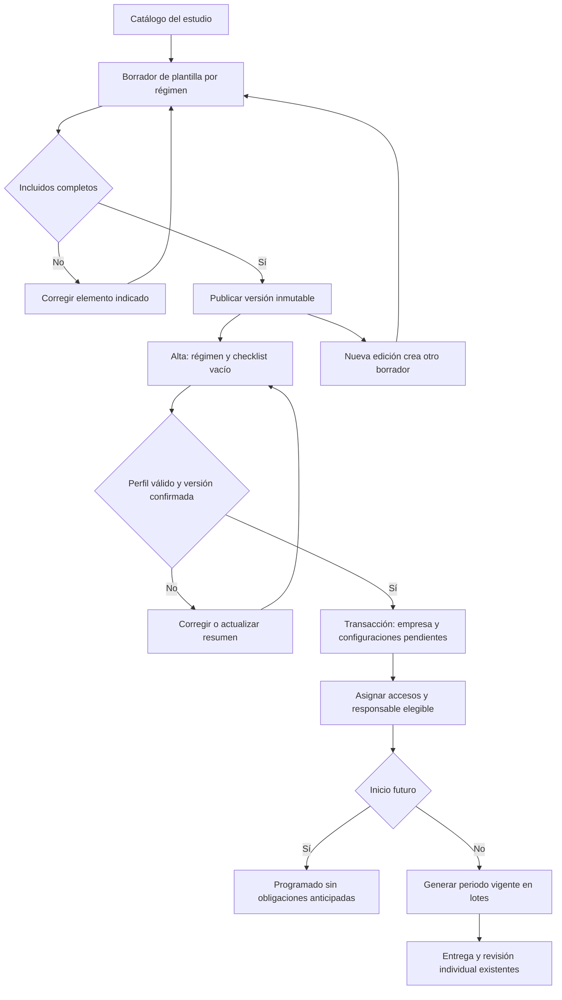

# Entregables, plantillas y preparación de empresas — H09

Especificación vigente del 25/10/2026. Complementa el [hito completo](hitos/h09-entregables-plantillas-empresa.md), el [modelo físico](tablas-db.md#extensión-h09--plantillas-y-perfil-documental) y la [vista documental](vista-documental-periodos.md). La [evidencia](hitos/evidencias/h09.md) distingue implementación, comprobaciones y pendientes. Los datos demostrativos y los plazos de ejemplo pertenecen exclusivamente a Docker.

**Publicación SQL posterior autorizada:** Cloud tiene las 83 migraciones, incluidos los dos cambios de vista por periodos y nueve H09. Se prepararon ocho borradores sin plazos ni versiones publicadas y los dos tipos EsSalud. El alta nueva en producción requiere desplegar el frontend H09 y completar/publicar las plantillas reales. [Verificación de publicación](hitos/evidencias/h09-cloud.json).

## Vocabulario y recorridos

| Concepto visible | Qué configura | Efecto |
|---|---|---|
| Catálogo de entregables | Tipos disponibles, módulo y formatos sugeridos. | Crear un tipo no lo asigna a ninguna empresa. Su detalle muestra empresas usuarias y sus estados. |
| Plantillas por régimen | Selección, orden, archivos requeridos, frecuencia y plazo de cada tipo. | Una versión publicada sirve de origen para nuevas empresas. No modifica empresas anteriores. |
| Entregables por empresa | Solicitudes concretas de esa empresa, responsables, versiones y fechas. | El motor emite obligaciones; cada obligación contiene sus archivos requeridos. |
| Documentos | Archivos entregados y versiones consultables. | Buscador transversal del historial; no configura solicitudes. |

Se conserva `/configuracion?tab=reglas` para enlaces anteriores, con etiqueta **Entregables por empresa**. Catálogo usa `tab=catalogo`; Plantillas por régimen, `tab=plantillas`. Son secciones de la misma página, sin nuevos endpoints ni páginas App Router.

1. El administrador prepara el catálogo y los ocho borradores independientes.
2. En cada régimen revisa módulo, etapa laboral, incluidos y excluidos. Completa periodicidad y plazo; los valores faltantes se muestran por entregable y se pueden abrir directamente desde el selector de pendientes.
3. La vista previa exige un checklist de prueba y no guarda, emite ni notifica. Separa Ingreso, Relación laboral y Cese.
4. Publica cada régimen cuando no quedan errores. Editar una publicación crea una nueva versión borrador y mantiene la anterior disponible hasta publicar el cambio.
5. Crea empresa en tres pasos: Datos → Módulos y cobertura → Resumen de entregables. Se confirma la versión publicada usada por el resumen.
6. Asigna accesos mediante Usuarios y luego responsable elegible en la ficha de empresa. Los tipos iniciales esperan hasta ese momento; no se concede ningún permiso al elegir responsable.

## Regímenes y checklist

| Código persistido | Etiqueta |
|---|---|
| `nuevo_rus` | Nuevo RUS |
| `rer` | RER - Régimen Especial de Renta |
| `mype` | MYPE - Régimen Mype Tributario |
| `rg` | RG - Régimen General |
| `renta_4ta` | 4ta Categoría |
| `renta_1ra` | 1ra Categoría |
| `renta_2da` | 2da Categoría |
| `renta_5ta` | 5ta Categoría |

El checklist comienza vacío incluso después de elegir régimen. Se prohíben valores libres. Estos códigos identifican plantillas que confirma el administrador; la aplicación no infiere obligaciones legales de un régimen.

| PLAME | IGV renta | AFP | Cobertura | Resultado |
|---|---|---|---|---|
| No | No | No | Ninguna | Rechazar: habilitar al menos un módulo. |
| No | Sí | No | Ninguna | Solo Tributario. |
| No | Cualquiera | Sí | Cualquiera | Rechazar: AFP requiere PLAME. |
| No | Sí | No | SIS/EsSalud | Rechazar: la cobertura exige PLAME. |
| Sí | Sí/No | Sí/No | Sin elegir | Rechazar: seleccionar cobertura expresamente. |
| Sí | Sí/No | No | Ninguna | Ambos módulos laborales, sin AFP ni seguros. |
| Sí | Sí/No | Sí | Ninguna | Ambos laborales y los dos tipos AFP. |
| Sí | Sí/No | Sí/No | SIS | Añadir Reporte SIS/Pago SIS; excluir EsSalud. |
| Sí | Sí/No | Sí/No | EsSalud | Añadir Reporte EsSalud/Pago EsSalud; excluir SIS. |

Desactivar PLAME limpia AFP y la selección de cobertura, sin alterar IGV renta. Al volver a marcar PLAME se exige una elección nueva. No se añaden tipos ONP. Los tipos finales dependen además de los incluidos en la plantilla publicada.

La base documental contiene 30 tipos (28 originales y dos EsSalud). Los borradores parten de los mismos tipos y frecuencias documentadas para los ocho regímenes, sin plazos inventados. Las dos consultas tributarias requieren confirmar su periodicidad; todos los tipos incluidos requieren confirmar su plazo. En la demostración se publica únicamente una configuración sintética RG; no se ofrece como plantilla legal real.

## Estados y conservación

`preparation_pending` identifica únicamente la preparación inicial. No equivale a `active=false`: este último también puede representar un borrador particular o una pausa deliberada. Guardar nuevamente el responsable no reanuda pausas manuales. Activar o pausar explícitamente termina la espera inicial.

Al asignar responsable tarde, el piso de control pasa al máximo entre fecha solicitada, inicio de empresa y hoy en Lima. Se emite la ocurrencia que contiene esa fecha para cada frecuencia, sin recuperar las anteriores. Ingreso, Cese y eventuales mantienen el motor H05 y requieren trabajador/evento; una plantilla por sí sola no genera esos eventos.

Cada tipo aparece una vez por empresa/módulo/etapa, aunque tenga varias configuraciones. El orden se obtiene de `presentation_order` y no de los conteos del mes. La interfaz numera solo los tipos configurados en esa lista: 01–03 → siguiente 04. Un tipo particular se agrega al final y no altera la plantilla.

Los configurados sin registros explican: Pendiente de responsable, Programado para una fecha futura, Pausado o Sin obligaciones en este periodo. Las obligaciones y versiones históricas permanecen consultables. Los registros de empresas anteriores conservan `documentary_profile=NULL` hasta una adaptación explícita; no se les aplica automáticamente H09.

Al editar contactos de una empresa anterior se conserva también su texto de régimen histórico. Si no coincide con las ocho etiquetas actuales, se ofrece conservar ese valor existente; no es una novena opción para empresas nuevas ni permite introducir valores libres nuevos.

## Inicio y vencimiento

| Campo | Regla |
|---|---|
| Empezar a solicitar desde | Fecha obligatoria al añadir; predeterminada a hoy en Lima o al inicio de control de la empresa si es posterior. No se acepta un inicio anterior en una alta particular nueva. |
| Aplicar cambios desde | Próximo ciclo no iniciado, o un comienzo de ciclo posterior válido. Eventual/único: desde el siguiente día permitido. |
| Cuándo vence cada periodo | Cierre, N días calendario antes o N después. Se conserva el entero con signo en `deadline_offset_days`. |
| Plazo desde el evento | Se cuenta desde la fecha del evento. |
| Único | Fecha límite explícita, representada por `anchor_date` y desplazamiento cero. |

Ejemplo: octubre cierra el 31/10; 10 días después vence el 10/11. El inicio decide cuándo se solicita; el plazo decide cuándo se entrega. La simulación conserva inicio solicitado, primer periodo y fecha límite y no crea obligaciones ni avisos. Modificar configuración crea una versión futura, sin reescribir snapshots emitidos.

## Contratos y transacciones

Todas las operaciones reutilizan `h02_command` o `h03_command`, con `organization_id`, `request_id`, sesión admitida e idempotencia existentes. Las lecturas usan `h03_query` directamente desde Supabase.

| Operación/recurso | Entrada relevante | Resultado/errores |
|---|---|---|
| `InitializeDeliverableTemplates` | Catálogo base opcional `templates`. | Crea metadatos/borradores faltantes, sin modificar empresas. Solo administrador. |
| `SaveDeliverableTemplate` | `template_id`, `version_id`, `expected_revision`, `items`. | Guarda borrador o crea el siguiente si el origen estaba publicado. Conflicto si otro editor cambió versión/revisión. |
| `PublishDeliverableTemplate` | Mismos identificadores/revisión. | Valida todos los incluidos, publica y mueve el puntero de cabecera. `VALIDATION_ERROR` con faltantes consultables; `CONFLICT` para revisión obsoleta. |
| `CreateOrUpdateCompany` | Datos habituales + `tax_regime_code`, `documentary_profile`, `document_template_version_id`; edición con revisión. | Alta y copia atómicas. Falta publicación → validación; resumen obsoleto → conflicto; reintento idéntico → mismo resultado. |
| Cambio de perfil | Además `confirm_document_changes=true`. | Previsualiza añadir/dejar de solicitar/conservar; pausa incompatibles y copia tipos ausentes. No sobreescribe ajustes propios compatibles ni reanuda pausas. |
| `SaveModuleSettings` | Empresa, módulo, responsable y revisión existentes. | Valida elegibilidad; activa solo preparación inicial y emite primer lote. Fallos transaccionales se presentan en el formulario. |
| `deliverable_templates` | Estudio de la sesión. | Cabeceras, última versión, publicación vigente y faltantes. Solo administración. |
| `company_preparation` | `company_id`. | Perfil y configuraciones, procedencia y preparación. Solo administración. |
| `catalog_usage` | Tipo, página, `include_history` opcional. | Empresas reales usuarias, conteos de configuraciones activas/pendientes/pausadas y totales antes de paginar. |
| `rule_start` | Entregable o empresa. | Fecha mínima, frecuencia y hoy para presentar los campos de inicio. |
| `document_workspace` | Contrato previo por empresa/módulo/periodo/etapa. | Añade grupos configurados, estado de preparación y fecha de inicio; conserva archivos/periodos/paginación. |

Las publicaciones son inmutables también en PostgreSQL, no solo en UI. Las nuevas tablas tienen RLS administrativa por estudio y ninguna escritura directa desde navegador. Los permisos de revisión/carga, revocación, auditoría e idempotencia previos siguen aplicando. Los lotes y continuaciones se consultan y reintentan mediante la gestión existente del entregable; no se encienden jobs por esta entrega.

Un perfil cambiado no restaura tipos pausados o eliminados por separado: los ajustes conservados deben revisarse explícitamente. La nueva publicación no migra empresas existentes, y sus datos conservan el UUID de versión originalmente aplicada hasta un cambio confirmado de perfil.

## Organización y despliegue local

`domain/company-profile` concentra códigos, validación y aplicabilidad; `features/deliverable-templates` concentra edición/previsualización; Empresas conserva su alta y composición. Reutilizan frecuencia, archivos requeridos, permisos, paneles y operaciones documentales. Los tipos y props están en carpetas `types/`; no hay una segunda implementación por módulo.

Las migraciones H09 se versionan en `supabase/migrations`, desde `20261025220955` hasta `20261026010740`. La lista exacta, pruebas y limitaciones se registra en la evidencia. La API Docker H09 utiliza 54431 y la aplicación `http://localhost:4002`; el hostname distinto evita compartir cookies con la presentación en `http://127.0.0.1:4001`.

Antes de usar la capacidad en otro entorno se deberán aplicar explícitamente las migraciones y preparar/publicar los valores reales de cada régimen con el administrador. Esa publicación y los pendientes operativos de H08 quedan fuera de esta entrega.
