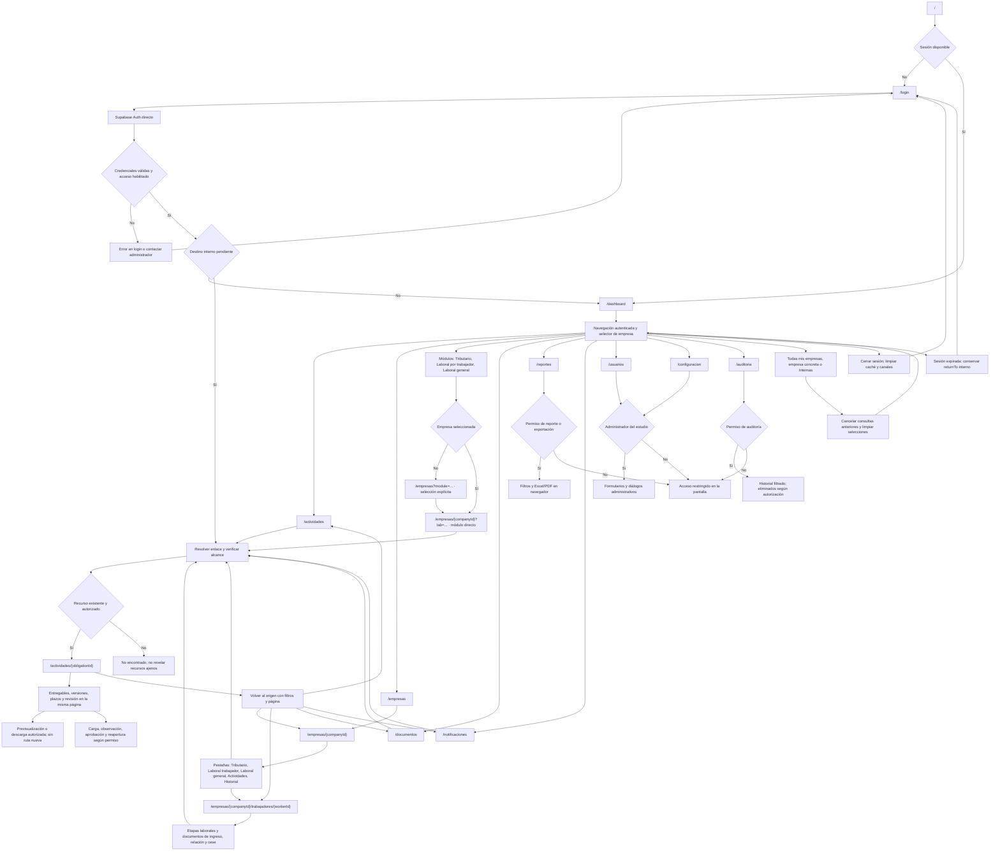

# Flujo de navegación: páginas y rutas

- **Versión:** 1.1 — actualización del 24 de octubre de 2026.
- **Estado:** navegación implementada; [accesos directos a módulos](plan-navegacion-modulos.md) verificados localmente, pendientes de publicación.
- **Fuentes:** [diseño técnico](diseno-tecnico.md), [análisis](analisis_completo_sistema_documental_contable.md) y [resumen](resumen_ejecutivo_sistema_documental_contable.md).
- **Relacionados:** [tablas](tablas-db.md), [funcionamiento](diagrama-flujo.md) y [carpetas](estructura-carpetas.md).

## 1. Convenciones y alcance

App Router mantiene rutas delgadas y delega composición a páginas de funcionalidad. (public) y (app) organizan layouts y **no forman parte de la URL**. companyId, workerId y obligationId son nombres explícitos para los mismos segmentos dinámicos del diseño central; no crean rutas nuevas.

**CONFIRMADO:** permisos por empresa/módulo, acceso administrado, Actividades centralizadas y Atomic Design. **BASE TÉCNICA:** tabs por query string, retorno al origen y nombres físicos de segmentos. T01 configurará el enforcement definitivo de acceso directo; navegación y botones son presentación, no sustituto de autorización.

## 2. Mermaid principal

## 3. Inventario de rutas y correspondencia física

| URL | Archivo | Propósito | Acceso objetivo |
|---|---|---|---|
| / | `src/app/page.tsx` | Entrada: login o dashboard según sesión. | Público; resuelve estado de Auth sin datos privados. |
| /login | `src/app/(public)/login/page.tsx` | Formulario y contacto con administrador. | Sin registro público ni recuperación por correo. |
| /dashboard | `src/app/(app)/dashboard/page.tsx` | Indicadores del universo autorizado. | Miembro activo; mostrar solo alcances permitidos. |
| /actividades | `src/app/(app)/actividades/page.tsx` | Bandeja central, prioridad y filtros. | view de los módulos/alcances pertinentes. |
| /actividades/{obligationId} | `src/app/(app)/actividades/[obligationId]/page.tsx` | Detalle común de obligación documental/adicional. | view; acciones individuales requieren su permiso. |
| /empresas | `src/app/(app)/empresas/page.tsx` | Listado de empresas del alcance. | Asignación vigente o administración del estudio. |
| /empresas/{companyId} | `src/app/(app)/empresas/[companyId]/page.tsx` | Ficha con pestañas de módulos y trabajadores. | Empresa autorizada y permiso por módulo. |
| /empresas/{companyId}/trabajadores/{workerId} | `src/app/(app)/empresas/[companyId]/trabajadores/[workerId]/page.tsx` | Expediente por etapa laboral. | Laboral trabajador view; edición con workers.manage. |
| /documentos | `src/app/(app)/documentos/page.tsx` | Búsqueda transversal por metadatos. | Solo obligaciones/documentos del alcance. |
| /reportes | `src/app/(app)/reportes/page.tsx` | Cumplimiento, pendientes, plazos, observaciones y exportación. | reports.view / reports.export. |
| /notificaciones | `src/app/(app)/notificaciones/page.tsx` | Centro de avisos propios. | Destinatario; el aviso no concede acceso al enlace. |
| /usuarios | `src/app/(app)/usuarios/page.tsx` | Cuentas, membresías, contraseñas y asignaciones. | Administrador del estudio. |
| /configuracion | `src/app/(app)/configuracion/page.tsx` | Catálogo, reglas, roles, responsables y parámetros. | Administrador del estudio. |
| /auditoria | `src/app/(app)/auditoria/page.tsx` | Registro de acciones autorizado. | audit.view o administrador. |

No crear páginas independientes para cada formulario o acción: alta/edición de empresa, cuenta, trabajador, cese, regla, actividad y revisión se presentan dentro de estas páginas mediante diálogos/paneles. No existen /registro, /recuperar-password, /tributario ni /laboral como rutas nuevas.

Los cuatro Route Handlers administrativos/integración son contratos HTTP, **no páginas de navegación**. Se detallan en [carpetas](estructura-carpetas.md) y en el diseño central.

### 3.1 Entrada, sesión y enlaces

- / espera resolución inicial de Auth antes de elegir /login o /dashboard; evitar un destello de datos del usuario anterior.
- Login llama directamente Supabase Auth. Contraseña olvidada muestra contacto con administrador; no envía correo ni crea cuenta.
- Al abrir una página protegida sin sesión, conservar returnTo interno y conducir a /login. Tras autenticación, volver a esa ruta si es válida; de lo contrario /dashboard.
- returnTo acepta únicamente rutas de la aplicación y query permitida; rechazar dominios externos, esquemas y rutas desconocidas. No introducir tokens en URL.
- Tras inhabilitación/sesión expirada, cancelar consultas/canales y retirar datos visibles; bloqueo real de Data API/Storage se verifica en T01.
- Salir limpia caché remota, formularios sensibles y canales, y vuelve a /login. La inhabilitación requiere nuevo acceso después de rehabilitar, sin reactivar sesiones revocadas.

### 3.2 Selector de empresa y pestañas

En pantallas transversales, el selector ofrece Todas mis empresas, empresa autorizada e Internas del estudio para usuarios internos con permiso. Dentro de módulos ofrece empresas y Seleccionar empresa; no muestra agregados ni internas. Cambiar contexto cancela peticiones anteriores y separa caché. En módulos conserva únicamente el módulo y limpia filtros, página, expediente y entregable anteriores. Una respuesta tardía no reemplaza datos del contexto nuevo.

Una carga ya iniciada conserva company_id/obligation_id de la intención; no cambia de destino por mover el selector. Detalles del recurso obtienen su empresa de las relaciones, sin confiar en el selector como autoridad.

En /empresas/{companyId}, usar tab con valores resumen,tributario,laboral_trabajador,laboral_general,actividades,historial,administracion. Omitido/incorrecto utiliza resumen. Administración reúne responsables y módulos de la empresa. Tabs sin permiso se ocultan; acceso manual se resuelve como restringido sin consultar datos del módulo. El query no crea un segmento de ruta.

Dentro de laboral_trabajador se lista trabajadores y se abre su expediente. employmentPeriodId en query selecciona una etapa que pertenezca al trabajador; omitido elige la etapa abierta o, si no existe, la más reciente por start_date/id. Valor ajeno o inexistente no muestra detalles: estado No encontrado, sin asumir otra identidad.

En configuración, tab puede ser catalogo,reglas,roles,responsables,parametros,historial,whatsapp,operacion; predeterminado catalogo. Las capacidades están compuestas desde sus funcionalidades, sin duplicar tablas/lógica bajo otra ruta.

### 3.3 Listados, detalle y retorno

En la implementación actual, Actividades admite companyId (UUID), scope (all/company/internal), module, class, group (mine/review/overdue/upcoming/observed/all), responsibleId, period, priority, dueFrom, dueTo, state, q, page, pageSize y sort. Defaults: scope=all, group=mine, page=1, pageSize=25, sort=urgency. pageSize solo 25/50/100; sort admite urgency/priority/due_date/received_at. Las etiquetas visibles permanecen en español. El alcance real siempre limita el resultado.

Los otros listados reutilizan contratos de filtros pertinentes, sin forzar filtros laborales a usuarios o auditoría. Búsqueda inicial por metadatos, no contenido de archivos.

Al abrir detalle desde bandeja, empresa, expediente, búsqueda o aviso, conservar origen interno y filtros/página. “Volver” usa origen validado; si no existe, /actividades. No fabricar acceso por conocer UUID.

La página /actividades/{obligationId} reúne slots, historial, fechas y acciones; el mismo UUID se usa desde los módulos originales y desde Actividades. Puede enfocar un entregable mediante anchor interno, sin página adicional.

### 3.4 Archivos y revisión

Previsualizar PDF/imágenes y descargar Office ocurre dentro de detalle/expediente. Autorizar intento por RPC y emitir URL Storage de 60 segundos al usarla; no guardar URL en navegación o caché persistente. PDF/imágenes no se ofrecen como página pública.

Cada control identifica entregable y versión vigente. Aprobar/observar/reabrir depende del permiso y estado. Observación/reapertura exige comentario y nuevo plazo antes de enviar. Conflicto mantiene el formulario y refresca el recurso; no confirma ni sobrescribe una revisión ajena.

### 3.5 Presentación UX/UI implementada el 24/10/2026

Se conservan todas las rutas. La barra lateral se mantiene en escritorio; en móvil hay cabecera compacta y navegación Inicio/Actividades/Módulos/Más. Empresas se encuentra en Más. Configuración tiene grupos en escritorio y selector en móvil. Ver [implementación y evidencias UX/UI](plan-mejoras-ux-ui.md) y [accesos a módulos](plan-navegacion-modulos.md).

| Ruta | Parámetros adicionales de presentación |
|---|---|
| `/usuarios` | `memberId` selecciona una membresía autorizada independientemente de la página del listado; `view=cuenta/accesos/contacto`. |
| `/actividades/{obligationId}` | `deliverableId` selecciona un archivo perteneciente a la obligación; `view=entrega/revision/historial`. |
| `/empresas/{companyId}` | `workerPage`, `workerQuery`, `workerStatus`, `workerDeleted`; `obligationPage`, `obligationPeriod`, `obligationState`. |
| `/empresas/{companyId}/trabajadores/{workerId}` | `view=documentos/ficha/eventos`, además de etapa y filtros documentales existentes. |

Los listados enlazan con su URL efectiva como `returnTo`, sin reconstruir defaults. Se conserva la posición solo en memoria, separada por usuario/estudio/empresa, y se valida recursivamente el retorno interno con profundidad máxima de dos. Los enlaces Volver no fuerzan scroll de Next. Cambiar un filtro laboral/documental reinicia su página en una única actualización. Contraseñas y borradores no se incluyen en URL ni almacenamiento persistente.

Los paneles administrativos no agregan rutas. Los asistentes conservan controles entre pasos, validan cada paso y todos los campos antes de guardar. Cerrar o cancelar un panel modificado advierte del descarte; una acción ocupada impide el cierre. Los permisos y la propiedad del recurso se validan además del estado de presentación.

### 3.6 Módulos y buscador Documentos

El término confirmado para Tributario, Laboral por trabajador y Laboral general es **Módulo**. La interfaz, filtros, configuración y exportaciones usan esta palabra. Las referencias históricas a «área documental» designan el mismo módulo; no se renombran identificadores, rutas ni archivos históricos. El campo de área/departamento de un puesto laboral conserva su significado laboral.

| Entrada | Qué permite consultar |
|---|---|
| Empresa → módulo | Obligaciones de esa empresa, entregables pendientes y revisión; en Laboral por trabajador, expedientes y etapas. |
| Actividades | Trabajo pendiente de varios módulos/empresas, urgencia y actividades adicionales; incluye obligaciones todavía sin archivos. |
| Documentos | Archivos ya entregados y sus versiones, buscados por metadatos en las empresas autorizadas. Permite descargar, previsualizar y abrir la obligación relacionada. |

Documentos no exige abrir primero una empresa: su filtro Módulo permite buscar, por ejemplo, archivos de Tributario en el alcance actual. Con Todas mis empresas busca en todas las empresas autorizadas; una empresa seleccionada restringe el contexto. No es un segundo repositorio ni genera las obligaciones pendientes.

**Decisión confirmada e implementada:** accesos directos a los tres módulos en escritorio y desde Módulos en la barra móvil. Con una empresa seleccionada abren su URL existente con `tab`; sin ella abren `/empresas?module={moduleId}`, con búsqueda y selección explícita de una empresa autorizada. Solo se admiten `tributario`, `laboral_trabajador` y `laboral_general`. Una elección previa no evita el selector cuando se abre explícitamente esa URL. No se selecciona automáticamente una única empresa elegible.

Una URL directa de módulo o expediente sincroniza la empresa del contexto antes de consultar contenido. El módulo tiene título propio, nombre/RUC de empresa y enlace Ficha empresa. El retorno interno validado permite mantener activo el módulo al abrir un detalle; un expediente pertenece a Laboral por trabajador. Cambiar empresa desde esos recorridos lleva al listado del mismo módulo, sin identificadores de recursos anteriores. Sin permiso se muestra Acceso restringido sin montar consultas del módulo. Ver [pruebas y capturas](plan-navegacion-modulos.md#5-validación-y-evidencias).

## 4. Recorridos por perfil

| Perfil | Entrada y recorridos | Acciones |
|---|---|---|
| Administrador | Dashboard → empresas/usuarios/configuración → Actividades → reportes/auditoría. | Configura, asigna, revisa y restaura entidades con motivo; protege último administrador. |
| Contador | Actividades, empresas asignadas, búsqueda, reportes autorizados. | Entrega/corrige/revisa y gestiona trabajadores cuando tenga workers.manage. |
| Supervisor | Por revisar, empresas autorizadas, dashboard/reportes. | Aprobar/observar/reabrir; upload configurable, no inicial. |
| Cliente | Mis entregas → empresa/módulo autorizado → detalle → carga/corrección. | Consulta/entrega/descarga; sin aprobación ni internas; reportes solo si se concede. |

El acceso laboral autorizado incluye remuneraciones/exámenes del expediente según D09; no se crea otra ruta o permiso específico. Cualquier revisor elegible puede revisar, sin responsable fijo de revisión. Un mismo usuario puede tener distintas facultades en distintas empresas.

### 4.1 Conservación y soft delete

Listados operativos excluyen eliminados y ancestros no operables. Solo administración histórica autorizada puede incluirlos, con etiqueta, motivo y acción de restauración dentro de la página existente. No hay /papelera ni una ruta nueva de restauración.

Restaurar conserva enabled/status y no restaura hijos eliminados. Un trabajador cesado sigue en expediente con sus etapas; un eliminado se consulta históricamente por administración. No confundir esas dos condiciones.

## 5. Estados de pantalla

| Situación | Presentación y recuperación |
|---|---|
| Auth/consulta en curso | Skeleton/estado cargando; sin datos obsoletos de otro contexto. |
| Listado vacío | Mensaje según filtros y acción pertinente. |
| Error transitorio | Mensaje accesible y reintento; conservar filtros/formulario. |
| Página administrativa sin permiso | Estado Acceso restringido dentro de la ruta; sin consultar datos administrativos. |
| UUID inexistente o recurso ajeno | Estado No encontrado; no revelar empresa/trabajador/título ajenos. |
| Revisión concurrente | Aviso de conflicto, datos actualizados y decisión explícita de usuario. |
| Archivo interrumpido/rechazado | Progreso, explicación y reanudación/nueva selección. |
| Eliminado visible en consulta histórica | Etiqueta, fecha/motivo y restauración autorizada; sin acciones operativas. |

not-found.tsx y error.tsx son convenciones de App Router, no rutas /404 o /error nuevas. Con datos consultados en cliente, el organismo de estado puede presentar No encontrado/Acceso restringido; no se promete un HTTP 404 generado por servidor para cada respuesta de la Data API.

Componentes pequeños y accesibles: campos etiquetados, foco visible, teclado, mensajes anunciados y estados acompañados de texto. Templates estructuran la pantalla; organismos no conocen SDK.

## 6. Validación

- Las 14 entradas de rutas tienen archivo correspondiente en el árbol propuesto.
- No incluir APIs como páginas, segmentos de route groups como URL ni tabs como rutas nuevas.
- Una notificación solo enlaza, no concede permiso; login conserva destino interno válido.
- Detalle de trabajador valida empresa/etapa; Actividades usa identidad de obligación sin duplicación.
- Cambios de contexto/salida no muestran datos del usuario/empresa anterior.
- Aplicar escenarios de teclado/móvil, conflicto, retorno con filtros y soft delete/restauración.
- Verificar aislamiento y revocación sobre SDK directo al completar T01.

## 7. Referencias

Convenciones verificadas en node_modules/next/dist/docs/01-app/01-getting-started/02-project-structure.md y guías locales de Route Groups/Server and Client Components. Los flujos y permisos provienen del diseño central; este archivo no crea páginas ni modifica rutas existentes.
