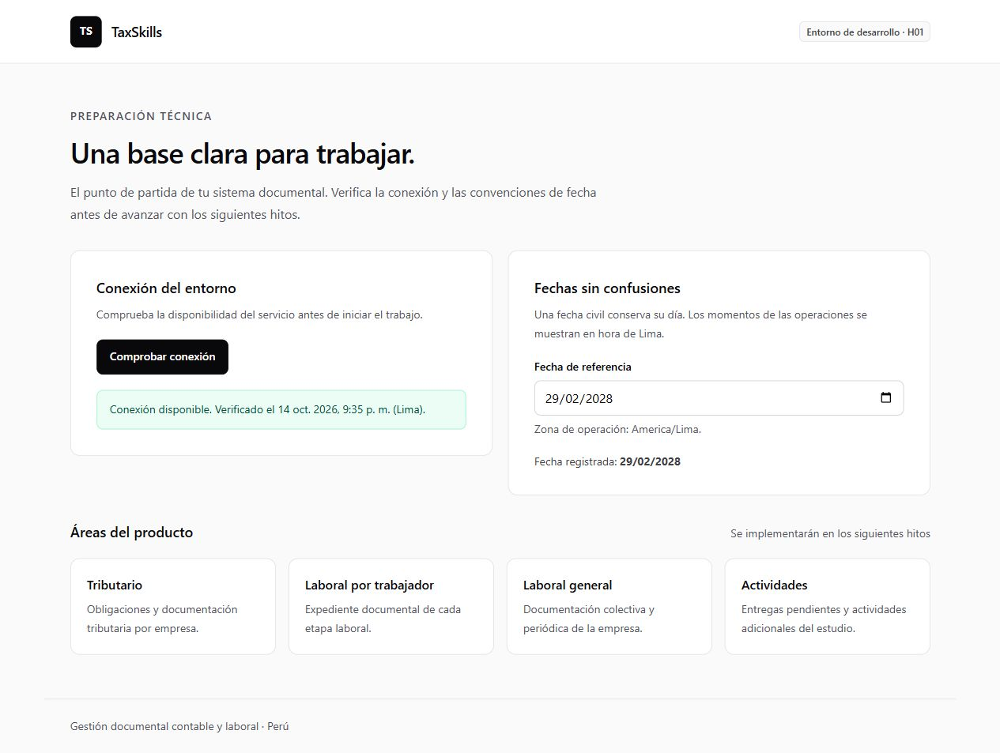
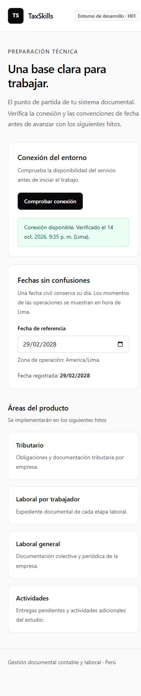

# Evidencias de H01 — Preparación técnica

**Fecha:** 14 de octubre de 2026, America/Bogota.

**Resultado:** implementación y verificación técnica completadas. La recepción de la demostración por el equipo/producto queda disponible para revisión.

**Alcance:** [H01](../h01-preparacion-tecnica.md), no H02 ni publicación.

## 1. Resultado entregado

Base Next.js con controles Atomic Design, contratos de error/operación, validación de entorno, utilidades de calendario, caché separada por contexto, adaptadores Supabase y flujo CLI/Yarn documentado.

Portada temporal de preparación en `/`, error/not-found y Proxy. No se implementaron login, cuentas, empresas, tablas documentales ni políticas RLS.

## 2. Verificaciones ejecutadas

| Verificación | Resultado observado |
|---|---|
| `yarn install --frozen-lockfile --offline` | Correcta; lockfile reproducible y dependencias resueltas. |
| `yarn verify` | Correcta: tipos, ESLint, arquitectura y tests. |
| `yarn test` dentro de verify | 40 pruebas aprobadas en ocho archivos. |
| `yarn build` | Correcta con Next.js 16.4.0 y Turbopack; `/` y not-found prerenderizadas, Proxy compilado. |
| `yarn env:setup <project-ref>` | Generó configuración exclusivamente pública. Se preservó/restauró el archivo local original y se verificó su hash. |
| `supabase link` | Configuración local vinculada al proyecto indicado por el usuario. |
| `yarn db:types --linked` | Tipos reales generados; esquema public sin tablas/vistas/funciones de negocio. |
| `yarn db:status` | Historial remoto vacío; ninguna migración aplicada por H01. |
| Inspección del bundle público | 17 assets inspeccionados; sin referencias a SUPABASE_SECRET_KEY, IDEMPOTENCY_HMAC_KEY ni tokens privados de n8n. |
| `git check-ignore` | .env.local, estado .temp del CLI y caché de Yarn excluidos de Git. |
| Arquitectura | 19 archivos de componentes; máximo observado 47 líneas, por debajo de 170. Sin tipos fuera de types/, ciclos ni rutas cliente hacia adaptadores .server.ts. |
| Estilos | Un único archivo CSS de infraestructura con import de Tailwind; sin CSS personalizado ni estilos inline. |
| Navegador | Conexión real pública correcta y consola sin errores/advertencias durante el recorrido. |
| HTTP local del build | / devuelve 200; dirección inexistente devuelve 404; cookie sintético de sesión produce Cache-Control: private, no-store. No equivale a autorización de negocio. |
| Responsive | Escritorio, viewport móvil solicitado 375 × 812 y horizontal 812 × 375, sin desbordamiento horizontal. |
| Teclado/campo | Foco visible, botón/campo de aproximadamente 44 CSS px, error vinculado con aria-invalid/aria-describedby y actualización de fecha al confirmar/salir. |

La base remota se consultó, sin sembrar datos ni aplicar DDL de negocio. La vinculación y las claves publicables no acreditan aislamiento ni completan T01.

## 3. Evidencia por tarea

| Tarea | Implementación/evidencia |
|---|---|
| H01-T01 | Revisión de versiones y guías locales; Next/React conservados y ajuste de loader documentado en desarrollo. |
| H01-T02 | .env.example vacío, .env.local ignorado, validadores de configuración, README y script de incorporación ejecutado. |
| H01-T03 | components por niveles, feature setup, domain puro, tipos por ámbito, ESLint y comprobador de dependencias. |
| H01-T04 | Adaptadores browser/admin.server separados y contratos OperationResult/OperationMetadata; frontera server-only. |
| H01-T05 | parseCivilDate, formatCivilDate, getLimaDate, formatLimaDateTime e isPastCivilDeadline probados. |
| H01-T06 | Claves con identidad completa; proveedor remonta contexto, limpia caché y cancela consultas con signal; respuestas tardías aisladas. |
| H01-T07 | CLI inicializado/vinculado, migraciones preparadas, tipos reales generados, esquema/historial vacíos y seed sin tablas prematuras. |
| H01-T08 | Botón/input/label/badge/spinner, campo/feedback, ResourceState y template; recorrido real de conexión/fecha y capturas. |
| H01-T09 | verify/build correctos, 40 pruebas, revisión de bundle, Git ignore y guía de incorporación. |

## 4. Cobertura de requisitos

| Requisito | Evidencia principal |
|---|---|
| H01-RF01 | Instalación frozen, script env y CLI comprobados; README/desarrollo; build correcto. |
| H01-RF02 | ResourceState/FeedbackMessage; error visible de configuración y fallo; códigos de conflicto/restricción/no encontrado diferenciados. |
| H01-RF03 | Teclado, foco, labels, errores anunciados, targets y revisión móvil/horizontal. |
| H01-RF04 | Fechas civiles no cambian de día; instantes en Lima; corte de día y bisiestos probados. |
| H01-RF05 | Áreas de producto identificadas como futuras; ninguna pantalla de negocio se presenta terminada. |
| H01-RT01 | Guías instaladas y versiones respetadas; PostCSS justificado por fallo reproducible del loader previo. |
| H01-RT02 | Cuatro niveles Atomic Design compartidos y composición en feature; tipos separados. |
| H01-RT03 | Dependencias dirigidas, funciones puras, revisión ESLint/arquitectura y ausencia de ciclos. |
| H01-RT04 | Browser SDK y admin server-only; sin API proxy de CRUD. |
| H01-RT05 | Variables por ejecutor, ejemplo vacío, configuración pública local y bundle sin credenciales privadas. |
| H01-RT06 | Metadatos/resultado/códigos tipados, validación y sanitización; HTTP separado del SDK. |
| H01-RT07 | Flujo CLI documentado/ejecutable, tipos actuales e inicio sin tablas de negocio. |
| H01-RT08 | Fecha civil y momento explícitos; utilidades puras de Lima. |
| H01-RT09 | Claves normalizadas, caché por identidad, cancelación/remontaje y ausencia de persistencia documental. |
| H01-RT10 | Scripts de verificación y pruebas significativas de reglas/interacción; sin snapshots triviales de cada átomo. |
| H01-RT11 | T01 pendiente explícito; clave administrativa exclusivamente en servidor y datos sintéticos. |

## 5. Escenarios cubiertos por pruebas

- Configuración ausente, URL inválida/insegura y clave administrativa rechazada como pública.
- Errores SQL/SDK traducidos sin mensajes privados, UUID y revisión validados.
- Meses cortos, año bisiesto, fecha civil en otra zona, medianoche de Lima, instante sin offset y fecha/hora imposible.
- Separación por usuario/estudio/empresa/módulo; filtros sin credenciales, sin mutación y normalizados.
- Cambio de contexto elimina caché, aborta consulta pendiente y no muestra respuesta tardía del anterior.
- Contexto anónimo no habilita consulta de negocio.
- Clics simultáneos generan una sola operación; loading contextual permanece deshabilitado y el fallo explícito permite reintentar.
- Desmontaje cancela conexión y configuración incompleta impide red.
- Fecha vacía vincula error al campo, válida restaura presentación y confirmación del control nativo sincroniza el estado.

## 6. Comprobación visual

La portada usa estilos neutros y mensajes de estado puntuales. No hay botones falsos para módulos aún pendientes ni loading en filtros locales.

[Captura de escritorio](h01-escritorio.png) · [Captura móvil](h01-movil.png)

## 7. Límites y continuidad

- Docker está instalado, pero el motor no estaba activo. No se ejecutaron Supabase local ni reset local; activar el motor antes de ensayar las primeras migraciones de H02. El esquema público vacío y el historial remoto sí se verificaron.
- Auth real, perfil/membresía, selector de empresa y limpieza de canales Realtime se conectan al incorporar esos flujos en H02 y siguientes. H01 no abre canales.
- Proxy aplica política de caché cuando detecta indicios de autenticación; no renueva ni autoriza sesiones todavía.
- No se configuraron RLS, permisos finales, buckets productivos, claves administrativas reales, n8n, dominio o respaldos. Continúan en sus hitos.
- La aceptación de producto y la verificación integral con datos reales no se sustituyen por estos checks de desarrollo.

Guía para continuar: [Desarrollo y migraciones](../../desarrollo.md) y [H02](../h02-acceso-empresas.md).
