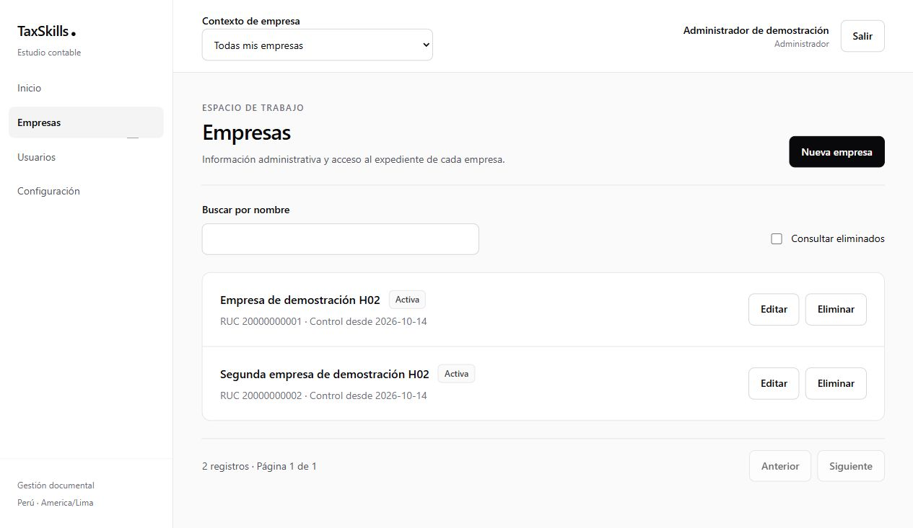
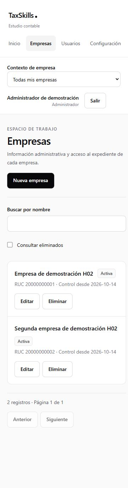
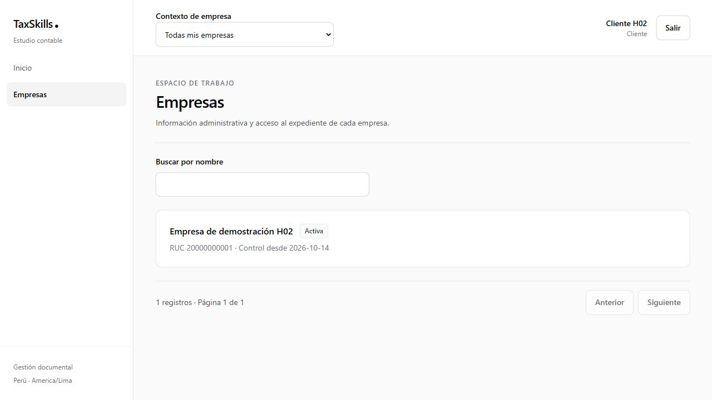

# H02 — Evidencia técnica de acceso y empresas

**Fechas:** 14–15 de octubre de 2026. **Estado:** implementado y verificado técnicamente; pendiente aceptación del equipo sobre la demostración. [Requisitos H02](../h02-acceso-empresas.md) · [Operación y configuración](../../desarrollo.md#11-acceso-administrativo-y-demostracion-de-h02).

## 1. Entrega

Rutas ejecutables: `/` dirige según sesión; `/login`, `/dashboard`, `/empresas`, `/empresas/{companyId}`, `/usuarios` y `/configuracion`. Configuración mantiene las cinco pestañas previstas y explica el alcance futuro del catálogo y reglas. No se crean rutas ficticias para H03–H08.

El SDK del navegador consulta Supabase directamente. Las tres únicas API routes son alta, contraseña e inhabilitación de Auth Admin. Antes de inicializar el cliente secreto verifican usuario real, contexto habilitado, administración del estudio y destinatario. Proxy renueva cookies; no hay middleware.

## 2. Persistencia y trazabilidad

Diez migraciones `20261014000100`–`20261014001000` aplicadas incrementalmente al proyecto de desarrollo `gzwrqvqofcrdjvzoblaz`, que partía de esquema público vacío. No se alteraron migraciones ya aplicadas: las correcciones de funciones quedaron registradas en nuevas migraciones.

| Entrega DB | Resultado |
|---|---|
| Tablas de acceso/configuración | organizations, profiles, organization_members, companies, roles, permissions, role_permissions, access_grants, grant_permission_overrides, company_module_settings. |
| Registros técnicos | app_sessions, audit_events, operation_requests. |
| Listado de usuarios | Vista h02_users con security_invoker; filtros y paginación desde SDK. |
| Soft delete | Nueve entidades administrables con autoría, revisión y tres campos de eliminación; sin cascadas físicas. |
| Mutaciones | h02_command verifica actor y petición; edición por revisión, auditoría y resultado transaccionales. |
| Auth Admin | UUID externo reservado, HMAC canónica, fases durables, reintento y exclusión de operaciones simultáneas sobre una cuenta pendiente. |
| Sesiones | Admisión con session_id del JWT de Auth; revocaciones conservadas al cambiar contraseña, inhabilitar o eliminar perfil/membresía. |

No se persisten contraseñas, JWT, refresh tokens o respuestas completas de Auth en las tablas de aplicación. Los eventos de auditoría solo conservan valores de una lista permitida. El cliente no tiene escritura directa de auditoría ni ejecución de las funciones Auth Admin.

## 3. Matriz de requisitos

| Requisitos | Evidencia implementada |
|---|---|
| RF01–RF02; RT01, RT03, RT11 | Empresas con RUC, datos administrativos, responsables, fecha civil y estados. Pausas J02; unicidad incluyendo eliminados; FK por estudio. Integración con generación/avisos en H04/H06. |
| RF03–RF05; RT06–RT09 | Alta sin correo, contraseña administrativa, habilitación, sesiones y último administrador. Tres endpoints con verificación de sesión/alcance, origen, entrada y límite de frecuencia. |
| RF06–RF09; RT05, RT12 | Roles configurables, permisos y overrides por módulo; clientes sin revisión ni internas; responsables elegibles por upload, sin concesión implícita. |
| RF10; RT04 | Eliminación/restauración de las nueve entidades, motivo, historial, padres y revisión. Un padre no restaura hijos ni cambia enabled/status/active. |
| RF11, RF13; RT09, RT12 | Login/logout, selector, cambio de alcance, caché cancelable, contexto sin asignaciones, errores explícitos y acceso denegado. |
| RF12; RT02, RT07–RT08 | Prueba real de fallo tras crear Auth, denegación del negocio y recuperación con la misma identidad/petición. Lista saneada de operaciones administrativas. |
| RF14; RT02, RT10 | Auditoría escrita por funciones confiables dentro de las transacciones; valores permitidos y cambios sin secretos. |
| RT13 | RLS y enforcement universal de lectura/Storage siguen pendientes en H08/T01. |

## 4. Verificaciones reproducibles

| Comando / recorrido | Resultado |
|---|---|
| yarn verify | Tipos, ESLint, arquitectura y 63 pruebas en 13 archivos. |
| yarn build | Compilación de producción local con Yarn y Next.js 16.4.0. |
| yarn check:bundle | Ausencia de la clave administrativa y la clave HMAC en los recursos del navegador. |
| yarn test:h02:sql | Fixtures transaccionales con rollback: unicidad, idempotencia, conflicto, revisión parcial de acceso, cliente sin approve, responsable elegible, restauración y sesión revocada. |
| yarn db:lint | Sin errores en las funciones de public/private. |
| yarn test:h02:live | Altas sin confirmación por correo; reintento sin duplicado; cliente sin administración; CSRF; contraseña; habilitación y sesión nueva obligatoria. |
| Recuperación Auth/SQL | Rol temporalmente pausado provoca fallo SQL tras Auth; cuenta incompleta denegada; dependencia reparada; misma solicitud completa el mismo UUID externo. |
| Perfiles de demostración | Contador: Tributario en empresa A y Laboral general en B. Supervisor: revisión sin upload inicial. Cliente: una empresa y sin revisión. |
| Navegador | Entrada, alta de empresa, listados, configuración, responsables, contexto, acceso de cliente y adaptación móvil. Capturas abajo. |
| Opciones tardías de responsable | Regresión corregida y probada: el responsable persistido permanece seleccionado al llegar las opciones de manera asíncrona. |

La secuencia se comprobó sobre Cloud de desarrollo; Docker no estaba activo y no se ejecutó reset local. El equipo puede repetirlo al disponer del motor. No se hizo despliegue de Vercel ni se cambiaron configuraciones productivas de Auth.

## 5. Demostración y credenciales

El bootstrap de una sola organización y los roles iniciales se ejecutan con `yarn seed:demo`. `yarn test:h02:live` prepara cuentas/empresas ficticias idempotentes y comprueba el recorrido con HTTP real. Consultar la guía antes de ejecutarlos sobre un entorno.

- Administrador: admin.h02@example.test; contraseña únicamente en `.env.h02-demo.local`.
- Contador, supervisor y cliente: credenciales únicamente en `test-results/h02-fixtures.json`.
- Cuenta de prueba de recuperación: `test-results/h02-recovery.json`.

Estos archivos están ignorados por Git y no forman parte del entregable compartido. Ninguna captura debe mostrar contraseñas, claves o tokens.

## 6. Límites y siguiente hito

La funcionalidad administrativa de H02 queda disponible para continuar H03. El equipo aún debe aceptar la demostración. El cumplimiento documental, obligaciones, revisión de archivos y Storage comienzan en H03; no están incluidos en este cierre.

Las lecturas de tablas/vistas todavía no tienen políticas RLS. Los filtros de UI, la caché y la comprobación de las RPC no son prueba de aislamiento de consultas arbitrarias. H08/T01 debe cubrir todas las vías, sesiones, Storage y configuración productiva de Auth. H02 utiliza exclusivamente información ficticia.

Ante un fallo administrativo, conservar el formulario y reintentar sin cambiar su entrada. La huella sensible no permite reconstruir una contraseña perdida. Una ejecución en curso se recupera con su misma intención tras dos minutos; un fallo en fase externa puede bloquear otra intención sobre la misma cuenta hasta reconciliarlo.

## 7. Capturas

Build de producción servido localmente en `127.0.0.1:3001`. Verificados escritorio, móvil de 375 px y horizontal de 812 × 375 sin desbordamiento horizontal, formulario móvil de una columna y avance por teclado de correo a contraseña. Autocomplete permite gestores de contraseñas. La pestaña de navegador quedó en el contexto administrativo para revisión.

El cliente solo ve su empresa y no tiene controles administrativos. El acceso directo a `/usuarios` muestra Acceso restringido; una empresa ajena muestra Empresa no encontrada sin revelar su contenido. Esto acredita comportamiento funcional de UI, no las políticas RLS pendientes.

[Responsable persistido después de recargar el build final](h02-responsables.png): Contador H02 seleccionado en Tributario; los otros módulos sin candidatos mantienen el botón deshabilitado.
