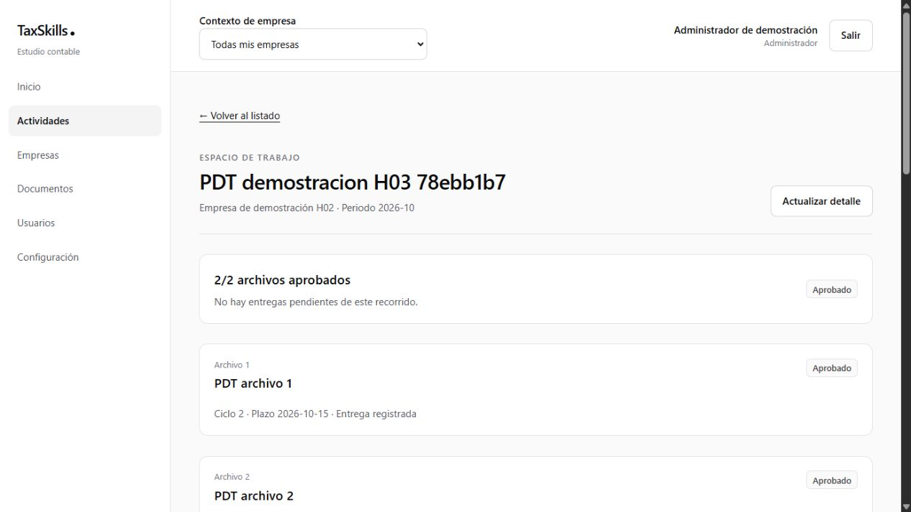
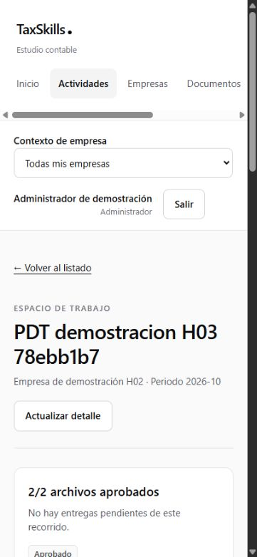
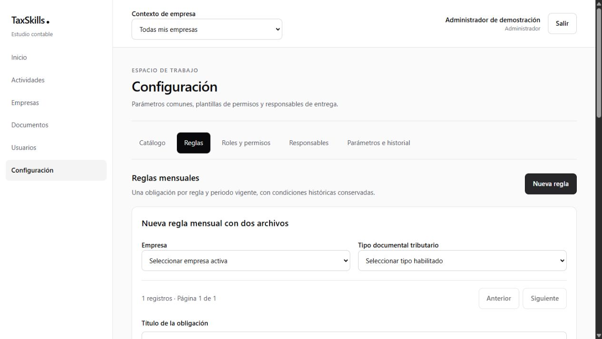
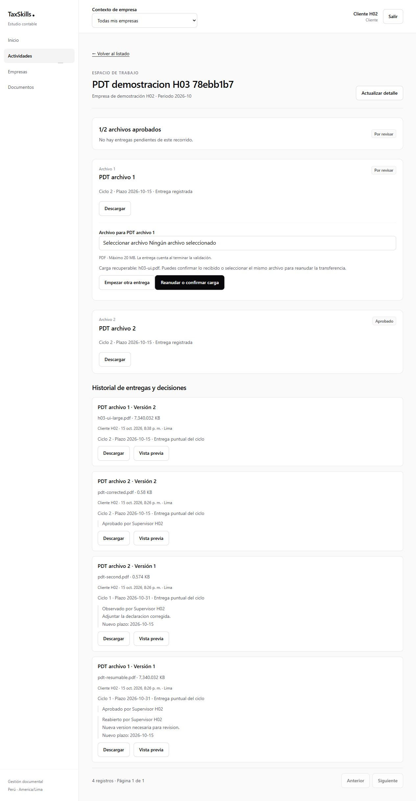
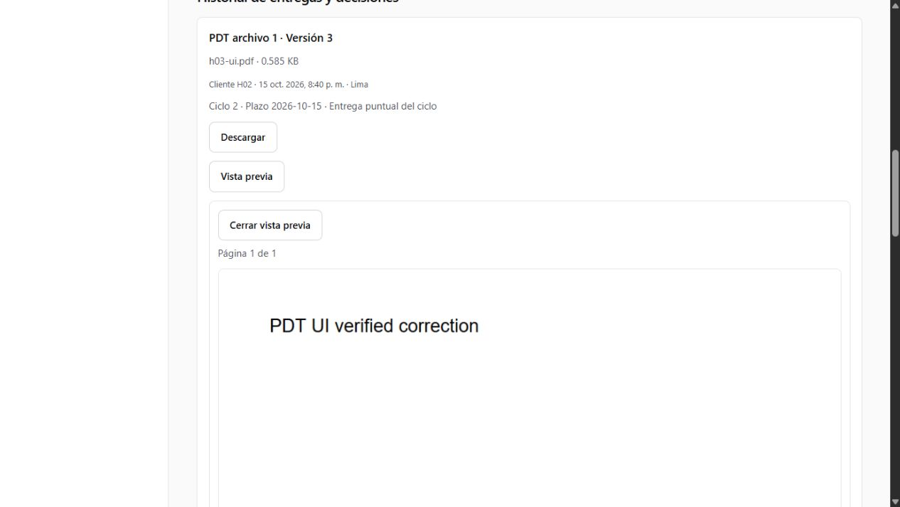
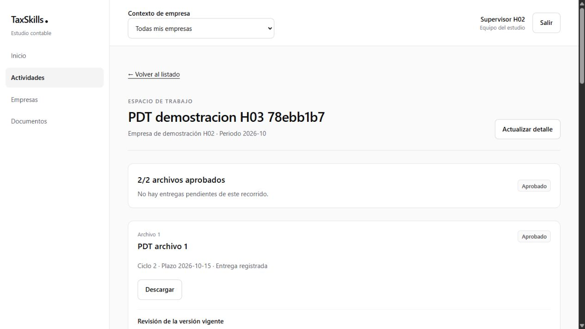

# H03 — Primer recorrido documental

**Evidencia vigente:** reconstrucción limpia, actualización H02 → H03 e integración repetidas correctamente en Docker el 16 de octubre de 2026, con 59 comprobaciones documentales. Consultar el [informe local y sus capturas](validacion-local-h02-h03.md). Las secciones siguientes conservan la ejecución histórica que usó incorrectamente Cloud: sus IDs/capturas no corresponden a la demostración local actual. Ver [corrección de entornos](correccion-entornos.md).

**Fecha histórica:** 15 de octubre de 2026, America/Lima. **Estado actual:** validación técnica local completada; aceptación formal de producto pendiente. [Hito](../h03-primer-recorrido-documental.md) · [Operación local](../../desarrollo.md#13-primer-recorrido-documental-h03).

## 1. Entrega

Catálogo tributario, regla mensual de dos posiciones, generación idempotente, bandeja básica `/actividades`, detalle `/actividades/{obligationId}`, versiones en `/documentos` y pestaña Tributario en la empresa. Una posición conserva sus versiones; Actividades consulta obligaciones y no duplica tareas.

La configuración mínima hereda al responsable de empresa/módulo de H02. SQL también admite un responsable explícito elegible. La pantalla permite configurar etiquetas, formatos y límite por posición, prioridad, exigibilidad y desplazamiento del plazo mensual. H04 amplía periodicidades y edición versionada de reglas; H05 amplía catálogo y expediente laboral.

## 2. Persistencia y contratos

Nueve migraciones nuevas `20261015000100`–`20261015000900`, añadidas a las diez de H02. Las 19 versiones locales coinciden con el proyecto Cloud compartido. Se aplicaron incrementalmente y no se modificaron las migraciones anteriores. Incluyen:

- Corrección de H02: el estado de la propia cuenta debe cambiarlo otro administrador. El rechazo sucede antes de crear o ejecutar una operación parcial; se conserva la protección del último administrador.
- Catorce tablas de H03, con `workers`/`employment_periods` como dependencias del motor. La UI laboral y sus operaciones completas corresponden a H05.
- Soft delete en `workers`, `document_types` y `requirement_rules`; ciclo histórico conservado en versiones, decisiones y periodos; FK con RESTRICT.
- `h03_command`: autorización por operación, sesión admitida, request_id, huella de entrada, revisión esperada, transacción y auditoría.
- `h03_query`: listados paginados de 25, detalle y versiones con autor, ciclos y decisiones. Permisos de UI y RPC comprobados; aislamiento universal de Data API pendiente de H08.
- `h03_obligation_summary`: estado agregado, contadores y plazo operativo derivados; una entrega recibida sin revisar no aparece vencida.
- Confirmación interna reservada a service_role. Validaciones con reserva de ejecución de dos minutos y token que evita confirmar desde una ejecución sustituida.
- Eventos `assigned`, `upload_finalized`, `approved`, `observed`, `reopened` y avisos individuales iniciales. El centro de notificaciones y WhatsApp se completan en H06.
- Restauración de reglas condicionada a que su empresa y tipo documental no estén eliminados; restaurar el padre no restaura hijos eliminados por separado.

Snapshots, origen y plazo inicial quedan protegidos contra modificaciones; versiones/reglas históricas y revisiones son inmutables. Observación conserva cabecera observada y abre otro ciclo; reapertura conserva la aprobación histórica y retira la versión vigente hasta una entrega nueva.

## 3. Storage y Edge

Buckets privados `document-reception` y `documents`; capacidad de bucket configurada a 50.000.000 bytes, sin cambiar el límite inicial documental de 20.000.000. El límite efectivo siempre procede del snapshot de la posición; una incompatibilidad con el proveedor se informa expresamente.

`document-operations` comprueba usuario real, sesión, propietario y permisos. Sus acciones son preparar token firmado, finalizar, emitir descarga y limpiar staging con otra credencial exclusivamente de mantenimiento. No se añadieron API routes Next.js. La verificación JWT del gateway está desactivada para admitir las claves actuales del SDK; las acciones de usuario verifican identidad y claims dentro de la función. Cleanup requiere su propia credencial.

**Adaptación técnica documentada:** al diferir políticas de Storage, Edge emite el token limitado a la ruta para TUS y el enlace breve de descarga. Ejecuta `RequestDownload` con la sesión del usuario antes de firmar; sus reintentos vuelven a comprobar el permiso. Los bytes de carga y descarga viajan directamente entre navegador y Storage. No se entrega la clave administrativa al navegador.

La validación comprueba tamaño real, firma/contenedor y SHA-256. PDF/imágenes usan firmas; XLS/DOC requieren contenedor OLE y stream del formato; XLSX/DOCX requieren las partes Office y su Content-Type correspondiente. Un ZIP cualquiera se rechaza. La expansión ZIP está acotada antes de extraer XML. Esto no constituye antivirus, OCR ni ejecución de macros.

La promoción final usa ruta reservada, sin upsert. Si el objeto final existe tras un fallo anterior, se comprueba su huella antes de confirmar. SQL crea versión, cabecera, recepción del ciclo, auditoría y eventos juntos. Un reintento devuelve el mismo UUID y no duplica efectos.

## 4. Limpieza

Cron horario `h03-staging-cleanup`, minuto 17, invoca Edge mediante pg_net. La credencial queda en Vault y en secretos de Edge; el comando del job no contiene su valor. El script de configuración es idempotente y no imprime secretos.

Se procesan hasta 100 reservas con más de 24 horas, sin versión confirmada y sin validación en curso. Solo se eliminan sus objetos de recepción; metadatos y marca de limpieza permanecen. El retry converge si el objeto ya se borró antes de guardar esa marca. Objetos finales y versiones confirmadas quedan excluidos.

## 5. Evidencia funcional

| Requisitos / escenarios | Evidencia |
|---|---|
| RF01–RF02; CA12 inicial | Configuración SQL y SDK; dos generaciones simultáneas devuelven la misma obligación con dos posiciones. |
| RF03–RF04, RF13; CA18 | TUS firmado con archivo ficticio de 7 MiB: interrupción, ausencia de versión prematura, instancia nueva que reanuda y finalización Edge. |
| RT05–RT07; CA18 | Archivo falso con nombre PDF rechazado por Edge; pruebas unitarias de ZIP/Office, contenido truncado, tamaño real y límite de snapshot. |
| RF05–RF07; CA06–CA07 | Aprobación individual 1/2; ambos recibidos sin fecha operativa pendiente; aprobación total solo con dos decisiones. |
| RF08–RF10; CA08–CA10 | Observación con motivo/plazo, nuevo ciclo, corrección, aprobación y reapertura. Pruebas de puntualidad al cierre del día de Lima y entrega tardía independientes de aprobación. |
| RF11; CA16 | SQL rechaza motivos vacíos y verifica exclusión No aplica sin borrar historia. Cancelación usa facultad administrativa y conserva archivos. |
| RF12; CA29 inicial | Descarga real de versión histórica con URL de 60 segundos; intento anónimo rechazado; se vuelve a autorizar al reusar una solicitud. |
| RF13; CA11 | Dos revisores simultáneos: una aprobación y un CONFLICT; sin repetir automáticamente la decisión. |
| RF13; CA19 | Objeto promovido antes de confirmar SQL, finalización recuperada por la misma intención y repetición después del éxito sin otra versión. |
| RF14 | Eventos con claves únicas y revisiones por versión; auditoría desde operaciones confiables; sin INSERT de confirmación libre desde navegador. |
| RT12 | SQL excluye validaciones y confirmados del TTL; SDK comprueba eliminación real de un temporal rechazado envejecido como fixture y conservación del final. |

`test-results/h03-evidence.json` conserva IDs y verificaciones del último recorrido con SDK. No contiene credenciales, archivos ni URLs vigentes. Cada ejecución crea una regla ficticia nueva; repetir su generación no crea otra ocurrencia del mismo periodo.

### 5.1 Demostración en la interfaz

Se revisó la compilación de producción local con administrador, cliente y supervisor ficticios. El cliente no presenta acciones de revisión; el supervisor puede revisar sin recibir controles de carga. Se comprobó el error visible al enviar bytes falsos como PDF, la carga de un PDF de 7 MiB, la recuperación después de recargar durante una entrega y la versión posterior conservando la primera recepción del ciclo. La interrupción tras el primer bloque TUS y su reanudación desde otra instancia se verificaron además mediante SDK; no se atribuye esa interrupción de bloque a la prueba visual.

La vista previa usa PDF.js 6.4.299 y un worker del mismo paquete servido localmente. Sustituye el visor PDF nativo, que aparecía vacío en el navegador integrado. Se verificó el texto del PDF renderizado y el fin del indicador «Preparando vista…». Los botones de página mantienen progreso durante el renderizado; las imágenes informan errores explícitos. Office se descarga bajo el contrato existente.

El supervisor aprobó la versión 3 de la primera posición: el avance cambió de 1/2 a 2/2, manteniendo las observaciones, corrección y reapertura anteriores. Al terminar se restauró la sesión del administrador de demostración y se dejó abierto el detalle. La revisión móvil a 375 × 812 no mostró desbordamiento horizontal del documento.

| Recurso ficticio conservado | Identificador |
|---|---|
| Estudio | `2803cd5e-8343-46ea-b300-c55ce84c92f1` |
| Empresa | `8150f2e7-f131-46e0-bd0b-ab6533ac778f` |
| Regla | `2c445665-9515-4556-a86c-2ac6a6ab3cdc` |
| Obligación | `8bf46f95-11aa-47ea-bdd3-c2771a2137c1` |
| Primera posición | `341b34bb-4aaa-4fd0-8e93-782c889ed7f4` |
| Segunda posición | `391654b0-4717-445a-9a76-9417f9ed7612` |

La consulta de relaciones sobre el ejemplo conservado confirmó los siguientes ciclos y versiones:

| Posición / versión | ID del ciclo | ID de la versión | Decisiones conservadas |
|---|---|---|---|
| 1 / 1 | `f3be7dca-e792-4e48-a88b-6a15c10cb33c` | `23157c11-4a1d-4637-a0c7-b3843dfd4daa` | Aprobar y reabrir. |
| 1 / 2 | `525a92a6-2f95-4d32-a064-aa01d629a399` | `406896e2-3ea3-40be-b29d-860872a02952` | Sin revisión; fue reemplazada antes de aprobar. |
| 1 / 3 | `525a92a6-2f95-4d32-a064-aa01d629a399` | `cb69c71d-8c95-42ff-bded-064591beb1cc` | Aprobación desde la interfaz del supervisor. |
| 2 / 1 | `1e705b4e-e620-4f8a-a32b-eaf123a88b24` | `b16d1050-f3d4-4c35-a79b-32c4235921ed` | Observación. |
| 2 / 2 | `b4d88359-e556-47db-9741-e7e3cc1803fb` | `b6b51b86-2d2b-4b18-bd85-3e37ba381c93` | Aprobación de la corrección. |

Abrir `/actividades/8bf46f95-11aa-47ea-bdd3-c2771a2137c1` con las cuentas de demostración. El historial permite comprobar autores, ciclos y decisiones. Se verificó también el acceso por teclado: Tab enfoca «Ir al contenido», Enter salta al contenido y el siguiente Tab continúa en «Volver al listado».

## 6. Comandos y límites

Verificación reproducible: `yarn verify`, `yarn build`, `yarn check:bundle`, `yarn db:lint`, `yarn test:h02:sql`, `yarn test:h03:sql` y `yarn test:h03:live`.

| Comprobación ejecutada | Resultado |
|---|---|
| `yarn verify` | TypeScript, ESLint, arquitectura y 86 pruebas en 16 archivos: correctos. |
| `yarn build` | Compilación Next.js correcta, incluido el worker PDF local. |
| `yarn check:bundle` | Sin clave administrativa ni clave HMAC en artefactos del navegador. |
| `yarn db:lint` | Sin errores en esquemas `public` y `private` después de la novena migración. |
| `yarn db:status` | 19 migraciones locales/remotas coincidentes. |
| `yarn test:h02:sql` / `yarn test:h03:sql` | Correctos, con rollback; regresión de acceso y contratos documentales. |
| `yarn test:h03:live` | Resultado histórico: 57 verificaciones correctas contra Cloud, destino usado por error. La repetición vigente en Docker pasa 59; ver informe local. |

Los escenarios SQL históricos revirtieron sus fixtures. La integración SDK conservó cuentas, empresas, obligaciones y archivos ficticios en Cloud; posteriormente se eliminaron por instrucción del usuario, según la corrección de entornos. Los comandos vigentes solo permiten integración y fixtures en Docker local. Los IDs y capturas de este documento son históricos y la demostración remota ya no está disponible.

El motor Docker no estaba disponible durante esta ejecución histórica. El 16 de octubre se corrigió su arranque y se completaron en Docker una base nueva con 19 migraciones, la actualización desde H02 conservando sus datos y las pruebas SQL/SDK. La documentación de esa ejecución vigente está separada para conservar el origen de cada evidencia; no se volvió a usar Cloud para fixtures.

RLS/Data API y protección universal de Storage, revocación de enlaces ya emitidos y configuración productiva se cierran en H08. No hay despliegue Vercel en esta entrega. Sí hubo cambios de esquema y datos ficticios en el Cloud compartido: se retira la afirmación anterior de que no hubo cambios en el destino real. La aceptación de producto corresponde al equipo y permanece separada de los checks técnicos.

## 7. Capturas

