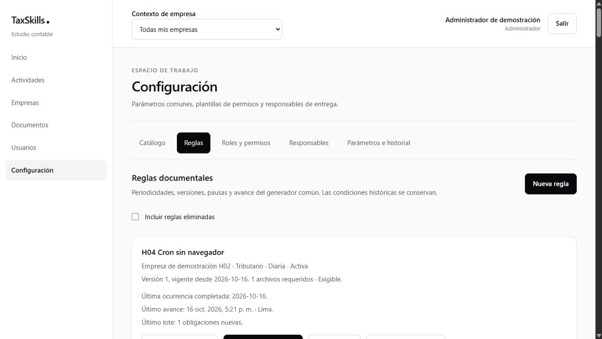
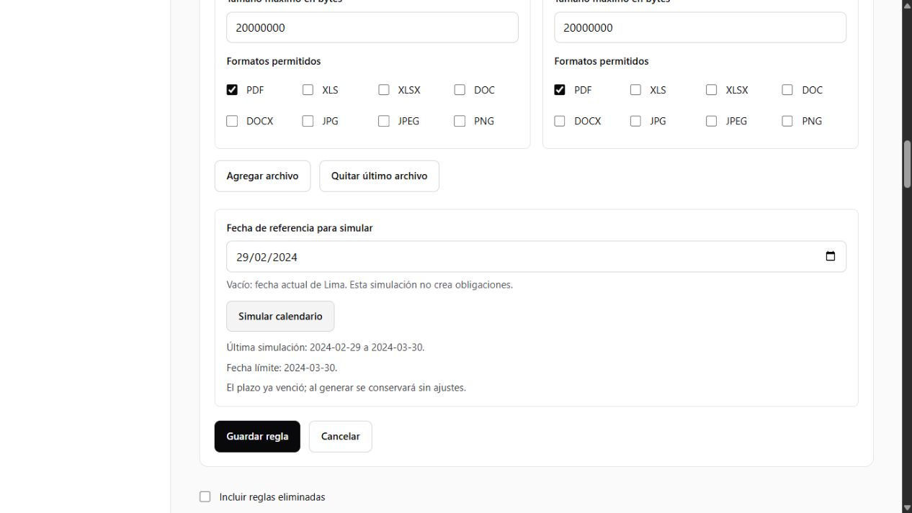
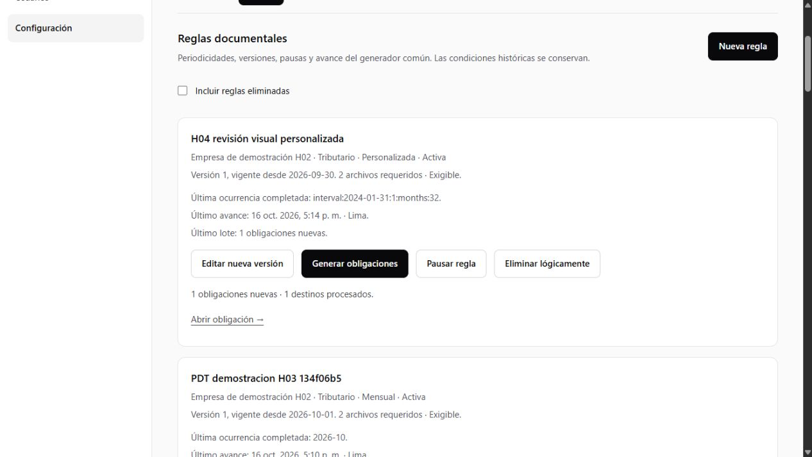
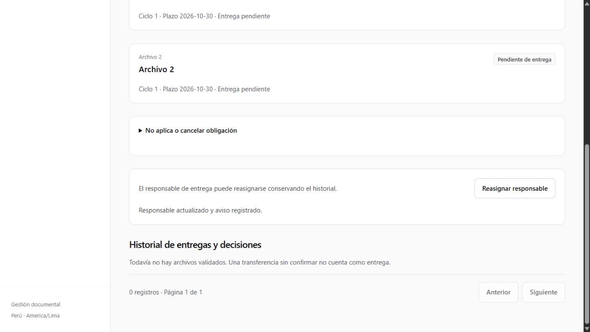

# Evidencias H04 — Motor documental completo

**Fecha:** 16 de octubre de 2026, America/Lima. **Estado:** implementación y validación técnica completadas en Docker local. La aceptación formal de producto se registra por separado. Ver [hito](../h04-motor-documental.md), [contratos](../../motor-documental.md) y [entornos](../../desarrollo.md).

## 1. Entorno y alcance

- Supabase Docker `tax-skill`, API loopback `54331`, PostgreSQL `54332`; aplicación local `3001`.
- La validación funcional inicial utilizó solo cuentas, empresas, trabajadores y archivos ficticios locales. El esquema se desplegó posteriormente a Cloud por autorización del usuario, como se registra en la sección 6; ningún fixture ni job de pruebas se trasladó allí.
- Nueve migraciones incrementales H04; 28 migraciones totales. No se añaden tablas fuera del modelo. Se amplía `rule_versions` con la cabecera congelada de versión y el cursor J03 con sus campos técnicos.
- RLS universal, seguridad final de consultas/Storage, publicación y Cron productivo permanecen en H08. Estas pruebas funcionales no acreditan aislamiento directo multiempresa.

## 2. Verificaciones ejecutadas

| Verificación | Resultado |
|---|---|
| `yarn verify` | TypeScript, ESLint y arquitectura aprobados; 123 pruebas en 19 archivos. |
| `yarn build` | Compilación de producción con Yarn; mismas rutas, tres endpoints administrativos y Proxy. |
| `yarn check:bundle` | Sin credenciales administrativas ni integración de servidor en el bundle cliente. |
| `yarn db:lint` | Sin errores SQL bloqueantes. Los avisos de coerciones literales/volatilidad declarada no son errores; el calendario fija zona y DateStyle y tiene prueba de independencia de conexión. |
| `yarn test:h04:sql` | 29 casos pgTAP: calendario y matriz transaccional de aceptación. Fixtures y trigger de inyección de fallo revertidos al finalizar. |
| `yarn test:h04:live` | 78 comprobaciones: diez frecuencias por RPC/SDK, posiciones persistidas, idempotencia, dos sesiones concurrentes, snapshots y Cron real. Resultado detallado sin secretos en `test-results/local/h04-evidence.json`. |
| `yarn test:h03:live` | 59 comprobaciones de regresión: entrega, validación, revisión, corrección, reapertura, descarga y limpieza local. |
| Instalación limpia aislada | Proyecto Docker temporal `tax-skill-h04-clean`, puertos 54340–54349. `db reset --local --workdir ...` aplicó las 28 migraciones desde cero; H02/H03/H04 pasaron 31 casos pgTAP combinados. Se detuvo solo ese proyecto, conservando respaldo. |
| Actualización con historia H03 | Huellas anteriores/posteriores iguales en diez tablas; solo se excluyeron de la comparación la nueva columna de metadatos y el cursor, cuya ampliación era intencional. |

La actualización comparó `obligations`, `deliverables`, `submission_cycles`, `upload_intents`, `document_versions`, `review_events`, `notification_events`, `notifications`, `rule_versions` y `requirement_rules`. La migración no reescribió versiones de archivos, revisiones, plazos, decisiones ni contenido previo de versiones de reglas. Los siguientes cambios incrementales sustituyen funciones/validaciones sin modificar esos históricos.

Los artefactos locales ignorados incluyen `h04-before-upgrade.json`, `h04-after-upgrade.json`, `h04-history-fingerprint.sql`, `h04-clean-reset.log`, `h04-clean-tests.log` y `h04-evidence.json`. No subir configuraciones `.env`, contraseñas ni respuestas completas de Auth.

## 3. Matriz de aceptación y trazabilidad

| Tareas / requisitos | Evidencia y resultado |
|---|---|
| T01 · RF01/RF05/RF12/RF15; RT03/RT10/RT12 | Catálogo de tres áreas y formularios con 1–20 posiciones. Contrato Zod y SQL rechazan posiciones/formatos vacíos y activación con responsable inhabilitado. Borrador conservado al fallar activación. |
| T02 · RF02–RF04; RT01/RT09 · CA26 | Diez frecuencias; año ISO 2020-W53, quincenas 15/16, febrero bisiesto/no bisiesto, trimestres/semestres/años, intervalos de días/semanas/meses. Ancla 31 → febrero → 31; N cero/negativo/unidad ausente rechazados; claves ISO con DateStyle diferente. |
| T03/T06 · RF06/RF08/RF13; RT02–RT05 · CA12/CA13 | Cambio mensual crea versión 2 desde el siguiente mes. La anterior mantiene título, plazo, posiciones y snapshot. Repetir el periodo no duplica; sesiones concurrentes producen un ganador y `CONFLICT`. |
| T04 · RF08/RF09/RF14; RT02/RT04/RT05/RT13 | Cinco destinos laborales, lotes 2 + 2 + 1, versión fijada al editar entre lotes. Fallo inyectado en el segundo lote: quedan dos obligaciones completas, mismo destino/versión de continuación y error registrado. Reintento termina los cinco sin omisión. |
| T05 · RF07; RT01/RT06 · CA14 | Primera generación mensual solo del periodo vigente, sin periodos anteriores. Desplazamiento −30 produce advertencia de vencimiento pasado y conserva la fecha. |
| T07 · RF09/RF10/RF13; RT06/RT11 | Caída técnica de cuatro días recupera cinco ocurrencias en total con lotes limitados. Pausa deliberada de tres días excluye esas fechas. Lote parcialmente emitido y luego pausado termina sus cinco destinos al reactivar. |
| T07 · conservación | Eliminar tipo impide generar; detalle y snapshot emitidos siguen disponibles. Restaurar padre no restaura una regla eliminada separadamente. No se borran obligaciones ni archivos. |
| T08 · RF11; RT08/RT10 · CA28 inicial | Inhabilitar al responsable conserva UUID, obligación y snapshot; registra incidencia y aviso sin duplicación. Reasignación elegible con revisión/motivo quita la incidencia, conserva snapshot y notifica. |
| T09 · RF12; RT03/RT09 | Evento de cese identificado se repite sin duplicación. Motivo distinto del configurado deja `no_aplica` y razón. Etapa inexistente se rechaza; evento de empresa rechaza destino laboral. Reintento exitoso limpia error sin mover el cursor por calendario. Operaciones laborales finales/UI siguen H05. |
| T10 · RF09/RF14; RT07/RT13 | Job real emitió una regla pendiente sin `GenerateRule` del cliente. Auditoría de sistema y `cron.job_run_details` confirmaron avance. El rol autenticado no puede ejecutar el trabajador de sistema. |
| T11/T12 · RF01–RF15; RT12 | Recorrido visual local: regla personalizada, simulación, guardado, activación, generación, apertura de obligación con dos posiciones y reasignación con motivo. Componentes ≤170 líneas, tipos separados, Supabase directo y Tailwind, sin rutas por periodicidad. |

La prueba de calendario usa fechas civiles explícitas; la matriz de negocio toma el día de Lima al ejecutar. En la validación del 16/10/2026: mensual `2026-10`, semanal `2026-W42`, quincenal `2026-10-Q2`, trimestral `2026-T4`, semestral `2026-S2` y anual `2026`. El cursor registra referencia, cierre, versión y destino; nunca se adelanta al confirmar solo parte de los destinos.

## 4. Cron observado

`h04-generation-day`: 00:05 Lima. `h04-generation-continuation`: cada minuto, esperando la ventana diaria inicial. Se habilitan mediante setup local explícito, no por la migración.

Una ejecución real de continuación a las **17:07 de Lima** emitió la regla `H04 Cron sin navegador` creada por la integración. Se observaron también ejecuciones `succeeded` a las 17:08, 17:09 y 17:10. El script confirmó la obligación y auditoría del sistema; no se dedujo éxito documental solamente del estado SQL del job. Los IDs reproducibles y recuentos quedan en la evidencia local.

La programación no depende de Next.js ni de una sesión abierta. El control definitivo de privilegios y monitoreo productivo sigue H08; ingreso/cese/reingreso desde el expediente se completa en H05.

## 5. Revisión visual

Se utilizó el administrador ficticio local. La simulación del ancla 31/01/2024 sobre 29/02/2024 devolvió 29/02–30/03 y advirtió el plazo pasado. Guardar no generó historia anterior. Tras activar y generar, la obligación actual quedó con periodo `interval:2024-01-31:1:months:32`, dos posiciones y fecha límite 30/10/2026. La reasignación mostró éxito y conservó condiciones.

Los controles de simulación, generación, guardado, activación, registro de evento y reasignación usan loading contextual y bloqueo durante el trabajo; errores explícitos y reintentos conservan identidad. Navegación, pestañas y controles locales no muestran indicadores artificiales.

## 6. Continuidad

### Despliegue de esquema en Cloud — 16/10/2026

Por instrucción expresa del usuario se desplegaron las nueve migraciones `20261016000100`–`20261016000900` a `gzwrqvqofcrdjvzoblaz`. El historial remoto quedó en 28 migraciones y `supabase db push --linked --dry-run` confirmó cero pendientes. No se incluyeron seeds, roles de prueba ni fixtures. Las diez huellas históricas previas/posteriores coincidieron; comprobaciones ignoradas en `test-results/cloud/h04-before.json` y `h04-after.json`.

Este despliegue publica estructura y funciones H04. No activa los jobs productivos ni acredita RLS; ambos conservan su cierre operativo de H08. Las pruebas siguen ejecutándose solo en Docker.

No quedan defectos funcionales conocidos que bloqueen H05. La revisión formal del responsable de producto conserva su casillero independiente; esta entrega no la marca como recibida. Se puede continuar técnicamente con [H05](../h05-areas-documentales.md): expediente, ingreso, cese, reingreso y catálogo inicial de las áreas, reutilizando este motor.
