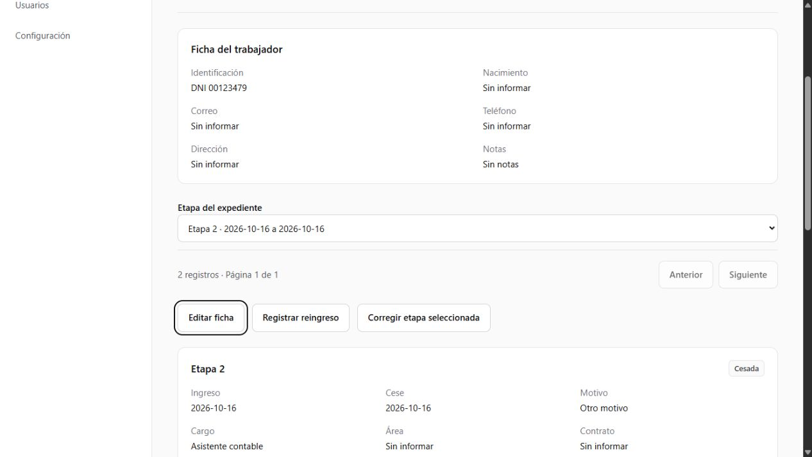
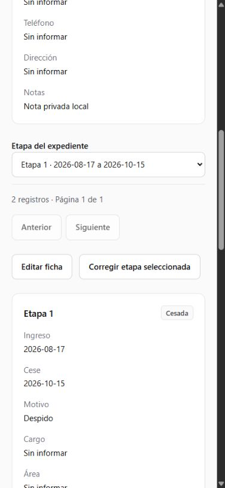
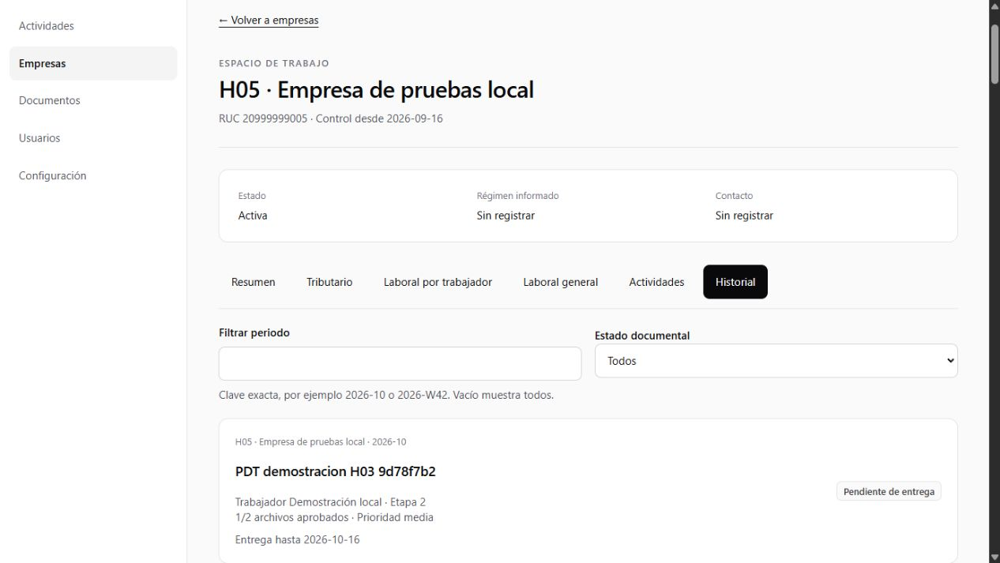

# Evidencias H05 — Tres áreas y expediente laboral

**Fecha:** 16 de octubre de 2026, America/Lima (migraciones del 17/10 en UTC). **Estado:** implementación y validación técnica; aceptación formal de producto independiente. Ver [hito](../h05-areas-documentales.md), [contratos](../../expediente-laboral.md) y [entornos](../../desarrollo.md).

## 1. Alcance comprobado

Ocho migraciones H05, `20261017000100`–`20261017000800`, sin tablas nuevas fuera del modelo. Completan identidad canónica, etapas sin superposición, comandos laborales, fases duraderas, consultas por etapa y contrato estricto de cese. Las tres áreas reutilizan el motor, carga y revisión existentes. Catálogo importable de 28 tipos editables, sin activación automática ni plazos legales.

Todos los datos sintéticos y archivos de estas pruebas se alojaron exclusivamente en **Supabase Docker 54331**, proyecto `tax-skill`. La app local usa ese destino. No se utilizaron credenciales de Cloud para probar los recorridos.

## 2. Comprobaciones reproducibles

| Control | Resultado observado |
|---|---|
| `yarn verify` | 137 pruebas en 20 archivos; TypeScript, ESLint y arquitectura aprobados. Componentes de hasta 170 líneas, tipos separados, sin ciclos ni CSS nuevo. |
| `yarn build` / `yarn check:bundle` | Compilación de producción aprobada con Yarn; incluye ruta de expediente, conserva Proxy y las tres excepciones Auth Admin existentes. Bundle público sin claves administrativas/HMAC. |
| `yarn db:lint` | Funciones y esquema locales sin errores de lint de PostgreSQL. |
| `yarn test:h05:sql` | Aprobado: ciclo laboral, salario exacto, identidad con ceros, superposición, historia anterior al control, aplicabilidad, soft delete/restauración, ámbito, lotes y fallo recuperable. Incluye rechazo de cambio salarial dentro de cese y corrección con motivo auditado. Fixtures con rollback. |
| Regresión SQL H02/H03/H04 | 31 casos pgTAP combinados aprobados; no se cambia el contrato de carga/revisión. |
| `yarn test:h05:live` | 114 comprobaciones de integración H05; dos actores compiten por iniciar etapa, solo uno gana. Cese/reingreso conservan documentos y snapshots anteriores. Solicitud manual repetida no duplica. |
| Recorrido documental de las tres áreas | La integración reutiliza `verify-h03.ts`: **61 comprobaciones por área**, con TUS real, validación confiable, aprobación parcial, observación/corrección, revisión concurrente, reapertura, descarga y limpieza temporal local. |
| Cron laboral real | Un checklist superior al lote inicial quedó pendiente y el job local creó la obligación eventual faltante como sistema, sin otra solicitud de generación del navegador. No se dedujo el éxito solo del estado del job. |
| Actualización H04 → H05 | En Docker aislado, datos/historial H04 previos; las doce huellas comparadas coincidieron después de las primeras siete migraciones. La octava solo restringe entrada del comando de cese y se comprobó después con SQL local. |
| Instalación limpia | Proyecto aislado `tax-skill-h04-clean`, puertos 54340–54349: reconstrucción final con las **36 migraciones desde cero** y 32 casos pgTAP H02–H05 aprobados. Se detuvo solo ese proyecto, conservando su respaldo; el proyecto principal quedó activo. |

IDs y checks reproducibles, sin secretos: `test-results/local/h05-evidence.json`. Los archivos de recorridos compartidos son `h03-evidence.json`, `h05-laboral_general-documents.json` y `h05-laboral_trabajador-documents.json` en esa carpeta ignorada. Huellas/registro de instalación: `h05-before-upgrade.json`, `h05-after-upgrade.json`, `h05-upgrade.log`, `h05-final-clean-reset.log` y `h05-final-clean-tests.log`. No versionar contraseñas, tokens ni enlaces firmados.

## 3. Correspondencia con tareas y requisitos

| Tarea | Evidencia funcional/técnica |
|---|---|
| T01 · RF03–RF05/RF12; RT01–RT03 | DNI texto con ceros, índice canónico incluyendo eliminados, salario decimal exacto, una abierta, trigger con bloqueo de trabajador y rangos inclusivos. Tipos generados actualizados. |
| T02 · RF03/RF04/RF15/RF16; RT04/RT08/RT10/RT13 | Alta combinada, edición CAS, búsqueda paginada, eliminar/restaurar con motivo, identidad no reutilizable y ninguna etapa creada por restaurar. |
| T03 · RF05/RF06; RT04–RT07 | Contratado antes del control recibe checklist actual y mensual vigente; ninguna boleta antigua automática. Fecha real de ingreso conservada en evento. |
| T04 · RF08–RF11; RT02/RT04–RT08 | Fecha/motivo juntos, observación para otro, cese registrado después con plazo desde fecha real, renuncia No aplica para despido, histórico precontrol sin retroactivos. Lote fallido conserva cursor. |
| T05 · RF12/RF13; RT01/RT02/RT05/RT09/RT13 | Reingreso crea otro UUID/secuencia; snapshots previos iguales; selector de etapa y sección, URL de etapa ajena rechazada. Dos inicios simultáneos: un ganador. |
| T06 · RF01/RF02/RF05–RF10; RT07 | Importación idempotente de 28 códigos; no sobrescribe tipos existentes. Reglas configuradas por módulo, evento, motivo, destino y posiciones antes de activación. |
| T07 · RF01/RF02/RF13/RF14/RF16; RT09/RT11/RT12 | Pestañas de empresa, historial, lista/ficha, selector y detalle común con retorno al contexto. Permisos por capacidad, sin privilegio médico adicional. |
| T08 · RF01/RF02/RF07/RF13; RT07/RT11 | Tres ejecuciones del mismo flujo documental con 61 controles cada una; no existen repositorios ni revisores copiados por área. |
| T09 · RF14/RF16; RT03/RT10/RT12 | Solo etapa seleccionada contiene salario como texto; listados paginados sin salario. Auditoría SQL verifica ausencia de salario, correo y notas privadas. Acceso laboral completo, aislamiento directo pendiente H08. |
| T10 · RF03–RF16; RT01–RT13 | Matriz SQL, integración con concurrencia y Cron, UI en escritorio/móvil/teclado, errores explícitos y estado pendiente visible. |
| T11 · RF01–RF16; RT01–RT13 | Contratos, diccionario, ruta delgada y evidencia de UI/obligaciones en este informe; verificaciones de compilación y bundle registradas al cierre. |

## 4. Revisión visual y accesibilidad

En `http://127.0.0.1:3001`, con administración ficticia local, se registró un trabajador DNI con ceros y etapa histórica cerrada, luego reingreso como etapa 2, cese con motivo/observación y corrección de cargo con motivo. Cada resultado se comprobó en la ficha. Los botones mostraron `Registrando trabajador…` y `Guardando etapa laboral…` deshabilitados durante la operación. El cese incompleto mostró error con foco; se añadió validación contextual de observación para no depender de un mensaje genérico del servidor.

El selector cambió con flechas/Enter a la etapa anterior, conservando fechas y remuneración correspondientes. La sección Cese mostró la carta de renuncia como No aplica para despido. Una URL con etapa de otro trabajador se rechazó sin mostrar ficha/documentos ajenos. Se añadió el enlace visible a Historial en la empresa.

En la compilación final, el cese con motivo Otro y sin observación mostró «Describe el otro motivo de cese.» y llevó el foco al error; cancelar conservó la etapa abierta. Los eventos se presentan como «Solicitud eventual», manteniendo sus identificadores técnicos fuera del listado visible. Los 111 enlaces locales de la documentación revisada resolvieron a archivos existentes.

Se revisó viewport móvil 390 × 844: título e identificación se ajustan; ancho del documento no supera el viewport; selector/secciones se operan con teclado. La navegación principal tiene desplazamiento propio. Se restauró el viewport normal al terminar.

## 5. Límites y continuidad

Se desplegaron primero las nueve migraciones H04 autorizadas y después las ocho H05, mediante `supabase db push --linked --yes`, sin seeds ni fixtures. Cloud `gzwrqvqofcrdjvzoblaz` quedó con **36 migraciones**, y el dry-run posterior confirmó cero pendientes. Las doce huellas de datos históricos previas/posteriores a H05 coincidieron, incluyendo todas las condiciones H04 y excluyendo únicamente las dos columnas nuevas H05. Registros ignorados: `test-results/cloud/h05-before.json`, `h05-after.json` y `h05-history-fingerprint.sql`. No se ejecutaron suites SQL ni integración en Cloud, ni se activaron jobs productivos.

No hay cálculo de nómina ni calendario legal. RLS, revocación universal, configuración/monitoreo productivo de Cron y pruebas de recuperación pertenecen a H08. No se marca aceptación de producto en nombre del usuario. El expediente y las tres áreas permiten continuar técnicamente con [H06](../h06-actividades-notificaciones.md).
