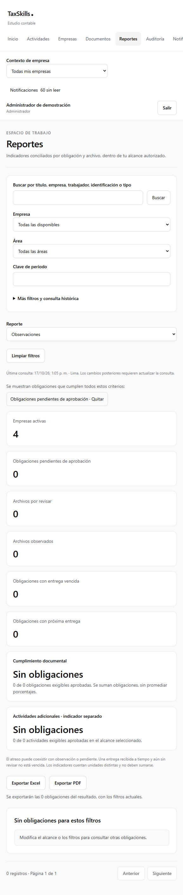
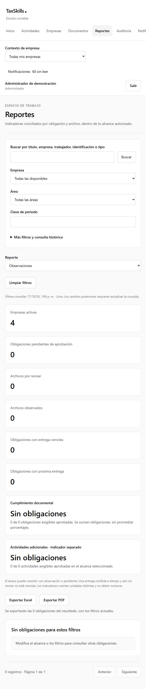

# Cierre complementario de H07 · REV-04 y REV-05

**Fecha:** 17 de octubre de 2026. **Estado:** ambas observaciones corregidas y verificadas en Docker local; publicación de la migración adicional pendiente. REV-01–REV-03 conservan su [cierre anterior](h07-correcciones.md). El [informe que reprodujo los defectos](revision-final-pre-h08.md) se conserva como evidencia histórica.

## 1. Indicadores por intersección · REV-04

Cada tarjeta añade una condición al resultado actual. Conserva el tipo de reporte, indicadores anteriores, empresa, módulo, periodo, búsqueda, estado, histórico y rangos; solo reinicia la página. Funciones puras del dominio construyen los filtros y permiten quitar un criterio sin eliminar los restantes. Los criterios activos tienen enlaces accesibles para quitarlos. El recurso sigue siendo dashboard o reportes según el origen, incluso con permisos parciales.

`indicators` es un array JSON de hasta cinco valores permitidos: `pending`, `review`, `observed`, `overdue`, `upcoming`. Todos se combinan mediante **AND**, además del reporte y los demás filtros. El navegador deduplica y ordena los valores para mantener URL y caché estables. URL: `indicators=pending,review`. El antiguo parámetro `indicator` sigue admitido para enlaces existentes y también se combina por intersección.

Desde `/reportes?report=observed`, pendientes abre `/reportes?indicators=pending&report=observed`: si las observaciones son cero, el destino conserva cero. Distintos archivos de una obligación pueden estar observados y por revisar simultáneamente. Las tarjetas de archivos siguen contando archivos; el listado presenta sus obligaciones sin confundir unidades.

La migración [20261017175617_h07_indicator_intersections.sql](../../../supabase/migrations/20261017175617_h07_indicator_intersections.sql) amplía el validador y el selector privado de hechos. El helper nuevo no concede ejecución directa a `public`, `anon` o `authenticated`. Conserva `reports.view` + `reports.export`, filtros históricos y resolver de auditoría. No crea tablas, reescribe eventos, carga fixtures ni activa jobs. Las 56 migraciones anteriores permanecen intactas.

## 2. Feedback de exportación contextual · REV-05

Progreso y error pertenecen a la identidad de la exportación: usuario, estudio, permisos, empresa y filtros. Cambiarla descarta el mensaje ya terminado sin depender de un desmontaje; regresar a una identidad en caché tampoco recupera mensajes descartados.

El trabajo activo se marca como descartado y se aborta al cambiar identidad o desmontar. Incluso al regresar a esa identidad, sus callbacks tardíos no publican mensajes ni archivos. Los controles siguen bloqueados durante la conciliación acotada y muestran cancelación real; no admiten una segunda ejecución mientras sigue activa. Un nuevo intento comienza con feedback limpio. Se conserva el contrato de auditoría e idempotencia anterior.

## 3. Verificaciones

| Comprobación | Resultado |
|---|---|
| `yarn verify` | PASS: TypeScript, ESLint, arquitectura y **227 pruebas / 27 archivos**; 15 regresiones nuevas. |
| Indicadores | Seis tipos de reporte, criterios previos, URL/retorno, eliminación individual, valores inválidos y permisos parciales. |
| Exportación | Éxito/error visibles con datos ya listos en caché, cambio de usuario/estudio/empresa/permisos, aborto y secuencia A → B → A con callbacks tardíos. |
| SQL Docker | Seis suites / **34 casos pgTAP** PASS. Nuevas aserciones de intersección, vacío, archivos en estados distintos, reserva de exportación y permisos conjuntos. |
| Instalación aislada | `tax-skill-h07-indicators-clean`, puertos 54520–54529: 57 migraciones instaladas y versión final del borrador reaplicada antes de pasar las seis suites. Detenido después, con volúmenes conservados. |
| Actualización incremental | Migración aplicada sobre las 56 versiones y datos sintéticos existentes. Borrador local reaplicado con CLI tras comprobar la preservación de lectura al exportar. Ninguna reparación del historial remoto. |
| `yarn db:lint`, `yarn db:types --local` | PASS. Los tipos públicos generados no cambian: mismas firmas RPC y tablas. |
| `yarn build`, `yarn check:bundle` | PASS: 19 páginas, dos workers, Proxy y ausencia de secretos configurados en recursos públicos. |
| `yarn test:h07:live` | PASS: 30 empresas, 100 usuarios, 1.000 trabajadores, 12.000 obligaciones; Excel/PDF de 1.000 filas y auditoría. Solo Docker. |
| Navegador real | Build en `127.0.0.1:3001`, Docker `127.0.0.1:54331`. Indicador cero abre cero manteniendo Observaciones. Excel prepara 185 filas; al volver a Observaciones aparece el mensaje actual de cero. No acredita guardado físico del archivo. |

Medición sin el arranque concurrente del contenedor auxiliar: P95 dashboard **1.280,2 ms**, reportes **1.193,8 ms**, documentos **763,7 ms**, auditoría **495,1 ms**. Un calentamiento y 20 muestras por recurso, un usuario concurrente, HTTP loopback; referencia local ≤2.000 ms. Excel de 1.000 filas: 423,9 ms; PDF: 1.204,0 ms; heap final aproximado: 82,2 MB. Consultas combinadas, 20 muestras sobre 12.000 obligaciones: pendientes + próximas **1.121,2 ms**, revisión + observadas **920,1 ms**. Ambos conjuntos resultaron vacíos; la conciliación no vacía está cubierta por la prueba SQL de archivos mixtos. No acredita SLA, concurrencia ni dispositivos productivos.

Las [mediciones completas](h07-cierre-complementario-capacidad.json) incluyen la primera muestra concurrente, con P95 de reportes de **4.047,0 ms** mientras arrancaba el contenedor auxiliar. No se omite ni se presenta como medición aislada. También se conservan los originales ignorados: `test-results/local/h07/performance.json` y `test-results/revision-pre-h08/indicators-combined-performance.json`.

## 4. Evidencia visual

Observaciones mantiene su selección y cero resultados después de pulsar pendientes:

Después de exportar 185 obligaciones y volver a Observaciones ya consultado, el control comunica las cero obligaciones actuales:

## 5. Publicación y continuidad

El código y la evidencia están publicados en GitHub, rama `codex/h02-acceso-empresas`, commit `7b18e83`. Publicar la migración antes de desplegar el frontend que envía `indicators`. El dry-run identifica exclusivamente `20261017175617_h07_indicator_intersections.sql`, sin seeds ni roles. Se guardaron las 13 huellas históricas y el inventario remoto mediante consultas de solo lectura.

**Publicación no ejecutada:** la revisión automática rechazó aplicar esta migración nueva al entorno real porque la autorización anterior correspondía específicamente a `20261017164155`, no a esta corrección. Es necesaria la autorización explícita del usuario para publicar únicamente `20261017175617_h07_indicator_intersections.sql` en `gzwrqvqofcrdjvzoblaz`. No se intentó otra vía ni se modificó el historial remoto. Tras autorización, comprobar 57 versiones coincidentes, las 13 huellas sin cambios, el helper privado, el lint y cero jobs nuevos antes de registrar el cierre remoto.

Ambas observaciones están cerradas funcionalmente en local. Completar la publicación y comprobar las huellas permitirá registrar la base sincronizada para [H08](../h08-preparacion-produccion.md). RLS/privilegios/sesiones, Storage, respaldos/restauración, monitoreo, dominio, secretos y canal productivo siguen siendo alcance de H08. Esta corrección no implementa esos controles ni realiza un piloto real.
