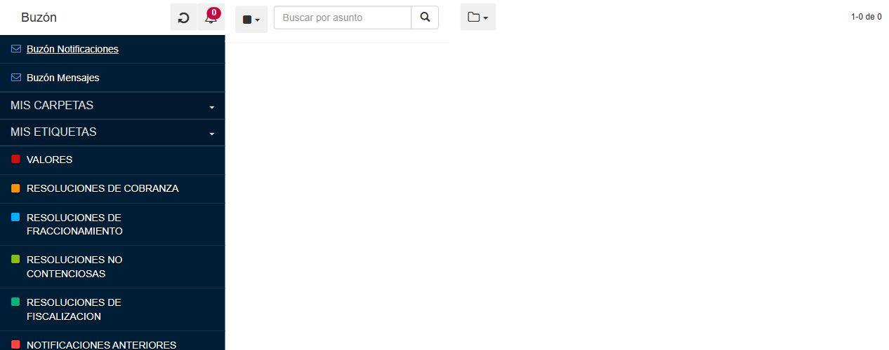

# Evidencias H10 — piloto de Buzón SUNAT

**Estado al 26/10/2026: parcial. H10 no está cerrado y el módulo completo no se ha construido.** [Hito](../h10-buzon-sunat.md), [diseño y requisitos](../../buzon-sunat.md), [herramienta local](../../../integrations/sunat/README.md).

**Correcciones posteriores de esta intervención:** [núcleo del prototipo y 41 comprobaciones Docker](h10-correcciones.md), con [reporte sintético separado](h10-worker-lab.json). Corrigen el tratamiento de inconsistencias y fallos en el prototipo, sin demostrar todavía un adaptador SUNAT real. Un cierre e inicio de sesión nuevos no resolvieron la discrepancia de Mensajes. El expediente real continúa con cuatro comprobaciones abiertas.

## Alcance autorizado y resultado real

El usuario facilitó dos empresas piloto y autorizó por separado iniciar sesión en `https://api-seguridad.sunat.gob.pe`, consultar su buzón y descargar un adjunto para la prueba. Se contrastaron fechas de octubre/septiembre de 2026. Identidad y metadatos de autorización se conservan privadamente, fuera de Git. No se registraron las claves en los archivos del kit.

El portal oficial permitió iniciar sesión y abrir el Buzón Electrónico. Se observaron las bandejas Notificaciones y Mensajes, y el contador **`1-0 de 0`**. En la vista directa se seleccionó Mensajes y se realizó una actualización del buzón; continuó el mismo contador.

**El usuario confirmó posteriormente que el primer buzón está vacío.** La observación coincide con esa confirmación y sirve como caso de buzón vacío en el portal. No acredita por sí sola una respuesta íntegra del conector, una consulta mensual ni la descarga de adjuntos.

La captura corresponde a la vista independiente del buzón y no contiene la cabecera de identidad del contribuyente, documentos ni la dirección autenticada. No versionar URLs del iframe: incluyen parámetros de sesión.

### Segundo piloto: caso positivo

Después de la autorización específica se sustituyó la sesión del primer piloto. Se observaron:

- **Notificaciones:** `1-25 de 196`; en la primera página, siete fechas de octubre y cuatro de septiembre de 2026.
- **Mensajes:** `1-25 de 40`; se identificaron fechas de ambos meses. Estos contadores corresponden a resultados de las bandejas, no a totales filtrados por mes.
- **PDF adjunto:** descarga desde el enlace visible de la previsualización, 88.793 bytes, cabecera `%PDF-` y una página validada mediante `pdf-lib`. SHA-256, nombre original y referencias de origen permanecen en el expediente privado.
- **Identificadores:** los 25 IDs y fechas de la primera página de Notificaciones permanecieron iguales después de actualizar. Esto es evidencia de repetibilidad en la muestra; no una garantía contractual de estabilidad de toda la fuente.
- **Paginación:** se pasó a `26-50 de 196`, con 25 filas fechadas entre febrero de 2026 y agosto de 2025, y se regresó a la primera página. La segunda página no compartía IDs con la primera. La ordenación descendente se observó en la muestra; falta verificar límites, continuidad y cambios concurrentes en el conector.

No se encontró un selector de fechas en la vista utilizada; la búsqueda visible es por asunto. No se deduce de ello que SUNAT carezca de otros mecanismos de consulta. No se considera completado septiembre mediante una simple coincidencia de fechas en la primera página.

**Inconsistencia adicional en Mensajes:** una revisión posterior encontró 24 filas renderizadas en la primera página aunque el contador indicaba `1-25 de 40`. Al pasar a la segunda, el contador cambió a `26-40 de 40`, pero la lista permaneció sin filas después de esperar un registro visible. No hubo un aviso explícito de error. Se regresó a la primera página y se conservaron ambas observaciones privadas. La causa no está determinada: no se atribuye todavía a SUNAT, al mecanismo del navegador ni al futuro conector. Esta discrepancia impide certificar integridad mensual y exige comprobar respuestas, carga y reintentos del prototipo; nunca interpretarla como ausencia de mensajes.

El ID de fila y el identificador de la ruta del adjunto **no coincidían** en esta muestra. El conector deberá conservar ambos y su asociación; no construir una URL de adjunto suponiendo que son iguales. La descarga se obtuvo del enlace de origen, sin adivinar endpoints.

### Efecto de lectura observado

Antes de entrar en Mensajes, su indicador mostraba 12; después mostró 11. Al cambiar de bandeja SUNAT previsualizó un registro automáticamente. No se utilizó una orden de marcar como leído/no leído. La observación es compatible con un cambio automático de lectura, pero no certifica por sí sola la semántica del indicador ni el efecto separado de listar, abrir y descargar.

Se detuvo la exploración y se solicitó al usuario la política deseada. **Confirmó permitir que la consulta marque mensajes como leídos, advirtiéndolo al configurar la conexión.** A continuación se abrió un único registro con la clase visual `msj_nuevo`: perdió esa clase, quedó seleccionado y el indicador pasó de **11 a 10**. La transición y el ID se conservaron privadamente, sin contenido del mensaje en Git. P08 queda sustentado para el efecto de abrir un registro en navegador; falta separar listado y descarga durante la prueba del prototipo. La revisión diaria sigue desactivada.

La captura solo conserva la navegación de las bandejas. Los valores entre paréntesis no se presentan como cantidades totales de mensajes; el indicador de Mensajes ya muestra el valor posterior a la apertura automática.

La política de conexión deberá advertir el efecto y conservar confirmación auditada. No se restauraron marcas ni se ejecutaron acciones sobre otros mensajes para completar esta comprobación.

## Ocho comprobaciones

| Caso | Resultado | Evidencia y límite |
|---|---|---|
| P01 Acceso autenticado | **Comprobado en navegador.** | Formulario oficial → menú SOL → interfaz del buzón en dos empresas autorizadas. No demuestra ejecución de un worker. |
| P02 Mes actual/anterior | Parcial; pendiente. | Fechas de octubre/septiembre observadas; la discrepancia entre contador y filas de Mensajes impide certificar integridad mensual. |
| P03 Adjunto coincidente | **Comprobado en navegador.** | PDF obtenido del enlace de la previsualización, formato, tamaño y página válidos; referencias/hash privados. Falta implementar la descarga del worker. |
| P04 Identificadores estables | **Comprobado en la muestra del navegador.** | 25 IDs y fechas iguales tras actualizar; fuente y adjuntos tienen identificadores distintos. Falta deduplicación del worker. |
| P05 Sesiones y errores | Pendiente. | Reiniciar sesión no demuestra todos los casos de renovación, expiración e indisponibilidad. No se forzó una contraseña incorrecta contra la cuenta real. |
| P06 Consulta acotada | Parcial; pendiente. | Paginación y retorno en Notificaciones comprobados; segunda página de Mensajes sin filas pese al contador. Criterio de parada, límites y recuperación del prototipo pendientes. |
| P07 Recursos | Pendiente. | Adjunto: 88.793 bytes. Duración, CPU, memoria, solicitudes y páginas del worker permanecen NULL. |
| P08 Lectura | **Efecto de apertura comprobado en navegador.** | Registro nuevo → abierto sin marca de nuevo y contador 11→10, después de autorización. Política: permitir con advertencia. Listado y descarga del prototipo aún requieren contraste. |

**Resultado: 4/8 comprobaciones sustentadas dentro del alcance de navegador, cuatro abiertas; condición de continuación no satisfecha.** El primer caso vacío se conserva como evidencia auxiliar independiente. El segundo expediente aporta muestras positivas y el evaluador queda en `pilot_incomplete`, sin requisitos administrativos de muestra faltantes. La condición sigue cerrada hasta completar el prototipo propio y los otros casos; no se suman evidencias de distintas empresas para declarar un expediente completo.

## Entregables de preparación implementados

- Hito H10 con acuerdos, requisitos funcionales/técnicos, tareas, protocolo y Definition of Done sin marcar pendientes como terminados.
- Especificación de factibilidad, información del administrador, interfaz mensual y consumo acotado.
- Comando `yarn h10:preflight --init` y ejemplos de solicitud/evidencia sin credenciales. No sobrescribe expedientes existentes.
- Evaluador puro con contratos Zod estrictos, tipos separados y salida sin identidad de empresa/operador/referencia privada.
- Ocho casos únicos y referencias de evidencia para resultados; procedencia real/sintética y navegador/worker diferenciadas.
- Validación de meses en Lima, autorización, lectura, ejecución diaria y presupuestos medidos. Una prueba sintética o únicamente en navegador no permite continuar.
- Prerrequisitos de producción separados: vínculo de empresa, capacidad del servidor privado y responsable de mantenimiento.

Los JSON privados están en `.envs/local/sunat`; el informe operativo en `test-results/local/h10/preflight.json`. Ambos directorios quedan ignorados por Git. El primer expediente fue archivado antes de preparar el segundo, con su autorización propia. El [informe compartible](h10-preflight.json) es una copia revisada sin datos del contribuyente ni secretos. `network_requests_performed: false` corresponde al evaluador, que solo procesa archivos; la observación real del portal se realizó separadamente mediante el navegador autorizado.

## Verificación del kit

[Registro de comprobaciones de esta intervención](h10-validacion.json). Estos resultados verifican la preparación y distinguen explícitamente lo que sigue pendiente del piloto real.

| Comprobación | Resultado |
|---|---|
| Unitarias dirigidas H10 | **16 aprobadas.** Son fixtures en memoria, sin consultas externas. |
| Lint dirigido | Aprobado tras corregir imports y callbacks anidados de tests. |
| TypeScript estricto | Aprobado con `yarn node node_modules/typescript/bin/tsc --noEmit --incremental false`. |
| Arquitectura | Aprobada: tipos separados, componentes hasta 170 líneas, sin ciclos, secretos aislados y Tailwind. |
| Preflight inicial y con observación | Bloqueo esperado: no convierte datos incompletos ni observación de navegador en integración lista. |
| Inicialización repetida | SHA-256 de los dos expedientes privados conservados; `--init` no sobrescribe datos existentes. |
| Formato/enlaces/privacidad | Prettier y diff sin errores; enlaces locales válidos y archivos compartibles sin identidad del piloto. |

No se recompiló el frontend para este kit de scripts/documentación. El build/bundle y la regresión funcional completa pertenecen a la implementación posterior del módulo, cuando se cumpla la condición de continuación.

## Incidencias y conservación de entornos

- La primera revisión automática bloqueó el inicio de sesión por falta de autorización explícita específica. El usuario la otorgó y el acceso se realizó después.
- Una interrupción de revisión por límite de uso no ejecutó la acción pendiente. Se retomó tras la instrucción del usuario.
- Los controles dentro del iframe no respondían al mecanismo de interacción. Se abrió la dirección actual de esa misma vista autenticada, sin adivinar endpoints ni desactivar protecciones; allí se pudo seleccionar Mensajes y actualizar.
- El primer intento de esperar una descarga tras hacer clic agotó el tiempo disponible. Se comprobó el estado antes de repetir; la operación de descarga de archivo del navegador obtuvo después el PDF correctamente. El timeout no se contó como descarga satisfactoria.
- La revisión automática rechazó una captura amplia de la bandeja porque podía exponer contenido tributario. La evidencia compartida se limitó a capturas de los indicadores, verificadas sin asuntos, identidad ni documentos.
- Tras la interrupción se encontraron Docker y los servidores locales cerrados. Se abrió Docker Desktop, se conservaron sus volúmenes y se restablecieron las compilaciones existentes en **4001 y 4002**, con sus funciones Edge locales. Ambas páginas de acceso respondieron **HTTP 200** y las funciones de 54331/54431 quedaron sirviendo. No se ejecutaron resets, migraciones ni seeds para recuperar estos entornos.
- No se modificaron Supabase Cloud, Vercel, n8n productivo, claves SOL, permisos externos ni programaciones productivas en esta intervención.

## Pendientes para avanzar

1. Llevar al prototipo la política de lectura confirmada y distinguir efectos de listar, abrir y descargar. Advertir antes de conectar y registrar confirmación; no restaurar después marcas automáticamente.
2. Resolver la discrepancia contador/filas y completar conciliación mensual y pruebas de sesión/fallos; no provocar bloqueos de contraseñas reales para probar errores. Una lista incompleta debe conservarse como parcial/fallo con reintentos acotados, nunca como mes vacío.
3. Implementar y medir el prototipo del worker con la fuente contrastada, continuidad/deduplicación y límites; probar revisión diaria sin intervención. Confirmar capacidad del servidor y mantenimiento antes de operación permanente.
4. Revisar evidencias antes de construir persistencia, permisos, cifrado y pantalla del módulo completo.

La lectura de mensajes, el almacenamiento de claves del producto y la activación diaria siguen sujetos al alcance y a las condiciones del [hito H10](../h10-buzon-sunat.md).
