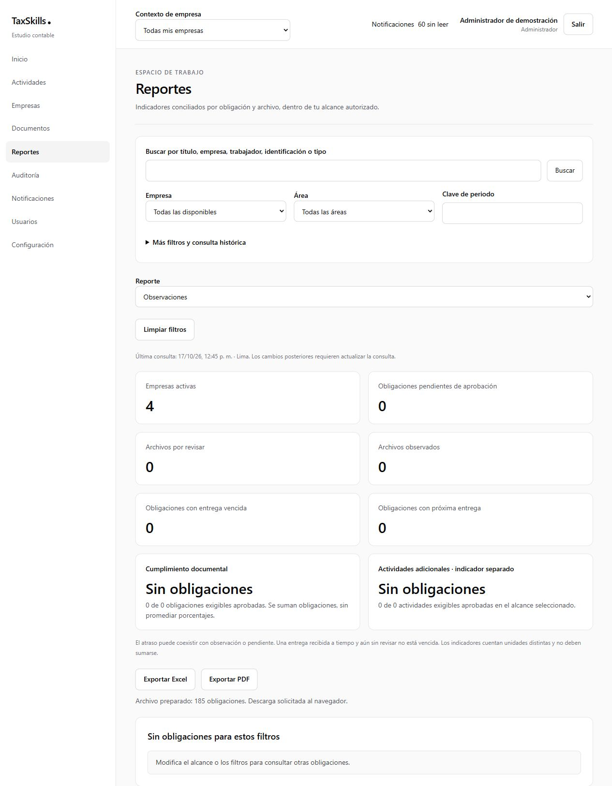

# Revisión complementaria antes de H08

**Seguimiento:** REV-04–REV-05 están corregidas, verificadas y publicadas con autorización explícita según el [cierre complementario](h07-cierre-complementario.md). El resultado y las reproducciones siguientes describen la revisión previa a esas correcciones.

**Fecha:** 17 de octubre de 2026. **Código revisado:** `661a6eb457311d2581c13e22da3435f539e6eff0` (cierre documental de la implementación `dc32440`). **Resultado:** las tres correcciones anteriores siguen verificadas; se encontraron dos casos adicionales de consistencia en H07. Se recomienda resolver REV-04 y REV-05 antes de aceptar H07 como completamente conforme y continuar con H08.

Referencias: [requisitos H07](../h07-supervision-reportes.md), [cierre REV-01–REV-03](h07-correcciones.md), [índice](../README.md), [H08](../h08-preparacion-produccion.md), [entornos](../../desarrollo.md) y [reglas](../../../.agents/rules.md).

## 1. REV-04 · P2 · El enlace de un indicador sustituye filtros del resultado

**Ubicación:** [ReportMetrics](../../../src/features/reporting/components/report-metrics.tsx), línea 18 y construcción de enlaces por indicador. **Requisitos:** H07-RF09, H07-RF14 y H07-RT02.

La corrección anterior mantiene correctamente el recurso de origen y evita elegir Reportes por un permiso de otra empresa. Sin embargo, el enlace de pendientes cambia `report` a `pending`, aunque las métricas se hayan calculado con otro tipo de reporte. Los enlaces restantes también sustituyen `indicator` cuando ya estaba aplicado. Mantener empresa, módulo y periodo no conserva por sí solo todas las restricciones del resultado.

**Reproducción real en Docker con la sesión administrativa de demostración:**

1. Abrir `/reportes` y elegir **Observaciones**. La dirección queda `/reportes?report=observed`.
2. La pantalla muestra cero resultados y el indicador **Obligaciones pendientes de aprobación: 0**.
3. Su enlace es `/reportes?report=pending`: elimina la restricción de observaciones.
4. Pulsarlo abre **185 obligaciones**, pese a que el indicador mostraba cero.

No es un fallo de autorización ni de la fórmula SQL de cumplimiento: la navegación solicita otro universo. Tampoco se debe resolver concediendo más permisos.

**Corrección requerida:** conservar las restricciones del resultado y aplicar el criterio del indicador como intersección, o definir una interacción que no presente como detalle de un cero un listado de otro universo. Centralizar la construcción de filtros para que no dependa de cada tarjeta.

**Aceptación:** observar cero y abrir cero; repetir con observaciones existentes, pendientes, vencimientos y un `indicator` ya aplicado, además de empresa/módulo/periodo y permisos parciales. Comparar las filas del destino con el subconjunto del resultado original y conservar retorno. Los indicadores de archivos deben seguir distinguiendo archivos de obligaciones.

## 2. REV-05 · P2 · El feedback de exportación permanece en otro resultado almacenado en caché

**Ubicación:** [useReportExport](../../../src/features/reporting/hooks/use-report-export.ts), líneas 27–35. **Requisitos:** H07-RF14, H07-RT05 y CA34.

El hook aborta al cambiar la identidad e impide publicar progreso/respuestas tardías de una identidad anterior. Los estados `progress` y `error` que ya se habían mostrado no se limpian ni se vinculan a la identidad que los produjo. Cuando el nuevo resultado ya está en caché y el componente sigue montado, el mensaje anterior permanece.

**Reproducción real:**

1. Consultar **Observaciones** y **Pendientes de aprobación** para que ambos resultados estén en caché.
2. En pendientes, exportar Excel y esperar el mensaje **Archivo preparado: 185 obligaciones. Descarga solicitada al navegador.**
3. Volver a **Observaciones** desde el selector, conservando el componente montado al recuperar el resultado en caché.
4. La pantalla queda sin obligaciones y con indicadores en cero, pero mantiene aquel mensaje de 185 obligaciones.

Si la nueva consulta necesita desmontar el contenido durante la carga, el estado desaparece; por eso la prueba debe cubrir resultados ya consultados. En esta reproducción no se inició una descarga al cambiar el filtro ni se demostró entrega de archivos de otro ámbito. El defecto es la presentación de un resultado anterior bajo el nuevo contexto.

**Corrección requerida:** asociar el estado visible de la exportación a su identidad y restablecerlo u ocultarlo al cambiar usuario, empresa, permisos o filtros. Mantener el aborto, la conciliación acotada y el bloqueo de doble ejecución durante el trabajo activo.

**Aceptación:** probar éxito y error anteriores, cambio de filtros/empresa con caché disponible y con consulta nueva, y cambio durante una exportación. El contexto nuevo muestra su cantidad actual y ningún mensaje o referencia de operación del anterior. La cancelación y los resultados inciertos de auditoría mantienen sus mensajes explícitos dentro de la identidad correcta.

### Evidencia visual

La captura muestra **Observaciones**, todos los indicadores en cero, ausencia de obligaciones y el mensaje anterior de 185 registros. Son exclusivamente datos sintéticos de Docker.

## 3. Comprobaciones repetidas en esta revisión

| Comprobación | Resultado |
|---|---|
| `yarn verify` | PASS: TypeScript, ESLint, reglas de arquitectura y **212 pruebas, 26 archivos**. |
| `supabase test db --local` | PASS: **seis suites y 34 casos pgTAP**, incluyendo regresión de las correcciones anteriores. |
| `yarn db:lint` | PASS en `public` y `private` de Docker local. |
| `yarn build` | PASS, dos workers mediante `CIRCLE_NODE_TOTAL=3`, 19 páginas y Proxy. |
| `yarn check:bundle` | PASS: sin valores privados configurados en recursos públicos. |
| Cloud, solo lectura | **56 versiones local/Cloud coincidentes**, 29 tablas públicas, resolver privado presente y utilizado por auditoría, cero jobs `h06-notifications-dispatch`. RLS sigue diferido a H08. |
| Navegación y exportación en navegador | Los dos casos anteriores se reprodujeron en `127.0.0.1:3001`, conectado a Docker `127.0.0.1:54331`. Excel completó la preparación de las 185 filas y se observó el evento de descarga. El mensaje de la aplicación no acredita guardado en disco. |
| Base Git | Al comenzar, árbol limpio y rama sincronizada con `origin/codex/h02-acceso-empresas`; código y migraciones de H03–H07 versionados. Esta revisión añade únicamente documentación y captura. |

No se añadieron pruebas que afirmen que estos comportamientos incorrectos son válidos. Las 212 pruebas actuales pasan porque no cubren estos dos casos completos. Su corrección necesita pruebas de regresión nuevas con los comportamientos esperados descritos arriba.

## 4. Revisión por hito y límites

| Área | Evidencia comprobada y límite |
|---|---|
| H01–H02 | Compilación, organización, secretos, contratos de acceso/contexto y regresión SQL. La autorización directa y revocación definitiva siguen en H08. Las casillas de entrega/aceptación del equipo que continúan abiertas no se marcaron como una aceptación de producto inexistente. |
| H03 | Regresión de carga, validación, versiones, aprobación parcial, corrección y reapertura en las suites existentes. No se repitió en navegador todo el circuito de archivos. |
| H04 | Regresión SQL del motor/calendario, snapshots, idempotencia y recuperación. La instalación limpia de 56 migraciones se conserva como evidencia de la entrega correctiva anterior, no como una nueva instalación de esta revisión. |
| H05 | Regresión SQL laboral, remuneración, ingreso/cese/reingreso y ámbito de auditoría. |
| H06 | Regresión SQL de actividades, notificaciones y transporte/contratos cubiertos por las pruebas actuales. El laboratorio n8n y sus pruebas de proveedor de la entrega original son evidencia histórica; aquí no se repitió el laboratorio completo ni se envió WhatsApp productivo. |
| H07 | Las correcciones REV-01–REV-03 siguen pasando. La inspección real de reportes detectó REV-04 y REV-05. No se afirma revisión visual completa de todas las pantallas/dispositivos. |

No se modificaron código de producción, migraciones ni datos de Cloud. Las acciones de exportación registraron operaciones únicamente en Docker local. No se activaron jobs ni integraciones externas.

## 5. Dictamen y continuidad

La base compilable, las migraciones y la regresión general están conformes con las verificaciones ejecutadas. La conformidad funcional completa de H07 queda pendiente de REV-04 y REV-05. Conviene corregirlas y repetir sus escenarios antes de establecer la base final de H08.

RLS/privilegios/sesiones, Storage protegido, dominio/secretos reales, n8n/proveedor productivos, programación, respaldos/restauración, monitoreo y aceptación del piloto son alcance previsto de H08, no defectos nuevos que esta revisión atribuya a H07. La preparación independiente de ese hito puede adelantarse; el piloto real mantiene sus condiciones de acceso y recuperación.
