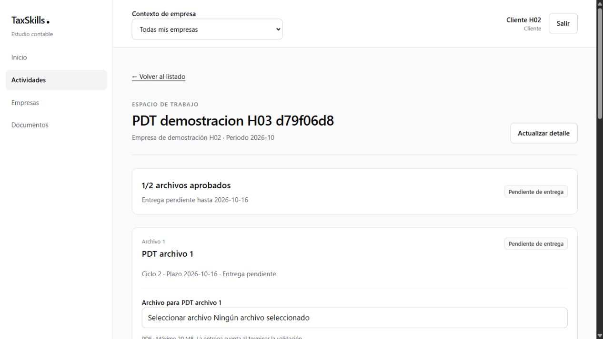
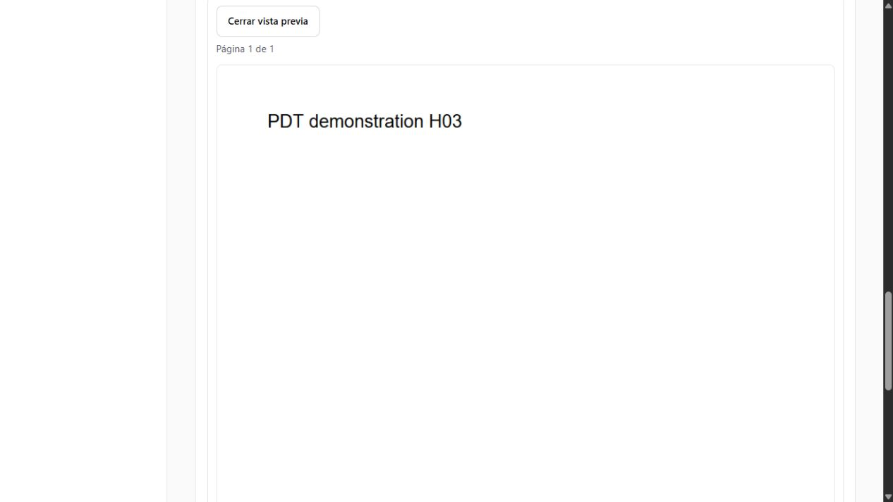

# Validación local de H02 y H03

**Fecha:** 16 de octubre de 2026, America/Lima. **Resultado:** validación técnica completada en Supabase local sobre Docker; se puede continuar con [H04](../h04-motor-documental.md). La aceptación formal del equipo/producto conserva su casillero independiente.

Esta ejecución reemplaza el pendiente de reconstrucción e integración local registrado en la [corrección de entornos](correccion-entornos.md). Las evidencias anteriores de Cloud permanecen como historia. En esta validación no se consultó ni modificó Supabase Cloud, ni se usó como alternativa a Docker.

## 1. Entorno y recuperación de Docker

Docker Desktop 4.31.1 abortaba el inicio con `running OTel manager: removing stale socket` y `The file cannot be accessed by the system` sobre `userAnalyticsOtlpHttp.sock`. Windows tampoco permitía retirar ese archivo después de cerrar los procesos de Docker.

Se comprobó que la carpeta runtime `C:\Users\ZeCarlos\AppData\Local\Docker\run` contenía únicamente ese socket. Con Docker detenido, se renombró a `run-quarantine-20261016-160141`, conservando su contenido. Docker creó un runtime nuevo y `docker info` respondió con Engine 26.1.4. No hubo restablecimiento de fábrica, actualización, eliminación de imágenes/volúmenes ni desregistro de WSL. Esto acredita la recuperación del arranque observado; no garantiza que un fallo de Windows no pueda repetirse.

Otro proyecto Supabase ocupaba los puertos habituales y permaneció activo. TaxSkill usa puertos propios comprobados mediante apertura TCP, fuera de las reservas de Windows:

| Recurso | Dirección / puerto |
|---|---|
| Proyecto Docker | `tax-skill`; contenedores con sufijo `_tax-skill`. |
| API Supabase | `http://127.0.0.1:54331`. |
| PostgreSQL | `54332`. |
| Studio | `http://127.0.0.1:54333`. |
| Rango reservado al proyecto | `54330–54339`; inspector Edge `8183`. |
| Aplicación revisada | `http://127.0.0.1:3001`. |

Los scripts solo admiten la API loopback de TaxSkill en 54331. Rechazan también 54321 para no sembrar datos en la base de otro proyecto. `env:local` conservó la conexión real en `.env.cloud.local`, excluido de Git, y se recompiló Next.js con la conexión local.

## 2. Reconstrucción y actualización

1. El primer arranque creó una base local nueva y aplicó las 19 migraciones en orden, sin errores.
2. Se reconstruyó exclusivamente TaxSkill mediante `supabase db reset --local --version 20261014001000 --no-seed`, hasta las diez migraciones H02.
3. Se ejecutaron la aceptación SQL H02, el bootstrap local y el recorrido HTTP/SDK H02. Las cuentas, empresas, permisos y operaciones de esa demostración quedaron disponibles para probar una actualización con datos.
4. Se calcularon huellas ordenadas de todas las filas de las 13 tablas H02, sin guardar sus valores en el informe.
5. `supabase migration up --local` aplicó las nueve migraciones H03. Las 13 huellas antes/después coincidieron exactamente.
6. Se repitieron SQL H02 y el recorrido HTTP/SDK H02 después de actualizar; ambos pasaron. SQL H03 y el lint también pasaron.
7. Se regeneraron los tipos desde Docker y se verificó su coherencia con TypeScript. El estado final contiene 19 migraciones, 27 tablas públicas y dos buckets documentales privados.

Registros locales ignorados por Git: `test-results/local/supabase-start.log`, `h02-clean-reset.log`, `h02-before-upgrade.json`, `h02-after-upgrade.json`, `h03-upgrade.log` y `final-schema-check.json`. Los registros de arranque pueden incluir credenciales locales: no adjuntarlos a chats, repositorios ni informes compartidos.

## 3. Correcciones necesarias para reproducir el entorno

| Hallazgo | Corrección y comprobación |
|---|---|
| `email_provider_disabled` al iniciar sesión. | `[auth.email].enable_signup = true` mantiene activo el proveedor de contraseña; `[auth].enable_signup = false` continúa bloqueando altas públicas. H02 comprueba `signup_disabled` y ausencia de una identidad creada al intentar registrarse. |
| `db query --local` rechazaba archivos con varias sentencias. | El runner usa `supabase test db --local` con pgTAP. Los archivos conservan sus aserciones de contratos y `ROLLBACK`; solo se admiten los dos archivos conocidos, sin argumentos remotos. |
| El recorrido H03 dependía de un responsable configurado manualmente. | La fixture prepara empresa/módulo mediante `h02_command / SaveModuleSettings` antes de crear la regla y verifica su resultado. |
| Edge firmaba descargas con el origen interno `http://kong:8000`. | `h03:setup` guarda `H03_PUBLIC_SUPABASE_URL` en el archivo local de configuración de Edge, conservando el secreto de limpieza. La función usa ese origen confiable y mantiene intactos ruta y query firmadas. No usa el host enviado por el solicitante. Se probaron la descarga efectiva y el visor del navegador. |
| Vector reiniciaba al intentar leer `host.docker.internal:2375`. | Se desactivó la agregación opcional de logs de Studio en el entorno local, conservando datos, auditoría de aplicación y logs directos de contenedores. No se habilitó una API Docker TCP sin autenticación. El monitoreo productivo mantiene su etapa H08. |
| Turbopack conservaba un fallo de su proceso auxiliar. | Se regeneró únicamente `.next`, comprobando previamente su ruta dentro del proyecto. La compilación posterior con Yarn terminó correctamente. |

La configuración local de Edge requiere reiniciar `functions serve` si cambia su archivo de entorno. En Cloud, el origen público puede usar el `SUPABASE_URL` HTTPS existente; esta corrección no se desplegó allí durante la validación. Referencias: [configuración oficial del CLI](https://supabase.com/docs/guides/local-development/cli/config) y [pruebas con pgTAP](https://supabase.com/docs/guides/local-development/testing/pgtap-extended).

## 4. Resultados

| Verificación | Resultado |
|---|---|
| `yarn verify` | Correcto: tipos, ESLint, arquitectura y **111 pruebas en 18 archivos**. |
| `yarn build` | Compilación de producción correcta con Next.js 16.4.0 y variables locales. |
| `yarn check:bundle` | Sin clave administrativa ni HMAC en los artefactos del navegador. |
| Base nueva y actualización H02 → H03 | Correctas; datos de las 13 tablas H02 conservados. |
| `yarn db:types --local` | Tipos regenerados desde Docker. |
| `yarn db:lint` | Sin errores en `public` y `private`. |
| `yarn test:h02:sql` | Correcto antes y después de actualizar; fixtures revertidas. |
| `yarn test:h03:sql` | Correcto; contratos, disposiciones, historia y fixtures revertidas. |
| `yarn test:h02:live` | Correcto antes y después de actualizar; incluye recuperación Auth/SQL, CSRF, perfiles, contraseñas, inhabilitación y sesiones. |
| `yarn test:h03:live` | **59 comprobaciones correctas**, con archivos sintéticos exclusivamente en Docker. |
| Interfaz local | Login administrador/cliente, navegación, detalle, controles del cliente, historial y PDF histórico renderizado. Sesión administrativa local restaurada al terminar. |
| Reinicio final conservando datos | Servicios de aplicación estables, sin el bucle de Vector; proveedor de contraseña activo y registro público bloqueado. El PDF histórico volvió a descargarse completo: 7.340.032 bytes y enlace de 60 segundos. |

H03 verificó generación concurrente sin duplicados, rechazo de bytes falsos, TUS de 7 MiB interrumpido y reanudado desde otra instancia, ausencia de confirmación prematura, recuperación de promoción previa a SQL, reintento sin otra versión, entrega puntual pendiente de revisión, revisores concurrentes, avance 1/2, observación/corrección, aprobación total, reapertura, descarga de 60 segundos, rechazo de acceso anónimo por Edge y limpieza real de un temporal de prueba sin eliminar el archivo final histórico.

El SQL agrupa numerosas aserciones de dominio en un caso pgTAP por archivo; el contador de pgTAP no equivale al número de escenarios funcionales. La protección universal de acceso directo continúa pendiente de H08.

## 5. Identificadores de la última demostración local

| Recurso sintético | UUID |
|---|---|
| Estudio | `c3a194fa-43f1-472a-9fd2-db7dc2ff45f8` |
| Empresa | `2b29322d-fb21-4797-be51-92266b51fad5` |
| Regla | `7d0f022b-7eb8-4c49-a809-db3578341892` |
| Obligación | `594af411-41f9-4d5c-9aa2-899235e5cc5c` |
| Primera posición | `62f6c250-8305-43df-bb66-3b527ef744c6` |
| Segunda posición | `8603a5ee-fc80-4087-84ed-567543b158bf` |
| PDF histórico de la primera posición | `054e4ab4-74a8-40ef-8d78-881567371ada` |

`test-results/local/h03-evidence.json` conserva estos IDs y las 59 comprobaciones, sin contraseñas ni enlaces firmados. Las credenciales están separadas en los archivos locales ignorados descritos en la [guía](../../desarrollo.md#11-acceso-administrativo-y-demostracion-de-h02). Cada ejecución crea una regla de prueba distinta: la idempotencia se comprueba dentro de la misma regla/ocurrencia.

El recorrido termina deliberadamente después de reabrir la primera posición: **1/2 aprobadas** es su resultado esperado, con la aprobación anterior conservada. No significa que la prueba haya fallado.

## 6. Continuidad

La reconstrucción y la repetición local que bloqueaban el avance están resueltas. La base técnica permite implementar H04 conforme a su alcance; no se implementó ese hito en esta validación.

RLS, privilegios y protección universal de Data API/Storage, revocación de enlaces emitidos y configuración de publicación mantienen su etapa H08/T01. El despliegue y las pruebas de respaldo productivo no forman parte de esta ejecución. La aceptación formal del responsable de producto no se sustituye por estos resultados técnicos.

Ver [H02](../h02-acceso-empresas.md), [H03](../h03-primer-recorrido-documental.md), [H04](../h04-motor-documental.md) y [procedimiento de desarrollo](../../desarrollo.md).
