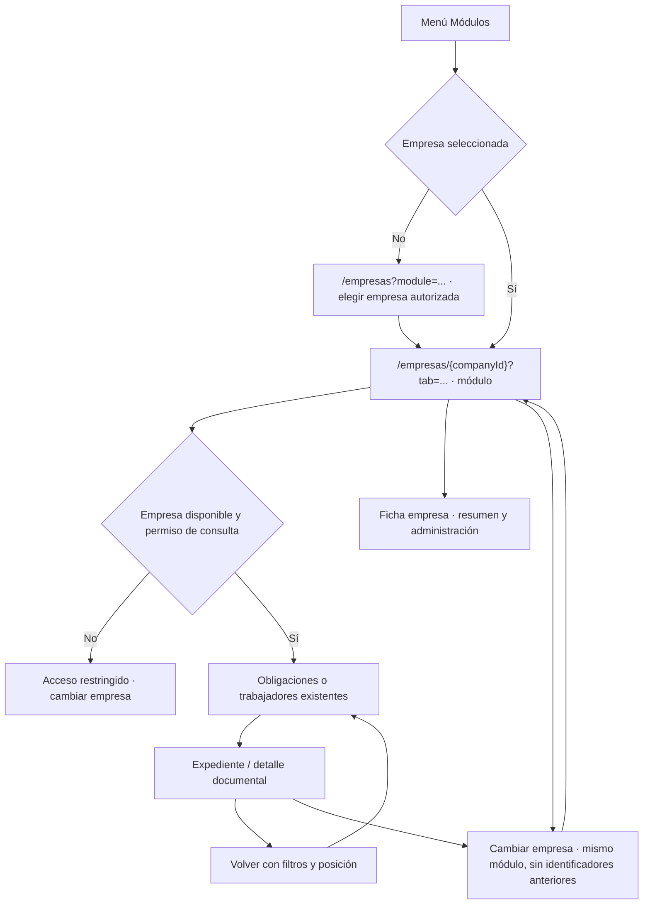

# Acceso directo a los módulos de TaxSkill

**Presentación del 25/10/2026:** [segunda mejora UX/UI](auditoria-ux-ui.md). Se conserva este contrato de rutas y permisos. La barra lateral utiliza iconos y separadores; solo MÓDULOS queda como etiqueta estática. Laboral por trabajador incorpora `laborView` para alternar trabajadores y obligaciones.

Fecha: 24 de octubre de 2026 · America/Lima. Estado: implementado y verificado localmente. No publicado en esta entrega. Referencias: [reglas](../.agents/rules.md), [navegación](flujo-navegacion.md), [carpetas](estructura-carpetas.md), [entornos](desarrollo.md) y [mejoras UX](plan-mejoras-ux-ui.md).

## 1. Decisiones confirmadas y resultado

- Tributario, Laboral por trabajador y Laboral general aparecen en el grupo Módulos de la navegación de escritorio.
- Cada módulo trabaja con una empresa a la vez. Sin una elección previa se abre un selector; no hay selección automática, aunque exista una única empresa elegible.
- En móvil la barra inferior contiene Inicio, Actividades, Módulos y Más. Módulos abre un diálogo con empresa y accesos autorizados. Empresas y Documentos están en Más.
- La ficha de empresa conserva los accesos a módulos, resumen, historial y administración. La pantalla de módulo presenta su propio título, nombre/RUC de la empresa y enlace Ficha empresa.
- Documentos conserva la búsqueda transversal de archivos entregados y versiones; Actividades conserva obligaciones pendientes, vencimientos y adicionales.

## 2. Rutas y flujos

Se mantienen las rutas existentes, sin nuevos endpoints ni tablas:

| Destino | URL |
|---|---|
| Elegir empresa para un módulo | `/empresas?module=tributario`, `laboral_trabajador` o `laboral_general` |
| Tributario de empresa | `/empresas/{companyId}?tab=tributario` |
| Laboral por trabajador | `/empresas/{companyId}?tab=laboral_trabajador` |
| Laboral general | `/empresas/{companyId}?tab=laboral_general` |
| Expediente y detalle documental | Rutas originales de trabajador y `/actividades/{obligationId}` |

El selector permite buscar por nombre, muestra el RUC y mantiene paginación de 25. Consulta el repositorio existente de empresas, restringido a identificadores activos y autorizados para el módulo. No carga el directorio administrativo ni muestra formularios de alta/edición. Sin empresas elegibles no inicia solicitudes y muestra un vacío explícito; el administrador puede ir a Gestionar empresas.

## 3. Contexto, permisos y compatibilidad

El contexto se resuelve antes de renderizar consultas: una URL de empresa/expediente válida sincroniza el selector con su empresa autorizada; un detalle documental puede obtener el contexto de su origen interno validado. La selección queda en memoria por identidad de usuario/estudio y se elimina al cambiar de identidad. No se guarda en almacenamiento persistente.

Dentro de módulos, el selector superior ofrece empresas activas y Seleccionar empresa. Las opciones Todas mis empresas e Internas del estudio se mantienen en las pantallas transversales. La vista de selección de módulo siempre exige elegir empresa, incluso si había otra seleccionada.

Cambiar empresa conserva únicamente el módulo. Retira trabajador, etapa, archivo seleccionado, filtros, página y retorno anteriores. Desde expediente o detalle de módulo conduce al listado del módulo en la nueva empresa. La URL anterior no se consulta bajo el contexto nuevo mientras cambia la navegación. El proveedor de consultas existente sigue cancelando y separando la caché por identidad, autorizaciones y empresa.

Los accesos visibles respetan las capacidades actuales; el administrador conserva su comportamiento previo. Sin permiso no se montan listas documentales ni laborales. Una empresa ajena continúa mostrándose como No encontrada. El estado del menú nunca concede autorización de Data API o Storage.

Se añadieron identificadores explícitos a los elementos de navegación y el tipo `DocumentaryModuleId`, derivado del identificador de módulo existente. Las funciones puras resuelven módulo, empresas elegibles, destino, contexto y elemento activo. El menú móvil ya no depende de posiciones del array. Los validadores existentes de `returnTo` admiten `module`, `tab` y los filtros utilizados; se conserva su límite de profundidad y el rechazo de destinos externos.

## 4. Organización y presentación

- Auth contiene resolución de contexto, metadatos de navegación, barra lateral, barra móvil y enlaces compartidos.
- Empresas contiene la entrada que distingue directorio/selector y el selector de empresa por módulo, usando el repositorio existente.
- Documentos compone el espacio de módulo y reutiliza `ObligationList`; Trabajadores mantiene sus formularios, listado y expediente.
- Los filtros documentales quedan plegados, con contador de filtros activos y los mismos parámetros URL. No se duplican carga, revisión, reglas ni generación.
- El layout autenticado incorpora el límite Suspense requerido por la versión instalada para leer parámetros URL. El primer build detectó su ausencia; se corrigió y se compiló de nuevo.
- Atomic Design, Tailwind, tipos separados, componentes de hasta 170 líneas y Proxy se conservan. No se añadieron dependencias, migraciones ni API routes.

## 5. Validación y evidencias

Todas las cuentas, empresas y archivos usados son ficticios de Docker. No hubo escrituras ni publicación en Cloud, cambios de jobs productivos o mensajes WhatsApp.

| Verificación | Resultado |
|---|---|
| `yarn verify --maxWorkers=1` | Tipos, lint, arquitectura y 308 pruebas / 46 archivos aprobados. |
| Nuevas regresiones | 11 pruebas de rutas, contexto, permisos, selección explícita, ausencia de consultas sin acceso y navegación móvil. |
| H05 live | 174 comprobaciones locales aprobadas; incluye los tres recorridos documentales y gestión laboral. |
| H08 live | 28 comprobaciones API aprobadas exclusivamente en Docker. |
| `yarn build` | Producción compilada; mismas 19 entradas y Proxy. |
| `yarn check:bundle` | Sin secretos administrativos configurados en los paquetes del navegador. |

Recorridos interactivos comprobados con administrador, contador, supervisor y cliente:

- Selector de empresa → módulo directo, sin pasar por Resumen.
- Regreso desde obligación → expediente → listado laboral, conservando búsqueda.
- Cambio desde expediente a otra empresa: conserva Laboral por trabajador y retira el trabajador anterior.
- Cliente con empresa ajena: No encontrada. Login con retorno a un módulo sin permiso de empresa propia: Acceso restringido; cambio a empresa autorizada permite continuar.
- Diálogo Módulos: Escape devuelve foco al botón y desbloquea el fondo.
- Vista móvil sin desbordamiento tras estabilizar la carga. El registro de perfiles contiene solo nombres de perfil y resultados, sin credenciales.

| Primera fila o vacío | 1366 × 768 | 390 × 844 |
|---|---:|---:|
| Selector de empresa | 274 px | 322 px |
| Tributario | 333 px | 348 px |
| Laboral por trabajador | 343 px | 391 px |
| Laboral general | 333 px | 348 px |

Cumplen <400 px en escritorio y <520 px en móvil. Los vacíos en otra empresa comenzaron a 395 px para trabajadores y 392 px para Laboral general. También se revisaron 375, 768, 1024 y 1440 px, con un `h1` por pantalla y sin desbordamiento. El navegador puede informar un píxel adicional de ancho; se registran las dimensiones interiores reales. [Mediciones](hitos/evidencias/capturas/navegacion-modulos/mediciones.json) · [Perfiles](hitos/evidencias/capturas/navegacion-modulos/perfiles.json) · [Recorridos adicionales](hitos/evidencias/capturas/navegacion-modulos/recorridos.json).

Capturas: [selector escritorio](hitos/evidencias/capturas/navegacion-modulos/selector-1366.png), [selector móvil](hitos/evidencias/capturas/navegacion-modulos/selector-390.png), [Tributario escritorio](hitos/evidencias/capturas/navegacion-modulos/tributario-1366.png), [Tributario móvil](hitos/evidencias/capturas/navegacion-modulos/tributario-390.png), [trabajadores escritorio](hitos/evidencias/capturas/navegacion-modulos/laboral_trabajador-1366.png), [trabajadores móvil](hitos/evidencias/capturas/navegacion-modulos/trabajadores-390.png), [panel Módulos](hitos/evidencias/capturas/navegacion-modulos/panel-modulos-390.png) y [módulo sin permiso](hitos/evidencias/capturas/navegacion-modulos/modulo-sin-permiso-390.png).

Los logs están en `test-results/ux-ui/`, ignorado por Git. Continúan las limitaciones de lector de pantalla/zoom real y el aviso de actualización de Next.js registrados en [UX/UI](plan-mejoras-ux-ui.md); esta entrega no certifica WCAG ni cierra esos pendientes. No se realizaron commits ni publicación en esta implementación.
