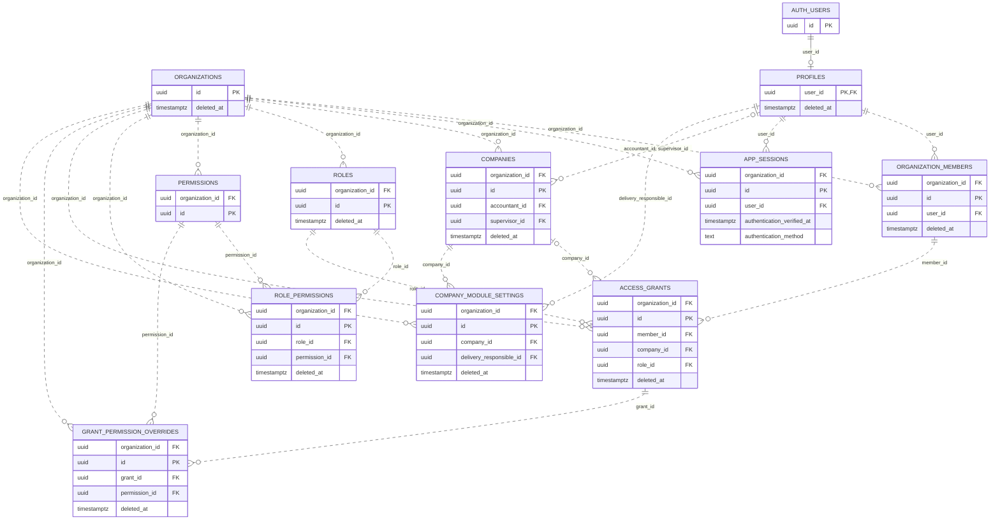
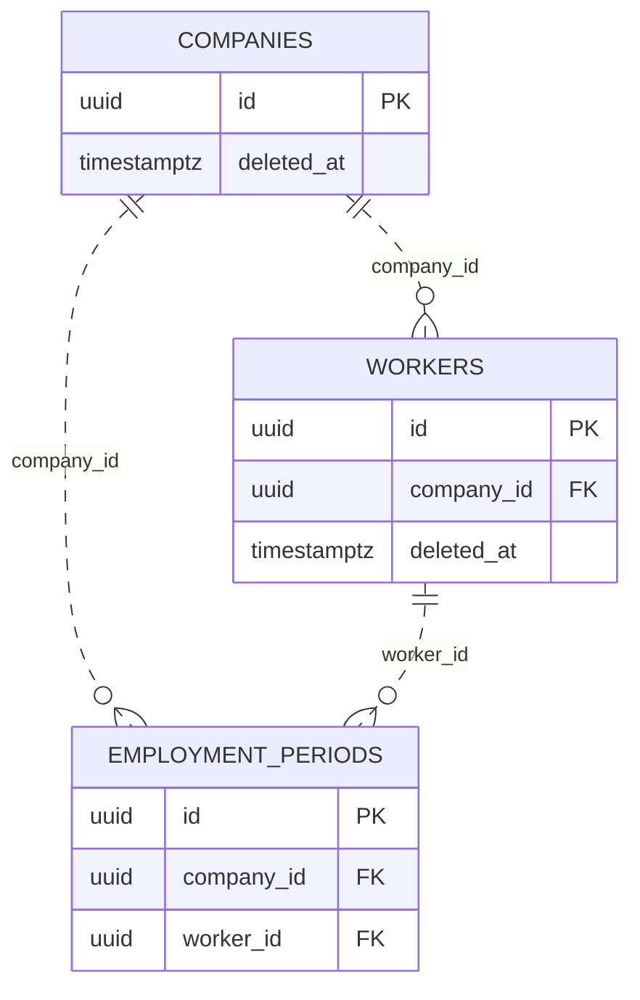
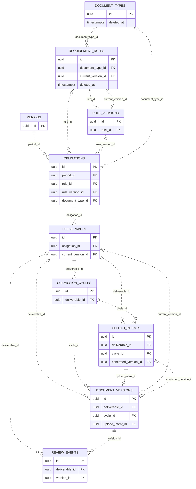
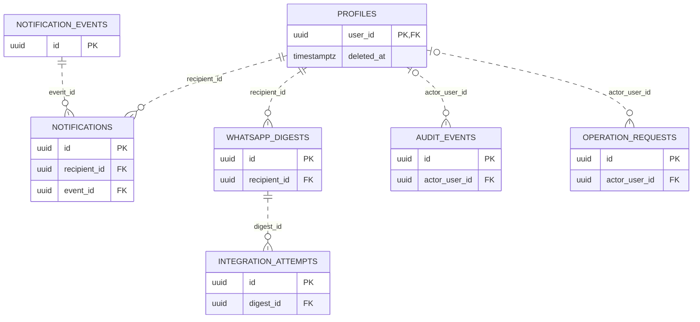
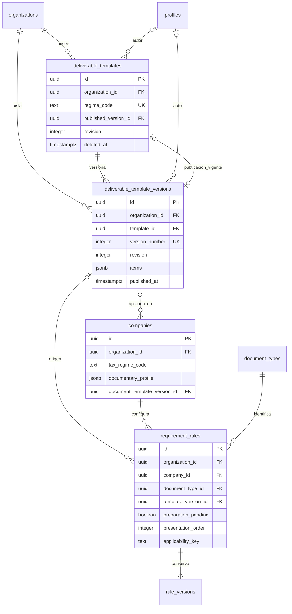
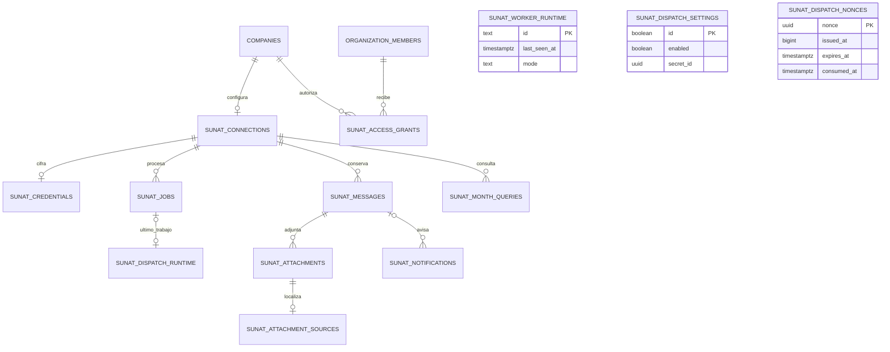

# Tablas DB y diccionario de datos

- **Versión:** 1.0 — 10 de octubre de 2026.
- **Estado:** modelo físico propuesto; no existen migraciones aplicadas por esta entrega.
- **Fuentes:** [diseño técnico 1.1](diseno-tecnico.md), [análisis funcional](analisis_completo_sistema_documental_contable.md) y [resumen ejecutivo](resumen_ejecutivo_sistema_documental_contable.md).
- **Relacionados:** [procesos](diagrama-flujo.md), [navegación](flujo-navegacion.md) y [carpetas](estructura-carpetas.md).

**Extensión implementada H09:** el modelo original de 29 tablas se amplía a **31** mediante plantillas y versiones. Consultar [diccionario H09](#extensión-h09--plantillas-y-perfil-documental) y [migraciones y comprobaciones](hitos/evidencias/h09.md). Las menciones a modelo propuesto/RLS posterior en el cuerpo original son históricas; H08 protege el modelo existente y H09 añade sus propias políticas administrativas. Las migraciones H09 se publicaron posteriormente en Cloud por solicitud del usuario, según [el registro](hitos/evidencias/h09-cloud.json).

**Extensión H10:** el [Buzón SUNAT](buzon-sunat-implementacion.md#persistencia-y-contratos) añade siete tablas públicas y seis privadas, con quince migraciones publicadas en Cloud. Mantiene aislamiento, soft delete de conexión/permisos y conservación de mensajes/trabajos/archivos. Ver [modelo operativo](#extensión-h10--buzón-sunat) y [evidencia de publicación](hitos/evidencias/h10-cloud-migrations.json).

## 1. Alcance y convenciones

Las decisiones recientes del usuario prevalecen sobre las propuestas de los análisis originales. **CONFIRMADO:** Next.js, Supabase directo como Plan A, Atomic Design, RLS posterior y soft delete de entidades administrables con restauración. **BASE TÉCNICA:** los nombres físicos, tipos, campos, restricciones y estructuras JSONB detallados aquí concretan esas decisiones.

Son **29 tablas propias** en public; roles y permissions son tablas distintas. Actividades consulta obligations de clase documentary/additional, sin una tabla paralela de tareas. profiles es global; las otras tablas de negocio llevan organization_id, salvo organizations, que representa ese propietario. permissions es un catálogo técnico sembrado por estudio.

auth.users y Storage son administrados por Supabase. profiles.user_id referencia auth.users(id); no se guardan contraseñas, hashes de credenciales ni tokens en public. Los archivos se identifican por bucket/ruta: no se define una FK a storage.objects. session_id es un identificador Auth verificado, sin acoplar una FK al esquema interno de sesiones.

RLS, la exposición definitiva de funciones/vistas y el control completo de sesiones se completarán en T01/F05. El filtrado operativo descrito aquí no implica que ese aislamiento ya esté configurado.

### 1.1 Tipos y metadatos

- Nombres snake_case; PK UUID. gen_random_uuid() por defecto, excepto profiles.user_id aportado por Auth y document_versions.id reservado por la intención.
- date para fechas civiles; timestamptz para instantes UTC. El negocio interpreta plazos y reportes en America/Lima.
- Remuneraciones numeric(14,2), moneda char(3) inicialmente PEN; tamaños bigint positivos, límite inicial 20.000.000 bytes.
- Códigos/estados text con CHECK de valores admitidos; no enums PostgreSQL que obliguen a cambiar el tipo para cada extensión.
- Los campos comunes aparecen **expandidos en cada diccionario**. created_at/created_by en todas las tablas; updated_at/updated_by/revision cuando hay cambios permitidos; tres campos de soft delete solo donde corresponde.
- En tablas mutables revision>=0. Una operación confiable aumenta revision y actualiza updated_at/updated_by; un DEFAULT now() por sí solo no actualiza una fila al modificarla.
- created_by/updated_by NULL solo para procesos identificados de sistema, cuya identidad queda en audit_events. Cuentas humanas eliminadas conservan su fila para que las FK históricas sigan siendo válidas.
- “—” significa sin DEFAULT: el contrato aporta el dato. “Objeto Jxx” identifica un DEFAULT lógico que la futura migración traducirá al JSON indicado, sin ser una expresión SQL literal.
- CHECK valida la fila. Coincidencias de módulo, membresía, permisos y elementos únicos dentro de JSONB se comprueban en RPC/trigger transaccional cuando dependen de otras filas.

### 1.2 Claves foráneas y ciclos

Todas las FK documentadas usan **ON DELETE RESTRICT / ON UPDATE NO ACTION**; ninguna hace borrado físico en cascada. El soft delete es un UPDATE que conserva claves y referencias.

Cada tabla con organization_id tendrá UNIQUE (organization_id,id), además de su PK. Sus FK a otra tabla propia del estudio se implementan como (organization_id,campo_id) → padre(organization_id,id). Las referencias a profiles son globales por user_id; elegibilidad y membresía se comprueban en la operación.

Agregar claves alternativas de contexto cuando sean necesarias:

| Padre | Clave alternativa para integridad adicional |
|---|---|
| workers | (organization_id,company_id,id) |
| employment_periods | (organization_id,company_id,id) |
| rule_versions | (organization_id,rule_id,id) |
| deliverables | (organization_id,obligation_id,id) |
| submission_cycles | (organization_id,deliverable_id,id) |
| upload_intents | (organization_id,deliverable_id,id) |
| document_versions | (organization_id,deliverable_id,id) |

Así, etapa/trabajador pertenecen a la empresa indicada; versión de regla pertenece a la regla; ciclo, intención, versión y revisión pertenecen al entregable indicado. No basta una FK aislada a un UUID.

Los ciclos requirement_rules.current_version_id ↔ rule_versions y deliverables.current_version_id ↔ document_versions se resuelven creando primero el padre con cabecera NULL, luego el hijo y finalmente actualizando la cabecera en la misma transacción. upload_intents.confirmed_version_id comienza NULL; la versión referencia una intención ya existente. Solo se publican reglas activas con configuración completa y versiones finalizadas.

## 2. Soft delete y conservación

### 2.1 Campos y operación

Las 12 tablas administrables de la matriz siguiente incluyen:

| Campo | Tipo | NULL / DEFAULT | Regla |
|---|---|---|---|
| deleted_at | timestamptz | Sí / NULL | Momento UTC de eliminación lógica. |
| deleted_by | uuid | Sí / NULL | FK profiles(user_id); administrador que elimina. |
| deletion_reason | text | Sí / NULL | Motivo no vacío al eliminar. |

CHECK común: los tres campos son NULL, o los tres están informados y deletion_reason no es vacío. Restaurar limpia los tres; el evento anterior conserva autor, fecha y motivo en auditoría. updated_at/updated_by/revision reflejan ambas operaciones.

Contratos propuestos DeleteEntity/RestoreEntity: tipo y UUID del recurso, motivo, request_id y expected_revision. Solo administrador del estudio con recurso en su alcance. Perfil global requiere que no existan membresías vigentes en otros estudios; una cuenta Auth no se borra. No eliminar/inhabilitar el último administrador efectivo. Operación, cambio y auditoría se confirman transaccionalmente; coordinación privilegiada de Auth conserva la excepción de servidor ya acordada.

Restaurar requiere padres no eliminados, claves de negocio compatibles y recursos existentes. No concede permisos, habilita cuentas, abre periodos laborales ni altera status por sí mismo. No restaura hijos eliminados individualmente.

### 2.2 Efecto operativo y histórico

- Consultas operativas exigen deleted_at IS NULL en la entidad y sus ancestros aplicables. Revisar estudio, empresa, perfil/membresía y rol/asignación/configuración; filtrar solo la fila hija no basta.
- Eliminar estudio/empresa detiene generación y avisos de su alcance; registrar operation_pauses. Eliminar trabajador impide generar documentación nueva para su expediente, sin inventar fecha de cese.
- Eliminar tipo/regla/configuración impide nuevos usos. Eliminar tipo o regla no cancela automáticamente obligaciones ya emitidas: siguen su snapshot y se cancelan explícitamente cuando corresponda.
- Si se elimina un responsable/membresía/asignación, mantener su identidad histórica, marcar incidencia de asignación y avisar al administrador elegible. No omitir silenciosamente obligaciones de otros alcances activos.
- Consulta histórica administrativa puede incluir eliminados, con etiqueta y motivo; no convertir include_deleted en un permiso concedido por el frontend. Su enforcement se completa en T01.
- Registrar pausas deliberadas y retomar el periodo vigente tras restauración; evitar generar pendientes de intervalos excluidos y conservar la clave idempotente de ocurrencias existentes.
- RUC e identidad del trabajador permanecen únicos en su ámbito incluso eliminados. Restaurar la ficha existente en lugar de crear una identidad duplicada.
- Eliminación lógica de una empresa no reescribe cumplimiento histórico ni cancela sus obligaciones. Dashboards operativos la excluyen; reportes históricos administrativos conservan sus resultados.

### 2.3 Matriz de ciclo de vida

| Tabla | Soft delete | Cambios permitidos y conservación |
|---|---|---|
| organizations | Sí | Administrable; restauración con auditoría. |
| profiles | Sí | Administrable; restauración con auditoría. |
| organization_members | Sí | Administrable; restauración con auditoría. |
| app_sessions | No | Cambios de estado/cabecera indicados abajo; conservar historial, sin purga automática. |
| companies | Sí | Administrable; restauración con auditoría. |
| roles | Sí | Administrable; restauración con auditoría. |
| permissions | No | Inmutable/catálogo técnico; conservar. Cambios de contenido mediante nuevos registros o migración controlada. |
| role_permissions | Sí | Administrable; restauración con auditoría. |
| access_grants | Sí | Administrable; restauración con auditoría. |
| grant_permission_overrides | Sí | Administrable; restauración con auditoría. |
| company_module_settings | Sí | Administrable; restauración con auditoría. |
| workers | Sí | Administrable; restauración con auditoría. |
| employment_periods | No | Cambios de estado/cabecera indicados abajo; conservar historial, sin purga automática. |
| document_types | Sí | Administrable; restauración con auditoría. |
| requirement_rules | Sí | Administrable; restauración con auditoría. |
| rule_versions | No | Inmutable/catálogo técnico; conservar. Cambios de contenido mediante nuevos registros o migración controlada. |
| periods | No | Inmutable/catálogo técnico; conservar. Cambios de contenido mediante nuevos registros o migración controlada. |
| obligations | No | Cambios de estado/cabecera indicados abajo; conservar historial, sin purga automática. |
| deliverables | No | Cambios de estado/cabecera indicados abajo; conservar historial, sin purga automática. |
| submission_cycles | No | Cambios de estado/cabecera indicados abajo; conservar historial, sin purga automática. |
| upload_intents | No | Cambios de estado/cabecera indicados abajo; conservar historial, sin purga automática. |
| document_versions | No | Inmutable/catálogo técnico; conservar. Cambios de contenido mediante nuevos registros o migración controlada. |
| review_events | No | Inmutable/catálogo técnico; conservar. Cambios de contenido mediante nuevos registros o migración controlada. |
| notification_events | No | Inmutable/catálogo técnico; conservar. Cambios de contenido mediante nuevos registros o migración controlada. |
| notifications | No | Cambios de estado/cabecera indicados abajo; conservar historial, sin purga automática. |
| whatsapp_digests | No | Cambios de estado/cabecera indicados abajo; conservar historial, sin purga automática. |
| integration_attempts | No | Inmutable/catálogo técnico; conservar. Cambios de contenido mediante nuevos registros o migración controlada. |
| audit_events | No | Inmutable/catálogo técnico; conservar. Cambios de contenido mediante nuevos registros o migración controlada. |
| operation_requests | No | Cambios de estado/cabecera indicados abajo; conservar historial, sin purga automática. |

Inhabilitar usuario usa enabled/active y revocación; empresa inactiva usa status; cese usa end_date; pausa de regla usa active/operation_pauses. Ninguna de esas operaciones equivale a eliminar una fila. Obligaciones se anulan con disposition=cancelled y motivo; No aplica es otra disposición. Archivos/versiones/revisiones/auditoría no admiten soft delete.

La única limpieza destructiva prevista elimina objetos temporales de recepción sin versión confirmada y sin validación en curso. Conservar sus registros de intención/resultados. No aplicar ese TTL a archivos finales ni registros históricos.

## 3. Diagrama E-R completo

Se muestran PK, todas las columnas FK y deleted_at de tablas administrables; los demás campos están en el diccionario. Aristas discontinuas significan relación no identificadora, pues el hijo tiene su propia identidad. El vínculo Auth/profiles comparte identidad. Varias FK del mismo hijo hacia el mismo padre con igual nulabilidad se agrupan en una arista etiquetada con sus columnas.

Las cardinalidades consideran FK y restricciones únicas: una versión puede ser cabecera de su propia regla/entregable; una intención produce como máximo una versión confirmada. La condición “versión del mismo entregable/regla” se completa con las claves compuestas de 1.2. Al finalizar una obligación se exige al menos un entregable/ciclo mediante operación transaccional, aunque la FK por sí sola permite cero hijos durante creación.

```mermaid
erDiagram
    direction TB
    AUTH_USERS {
        uuid id PK
    }
    ORGANIZATIONS {
        uuid id PK
        uuid created_by FK
        uuid updated_by FK
        timestamptz deleted_at
        uuid deleted_by FK
    }
    PROFILES {
        uuid user_id PK, FK
        uuid created_by FK
        uuid updated_by FK
        timestamptz deleted_at
        uuid deleted_by FK
    }
    ORGANIZATION_MEMBERS {
        uuid id PK
        uuid organization_id FK
        uuid user_id FK
        uuid created_by FK
        uuid updated_by FK
        timestamptz deleted_at
        uuid deleted_by FK
    }
    APP_SESSIONS {
        uuid id PK
        uuid organization_id FK
        uuid user_id FK
        timestamptz authentication_verified_at
        text authentication_method
        uuid created_by FK
        uuid updated_by FK
    }
    COMPANIES {
        uuid id PK
        uuid organization_id FK
        uuid accountant_id FK
        uuid supervisor_id FK
        uuid created_by FK
        uuid updated_by FK
        timestamptz deleted_at
        uuid deleted_by FK
    }
    ROLES {
        uuid id PK
        uuid organization_id FK
        uuid created_by FK
        uuid updated_by FK
        timestamptz deleted_at
        uuid deleted_by FK
    }
    PERMISSIONS {
        uuid id PK
        uuid organization_id FK
        uuid created_by FK
    }
    ROLE_PERMISSIONS {
        uuid id PK
        uuid organization_id FK
        uuid role_id FK
        uuid permission_id FK
        uuid created_by FK
        uuid updated_by FK
        timestamptz deleted_at
        uuid deleted_by FK
    }
    ACCESS_GRANTS {
        uuid id PK
        uuid organization_id FK
        uuid member_id FK
        uuid company_id FK
        uuid role_id FK
        uuid created_by FK
        uuid updated_by FK
        timestamptz deleted_at
        uuid deleted_by FK
    }
    GRANT_PERMISSION_OVERRIDES {
        uuid id PK
        uuid organization_id FK
        uuid grant_id FK
        uuid permission_id FK
        uuid created_by FK
        uuid updated_by FK
        timestamptz deleted_at
        uuid deleted_by FK
    }
    COMPANY_MODULE_SETTINGS {
        uuid id PK
        uuid organization_id FK
        uuid company_id FK
        uuid delivery_responsible_id FK
        uuid created_by FK
        uuid updated_by FK
        timestamptz deleted_at
        uuid deleted_by FK
    }
    WORKERS {
        uuid id PK
        uuid organization_id FK
        uuid company_id FK
        uuid created_by FK
        uuid updated_by FK
        timestamptz deleted_at
        uuid deleted_by FK
    }
    EMPLOYMENT_PERIODS {
        uuid id PK
        uuid organization_id FK
        uuid company_id FK
        uuid worker_id FK
        uuid created_by FK
        uuid updated_by FK
    }
    DOCUMENT_TYPES {
        uuid id PK
        uuid organization_id FK
        uuid created_by FK
        uuid updated_by FK
        timestamptz deleted_at
        uuid deleted_by FK
    }
    REQUIREMENT_RULES {
        uuid id PK
        uuid organization_id FK
        uuid document_type_id FK
        uuid company_id FK
        uuid employment_period_id FK
        uuid delivery_responsible_id FK
        uuid current_version_id FK
        uuid created_by FK
        uuid updated_by FK
        timestamptz deleted_at
        uuid deleted_by FK
    }
    RULE_VERSIONS {
        uuid id PK
        uuid organization_id FK
        uuid rule_id FK
        uuid created_by FK
    }
    PERIODS {
        uuid id PK
        uuid organization_id FK
        uuid created_by FK
    }
    OBLIGATIONS {
        uuid id PK
        uuid organization_id FK
        uuid company_id FK
        uuid employment_period_id FK
        uuid period_id FK
        uuid rule_id FK
        uuid rule_version_id FK
        uuid document_type_id FK
        uuid delivery_responsible_id FK
        uuid created_by FK
        uuid updated_by FK
    }
    DELIVERABLES {
        uuid id PK
        uuid organization_id FK
        uuid obligation_id FK
        uuid current_version_id FK
        uuid created_by FK
        uuid updated_by FK
    }
    SUBMISSION_CYCLES {
        uuid id PK
        uuid organization_id FK
        uuid deliverable_id FK
        uuid created_by FK
        uuid updated_by FK
    }
    UPLOAD_INTENTS {
        uuid id PK
        uuid organization_id FK
        uuid deliverable_id FK
        uuid cycle_id FK
        uuid user_id FK
        uuid confirmed_version_id FK
        uuid created_by FK
        uuid updated_by FK
    }
    DOCUMENT_VERSIONS {
        uuid id PK
        uuid organization_id FK
        uuid deliverable_id FK
        uuid cycle_id FK
        uuid upload_intent_id FK
        uuid uploaded_by FK
        uuid created_by FK
    }
    REVIEW_EVENTS {
        uuid id PK
        uuid organization_id FK
        uuid deliverable_id FK
        uuid version_id FK
        uuid reviewer_id FK
        uuid created_by FK
    }
    NOTIFICATION_EVENTS {
        uuid id PK
        uuid organization_id FK
        uuid company_id FK
        uuid obligation_id FK
        uuid cycle_id FK
        uuid review_event_id FK
        uuid created_by FK
    }
    NOTIFICATIONS {
        uuid id PK
        uuid organization_id FK
        uuid recipient_id FK
        uuid event_id FK
        uuid created_by FK
        uuid updated_by FK
    }
    WHATSAPP_DIGESTS {
        uuid id PK
        uuid organization_id FK
        uuid recipient_id FK
        uuid created_by FK
        uuid updated_by FK
    }
    INTEGRATION_ATTEMPTS {
        uuid id PK
        uuid organization_id FK
        uuid digest_id FK
        uuid created_by FK
    }
    AUDIT_EVENTS {
        uuid id PK
        uuid organization_id FK
        uuid actor_user_id FK
        uuid company_id FK
        uuid created_by FK
    }
    OPERATION_REQUESTS {
        uuid id PK
        uuid organization_id FK
        uuid actor_user_id FK
        uuid created_by FK
        uuid updated_by FK
    }
    PROFILES o|..o{ ORGANIZATIONS : "created_by, updated_by, deleted_by"
    AUTH_USERS ||--o| PROFILES : "user_id"
    PROFILES o|..o{ PROFILES : "created_by, updated_by, deleted_by"
    ORGANIZATIONS ||..o{ ORGANIZATION_MEMBERS : "organization_id"
    PROFILES ||..o{ ORGANIZATION_MEMBERS : "user_id"
    PROFILES o|..o{ ORGANIZATION_MEMBERS : "created_by, updated_by, deleted_by"
    ORGANIZATIONS ||..o{ APP_SESSIONS : "organization_id"
    PROFILES ||..o{ APP_SESSIONS : "user_id"
    PROFILES o|..o{ APP_SESSIONS : "created_by, updated_by"
    ORGANIZATIONS ||..o{ COMPANIES : "organization_id"
    PROFILES o|..o{ COMPANIES : "accountant_id, supervisor_id, created_by, updated_by, deleted_by"
    ORGANIZATIONS ||..o{ ROLES : "organization_id"
    PROFILES o|..o{ ROLES : "created_by, updated_by, deleted_by"
    ORGANIZATIONS ||..o{ PERMISSIONS : "organization_id"
    PROFILES o|..o{ PERMISSIONS : "created_by"
    ORGANIZATIONS ||..o{ ROLE_PERMISSIONS : "organization_id"
    ROLES ||..o{ ROLE_PERMISSIONS : "role_id"
    PERMISSIONS ||..o{ ROLE_PERMISSIONS : "permission_id"
    PROFILES o|..o{ ROLE_PERMISSIONS : "created_by, updated_by, deleted_by"
    ORGANIZATIONS ||..o{ ACCESS_GRANTS : "organization_id"
    ORGANIZATION_MEMBERS ||..o{ ACCESS_GRANTS : "member_id"
    COMPANIES o|..o{ ACCESS_GRANTS : "company_id"
    ROLES ||..o{ ACCESS_GRANTS : "role_id"
    PROFILES o|..o{ ACCESS_GRANTS : "created_by, updated_by, deleted_by"
    ORGANIZATIONS ||..o{ GRANT_PERMISSION_OVERRIDES : "organization_id"
    ACCESS_GRANTS ||..o{ GRANT_PERMISSION_OVERRIDES : "grant_id"
    PERMISSIONS ||..o{ GRANT_PERMISSION_OVERRIDES : "permission_id"
    PROFILES o|..o{ GRANT_PERMISSION_OVERRIDES : "created_by, updated_by, deleted_by"
    ORGANIZATIONS ||..o{ COMPANY_MODULE_SETTINGS : "organization_id"
    COMPANIES ||..o{ COMPANY_MODULE_SETTINGS : "company_id"
    PROFILES ||..o{ COMPANY_MODULE_SETTINGS : "delivery_responsible_id"
    PROFILES o|..o{ COMPANY_MODULE_SETTINGS : "created_by, updated_by, deleted_by"
    ORGANIZATIONS ||..o{ WORKERS : "organization_id"
    COMPANIES ||..o{ WORKERS : "company_id"
    PROFILES o|..o{ WORKERS : "created_by, updated_by, deleted_by"
    ORGANIZATIONS ||..o{ EMPLOYMENT_PERIODS : "organization_id"
    COMPANIES ||..o{ EMPLOYMENT_PERIODS : "company_id"
    WORKERS ||..o{ EMPLOYMENT_PERIODS : "worker_id"
    PROFILES o|..o{ EMPLOYMENT_PERIODS : "created_by, updated_by"
    ORGANIZATIONS ||..o{ DOCUMENT_TYPES : "organization_id"
    PROFILES o|..o{ DOCUMENT_TYPES : "created_by, updated_by, deleted_by"
    ORGANIZATIONS ||..o{ REQUIREMENT_RULES : "organization_id"
    DOCUMENT_TYPES o|..o{ REQUIREMENT_RULES : "document_type_id"
    COMPANIES o|..o{ REQUIREMENT_RULES : "company_id"
    EMPLOYMENT_PERIODS o|..o{ REQUIREMENT_RULES : "employment_period_id"
    PROFILES o|..o{ REQUIREMENT_RULES : "delivery_responsible_id, created_by, updated_by, deleted_by"
    RULE_VERSIONS o|..o| REQUIREMENT_RULES : "current_version_id"
    ORGANIZATIONS ||..o{ RULE_VERSIONS : "organization_id"
    REQUIREMENT_RULES ||..o{ RULE_VERSIONS : "rule_id"
    PROFILES o|..o{ RULE_VERSIONS : "created_by"
    ORGANIZATIONS ||..o{ PERIODS : "organization_id"
    PROFILES o|..o{ PERIODS : "created_by"
    ORGANIZATIONS ||..o{ OBLIGATIONS : "organization_id"
    COMPANIES o|..o{ OBLIGATIONS : "company_id"
    EMPLOYMENT_PERIODS o|..o{ OBLIGATIONS : "employment_period_id"
    PERIODS ||..o{ OBLIGATIONS : "period_id"
    REQUIREMENT_RULES o|..o{ OBLIGATIONS : "rule_id"
    RULE_VERSIONS o|..o{ OBLIGATIONS : "rule_version_id"
    DOCUMENT_TYPES o|..o{ OBLIGATIONS : "document_type_id"
    PROFILES o|..o{ OBLIGATIONS : "delivery_responsible_id, created_by, updated_by"
    ORGANIZATIONS ||..o{ DELIVERABLES : "organization_id"
    OBLIGATIONS ||..o{ DELIVERABLES : "obligation_id"
    DOCUMENT_VERSIONS o|..o| DELIVERABLES : "current_version_id"
    PROFILES o|..o{ DELIVERABLES : "created_by, updated_by"
    ORGANIZATIONS ||..o{ SUBMISSION_CYCLES : "organization_id"
    DELIVERABLES ||..o{ SUBMISSION_CYCLES : "deliverable_id"
    PROFILES o|..o{ SUBMISSION_CYCLES : "created_by, updated_by"
    ORGANIZATIONS ||..o{ UPLOAD_INTENTS : "organization_id"
    DELIVERABLES ||..o{ UPLOAD_INTENTS : "deliverable_id"
    SUBMISSION_CYCLES ||..o{ UPLOAD_INTENTS : "cycle_id"
    PROFILES ||..o{ UPLOAD_INTENTS : "user_id"
    DOCUMENT_VERSIONS o|..o| UPLOAD_INTENTS : "confirmed_version_id"
    PROFILES o|..o{ UPLOAD_INTENTS : "created_by, updated_by"
    ORGANIZATIONS ||..o{ DOCUMENT_VERSIONS : "organization_id"
    DELIVERABLES ||..o{ DOCUMENT_VERSIONS : "deliverable_id"
    SUBMISSION_CYCLES ||..o{ DOCUMENT_VERSIONS : "cycle_id"
    UPLOAD_INTENTS ||..o| DOCUMENT_VERSIONS : "upload_intent_id"
    PROFILES ||..o{ DOCUMENT_VERSIONS : "uploaded_by"
    PROFILES o|..o{ DOCUMENT_VERSIONS : "created_by"
    ORGANIZATIONS ||..o{ REVIEW_EVENTS : "organization_id"
    DELIVERABLES ||..o{ REVIEW_EVENTS : "deliverable_id"
    DOCUMENT_VERSIONS ||..o{ REVIEW_EVENTS : "version_id"
    PROFILES ||..o{ REVIEW_EVENTS : "reviewer_id"
    PROFILES o|..o{ REVIEW_EVENTS : "created_by"
    ORGANIZATIONS ||..o{ NOTIFICATION_EVENTS : "organization_id"
    COMPANIES o|..o{ NOTIFICATION_EVENTS : "company_id"
    OBLIGATIONS o|..o{ NOTIFICATION_EVENTS : "obligation_id"
    SUBMISSION_CYCLES o|..o{ NOTIFICATION_EVENTS : "cycle_id"
    REVIEW_EVENTS o|..o{ NOTIFICATION_EVENTS : "review_event_id"
    PROFILES o|..o{ NOTIFICATION_EVENTS : "created_by"
    ORGANIZATIONS ||..o{ NOTIFICATIONS : "organization_id"
    PROFILES ||..o{ NOTIFICATIONS : "recipient_id"
    NOTIFICATION_EVENTS ||..o{ NOTIFICATIONS : "event_id"
    PROFILES o|..o{ NOTIFICATIONS : "created_by, updated_by"
    ORGANIZATIONS ||..o{ WHATSAPP_DIGESTS : "organization_id"
    PROFILES ||..o{ WHATSAPP_DIGESTS : "recipient_id"
    PROFILES o|..o{ WHATSAPP_DIGESTS : "created_by, updated_by"
    ORGANIZATIONS ||..o{ INTEGRATION_ATTEMPTS : "organization_id"
    WHATSAPP_DIGESTS ||..o{ INTEGRATION_ATTEMPTS : "digest_id"
    PROFILES o|..o{ INTEGRATION_ATTEMPTS : "created_by"
    ORGANIZATIONS ||..o{ AUDIT_EVENTS : "organization_id"
    PROFILES o|..o{ AUDIT_EVENTS : "actor_user_id, created_by"
    COMPANIES o|..o{ AUDIT_EVENTS : "company_id"
    ORGANIZATIONS ||..o{ OPERATION_REQUESTS : "organization_id"
    PROFILES o|..o{ OPERATION_REQUESTS : "actor_user_id, created_by, updated_by"
```




### Vistas de apoyo por dominio

El diagrama anterior conserva todas las FK. Las siguientes vistas reducen el tamaño para lectura habitual: omiten las aristas repetidas de propietario y metadatos de autoría, salvo que sean parte del alcance del dominio. No representan tablas adicionales ni reemplazan restricciones del diccionario. Para revisar un campo particular, usar el índice de tablas y el E-R completo con ampliación.

### 3.1 Acceso y configuración de empresas

Membresías, roles/acciones, alcance por empresa/módulo y responsable configurado. El alcance interno se representa con company_id NULL, no con una empresa ficticia.



### 3.2 Expediente laboral

Una ficha conserva múltiples etapas laborales; cese y reingreso no eliminan la identidad. Salario y fechas se conservan en cada etapa, conforme al diccionario.



### 3.3 Motor documental y revisión

Reglas versionadas crean obligaciones y slots; ciclos controlan entrega, versiones conservan archivos y eventos conservan decisiones. Los punteros de versión vigente no sustituyen el historial.



### 3.4 Notificaciones, integración y evidencia

Avisos propios y resúmenes conservados con intentos/callbacks. audit_events.resource_id y JSON de resultados son referencias lógicas verificadas en operaciones, no FK polimórficas ficticias.



## 4. Diccionario completo de tablas

### Índice de tablas

- [organizations](#tabla-01)
- [profiles](#tabla-02)
- [organization_members](#tabla-03)
- [app_sessions](#tabla-04)
- [companies](#tabla-05)
- [roles](#tabla-06)
- [permissions](#tabla-07)
- [role_permissions](#tabla-08)
- [access_grants](#tabla-09)
- [grant_permission_overrides](#tabla-10)
- [company_module_settings](#tabla-11)
- [workers](#tabla-12)
- [employment_periods](#tabla-13)
- [document_types](#tabla-14)
- [requirement_rules](#tabla-15)
- [rule_versions](#tabla-16)
- [periods](#tabla-17)
- [obligations](#tabla-18)
- [deliverables](#tabla-19)
- [submission_cycles](#tabla-20)
- [upload_intents](#tabla-21)
- [document_versions](#tabla-22)
- [review_events](#tabla-23)
- [notification_events](#tabla-24)
- [notifications](#tabla-25)
- [whatsapp_digests](#tabla-26)
- [integration_attempts](#tabla-27)
- [audit_events](#tabla-28)
- [operation_requests](#tabla-29)

<a id="tabla-01"></a>

### 4.1 organizations

Estudio contable y parámetros operativos.

**Clasificación:** administrable con soft delete. **PK:** `id`. **Propietario:** global (profiles) o raíz del estudio (organizations).

| Campo | Tipo PostgreSQL | NULL | DEFAULT | Claves / referencia | Descripción |
|---|---|---|---|---|---|
| `id` | `uuid` | No | gen_random_uuid() | PK | Identificador inmutable. |
| `name` | `text` | No | — | — | Nombre del estudio. |
| `country_code` | `char(2)` | No | 'PE' | — | País de operación. |
| `timezone` | `text` | No | 'America/Lima' | — | Zona IANA; conversión de fechas de negocio. |
| `status` | `text` | No | 'active' | — | active, inactive. |
| `settings` | `jsonb` | No | Objeto J01 | — | Parámetros descritos en J01. |
| `operation_pauses` | `jsonb` | No | [] | — | Pausas del estudio y restauraciones; J02. |
| `created_at` | `timestamptz` | No | now() | — | Creación registrada en UTC. |
| `created_by` | `uuid` | Sí | NULL | FK → profiles.user_id; RESTRICT / NO ACTION | Autor de creación; NULL para trabajo identificado de sistema. |
| `updated_at` | `timestamptz` | No | now() | — | Última modificación; operación/trigger lo actualiza. |
| `updated_by` | `uuid` | Sí | NULL | FK → profiles.user_id; RESTRICT / NO ACTION | Autor de modificación; NULL para sistema. |
| `revision` | `integer` | No | 0 | — | Contador de concurrencia; >=0 e incrementado por operación. |
| `deleted_at` | `timestamptz` | Sí | NULL | — | Marca de eliminación lógica; NULL significa no eliminado. |
| `deleted_by` | `uuid` | Sí | NULL | FK → profiles.user_id; RESTRICT / NO ACTION | Administrador que elimina; requerido si deleted_at existe. |
| `deletion_reason` | `text` | Sí | NULL | — | Motivo obligatorio al eliminar; NULL sin eliminación. |

**Restricciones y ciclo de vida:**

- revision>=0; updated_at/updated_by se actualizan de forma confiable. Solo modificar los campos que este ciclo permite.
- CHECK conjunto de deleted_at/deleted_by/deletion_reason y reglas de eliminación/restauración de la sección 2.
- Nombre no vacío; country_code de dos letras mayúsculas.
- timezone = America/Lima en el MVP; status IN (active,inactive).
- No se habilita administración de varios estudios en esta versión.

**Índices:**

- Índice de operación: (status) WHERE deleted_at IS NULL.

**Relaciones:** `created_by` → `profiles.user_id` (cero/uno padre por fila; padre admite múltiples filas salvo UNIQUE específico); `updated_by` → `profiles.user_id` (cero/uno padre por fila; padre admite múltiples filas salvo UNIQUE específico); `deleted_by` → `profiles.user_id` (cero/uno padre por fila; padre admite múltiples filas salvo UNIQUE específico).

<a id="tabla-02"></a>

### 4.2 profiles

Identidad global vinculada a Supabase Auth; sin contraseñas.

**Clasificación:** administrable con soft delete. **PK:** `user_id`. **Propietario:** global (profiles) o raíz del estudio (organizations).

| Campo | Tipo PostgreSQL | NULL | DEFAULT | Claves / referencia | Descripción |
|---|---|---|---|---|---|
| `user_id` | `uuid` | No | — | PK; FK → auth.users.id; RESTRICT / NO ACTION | Identidad suministrada por Auth. |
| `email` | `text` | No | — | — | Copia normalizada en minúsculas del identificador Auth. |
| `full_name` | `text` | No | — | — | Nombre visible del usuario. |
| `whatsapp_phone` | `text` | Sí | — | — | Número internacional E.164; nullable si no usa WhatsApp. |
| `enabled` | `boolean` | No | true | — | Inhabilitación global de acceso al negocio. |
| `provisioning_status` | `text` | No | 'pending' | — | pending, ready, failed. |
| `created_at` | `timestamptz` | No | now() | — | Creación registrada en UTC. |
| `created_by` | `uuid` | Sí | NULL | FK → profiles.user_id; RESTRICT / NO ACTION | Autor de creación; NULL para trabajo identificado de sistema. |
| `updated_at` | `timestamptz` | No | now() | — | Última modificación; operación/trigger lo actualiza. |
| `updated_by` | `uuid` | Sí | NULL | FK → profiles.user_id; RESTRICT / NO ACTION | Autor de modificación; NULL para sistema. |
| `revision` | `integer` | No | 0 | — | Contador de concurrencia; >=0 e incrementado por operación. |
| `deleted_at` | `timestamptz` | Sí | NULL | — | Marca de eliminación lógica; NULL significa no eliminado. |
| `deleted_by` | `uuid` | Sí | NULL | FK → profiles.user_id; RESTRICT / NO ACTION | Administrador que elimina; requerido si deleted_at existe. |
| `deletion_reason` | `text` | Sí | NULL | — | Motivo obligatorio al eliminar; NULL sin eliminación. |

**Restricciones y ciclo de vida:**

- revision>=0; updated_at/updated_by se actualizan de forma confiable. Solo modificar los campos que este ciclo permite.
- CHECK conjunto de deleted_at/deleted_by/deletion_reason y reglas de eliminación/restauración de la sección 2.
- PK user_id y FK auth.users(id), sin UUID nuevo.
- UNIQUE lower(email), incluyendo eliminados; sincronizar con Auth, sin editar solo la copia.
- Teléfono, si existe: + seguido de 8–15 dígitos; nombre y correo no vacíos.
- El administrador gestiona membresías de su estudio; eliminar el perfil global solo si no quedan membresías vigentes en ningún estudio. No borrar Auth.
- Mantener la identidad referenciada por la auditoría; no restaurar enabled ni sesiones implícitamente.

**Índices:**

- Índice lower(email) UNIQUE; (enabled,provisioning_status) WHERE deleted_at IS NULL.

**Relaciones:** `user_id` → `auth.users.id` (cero/uno profile por Auth; exactamente un Auth por profile, identidad compartida); `created_by` → `profiles.user_id` (cero/uno padre por fila; padre admite múltiples filas); `updated_by` → `profiles.user_id` (cero/uno padre por fila; padre admite múltiples filas); `deleted_by` → `profiles.user_id` (cero/uno padre por fila; padre admite múltiples filas).

<a id="tabla-03"></a>

### 4.3 organization_members

Membresía del usuario, perfil interno/cliente y administración del estudio.

**Clasificación:** administrable con soft delete. **PK:** `id`. **Propietario:** organization_id.

| Campo | Tipo PostgreSQL | NULL | DEFAULT | Claves / referencia | Descripción |
|---|---|---|---|---|---|
| `id` | `uuid` | No | gen_random_uuid() | PK | Identificador inmutable. |
| `organization_id` | `uuid` | No | — | FK → organizations.id; RESTRICT / NO ACTION | Estudio propietario; participa en FK compuestas. |
| `user_id` | `uuid` | No | — | FK → profiles.user_id; RESTRICT / NO ACTION | Identidad del miembro. |
| `member_type` | `text` | No | — | — | internal, client. |
| `is_admin` | `boolean` | No | false | — | Facultad de administrador del estudio. |
| `active` | `boolean` | No | true | — | Membresía habilitada. |
| `created_at` | `timestamptz` | No | now() | — | Creación registrada en UTC. |
| `created_by` | `uuid` | Sí | NULL | FK → profiles.user_id; RESTRICT / NO ACTION | Autor de creación; NULL para trabajo identificado de sistema. |
| `updated_at` | `timestamptz` | No | now() | — | Última modificación; operación/trigger lo actualiza. |
| `updated_by` | `uuid` | Sí | NULL | FK → profiles.user_id; RESTRICT / NO ACTION | Autor de modificación; NULL para sistema. |
| `revision` | `integer` | No | 0 | — | Contador de concurrencia; >=0 e incrementado por operación. |
| `deleted_at` | `timestamptz` | Sí | NULL | — | Marca de eliminación lógica; NULL significa no eliminado. |
| `deleted_by` | `uuid` | Sí | NULL | FK → profiles.user_id; RESTRICT / NO ACTION | Administrador que elimina; requerido si deleted_at existe. |
| `deletion_reason` | `text` | Sí | NULL | — | Motivo obligatorio al eliminar; NULL sin eliminación. |

**Restricciones y ciclo de vida:**

- UNIQUE (organization_id,id); FK compuestas del estudio según 1.2.
- revision>=0; updated_at/updated_by se actualizan de forma confiable. Solo modificar los campos que este ciclo permite.
- CHECK conjunto de deleted_at/deleted_by/deletion_reason y reglas de eliminación/restauración de la sección 2.
- UNIQUE (organization_id,user_id), también con soft delete; restaurar antes de volver a asignar.
- is_admin implica member_type=internal; client nunca administra.
- No inhabilitar/eliminar al último administrador efectivo del estudio.
- Ser responsable no crea una membresía ni concede permisos.

**Índices:**

- (organization_id,active,user_id) WHERE deleted_at IS NULL.

**Relaciones:** `organization_id` → `organizations.id` (un padre por fila; padre admite múltiples filas salvo UNIQUE específico); `user_id` → `profiles.user_id` (un padre por fila; padre admite múltiples filas salvo UNIQUE específico); `created_by` → `profiles.user_id` (cero/uno padre por fila; padre admite múltiples filas salvo UNIQUE específico); `updated_by` → `profiles.user_id` (cero/uno padre por fila; padre admite múltiples filas salvo UNIQUE específico); `deleted_by` → `profiles.user_id` (cero/uno padre por fila; padre admite múltiples filas salvo UNIQUE específico).

<a id="tabla-04"></a>

### 4.4 app_sessions

Registro técnico de admisión y revocación. H08 incorpora el registro Auth y la verificación por hook; consultar [seguridad](seguridad-produccion.md) y el estado de instalación local/Cloud en [evidencias](hitos/evidencias/h08.md).

**Clasificación:** registro conservado con cambios controlados. **PK:** `id`. **Propietario:** organization_id.

| Campo | Tipo PostgreSQL | NULL | DEFAULT | Claves / referencia | Descripción |
|---|---|---|---|---|---|
| `id` | `uuid` | No | gen_random_uuid() | PK | Identificador inmutable. |
| `organization_id` | `uuid` | No | — | FK → organizations.id; RESTRICT / NO ACTION | Estudio propietario; participa en FK compuestas. |
| `user_id` | `uuid` | No | — | FK → profiles.user_id; RESTRICT / NO ACTION | Usuario de la sesión. |
| `session_id` | `uuid` | No | — | — | session_id emitido por Auth; identificador verificado, sin FK al esquema interno de sesiones. |
| `registered_at` | `timestamptz` | No | now() | — | Admisión confiable de la sesión. |
| `authentication_verified_at` | `timestamptz` | Sí | NULL | — | Verificación confiable por Custom Access Token hook; fila Auth por sí sola no concede acceso. |
| `authentication_method` | `text` | Sí | NULL | CHECK: `password` | Método admitido por el hook, nunca declarado libremente por navegador. |
| `last_seen_at` | `timestamptz` | Sí | — | — | Última actividad registrada de forma acotada. |
| `revoked_at` | `timestamptz` | Sí | — | — | Revocación explícita. |
| `revocation_reason` | `text` | Sí | — | — | Motivo de revocación. |
| `created_at` | `timestamptz` | No | now() | — | Creación registrada en UTC. |
| `created_by` | `uuid` | Sí | NULL | FK → profiles.user_id; RESTRICT / NO ACTION | Autor de creación; NULL para trabajo identificado de sistema. |
| `updated_at` | `timestamptz` | No | now() | — | Última modificación; operación/trigger lo actualiza. |
| `updated_by` | `uuid` | Sí | NULL | FK → profiles.user_id; RESTRICT / NO ACTION | Autor de modificación; NULL para sistema. |
| `revision` | `integer` | No | 0 | — | Contador de concurrencia; >=0 e incrementado por operación. |

**Restricciones y ciclo de vida:**

- UNIQUE (organization_id,id); FK compuestas del estudio según 1.2.
- revision>=0; updated_at/updated_by se actualizan de forma confiable. Solo modificar los campos que este ciclo permite.
- UNIQUE (organization_id,session_id); user_id debe tener membresía del estudio.
- revoked_at y revocation_reason se establecen juntos; revocación posterior o igual al registro.
- No restaurar una sesión revocada: una nueva autenticación produce otro session_id.
- `authentication_verified_at` y `authentication_method` son ambos NULL o ambos no NULL. Acceso exige verificación por contraseña y vigencia de perfil, membresía y sesión Auth.
- No almacenar JWT, refresh_token ni contraseñas; admisión confiable implementada en H08, pendiente de activar/verificar en cada entorno productivo.

**Índices:**

- (organization_id,user_id,registered_at DESC); índice de sesión vigente WHERE revoked_at IS NULL.

**Relaciones:** `organization_id` → `organizations.id` (un padre por fila; padre admite múltiples filas salvo UNIQUE específico); `user_id` → `profiles.user_id` (un padre por fila; padre admite múltiples filas salvo UNIQUE específico); `created_by` → `profiles.user_id` (cero/uno padre por fila; padre admite múltiples filas salvo UNIQUE específico); `updated_by` → `profiles.user_id` (cero/uno padre por fila; padre admite múltiples filas salvo UNIQUE específico).

<a id="tabla-05"></a>

### 4.5 companies

Empresa cliente, responsables administrativos y fecha inicial de control.

**Clasificación:** administrable con soft delete. **PK:** `id`. **Propietario:** organization_id.

| Campo | Tipo PostgreSQL | NULL | DEFAULT | Claves / referencia | Descripción |
|---|---|---|---|---|---|
| `id` | `uuid` | No | gen_random_uuid() | PK | Identificador inmutable. |
| `organization_id` | `uuid` | No | — | FK → organizations.id; RESTRICT / NO ACTION | Estudio propietario; participa en FK compuestas. |
| `ruc` | `char(11)` | No | — | — | Identificador tributario de 11 dígitos; no validación legal externa. |
| `legal_name` | `text` | No | — | — | Razón social. |
| `trade_name` | `text` | Sí | — | — | Nombre comercial. |
| `address` | `text` | Sí | — | — | Dirección. |
| `contact_email` | `text` | Sí | — | — | Correo de contacto, no credencial. |
| `contact_phone` | `text` | Sí | — | — | Teléfono. |
| `legal_representative` | `text` | Sí | — | — | Representante. |
| `tax_regime` | `text` | Sí | — | — | Código configurado manualmente; sin catálogo legal deducido. |
| `status` | `text` | No | 'active' | — | active, inactive, suspended. |
| `accountant_id` | `uuid` | Sí | NULL | FK → profiles.user_id; RESTRICT / NO ACTION | Contador asignado; debe ser miembro elegible. |
| `supervisor_id` | `uuid` | Sí | NULL | FK → profiles.user_id; RESTRICT / NO ACTION | Supervisor asignado; debe ser miembro elegible. |
| `control_start_date` | `date` | No | — | — | Comienzo del control; no genera historia anterior. |
| `operation_pauses` | `jsonb` | No | [] | — | Intervalos de pausa y restauración; J02. |
| `created_at` | `timestamptz` | No | now() | — | Creación registrada en UTC. |
| `created_by` | `uuid` | Sí | NULL | FK → profiles.user_id; RESTRICT / NO ACTION | Autor de creación; NULL para trabajo identificado de sistema. |
| `updated_at` | `timestamptz` | No | now() | — | Última modificación; operación/trigger lo actualiza. |
| `updated_by` | `uuid` | Sí | NULL | FK → profiles.user_id; RESTRICT / NO ACTION | Autor de modificación; NULL para sistema. |
| `revision` | `integer` | No | 0 | — | Contador de concurrencia; >=0 e incrementado por operación. |
| `deleted_at` | `timestamptz` | Sí | NULL | — | Marca de eliminación lógica; NULL significa no eliminado. |
| `deleted_by` | `uuid` | Sí | NULL | FK → profiles.user_id; RESTRICT / NO ACTION | Administrador que elimina; requerido si deleted_at existe. |
| `deletion_reason` | `text` | Sí | NULL | — | Motivo obligatorio al eliminar; NULL sin eliminación. |

**Restricciones y ciclo de vida:**

- UNIQUE (organization_id,id); FK compuestas del estudio según 1.2.
- revision>=0; updated_at/updated_by se actualizan de forma confiable. Solo modificar los campos que este ciclo permite.
- CHECK conjunto de deleted_at/deleted_by/deletion_reason y reglas de eliminación/restauración de la sección 2.
- UNIQUE (organization_id,ruc), incluyendo eliminados; RUC de 11 dígitos y razón social no vacía.
- Eliminar lógicamente no equivale a inactive/suspended. Ambas condiciones frenan generación y avisos.
- Restaurar conserva status y permisos; el generador retoma el periodo vigente sin recuperar pausas deliberadas.
- Contador/supervisor deben pertenecer al estudio; sus permisos se comprueban en la operación.

**Índices:**

- (organization_id,status,legal_name) WHERE deleted_at IS NULL.

**Relaciones:** `organization_id` → `organizations.id` (un padre por fila; padre admite múltiples filas salvo UNIQUE específico); `accountant_id` → `profiles.user_id` (cero/uno padre por fila; padre admite múltiples filas salvo UNIQUE específico); `supervisor_id` → `profiles.user_id` (cero/uno padre por fila; padre admite múltiples filas salvo UNIQUE específico); `created_by` → `profiles.user_id` (cero/uno padre por fila; padre admite múltiples filas salvo UNIQUE específico); `updated_by` → `profiles.user_id` (cero/uno padre por fila; padre admite múltiples filas salvo UNIQUE específico); `deleted_by` → `profiles.user_id` (cero/uno padre por fila; padre admite múltiples filas salvo UNIQUE específico).

<a id="tabla-06"></a>

### 4.6 roles

Plantillas de permisos de módulo; administración no se concede como rol.

**Clasificación:** administrable con soft delete. **PK:** `id`. **Propietario:** organization_id.

| Campo | Tipo PostgreSQL | NULL | DEFAULT | Claves / referencia | Descripción |
|---|---|---|---|---|---|
| `id` | `uuid` | No | gen_random_uuid() | PK | Identificador inmutable. |
| `organization_id` | `uuid` | No | — | FK → organizations.id; RESTRICT / NO ACTION | Estudio propietario; participa en FK compuestas. |
| `code` | `text` | No | — | — | Código estable del rol, p. ej. contador. |
| `name` | `text` | No | — | — | Etiqueta. |
| `description` | `text` | Sí | — | — | Descripción del perfil. |
| `audience` | `text` | No | — | — | internal, client. |
| `active` | `boolean` | No | true | — | Rol habilitado. |
| `created_at` | `timestamptz` | No | now() | — | Creación registrada en UTC. |
| `created_by` | `uuid` | Sí | NULL | FK → profiles.user_id; RESTRICT / NO ACTION | Autor de creación; NULL para trabajo identificado de sistema. |
| `updated_at` | `timestamptz` | No | now() | — | Última modificación; operación/trigger lo actualiza. |
| `updated_by` | `uuid` | Sí | NULL | FK → profiles.user_id; RESTRICT / NO ACTION | Autor de modificación; NULL para sistema. |
| `revision` | `integer` | No | 0 | — | Contador de concurrencia; >=0 e incrementado por operación. |
| `deleted_at` | `timestamptz` | Sí | NULL | — | Marca de eliminación lógica; NULL significa no eliminado. |
| `deleted_by` | `uuid` | Sí | NULL | FK → profiles.user_id; RESTRICT / NO ACTION | Administrador que elimina; requerido si deleted_at existe. |
| `deletion_reason` | `text` | Sí | NULL | — | Motivo obligatorio al eliminar; NULL sin eliminación. |

**Restricciones y ciclo de vida:**

- UNIQUE (organization_id,id); FK compuestas del estudio según 1.2.
- revision>=0; updated_at/updated_by se actualizan de forma confiable. Solo modificar los campos que este ciclo permite.
- CHECK conjunto de deleted_at/deleted_by/deletion_reason y reglas de eliminación/restauración de la sección 2.
- UNIQUE (organization_id,code), incluyendo eliminados.
- code cumple [a-z][a-z0-9_]*; nombre no vacío.
- Un rol client nunca incluye approve, observe o reopen; comprobar sus relaciones de permiso.

**Índices:**

- (organization_id,active,audience) WHERE deleted_at IS NULL.

**Relaciones:** `organization_id` → `organizations.id` (un padre por fila; padre admite múltiples filas salvo UNIQUE específico); `created_by` → `profiles.user_id` (cero/uno padre por fila; padre admite múltiples filas salvo UNIQUE específico); `updated_by` → `profiles.user_id` (cero/uno padre por fila; padre admite múltiples filas salvo UNIQUE específico); `deleted_by` → `profiles.user_id` (cero/uno padre por fila; padre admite múltiples filas salvo UNIQUE específico).

<a id="tabla-07"></a>

### 4.7 permissions

Catálogo técnico de acciones por módulo, sembrado por migración.

**Clasificación:** registro inmutable / catálogo técnico. **PK:** `id`. **Propietario:** organization_id.

| Campo | Tipo PostgreSQL | NULL | DEFAULT | Claves / referencia | Descripción |
|---|---|---|---|---|---|
| `id` | `uuid` | No | gen_random_uuid() | PK | Identificador inmutable. |
| `organization_id` | `uuid` | No | — | FK → organizations.id; RESTRICT / NO ACTION | Estudio propietario; participa en FK compuestas. |
| `module` | `text` | No | — | — | tributario, laboral_trabajador, laboral_general, actividades. |
| `action` | `text` | No | — | — | view, upload, download, approve, observe, reopen, waive, reports.view, reports.export, workers.manage, audit.view. |
| `description` | `text` | No | — | — | Descripción del permiso. |
| `created_at` | `timestamptz` | No | now() | — | Creación registrada en UTC. |
| `created_by` | `uuid` | Sí | NULL | FK → profiles.user_id; RESTRICT / NO ACTION | Autor de creación; NULL para trabajo identificado de sistema. |

**Restricciones y ciclo de vida:**

- UNIQUE (organization_id,id); FK compuestas del estudio según 1.2.
- UNIQUE (organization_id,module,action).
- Sin edición/eliminación en la interfaz; ampliar el catálogo mediante una migración posterior.
- workers.manage solo corresponde a laboral_trabajador; combinaciones incompatibles no se siembran.

**Índices:**

- Índice UNIQUE de módulo/acción por estudio.

**Relaciones:** `organization_id` → `organizations.id` (un padre por fila; padre admite múltiples filas salvo UNIQUE específico); `created_by` → `profiles.user_id` (cero/uno padre por fila; padre admite múltiples filas salvo UNIQUE específico).

<a id="tabla-08"></a>

### 4.8 role_permissions

Concesiones de permisos de una plantilla de rol.

**Clasificación:** administrable con soft delete. **PK:** `id`. **Propietario:** organization_id.

| Campo | Tipo PostgreSQL | NULL | DEFAULT | Claves / referencia | Descripción |
|---|---|---|---|---|---|
| `id` | `uuid` | No | gen_random_uuid() | PK | Identificador inmutable. |
| `organization_id` | `uuid` | No | — | FK → organizations.id; RESTRICT / NO ACTION | Estudio propietario; participa en FK compuestas. |
| `role_id` | `uuid` | No | — | FK → roles.id; RESTRICT / NO ACTION | Rol del mismo estudio. |
| `permission_id` | `uuid` | No | — | FK → permissions.id; RESTRICT / NO ACTION | Permiso del mismo estudio. |
| `created_at` | `timestamptz` | No | now() | — | Creación registrada en UTC. |
| `created_by` | `uuid` | Sí | NULL | FK → profiles.user_id; RESTRICT / NO ACTION | Autor de creación; NULL para trabajo identificado de sistema. |
| `updated_at` | `timestamptz` | No | now() | — | Última modificación; operación/trigger lo actualiza. |
| `updated_by` | `uuid` | Sí | NULL | FK → profiles.user_id; RESTRICT / NO ACTION | Autor de modificación; NULL para sistema. |
| `revision` | `integer` | No | 0 | — | Contador de concurrencia; >=0 e incrementado por operación. |
| `deleted_at` | `timestamptz` | Sí | NULL | — | Marca de eliminación lógica; NULL significa no eliminado. |
| `deleted_by` | `uuid` | Sí | NULL | FK → profiles.user_id; RESTRICT / NO ACTION | Administrador que elimina; requerido si deleted_at existe. |
| `deletion_reason` | `text` | Sí | NULL | — | Motivo obligatorio al eliminar; NULL sin eliminación. |

**Restricciones y ciclo de vida:**

- UNIQUE (organization_id,id); FK compuestas del estudio según 1.2.
- revision>=0; updated_at/updated_by se actualizan de forma confiable. Solo modificar los campos que este ciclo permite.
- CHECK conjunto de deleted_at/deleted_by/deletion_reason y reglas de eliminación/restauración de la sección 2.
- UNIQUE (organization_id,role_id,permission_id), incluyendo eliminados.
- Eliminar esta relación retira la concesión sin modificar permisos técnicos ni eventos históricos.
- Restauración requiere rol vigente y compatibilidad de audiencia.

**Índices:**

- (organization_id,role_id) WHERE deleted_at IS NULL.

**Relaciones:** `organization_id` → `organizations.id` (un padre por fila; padre admite múltiples filas salvo UNIQUE específico); `role_id` → `roles.id` (un padre por fila; padre admite múltiples filas salvo UNIQUE específico); `permission_id` → `permissions.id` (un padre por fila; padre admite múltiples filas salvo UNIQUE específico); `created_by` → `profiles.user_id` (cero/uno padre por fila; padre admite múltiples filas salvo UNIQUE específico); `updated_by` → `profiles.user_id` (cero/uno padre por fila; padre admite múltiples filas salvo UNIQUE específico); `deleted_by` → `profiles.user_id` (cero/uno padre por fila; padre admite múltiples filas salvo UNIQUE específico).

<a id="tabla-09"></a>

### 4.9 access_grants

Asignación efectiva del miembro a empresa/estudio, módulo y rol.

**Clasificación:** administrable con soft delete. **PK:** `id`. **Propietario:** organization_id.

| Campo | Tipo PostgreSQL | NULL | DEFAULT | Claves / referencia | Descripción |
|---|---|---|---|---|---|
| `id` | `uuid` | No | gen_random_uuid() | PK | Identificador inmutable. |
| `organization_id` | `uuid` | No | — | FK → organizations.id; RESTRICT / NO ACTION | Estudio propietario; participa en FK compuestas. |
| `member_id` | `uuid` | No | — | FK → organization_members.id; RESTRICT / NO ACTION | Membresía del mismo estudio. |
| `scope` | `text` | No | — | — | company, organization. |
| `company_id` | `uuid` | Sí | NULL | FK → companies.id; RESTRICT / NO ACTION | Empresa del mismo estudio; NULL para internas. |
| `module` | `text` | No | — | — | Código de módulo. |
| `role_id` | `uuid` | No | — | FK → roles.id; RESTRICT / NO ACTION | Plantilla del mismo estudio. |
| `active` | `boolean` | No | true | — | Asignación habilitada. |
| `created_at` | `timestamptz` | No | now() | — | Creación registrada en UTC. |
| `created_by` | `uuid` | Sí | NULL | FK → profiles.user_id; RESTRICT / NO ACTION | Autor de creación; NULL para trabajo identificado de sistema. |
| `updated_at` | `timestamptz` | No | now() | — | Última modificación; operación/trigger lo actualiza. |
| `updated_by` | `uuid` | Sí | NULL | FK → profiles.user_id; RESTRICT / NO ACTION | Autor de modificación; NULL para sistema. |
| `revision` | `integer` | No | 0 | — | Contador de concurrencia; >=0 e incrementado por operación. |
| `deleted_at` | `timestamptz` | Sí | NULL | — | Marca de eliminación lógica; NULL significa no eliminado. |
| `deleted_by` | `uuid` | Sí | NULL | FK → profiles.user_id; RESTRICT / NO ACTION | Administrador que elimina; requerido si deleted_at existe. |
| `deletion_reason` | `text` | Sí | NULL | — | Motivo obligatorio al eliminar; NULL sin eliminación. |

**Restricciones y ciclo de vida:**

- UNIQUE (organization_id,id); FK compuestas del estudio según 1.2.
- revision>=0; updated_at/updated_by se actualizan de forma confiable. Solo modificar los campos que este ciclo permite.
- CHECK conjunto de deleted_at/deleted_by/deletion_reason y reglas de eliminación/restauración de la sección 2.
- scope=company exige company_id; scope=organization exige company_id IS NULL y module=actividades.
- Alcance organization solo para member_type=internal.
- UNIQUE (organization_id,member_id,company_id,module) para company; UNIQUE (organization_id,member_id,module) para organization. Dos índices parciales por scope, incluyendo eliminados.
- No reutilizar una fila eliminada creando otra: restaurar la asignación. Rol y permiso pueden variar por empresa/módulo.

**Índices:**

- (organization_id,member_id,module) WHERE active AND deleted_at IS NULL.

**Relaciones:** `organization_id` → `organizations.id` (un padre por fila; padre admite múltiples filas salvo UNIQUE específico); `member_id` → `organization_members.id` (un padre por fila; padre admite múltiples filas salvo UNIQUE específico); `company_id` → `companies.id` (cero/uno padre por fila; padre admite múltiples filas salvo UNIQUE específico); `role_id` → `roles.id` (un padre por fila; padre admite múltiples filas salvo UNIQUE específico); `created_by` → `profiles.user_id` (cero/uno padre por fila; padre admite múltiples filas salvo UNIQUE específico); `updated_by` → `profiles.user_id` (cero/uno padre por fila; padre admite múltiples filas salvo UNIQUE específico); `deleted_by` → `profiles.user_id` (cero/uno padre por fila; padre admite múltiples filas salvo UNIQUE específico).

<a id="tabla-10"></a>

### 4.10 grant_permission_overrides

Concesión o denegación explícita que prevalece sobre la plantilla.

**Clasificación:** administrable con soft delete. **PK:** `id`. **Propietario:** organization_id.

| Campo | Tipo PostgreSQL | NULL | DEFAULT | Claves / referencia | Descripción |
|---|---|---|---|---|---|
| `id` | `uuid` | No | gen_random_uuid() | PK | Identificador inmutable. |
| `organization_id` | `uuid` | No | — | FK → organizations.id; RESTRICT / NO ACTION | Estudio propietario; participa en FK compuestas. |
| `grant_id` | `uuid` | No | — | FK → access_grants.id; RESTRICT / NO ACTION | Asignación del estudio. |
| `permission_id` | `uuid` | No | — | FK → permissions.id; RESTRICT / NO ACTION | Acción del mismo módulo de la asignación. |
| `allowed` | `boolean` | No | — | — | true concede; false deniega. |
| `created_at` | `timestamptz` | No | now() | — | Creación registrada en UTC. |
| `created_by` | `uuid` | Sí | NULL | FK → profiles.user_id; RESTRICT / NO ACTION | Autor de creación; NULL para trabajo identificado de sistema. |
| `updated_at` | `timestamptz` | No | now() | — | Última modificación; operación/trigger lo actualiza. |
| `updated_by` | `uuid` | Sí | NULL | FK → profiles.user_id; RESTRICT / NO ACTION | Autor de modificación; NULL para sistema. |
| `revision` | `integer` | No | 0 | — | Contador de concurrencia; >=0 e incrementado por operación. |
| `deleted_at` | `timestamptz` | Sí | NULL | — | Marca de eliminación lógica; NULL significa no eliminado. |
| `deleted_by` | `uuid` | Sí | NULL | FK → profiles.user_id; RESTRICT / NO ACTION | Administrador que elimina; requerido si deleted_at existe. |
| `deletion_reason` | `text` | Sí | NULL | — | Motivo obligatorio al eliminar; NULL sin eliminación. |

**Restricciones y ciclo de vida:**

- UNIQUE (organization_id,id); FK compuestas del estudio según 1.2.
- revision>=0; updated_at/updated_by se actualizan de forma confiable. Solo modificar los campos que este ciclo permite.
- CHECK conjunto de deleted_at/deleted_by/deletion_reason y reglas de eliminación/restauración de la sección 2.
- UNIQUE (organization_id,grant_id,permission_id), incluyendo eliminados.
- permission.module debe coincidir con grant.module; validar en RPC/trigger, no con CHECK entre tablas.
- No permitir aprobación/reapertura/observación para audiencia client aunque allowed=true.

**Índices:**

- (organization_id,grant_id) WHERE deleted_at IS NULL.

**Relaciones:** `organization_id` → `organizations.id` (un padre por fila; padre admite múltiples filas salvo UNIQUE específico); `grant_id` → `access_grants.id` (un padre por fila; padre admite múltiples filas salvo UNIQUE específico); `permission_id` → `permissions.id` (un padre por fila; padre admite múltiples filas salvo UNIQUE específico); `created_by` → `profiles.user_id` (cero/uno padre por fila; padre admite múltiples filas salvo UNIQUE específico); `updated_by` → `profiles.user_id` (cero/uno padre por fila; padre admite múltiples filas salvo UNIQUE específico); `deleted_by` → `profiles.user_id` (cero/uno padre por fila; padre admite múltiples filas salvo UNIQUE específico).

<a id="tabla-11"></a>

### 4.11 company_module_settings

Responsable de entrega habitual por empresa y módulo.

**Clasificación:** administrable con soft delete. **PK:** `id`. **Propietario:** organization_id.

| Campo | Tipo PostgreSQL | NULL | DEFAULT | Claves / referencia | Descripción |
|---|---|---|---|---|---|
| `id` | `uuid` | No | gen_random_uuid() | PK | Identificador inmutable. |
| `organization_id` | `uuid` | No | — | FK → organizations.id; RESTRICT / NO ACTION | Estudio propietario; participa en FK compuestas. |
| `company_id` | `uuid` | No | — | FK → companies.id; RESTRICT / NO ACTION | Empresa del estudio. |
| `module` | `text` | No | — | — | tributario, laboral_trabajador, laboral_general, actividades. |
| `delivery_responsible_id` | `uuid` | No | — | FK → profiles.user_id; RESTRICT / NO ACTION | Usuario elegible para entregar. |
| `created_at` | `timestamptz` | No | now() | — | Creación registrada en UTC. |
| `created_by` | `uuid` | Sí | NULL | FK → profiles.user_id; RESTRICT / NO ACTION | Autor de creación; NULL para trabajo identificado de sistema. |
| `updated_at` | `timestamptz` | No | now() | — | Última modificación; operación/trigger lo actualiza. |
| `updated_by` | `uuid` | Sí | NULL | FK → profiles.user_id; RESTRICT / NO ACTION | Autor de modificación; NULL para sistema. |
| `revision` | `integer` | No | 0 | — | Contador de concurrencia; >=0 e incrementado por operación. |
| `deleted_at` | `timestamptz` | Sí | NULL | — | Marca de eliminación lógica; NULL significa no eliminado. |
| `deleted_by` | `uuid` | Sí | NULL | FK → profiles.user_id; RESTRICT / NO ACTION | Administrador que elimina; requerido si deleted_at existe. |
| `deletion_reason` | `text` | Sí | NULL | — | Motivo obligatorio al eliminar; NULL sin eliminación. |

**Restricciones y ciclo de vida:**

- UNIQUE (organization_id,id); FK compuestas del estudio según 1.2.
- revision>=0; updated_at/updated_by se actualizan de forma confiable. Solo modificar los campos que este ciclo permite.
- CHECK conjunto de deleted_at/deleted_by/deletion_reason y reglas de eliminación/restauración de la sección 2.
- UNIQUE (organization_id,company_id,module), incluyendo eliminados.
- Responsable con membresía/asignación activa y upload; asignación de responsabilidad no concede acceso.
- Su cambio afecta nuevas obligaciones; las existentes conservan responsable salvo reasignación explícita.

**Índices:**

- (organization_id,delivery_responsible_id) WHERE deleted_at IS NULL.

**Relaciones:** `organization_id` → `organizations.id` (un padre por fila; padre admite múltiples filas salvo UNIQUE específico); `company_id` → `companies.id` (un padre por fila; padre admite múltiples filas salvo UNIQUE específico); `delivery_responsible_id` → `profiles.user_id` (un padre por fila; padre admite múltiples filas salvo UNIQUE específico); `created_by` → `profiles.user_id` (cero/uno padre por fila; padre admite múltiples filas salvo UNIQUE específico); `updated_by` → `profiles.user_id` (cero/uno padre por fila; padre admite múltiples filas salvo UNIQUE específico); `deleted_by` → `profiles.user_id` (cero/uno padre por fila; padre admite múltiples filas salvo UNIQUE específico).

<a id="tabla-12"></a>

### 4.12 workers

Ficha del trabajador dentro de una empresa; etapas laborales separadas.

**Clasificación:** administrable con soft delete. **PK:** `id`. **Propietario:** organization_id.

| Campo | Tipo PostgreSQL | NULL | DEFAULT | Claves / referencia | Descripción |
|---|---|---|---|---|---|
| `id` | `uuid` | No | gen_random_uuid() | PK | Identificador inmutable. |
| `organization_id` | `uuid` | No | — | FK → organizations.id; RESTRICT / NO ACTION | Estudio propietario; participa en FK compuestas. |
| `company_id` | `uuid` | No | — | FK → companies.id; RESTRICT / NO ACTION | Empresa del estudio. |
| `identity_type` | `text` | No | — | — | DNI, CE, PASSPORT, OTHER. |
| `identity_number` | `text` | No | — | — | Identificación normalizada; no entero para conservar ceros. |
| `first_names` | `text` | No | — | — | Nombres. |
| `last_names` | `text` | No | — | — | Apellidos. |
| `birth_date` | `date` | Sí | — | — | Fecha de nacimiento. |
| `email` | `text` | Sí | — | — | Contacto. |
| `phone` | `text` | Sí | — | — | Contacto. |
| `address` | `text` | Sí | — | — | Dirección. |
| `notes` | `text` | Sí | — | — | Observaciones; no almacenar diagnósticos en avisos. |
| `operation_pauses` | `jsonb` | No | [] | — | Intervalos de pausa de generación por eliminación lógica, contrato J02. Incorporado en H05. |
| `created_at` | `timestamptz` | No | now() | — | Creación registrada en UTC. |
| `created_by` | `uuid` | Sí | NULL | FK → profiles.user_id; RESTRICT / NO ACTION | Autor de creación; NULL para trabajo identificado de sistema. |
| `updated_at` | `timestamptz` | No | now() | — | Última modificación; operación/trigger lo actualiza. |
| `updated_by` | `uuid` | Sí | NULL | FK → profiles.user_id; RESTRICT / NO ACTION | Autor de modificación; NULL para sistema. |
| `revision` | `integer` | No | 0 | — | Contador de concurrencia; >=0 e incrementado por operación. |
| `deleted_at` | `timestamptz` | Sí | NULL | — | Marca de eliminación lógica; NULL significa no eliminado. |
| `deleted_by` | `uuid` | Sí | NULL | FK → profiles.user_id; RESTRICT / NO ACTION | Administrador que elimina; requerido si deleted_at existe. |
| `deletion_reason` | `text` | Sí | NULL | — | Motivo obligatorio al eliminar; NULL sin eliminación. |

**Restricciones y ciclo de vida:**

- UNIQUE (organization_id,id); FK compuestas del estudio según 1.2.
- revision>=0; updated_at/updated_by se actualizan de forma confiable. Solo modificar los campos que este ciclo permite.
- CHECK conjunto de deleted_at/deleted_by/deletion_reason y reglas de eliminación/restauración de la sección 2.
- UNIQUE (organization_id,company_id,identity_type,identity_number), incluyendo eliminados; índice canónico adicional sobre identificación sin espacios y en mayúsculas, incluso para filas anteriores a H05.
- Nombres, apellidos e identificación no vacíos; DNI de 8 dígitos cuando identity_type=DNI.
- Activo/cesado se deriva de employment_periods; soft delete no registra un cese ficticio.
- La eliminación no borra periodos ni documentos; restaurar no inicia un reingreso.

**Índices:**

- (organization_id,company_id,last_names,first_names) WHERE deleted_at IS NULL.

**Relaciones:** `organization_id` → `organizations.id` (un padre por fila; padre admite múltiples filas salvo UNIQUE específico); `company_id` → `companies.id` (un padre por fila; padre admite múltiples filas salvo UNIQUE específico); `created_by` → `profiles.user_id` (cero/uno padre por fila; padre admite múltiples filas salvo UNIQUE específico); `updated_by` → `profiles.user_id` (cero/uno padre por fila; padre admite múltiples filas salvo UNIQUE específico); `deleted_by` → `profiles.user_id` (cero/uno padre por fila; padre admite múltiples filas salvo UNIQUE específico).

<a id="tabla-13"></a>

### 4.13 employment_periods

Etapa laboral histórica, ingreso/cese y remuneración de referencia.

**Clasificación:** registro conservado con cambios controlados. **PK:** `id`. **Propietario:** organization_id.

| Campo | Tipo PostgreSQL | NULL | DEFAULT | Claves / referencia | Descripción |
|---|---|---|---|---|---|
| `id` | `uuid` | No | gen_random_uuid() | PK | Identificador inmutable. |
| `organization_id` | `uuid` | No | — | FK → organizations.id; RESTRICT / NO ACTION | Estudio propietario; participa en FK compuestas. |
| `company_id` | `uuid` | No | — | FK → companies.id; RESTRICT / NO ACTION | Empresa redundante para integridad del trabajador. |
| `worker_id` | `uuid` | No | — | FK → workers.id; RESTRICT / NO ACTION | Trabajador de esa empresa. |
| `sequence_number` | `integer` | No | — | — | Número de etapa desde 1. |
| `start_date` | `date` | No | — | — | Ingreso laboral. |
| `end_date` | `date` | Sí | — | — | Cese; NULL mientras la etapa está abierta. |
| `termination_reason` | `text` | Sí | — | — | renuncia, despido, fin_contrato, mutuo_acuerdo, otro; requerido al cesar. |
| `termination_notes` | `text` | Sí | — | — | Detalle de cese. |
| `position` | `text` | Sí | — | — | Cargo. |
| `department` | `text` | Sí | — | — | Área. |
| `contract_type` | `text` | Sí | — | — | Tipo de contrato configurado. |
| `reference_salary` | `numeric(14,2)` | Sí | — | — | Remuneración de referencia; nunca se envía a n8n. |
| `currency` | `char(3)` | No | 'PEN' | — | Moneda ISO de tres letras. |
| `document_generation` | `jsonb` | No | {"schema_version":1,"hire":null,"termination":null,"reconcile":null} | — | Eventos/cursor laboral duraderos con CHECK de contrato J14; incorporado en H05. |
| `created_at` | `timestamptz` | No | now() | — | Creación registrada en UTC. |
| `created_by` | `uuid` | Sí | NULL | FK → profiles.user_id; RESTRICT / NO ACTION | Autor de creación; NULL para trabajo identificado de sistema. |
| `updated_at` | `timestamptz` | No | now() | — | Última modificación; operación/trigger lo actualiza. |
| `updated_by` | `uuid` | Sí | NULL | FK → profiles.user_id; RESTRICT / NO ACTION | Autor de modificación; NULL para sistema. |
| `revision` | `integer` | No | 0 | — | Contador de concurrencia; >=0 e incrementado por operación. |

**Restricciones y ciclo de vida:**

- UNIQUE (organization_id,id); FK compuestas del estudio según 1.2.
- revision>=0; updated_at/updated_by se actualizan de forma confiable. Solo modificar los campos que este ciclo permite.
- UNIQUE (organization_id,worker_id,sequence_number); sequence_number>=1.
- Un único periodo abierto por worker_id: UNIQUE parcial WHERE end_date IS NULL. H05 impide superposición con trigger y bloqueo del trabajador; rangos de fechas inclusivos.
- end_date>=start_date; end_date y termination_reason se establecen conjuntamente; salario NULL o >=0.
- (organization_id,company_id,worker_id) corresponde a workers. El reingreso crea otro id/secuencia.
- No soft delete ni borrado: corregir datos con auditoría, registrar cese y conservar todas las etapas.
- H05 bloquea DELETE físico con trigger; empresa/trabajador/secuencia son inmutables. La lectura RPC serializa remuneración como texto decimal exacto, sin cambiar su tipo PostgreSQL. Moneda CHECK de tres letras mayúsculas.

**Índices:**

- (organization_id,company_id,start_date); (organization_id,worker_id,start_date DESC).

**Relaciones:** `organization_id` → `organizations.id` (un padre por fila; padre admite múltiples filas salvo UNIQUE específico); `company_id` → `companies.id` (un padre por fila; padre admite múltiples filas salvo UNIQUE específico); `worker_id` → `workers.id` (un padre por fila; padre admite múltiples filas salvo UNIQUE específico); `created_by` → `profiles.user_id` (cero/uno padre por fila; padre admite múltiples filas salvo UNIQUE específico); `updated_by` → `profiles.user_id` (cero/uno padre por fila; padre admite múltiples filas salvo UNIQUE específico).

<a id="tabla-14"></a>

### 4.14 document_types

Catálogo documental por módulo.

**Clasificación:** administrable con soft delete. **PK:** `id`. **Propietario:** organization_id.

| Campo | Tipo PostgreSQL | NULL | DEFAULT | Claves / referencia | Descripción |
|---|---|---|---|---|---|
| `id` | `uuid` | No | gen_random_uuid() | PK | Identificador inmutable. |
| `organization_id` | `uuid` | No | — | FK → organizations.id; RESTRICT / NO ACTION | Estudio propietario; participa en FK compuestas. |
| `code` | `text` | No | — | — | Código estable. |
| `name` | `text` | No | — | — | Nombre documental. |
| `module` | `text` | No | — | — | tributario, laboral_trabajador, laboral_general; adicionales usan reglas propias. |
| `category` | `text` | Sí | — | — | Agrupación configurable, p. ej. ingreso, relacion, cese. |
| `description` | `text` | Sí | — | — | Descripción. |
| `suggested_formats` | `text[]` | No | ARRAY['pdf'] | — | Extensiones sugeridas, subconjunto de formatos generales. |
| `active` | `boolean` | No | true | — | Tipo habilitado. |
| `created_at` | `timestamptz` | No | now() | — | Creación registrada en UTC. |
| `created_by` | `uuid` | Sí | NULL | FK → profiles.user_id; RESTRICT / NO ACTION | Autor de creación; NULL para trabajo identificado de sistema. |
| `updated_at` | `timestamptz` | No | now() | — | Última modificación; operación/trigger lo actualiza. |
| `updated_by` | `uuid` | Sí | NULL | FK → profiles.user_id; RESTRICT / NO ACTION | Autor de modificación; NULL para sistema. |
| `revision` | `integer` | No | 0 | — | Contador de concurrencia; >=0 e incrementado por operación. |
| `deleted_at` | `timestamptz` | Sí | NULL | — | Marca de eliminación lógica; NULL significa no eliminado. |
| `deleted_by` | `uuid` | Sí | NULL | FK → profiles.user_id; RESTRICT / NO ACTION | Administrador que elimina; requerido si deleted_at existe. |
| `deletion_reason` | `text` | Sí | NULL | — | Motivo obligatorio al eliminar; NULL sin eliminación. |

**Restricciones y ciclo de vida:**

- UNIQUE (organization_id,id); FK compuestas del estudio según 1.2.
- revision>=0; updated_at/updated_by se actualizan de forma confiable. Solo modificar los campos que este ciclo permite.
- CHECK conjunto de deleted_at/deleted_by/deletion_reason y reglas de eliminación/restauración de la sección 2.
- UNIQUE (organization_id,code), incluyendo eliminados; code y name no vacíos.
- suggested_formats no vacío, sin repetidos, subconjunto de pdf,xls,xlsx,doc,docx,jpg,jpeg,png.
- Eliminar/desactivar impide nuevas configuraciones, sin alterar snapshots ni obligaciones existentes.

**Índices:**

- (organization_id,module,active) WHERE deleted_at IS NULL.

**Relaciones:** `organization_id` → `organizations.id` (un padre por fila; padre admite múltiples filas salvo UNIQUE específico); `created_by` → `profiles.user_id` (cero/uno padre por fila; padre admite múltiples filas salvo UNIQUE específico); `updated_by` → `profiles.user_id` (cero/uno padre por fila; padre admite múltiples filas salvo UNIQUE específico); `deleted_by` → `profiles.user_id` (cero/uno padre por fila; padre admite múltiples filas salvo UNIQUE específico).

<a id="tabla-15"></a>

### 4.15 requirement_rules

Regla estable de generación, destino, responsables y avance.

**Clasificación:** administrable con soft delete. **PK:** `id`. **Propietario:** organization_id.

| Campo | Tipo PostgreSQL | NULL | DEFAULT | Claves / referencia | Descripción |
|---|---|---|---|---|---|
| `id` | `uuid` | No | gen_random_uuid() | PK | Identificador inmutable. |
| `organization_id` | `uuid` | No | — | FK → organizations.id; RESTRICT / NO ACTION | Estudio propietario; participa en FK compuestas. |
| `class` | `text` | No | 'documentary' | — | documentary, additional. |
| `document_type_id` | `uuid` | Sí | NULL | FK → document_types.id; RESTRICT / NO ACTION | Tipo del catálogo; NULL para actividad adicional. |
| `module` | `text` | No | — | — | Área documental; actividades para additional. |
| `target_scope` | `text` | No | — | — | company, employment_period, organization. |
| `company_id` | `uuid` | Sí | NULL | FK → companies.id; RESTRICT / NO ACTION | Empresa del destino, si corresponde. |
| `employment_period_id` | `uuid` | Sí | NULL | FK → employment_periods.id; RESTRICT / NO ACTION | Etapa concreta; NULL para regla de empresa o interna. |
| `title` | `text` | No | — | — | Nombre base para instancias. |
| `description` | `text` | Sí | — | — | Descripción base. |
| `active` | `boolean` | No | true | — | Generación habilitada. |
| `inherit_responsible` | `boolean` | No | true | — | Usar configuración de empresa/módulo. |
| `delivery_responsible_id` | `uuid` | Sí | NULL | FK → profiles.user_id; RESTRICT / NO ACTION | Responsable explícito; obligatorio cuando no hereda. |
| `current_version_id` | `uuid` | Sí | NULL | FK → rule_versions.id; RESTRICT / NO ACTION | Cabecera de la última versión guardada, incluso si tiene vigencia futura; la efectiva se resuelve por fecha. NULL durante creación transaccional. |
| `control_start_date` | `date` | No | — | — | Inicio de control de esta regla. |
| `generation_cursor` | `jsonb` | No | Objeto J03 | — | Último avance y continuación de lotes, J03. |
| `operation_pauses` | `jsonb` | No | [] | — | Pausas deliberadas, J02. |
| `created_at` | `timestamptz` | No | now() | — | Creación registrada en UTC. |
| `created_by` | `uuid` | Sí | NULL | FK → profiles.user_id; RESTRICT / NO ACTION | Autor de creación; NULL para trabajo identificado de sistema. |
| `updated_at` | `timestamptz` | No | now() | — | Última modificación; operación/trigger lo actualiza. |
| `updated_by` | `uuid` | Sí | NULL | FK → profiles.user_id; RESTRICT / NO ACTION | Autor de modificación; NULL para sistema. |
| `revision` | `integer` | No | 0 | — | Contador de concurrencia; >=0 e incrementado por operación. |
| `deleted_at` | `timestamptz` | Sí | NULL | — | Marca de eliminación lógica; NULL significa no eliminado. |
| `deleted_by` | `uuid` | Sí | NULL | FK → profiles.user_id; RESTRICT / NO ACTION | Administrador que elimina; requerido si deleted_at existe. |
| `deletion_reason` | `text` | Sí | NULL | — | Motivo obligatorio al eliminar; NULL sin eliminación. |

**Restricciones y ciclo de vida:**

- UNIQUE (organization_id,id); FK compuestas del estudio según 1.2.
- revision>=0; updated_at/updated_by se actualizan de forma confiable. Solo modificar los campos que este ciclo permite.
- CHECK conjunto de deleted_at/deleted_by/deletion_reason y reglas de eliminación/restauración de la sección 2.
- documentary exige document_type_id y module coincidente; additional exige tipo NULL y module=actividades.
- company exige empresa y etapa NULL; employment_period exige empresa/etapa relacionadas; organization exige ambas NULL y class=additional.
- Regla laboral_trabajador a nivel company se expande a etapas laborales elegibles; el destino efectivo se incorpora a la clave de obligación.
- inherit_responsible=false exige delivery_responsible_id; internas no heredan una empresa inexistente.
- current_version_id, si existe, pertenece a esta regla; no debe quedar NULL al confirmar activación. UNIQUE (organization_id,current_version_id) WHERE current_version_id IS NOT NULL explicita una sola cabecera por versión.
- Soft delete/pausa detiene generación; snapshots ya creados no cambian. Registrar pausa para no recuperar ciclos deliberadamente excluidos.

**Índices:**

- (organization_id,active,module) WHERE deleted_at IS NULL; (organization_id,company_id).

**Relaciones:** `organization_id` → `organizations.id` (un padre por fila; padre admite múltiples filas salvo UNIQUE específico); `document_type_id` → `document_types.id` (cero/uno padre por fila; padre admite múltiples filas salvo UNIQUE específico); `company_id` → `companies.id` (cero/uno padre por fila; padre admite múltiples filas salvo UNIQUE específico); `employment_period_id` → `employment_periods.id` (cero/uno padre por fila; padre admite múltiples filas salvo UNIQUE específico); `delivery_responsible_id` → `profiles.user_id` (cero/uno padre por fila; padre admite múltiples filas salvo UNIQUE específico); `current_version_id` → `rule_versions.id` (cero/uno padre por fila; padre admite múltiples filas salvo UNIQUE específico); `created_by` → `profiles.user_id` (cero/uno padre por fila; padre admite múltiples filas salvo UNIQUE específico); `updated_by` → `profiles.user_id` (cero/uno padre por fila; padre admite múltiples filas salvo UNIQUE específico); `deleted_by` → `profiles.user_id` (cero/uno padre por fila; padre admite múltiples filas salvo UNIQUE específico).

<a id="tabla-16"></a>

### 4.16 rule_versions

Condiciones inmutables de una versión de configuración.

**Clasificación:** registro inmutable / catálogo técnico. **PK:** `id`. **Propietario:** organization_id.

| Campo | Tipo PostgreSQL | NULL | DEFAULT | Claves / referencia | Descripción |
|---|---|---|---|---|---|
| `id` | `uuid` | No | gen_random_uuid() | PK | Identificador inmutable. |
| `organization_id` | `uuid` | No | — | FK → organizations.id; RESTRICT / NO ACTION | Estudio propietario; participa en FK compuestas. |
| `rule_id` | `uuid` | No | — | FK → requirement_rules.id; RESTRICT / NO ACTION | Regla del estudio. |
| `version_number` | `integer` | No | — | — | Secuencia desde 1. |
| `effective_from` | `date` | No | — | — | Vigencia para ocurrencias nuevas. |
| `frequency` | `text` | No | — | — | unica, diaria, semanal, quincenal, mensual, trimestral, semestral, anual, eventual, personalizada. |
| `interval_count` | `integer` | Sí | — | — | N positivo solo para personalizada. |
| `interval_unit` | `text` | Sí | — | — | days, weeks, months solo para personalizada. |
| `anchor_date` | `date` | Sí | — | — | Ancla para única/personalizada; opcional para calendario/eventos. |
| `deadline_offset_days` | `integer` | No | — | — | Desplazamiento respecto al cierre de periodo o fecha de evento. |
| `is_required` | `boolean` | No | true | — | Obligación exigible para cumplimiento. |
| `priority` | `text` | No | 'media' | — | alta, media, baja. |
| `allowed_formats` | `text[]` | No | ARRAY['pdf','xls','xlsx','doc','docx','jpg','jpeg','png'] | — | Extensiones admitidas por la regla. |
| `max_file_bytes` | `bigint` | No | 20000000 | — | Límite máximo configurado por archivo. |
| `deliverable_specs` | `jsonb` | No | — | — | Posiciones requeridas, con límites y formatos, J04. |
| `applicability_conditions` | `jsonb` | No | Objeto J05 | — | Condiciones tipadas de aplicación, J05. |
| `configuration_snapshot` | `jsonb` | No | Trigger de inserción | — | Cabecera congelada de esta versión: `schema_version: 1`, `title: text`, `description: text/null`, `inherit_responsible: boolean`, `delivery_responsible_id: uuid/null`. Incorporado en H04. |
| `created_at` | `timestamptz` | No | now() | — | Creación registrada en UTC. |
| `created_by` | `uuid` | Sí | NULL | FK → profiles.user_id; RESTRICT / NO ACTION | Autor de creación; NULL para trabajo identificado de sistema. |

**Restricciones y ciclo de vida:**

- UNIQUE (organization_id,id); FK compuestas del estudio según 1.2.
- UNIQUE (organization_id,rule_id,version_number); número>=1, max_file_bytes>0 y formatos válidos no vacíos.
- personalizada exige interval_count>0, interval_unit y anchor_date; otras frecuencias no usan interval_count/unit. unica exige anchor_date.
- deadline_offset_days admite desplazamiento negativo o positivo configurado; advertir plazo ya pasado, sin alterarlo.
- deliverable_specs array no vacío, códigos/posiciones únicos; todos los slots son requeridos. is_required indica si la obligación participa en el denominador.
- Vigencia siguiente ciclo no iniciado, o fecha posterior explícita; filas no se modifican ni eliminan. Nueva configuración crea otra versión.
- `configuration_snapshot` conserva título, descripción y política de asignación aunque cambie la cabecera de la regla durante un lote. Si hereda responsable, la identidad se resuelve en la configuración de empresa/módulo al emitir y se congela en la obligación. La migración H04 completa solo esta columna nueva para versiones H03; conserva sus campos históricos y restablece inmediatamente la protección de historial.

**Índices:**

- (organization_id,rule_id,effective_from DESC).

**Relaciones:** `organization_id` → `organizations.id` (un padre por fila; padre admite múltiples filas salvo UNIQUE específico); `rule_id` → `requirement_rules.id` (un padre por fila; padre admite múltiples filas salvo UNIQUE específico); `created_by` → `profiles.user_id` (cero/uno padre por fila; padre admite múltiples filas salvo UNIQUE específico).

<a id="tabla-17"></a>

### 4.17 periods

Identificación calendario, evento o entrega única.

**Clasificación:** registro inmutable / catálogo técnico. **PK:** `id`. **Propietario:** organization_id.

| Campo | Tipo PostgreSQL | NULL | DEFAULT | Claves / referencia | Descripción |
|---|---|---|---|---|---|
| `id` | `uuid` | No | gen_random_uuid() | PK | Identificador inmutable. |
| `organization_id` | `uuid` | No | — | FK → organizations.id; RESTRICT / NO ACTION | Estudio propietario; participa en FK compuestas. |
| `kind` | `text` | No | — | — | daily, weekly, fortnightly, monthly, quarterly, semiannual, annual, interval, event, unique. |
| `period_key` | `text` | No | — | — | Clave estable: 2026-10, 2026-W41, event:{id}, unique:{id}, etc. |
| `start_date` | `date` | No | — | — | Inicio inclusivo de periodo local. |
| `end_date` | `date` | No | — | — | Final inclusivo del periodo local. |
| `reference_date` | `date` | Sí | — | — | Referencia del evento/única; NULL para calendarios. |
| `created_at` | `timestamptz` | No | now() | — | Creación registrada en UTC. |
| `created_by` | `uuid` | Sí | NULL | FK → profiles.user_id; RESTRICT / NO ACTION | Autor de creación; NULL para trabajo identificado de sistema. |

**Restricciones y ciclo de vida:**

- UNIQUE (organization_id,id); FK compuestas del estudio según 1.2.
- UNIQUE (organization_id,kind,period_key); start_date<=end_date.
- event/unique exigen reference_date y start_date=end_date=reference_date.
- Semana ISO lunes–domingo, quincenas 1–15/16–fin; meses/intervalos ajustados según diseño central.
- No soft delete: un periodo es referencia histórica compartida; no editar fechas ya utilizadas.

**Índices:**

- (organization_id,start_date,end_date).

**Relaciones:** `organization_id` → `organizations.id` (un padre por fila; padre admite múltiples filas salvo UNIQUE específico); `created_by` → `profiles.user_id` (cero/uno padre por fila; padre admite múltiples filas salvo UNIQUE específico).

<a id="tabla-18"></a>

### 4.18 obligations

Instancia documental o actividad adicional; snapshot y responsable.

**Clasificación:** registro conservado con cambios controlados. **PK:** `id`. **Propietario:** organization_id.

| Campo | Tipo PostgreSQL | NULL | DEFAULT | Claves / referencia | Descripción |
|---|---|---|---|---|---|
| `id` | `uuid` | No | gen_random_uuid() | PK | Identificador inmutable. |
| `organization_id` | `uuid` | No | — | FK → organizations.id; RESTRICT / NO ACTION | Estudio propietario; participa en FK compuestas. |
| `class` | `text` | No | — | — | documentary, additional. |
| `company_id` | `uuid` | Sí | NULL | FK → companies.id; RESTRICT / NO ACTION | Empresa; NULL solo para actividad interna. |
| `employment_period_id` | `uuid` | Sí | NULL | FK → employment_periods.id; RESTRICT / NO ACTION | Etapa laboral; debe pertenecer a la empresa. |
| `module` | `text` | No | — | — | tributario, laboral_trabajador, laboral_general, actividades. |
| `period_id` | `uuid` | No | — | FK → periods.id; RESTRICT / NO ACTION | Periodo calendario/evento/único. |
| `rule_id` | `uuid` | Sí | NULL | FK → requirement_rules.id; RESTRICT / NO ACTION | Regla generadora; NULL para adicional única manual. |
| `rule_version_id` | `uuid` | Sí | NULL | FK → rule_versions.id; RESTRICT / NO ACTION | Versión aplicada, de esa misma regla. |
| `document_type_id` | `uuid` | Sí | NULL | FK → document_types.id; RESTRICT / NO ACTION | Tipo de origen; NULL para additional. |
| `destination_key` | `text` | No | — | — | organization:{id}, company:{id}, employment:{id}; nunca NULL. |
| `occurrence_key` | `text` | No | — | — | Clave de periodo/evento de la ocurrencia; nunca NULL. |
| `manual_request_id` | `uuid` | Sí | — | — | Idempotencia de creación manual; NULL para generación. |
| `title` | `text` | No | — | — | Nombre congelado de la instancia. |
| `description` | `text` | Sí | — | — | Detalle. |
| `initial_due_date` | `date` | No | — | — | Plazo inicial; ciclos posteriores conservan sus propias fechas. |
| `delivery_responsible_id` | `uuid` | Sí | NULL | FK → profiles.user_id; RESTRICT / NO ACTION | Responsable actual; solo NULL si hay incidencia explícita. |
| `assignment_issue` | `boolean` | No | false | — | Responsable inexistente/no elegible. |
| `priority` | `text` | No | 'media' | — | alta, media, baja. |
| `is_required` | `boolean` | No | true | — | Participa en cumplimiento del universo correspondiente. |
| `disposition` | `text` | No | 'active' | — | active, no_aplica, cancelled. |
| `disposition_reason` | `text` | Sí | — | — | Motivo de exclusión/cancelación. |
| `snapshot` | `jsonb` | No | — | — | Condiciones congeladas de creación, J06. |
| `created_at` | `timestamptz` | No | now() | — | Creación registrada en UTC. |
| `created_by` | `uuid` | Sí | NULL | FK → profiles.user_id; RESTRICT / NO ACTION | Autor de creación; NULL para trabajo identificado de sistema. |
| `updated_at` | `timestamptz` | No | now() | — | Última modificación; operación/trigger lo actualiza. |
| `updated_by` | `uuid` | Sí | NULL | FK → profiles.user_id; RESTRICT / NO ACTION | Autor de modificación; NULL para sistema. |
| `revision` | `integer` | No | 0 | — | Contador de concurrencia; >=0 e incrementado por operación. |

**Restricciones y ciclo de vida:**

- UNIQUE (organization_id,id); FK compuestas del estudio según 1.2.
- revision>=0; updated_at/updated_by se actualizan de forma confiable. Solo modificar los campos que este ciclo permite.
- UNIQUE (organization_id,rule_id,destination_key,occurrence_key) WHERE rule_id IS NOT NULL; no incluir rule_version_id en la clave.
- UNIQUE (organization_id,manual_request_id) WHERE manual_request_id IS NOT NULL; ambas identidades se excluyen mutuamente.
- rule_id y rule_version_id ambos NULL o ambos presentes; versión y tipo/módulo deben corresponder al origen.
- documentary exige empresa/tipo y uno de los tres módulos; additional exige module=actividades y tipo NULL. Solo additional puede ser interna.
- Etapa laboral exige empresa coincidente y documento laboral_trabajador; responsable NULL implica assignment_issue=true.
- disposition distinta de active requiere motivo; no_aplica/cancelled conservan archivos y se excluyen de exigibles/avisos.
- snapshot, periodo, origen y plazo inicial no se recalculan por nuevas reglas; solo responsable/prioridad/disposición cambian con auditoría.

**Índices:**

- (organization_id,company_id,module,period_id); (organization_id,delivery_responsible_id,disposition); (organization_id,initial_due_date) WHERE disposition='active'.

**Relaciones:** `organization_id` → `organizations.id` (un padre por fila; padre admite múltiples filas salvo UNIQUE específico); `company_id` → `companies.id` (cero/uno padre por fila; padre admite múltiples filas salvo UNIQUE específico); `employment_period_id` → `employment_periods.id` (cero/uno padre por fila; padre admite múltiples filas salvo UNIQUE específico); `period_id` → `periods.id` (un padre por fila; padre admite múltiples filas salvo UNIQUE específico); `rule_id` → `requirement_rules.id` (cero/uno padre por fila; padre admite múltiples filas salvo UNIQUE específico); `rule_version_id` → `rule_versions.id` (cero/uno padre por fila; padre admite múltiples filas salvo UNIQUE específico); `document_type_id` → `document_types.id` (cero/uno padre por fila; padre admite múltiples filas salvo UNIQUE específico); `delivery_responsible_id` → `profiles.user_id` (cero/uno padre por fila; padre admite múltiples filas salvo UNIQUE específico); `created_by` → `profiles.user_id` (cero/uno padre por fila; padre admite múltiples filas salvo UNIQUE específico); `updated_by` → `profiles.user_id` (cero/uno padre por fila; padre admite múltiples filas salvo UNIQUE específico).

<a id="tabla-19"></a>

### 4.19 deliverables

Posición requerida de archivo y cabecera de revisión actual.

**Clasificación:** registro conservado con cambios controlados. **PK:** `id`. **Propietario:** organization_id.

| Campo | Tipo PostgreSQL | NULL | DEFAULT | Claves / referencia | Descripción |
|---|---|---|---|---|---|
| `id` | `uuid` | No | gen_random_uuid() | PK | Identificador inmutable. |
| `organization_id` | `uuid` | No | — | FK → organizations.id; RESTRICT / NO ACTION | Estudio propietario; participa en FK compuestas. |
| `obligation_id` | `uuid` | No | — | FK → obligations.id; RESTRICT / NO ACTION | Obligación del estudio. |
| `position_code` | `text` | No | — | — | Código único del slot, p. ej. pdt_1. |
| `label` | `text` | No | — | — | Etiqueta visible. |
| `display_order` | `integer` | No | — | — | Orden desde 1. |
| `current_version_id` | `uuid` | Sí | NULL | FK → document_versions.id; RESTRICT / NO ACTION | Versión vigente del mismo entregable; NULL inicial/reapertura. |
| `review_state` | `text` | No | 'pendiente' | — | pendiente, por_revisar, observado, aprobado. |
| `created_at` | `timestamptz` | No | now() | — | Creación registrada en UTC. |
| `created_by` | `uuid` | Sí | NULL | FK → profiles.user_id; RESTRICT / NO ACTION | Autor de creación; NULL para trabajo identificado de sistema. |
| `updated_at` | `timestamptz` | No | now() | — | Última modificación; operación/trigger lo actualiza. |
| `updated_by` | `uuid` | Sí | NULL | FK → profiles.user_id; RESTRICT / NO ACTION | Autor de modificación; NULL para sistema. |
| `revision` | `integer` | No | 0 | — | Contador de concurrencia; >=0 e incrementado por operación. |

**Restricciones y ciclo de vida:**

- UNIQUE (organization_id,id); FK compuestas del estudio según 1.2.
- revision>=0; updated_at/updated_by se actualizan de forma confiable. Solo modificar los campos que este ciclo permite.
- UNIQUE (organization_id,obligation_id,position_code) y (organization_id,obligation_id,display_order); orden>=1.
- Una obligación confirmada tiene al menos un entregable. Su estructura coincide con snapshot; no cambia por editar catálogo.
- pendiente exige current_version_id NULL; restantes estados exigen versión. Reapertura deja cabecera NULL y conserva versiones anteriores.
- (organization_id,id,current_version_id) debe referenciar document_versions(organization_id,deliverable_id,id), no solo un UUID. UNIQUE (organization_id,current_version_id) WHERE current_version_id IS NOT NULL: una versión es cabecera de un solo entregable.
- No DELETE ni soft delete: anular obligación si hubo un error de generación.

**Índices:**

- (organization_id,review_state,obligation_id).

**Relaciones:** `organization_id` → `organizations.id` (un padre por fila; padre admite múltiples filas salvo UNIQUE específico); `obligation_id` → `obligations.id` (un padre por fila; padre admite múltiples filas salvo UNIQUE específico); `current_version_id` → `document_versions.id` (cero/uno padre por fila; padre admite múltiples filas salvo UNIQUE específico); `created_by` → `profiles.user_id` (cero/uno padre por fila; padre admite múltiples filas salvo UNIQUE específico); `updated_by` → `profiles.user_id` (cero/uno padre por fila; padre admite múltiples filas salvo UNIQUE específico).

<a id="tabla-20"></a>

### 4.20 submission_cycles

Plazo inicial, corrección o reapertura por entregable.

**Clasificación:** registro conservado con cambios controlados. **PK:** `id`. **Propietario:** organization_id.

| Campo | Tipo PostgreSQL | NULL | DEFAULT | Claves / referencia | Descripción |
|---|---|---|---|---|---|
| `id` | `uuid` | No | gen_random_uuid() | PK | Identificador inmutable. |
| `organization_id` | `uuid` | No | — | FK → organizations.id; RESTRICT / NO ACTION | Estudio propietario; participa en FK compuestas. |
| `deliverable_id` | `uuid` | No | — | FK → deliverables.id; RESTRICT / NO ACTION | Entregable del estudio. |
| `cycle_number` | `integer` | No | — | — | Secuencia desde 1. |
| `reason` | `text` | No | — | — | initial, correction, reopen. |
| `due_date` | `date` | No | — | — | Último día civil de entrega en Lima. |
| `state` | `text` | No | 'open' | — | open, submitted, closed, cancelled. |
| `first_submitted_at` | `timestamptz` | Sí | — | — | Primera finalización válida del ciclo; no cambia por reemplazos. |
| `closed_at` | `timestamptz` | Sí | — | — | Cierre o cancelación. |
| `created_at` | `timestamptz` | No | now() | — | Creación registrada en UTC. |
| `created_by` | `uuid` | Sí | NULL | FK → profiles.user_id; RESTRICT / NO ACTION | Autor de creación; NULL para trabajo identificado de sistema. |
| `updated_at` | `timestamptz` | No | now() | — | Última modificación; operación/trigger lo actualiza. |
| `updated_by` | `uuid` | Sí | NULL | FK → profiles.user_id; RESTRICT / NO ACTION | Autor de modificación; NULL para sistema. |
| `revision` | `integer` | No | 0 | — | Contador de concurrencia; >=0 e incrementado por operación. |

**Restricciones y ciclo de vida:**

- UNIQUE (organization_id,id); FK compuestas del estudio según 1.2.
- revision>=0; updated_at/updated_by se actualizan de forma confiable. Solo modificar los campos que este ciclo permite.
- UNIQUE (organization_id,deliverable_id,cycle_number); ciclo>=1 y primer ciclo reason=initial.
- Un único ciclo open por entregable, con índice UNIQUE parcial; revisión y apertura serializadas.
- submitted requiere first_submitted_at; closed conserva primera entrega si existió; cancelled puede no tener entrega.
- Corrección/reapertura cierra el ciclo anterior y abre uno nuevo; nueva fecha no anterior al día local de la decisión.
- No soft delete; puntualidad derivada de first_submitted_at convertido a Lima frente a due_date.

**Índices:**

- (organization_id,due_date,deliverable_id) WHERE state='open'; (organization_id,deliverable_id,cycle_number DESC).

**Relaciones:** `organization_id` → `organizations.id` (un padre por fila; padre admite múltiples filas salvo UNIQUE específico); `deliverable_id` → `deliverables.id` (un padre por fila; padre admite múltiples filas salvo UNIQUE específico); `created_by` → `profiles.user_id` (cero/uno padre por fila; padre admite múltiples filas salvo UNIQUE específico); `updated_by` → `profiles.user_id` (cero/uno padre por fila; padre admite múltiples filas salvo UNIQUE específico).

<a id="tabla-21"></a>

### 4.21 upload_intents

Reserva y recuperación entre transferencia, validación y confirmación.

**Clasificación:** registro conservado con cambios controlados. **PK:** `id`. **Propietario:** organization_id.

| Campo | Tipo PostgreSQL | NULL | DEFAULT | Claves / referencia | Descripción |
|---|---|---|---|---|---|
| `id` | `uuid` | No | gen_random_uuid() | PK | Identificador inmutable. |
| `organization_id` | `uuid` | No | — | FK → organizations.id; RESTRICT / NO ACTION | Estudio propietario; participa en FK compuestas. |
| `deliverable_id` | `uuid` | No | — | FK → deliverables.id; RESTRICT / NO ACTION | Destino del estudio. |
| `cycle_id` | `uuid` | No | — | FK → submission_cycles.id; RESTRICT / NO ACTION | Ciclo del mismo entregable. |
| `user_id` | `uuid` | No | — | FK → profiles.user_id; RESTRICT / NO ACTION | Usuario que inicia la carga. |
| `request_id` | `uuid` | No | — | — | Idempotencia de reserva, suministrada por cliente. |
| `reserved_version_id` | `uuid` | No | — | — | UUID destinado a la futura versión; aún no es una FK. |
| `expected_deliverable_revision` | `integer` | No | — | — | Revisión utilizada para reservar/finalizar. |
| `original_name` | `text` | No | — | — | Nombre de archivo visible, sin usarlo como ruta. |
| `declared_bytes` | `bigint` | No | — | — | Tamaño declarado; comprobación previa. |
| `declared_mime` | `text` | No | — | — | MIME declarado; no demuestra el formato real. |
| `staging_bucket` | `text` | No | 'document-reception' | — | Bucket de recepción. |
| `staging_path` | `text` | No | — | — | Ruta UUID reservada, sin sobreescritura. |
| `final_bucket` | `text` | No | 'documents' | — | Bucket final previsto. |
| `final_path` | `text` | No | — | — | Ruta inmutable reservada. |
| `state` | `text` | No | 'reserved' | — | reserved, uploaded, validating, ready, rejected, conflict, expired. |
| `expires_at` | `timestamptz` | No | created_at + interval '24 hours' | — | Vigencia inicial de reserva. |
| `validation_result` | `jsonb` | Sí | — | — | Resultado saneado de validación, J07. |
| `confirmed_version_id` | `uuid` | Sí | NULL | FK → document_versions.id; RESTRICT / NO ACTION | Versión ya confirmada una sola vez. |
| `error_code` | `text` | Sí | — | — | Código explicable de fallo. |
| `validation_token` | `uuid` | Sí | NULL | — | BASE TÉCNICA H03: identificador de ejecución para impedir confirmaciones de un validador sustituido; requerido solo en validating. |
| `validation_lease_until` | `timestamptz` | Sí | NULL | — | BASE TÉCNICA H03: reserva de ejecución de dos minutos; permite retomar tras caída del worker. |
| `staging_cleaned_at` | `timestamptz` | Sí | NULL | — | BASE TÉCNICA H03: limpieza de recepción completada; conserva la intención y evita repetir lotes ya tratados. |
| `created_at` | `timestamptz` | No | now() | — | Creación registrada en UTC. |
| `created_by` | `uuid` | Sí | NULL | FK → profiles.user_id; RESTRICT / NO ACTION | Autor de creación; NULL para trabajo identificado de sistema. |
| `updated_at` | `timestamptz` | No | now() | — | Última modificación; operación/trigger lo actualiza. |
| `updated_by` | `uuid` | Sí | NULL | FK → profiles.user_id; RESTRICT / NO ACTION | Autor de modificación; NULL para sistema. |
| `revision` | `integer` | No | 0 | — | Contador de concurrencia; >=0 e incrementado por operación. |

**Restricciones y ciclo de vida:**

- UNIQUE (organization_id,id); FK compuestas del estudio según 1.2.
- revision>=0; updated_at/updated_by se actualizan de forma confiable. Solo modificar los campos que este ciclo permite.
- UNIQUE (organization_id,user_id,request_id), reserved_version_id, (staging_bucket,staging_path) y (final_bucket,final_path).
- declared_bytes>0, expected_deliverable_revision>=0; expires_at>created_at.
- Ciclo y versión confirmada corresponden a deliverable_id; ready exige versión y validación aprobada. CHECK: confirmed_version_id IS NULL o confirmed_version_id=reserved_version_id; comprobar que document_versions.upload_intent_id sea esta intención. Una versión confirmada corresponde a una sola intención.
- La versión final usa reserved_version_id; no FK a Storage ni a versión inexistente.
- No borrar metadatos al limpiar recepción. Expiración no elimina una versión; temporales solo se limpian sin versión/finalización activa.
- No aplicar TTL destructivo a una validación en curso: worker registra progreso o resuelve incidencia.
- H03 renueva una validación abandonada con otro token al vencer su reserva de ejecución. La limpieza horaria procesa hasta 100 intenciones vencidas y sin versión confirmada; nunca reclama validating ni elimina objetos finales. Un temporal eliminado conserva metadatos y staging_cleaned_at.

**Índices:**

- (organization_id,user_id,state); (organization_id,expires_at) WHERE state IN ('reserved','uploaded').

**Relaciones:** `organization_id` → `organizations.id` (un padre por fila; padre admite múltiples filas salvo UNIQUE específico); `deliverable_id` → `deliverables.id` (un padre por fila; padre admite múltiples filas salvo UNIQUE específico); `cycle_id` → `submission_cycles.id` (un padre por fila; padre admite múltiples filas salvo UNIQUE específico); `user_id` → `profiles.user_id` (un padre por fila; padre admite múltiples filas salvo UNIQUE específico); `confirmed_version_id` → `document_versions.id` (cero/uno padre por fila; padre admite múltiples filas salvo UNIQUE específico); `created_by` → `profiles.user_id` (cero/uno padre por fila; padre admite múltiples filas salvo UNIQUE específico); `updated_by` → `profiles.user_id` (cero/uno padre por fila; padre admite múltiples filas salvo UNIQUE específico).

<a id="tabla-22"></a>

### 4.22 document_versions

Archivo validado e inmutable; contenido en Storage, metadatos en PostgreSQL.

**Clasificación:** registro inmutable / catálogo técnico. **PK:** `id`. **Propietario:** organization_id.

| Campo | Tipo PostgreSQL | NULL | DEFAULT | Claves / referencia | Descripción |
|---|---|---|---|---|---|
| `id` | `uuid` | No | — | PK | Identificador inmutable. |
| `organization_id` | `uuid` | No | — | FK → organizations.id; RESTRICT / NO ACTION | Estudio propietario; participa en FK compuestas. |
| `deliverable_id` | `uuid` | No | — | FK → deliverables.id; RESTRICT / NO ACTION | Entregable del estudio. |
| `cycle_id` | `uuid` | No | — | FK → submission_cycles.id; RESTRICT / NO ACTION | Ciclo de entrega correspondiente. |
| `upload_intent_id` | `uuid` | No | — | FK → upload_intents.id; RESTRICT / NO ACTION | Intención finalizada. |
| `version_number` | `integer` | No | — | — | Secuencia del entregable desde 1. |
| `storage_bucket` | `text` | No | 'documents' | — | Bucket final. |
| `storage_path` | `text` | No | — | — | Ruta inmutable de objeto; referencia lógica a Storage. |
| `original_name` | `text` | No | — | — | Nombre visible del archivo. |
| `validated_bytes` | `bigint` | No | — | — | Tamaño comprobado. |
| `validated_mime` | `text` | No | — | — | Tipo real comprobado. |
| `extension` | `text` | No | — | — | Extensión admitida en el snapshot. |
| `sha256` | `char(64)` | No | — | — | Huella de bytes calculada por función confiable. |
| `uploaded_by` | `uuid` | No | — | FK → profiles.user_id; RESTRICT / NO ACTION | Responsable que cargó esta versión. |
| `finalized_at` | `timestamptz` | No | — | — | Momento válido de entrega, asignado al confirmar. |
| `comment` | `text` | Sí | — | — | Comentario opcional de entrega. |
| `created_at` | `timestamptz` | No | now() | — | Creación registrada en UTC. |
| `created_by` | `uuid` | Sí | NULL | FK → profiles.user_id; RESTRICT / NO ACTION | Autor de creación; NULL para trabajo identificado de sistema. |

**Restricciones y ciclo de vida:**

- UNIQUE (organization_id,id); FK compuestas del estudio según 1.2.
- PK id usa reserved_version_id, asignado previamente; no generar otra identidad al confirmar.
- UNIQUE (organization_id,deliverable_id,version_number), upload_intent_id y (storage_bucket,storage_path).
- version_number>=1, validated_bytes>0 y <= máximo del snapshot; sha256 hexadecimal de 64 caracteres.
- Ciclo/intención/version_id pertenecen al mismo entregable; confirmar fila y cabecera en una transacción.
- No soft delete, UPDATE ni DELETE del historial. Reemplazos crean otra versión; objetos sin upsert.
- Storage es referencia por bucket/ruta, sin FK a storage.objects; conciliar con manifiesto y respaldo independiente.

**Índices:**

- (organization_id,deliverable_id,version_number DESC); (organization_id,finalized_at).

**Relaciones:** `organization_id` → `organizations.id` (un padre por fila; padre admite múltiples filas salvo UNIQUE específico); `deliverable_id` → `deliverables.id` (un padre por fila; padre admite múltiples filas salvo UNIQUE específico); `cycle_id` → `submission_cycles.id` (un padre por fila; padre admite múltiples filas salvo UNIQUE específico); `upload_intent_id` → `upload_intents.id` (un padre por fila; padre admite múltiples filas salvo UNIQUE específico); `uploaded_by` → `profiles.user_id` (un padre por fila; padre admite múltiples filas salvo UNIQUE específico); `created_by` → `profiles.user_id` (cero/uno padre por fila; padre admite múltiples filas salvo UNIQUE específico).

<a id="tabla-23"></a>

### 4.23 review_events

Decisión inmutable sobre una versión: aprobación, observación o reapertura.

**Clasificación:** registro inmutable / catálogo técnico. **PK:** `id`. **Propietario:** organization_id.

| Campo | Tipo PostgreSQL | NULL | DEFAULT | Claves / referencia | Descripción |
|---|---|---|---|---|---|
| `id` | `uuid` | No | gen_random_uuid() | PK | Identificador inmutable. |
| `organization_id` | `uuid` | No | — | FK → organizations.id; RESTRICT / NO ACTION | Estudio propietario; participa en FK compuestas. |
| `deliverable_id` | `uuid` | No | — | FK → deliverables.id; RESTRICT / NO ACTION | Entregable del estudio. |
| `version_id` | `uuid` | No | — | FK → document_versions.id; RESTRICT / NO ACTION | Versión del mismo entregable. |
| `reviewer_id` | `uuid` | No | — | FK → profiles.user_id; RESTRICT / NO ACTION | Revisor autorizado. |
| `decision` | `text` | No | — | — | approve, observe, reopen. |
| `comment` | `text` | Sí | — | — | Motivo/comentario; obligatorio para observe/reopen. |
| `new_due_date` | `date` | Sí | — | — | Nuevo plazo para observe/reopen, nunca para approve. |
| `before_state` | `text` | No | — | — | Estado de cabecera antes de decidir. |
| `after_state` | `text` | No | — | — | aprobado para approve, observado para observe, pendiente para reopen. |
| `expected_revision` | `integer` | No | — | — | Revisión de cabecera sobre la que se actuó. |
| `resulting_revision` | `integer` | No | — | — | Nueva revisión confirmada. |
| `request_id` | `uuid` | No | — | — | Idempotencia del evento de revisión. |
| `created_at` | `timestamptz` | No | now() | — | Creación registrada en UTC. |
| `created_by` | `uuid` | Sí | NULL | FK → profiles.user_id; RESTRICT / NO ACTION | Autor de creación; NULL para trabajo identificado de sistema. |

**Restricciones y ciclo de vida:**

- UNIQUE (organization_id,id); FK compuestas del estudio según 1.2.
- UNIQUE (organization_id,reviewer_id,request_id).
- resulting_revision=expected_revision+1 y expected_revision>=0; decisión y transición compatibles.
- observe/reopen exigen comentario no vacío y new_due_date >= fecha local de created_at; approve exige plazo NULL.
- Revisor vigente con permiso; versión igual a cabecera y estado revisable; comprobar en transacción con bloqueo/CAS.
- Reopen referencia la versión previamente aprobada, conserva su aprobación y deja cabecera pendiente sin versión vigente.
- Sin UPDATE/DELETE/soft delete: rectificar mediante nuevo evento permitido, no reescribir la decisión anterior.

**Índices:**

- (organization_id,version_id,created_at); (organization_id,reviewer_id,created_at DESC).

**Relaciones:** `organization_id` → `organizations.id` (un padre por fila; padre admite múltiples filas salvo UNIQUE específico); `deliverable_id` → `deliverables.id` (un padre por fila; padre admite múltiples filas salvo UNIQUE específico); `version_id` → `document_versions.id` (un padre por fila; padre admite múltiples filas salvo UNIQUE específico); `reviewer_id` → `profiles.user_id` (un padre por fila; padre admite múltiples filas salvo UNIQUE específico); `created_by` → `profiles.user_id` (cero/uno padre por fila; padre admite múltiples filas salvo UNIQUE específico).

<a id="tabla-24"></a>

### 4.24 notification_events

Evento de negocio único; destinatarios materializados en notifications.

**Clasificación:** registro inmutable / catálogo técnico. **PK:** `id`. **Propietario:** organization_id.

| Campo | Tipo PostgreSQL | NULL | DEFAULT | Claves / referencia | Descripción |
|---|---|---|---|---|---|
| `id` | `uuid` | No | gen_random_uuid() | PK | Identificador inmutable. |
| `organization_id` | `uuid` | No | — | FK → organizations.id; RESTRICT / NO ACTION | Estudio propietario; participa en FK compuestas. |
| `event_key` | `text` | No | — | — | Clave estable para deduplicar evento/umbral. |
| `event_type` | `text` | No | — | — | assigned, reassigned, upload_finalized, observed, approved, reopened, due_soon, due_today, overdue, assignment_issue. |
| `company_id` | `uuid` | Sí | NULL | FK → companies.id; RESTRICT / NO ACTION | Alcance empresa, si procede. |
| `module` | `text` | Sí | — | — | Módulo del evento; NULL solo para incidencia administrativa global. |
| `obligation_id` | `uuid` | Sí | NULL | FK → obligations.id; RESTRICT / NO ACTION | Obligación relacionada. |
| `cycle_id` | `uuid` | Sí | NULL | FK → submission_cycles.id; RESTRICT / NO ACTION | Ciclo para avisos de plazo. |
| `review_event_id` | `uuid` | Sí | NULL | FK → review_events.id; RESTRICT / NO ACTION | Decisión origen de observación/aprobación/reapertura. |
| `threshold_days` | `integer` | Sí | — | — | 7,3,1,0 para próximos/hoy; -1 primer día vencido. |
| `payload` | `jsonb` | No | — | — | Metadatos mínimos de interfaz, J08. |
| `created_at` | `timestamptz` | No | now() | — | Creación registrada en UTC. |
| `created_by` | `uuid` | Sí | NULL | FK → profiles.user_id; RESTRICT / NO ACTION | Autor de creación; NULL para trabajo identificado de sistema. |

**Restricciones y ciclo de vida:**

- UNIQUE (organization_id,id); FK compuestas del estudio según 1.2.
- UNIQUE (organization_id,event_key).
- cycle/review/empresa/módulo deben corresponder a la obligación; una incidencia global puede carecer de obligación.
- due_soon/due_today/overdue exigen ciclo y threshold_days consistente; observed/approved/reopened exigen revisión.
- Destinatarios en notifications, no array que sustituya sus FK. Evento inmutable, con audiencia reevaluada antes de enviar WhatsApp.
- No guardar cuerpo de documentos, salarios, diagnósticos ni secretos en payload.

**Índices:**

- (organization_id,event_type,created_at); (organization_id,obligation_id,created_at).

**Relaciones:** `organization_id` → `organizations.id` (un padre por fila; padre admite múltiples filas salvo UNIQUE específico); `company_id` → `companies.id` (cero/uno padre por fila; padre admite múltiples filas salvo UNIQUE específico); `obligation_id` → `obligations.id` (cero/uno padre por fila; padre admite múltiples filas salvo UNIQUE específico); `cycle_id` → `submission_cycles.id` (cero/uno padre por fila; padre admite múltiples filas salvo UNIQUE específico); `review_event_id` → `review_events.id` (cero/uno padre por fila; padre admite múltiples filas salvo UNIQUE específico); `created_by` → `profiles.user_id` (cero/uno padre por fila; padre admite múltiples filas salvo UNIQUE específico).

<a id="tabla-25"></a>

### 4.25 notifications

Aviso individual persistente y marca de lectura del destinatario.

**Clasificación:** registro conservado con cambios controlados. **PK:** `id`. **Propietario:** organization_id.

| Campo | Tipo PostgreSQL | NULL | DEFAULT | Claves / referencia | Descripción |
|---|---|---|---|---|---|
| `id` | `uuid` | No | gen_random_uuid() | PK | Identificador inmutable. |
| `organization_id` | `uuid` | No | — | FK → organizations.id; RESTRICT / NO ACTION | Estudio propietario; participa en FK compuestas. |
| `recipient_id` | `uuid` | No | — | FK → profiles.user_id; RESTRICT / NO ACTION | Destinatario. |
| `event_id` | `uuid` | No | — | FK → notification_events.id; RESTRICT / NO ACTION | Evento del mismo estudio. |
| `title` | `text` | No | — | — | Etiqueta de aviso. |
| `body` | `text` | No | — | — | Mensaje mínimo; los detalles sensibles requieren abrir el recurso. |
| `target_path` | `text` | No | — | — | Ruta interna, p. ej. /actividades/{id}; sin dominio arbitrario. |
| `read_at` | `timestamptz` | Sí | — | — | Lectura por el destinatario. |
| `created_at` | `timestamptz` | No | now() | — | Creación registrada en UTC. |
| `created_by` | `uuid` | Sí | NULL | FK → profiles.user_id; RESTRICT / NO ACTION | Autor de creación; NULL para trabajo identificado de sistema. |
| `updated_at` | `timestamptz` | No | now() | — | Última modificación; operación/trigger lo actualiza. |
| `updated_by` | `uuid` | Sí | NULL | FK → profiles.user_id; RESTRICT / NO ACTION | Autor de modificación; NULL para sistema. |
| `revision` | `integer` | No | 0 | — | Contador de concurrencia; >=0 e incrementado por operación. |

**Restricciones y ciclo de vida:**

- UNIQUE (organization_id,id); FK compuestas del estudio según 1.2.
- revision>=0; updated_at/updated_by se actualizan de forma confiable. Solo modificar los campos que este ciclo permite.
- UNIQUE (organization_id,event_id,recipient_id).
- Destinatario con alcance efectivo al crear; reevaluar antes de consumir/enviar. target_path es ruta relativa permitida.
- Solo read_at y metadatos de modificación cambian; destinatario/evento/contenido no se editan.
- Sin soft delete ni purga automática en MVP; marcar leído no equivale a eliminar ni a resolver una obligación.

**Índices:**

- (organization_id,recipient_id,created_at DESC); índice de no leídas WHERE read_at IS NULL.

**Relaciones:** `organization_id` → `organizations.id` (un padre por fila; padre admite múltiples filas salvo UNIQUE específico); `recipient_id` → `profiles.user_id` (un padre por fila; padre admite múltiples filas salvo UNIQUE específico); `event_id` → `notification_events.id` (un padre por fila; padre admite múltiples filas salvo UNIQUE específico); `created_by` → `profiles.user_id` (cero/uno padre por fila; padre admite múltiples filas salvo UNIQUE específico); `updated_by` → `profiles.user_id` (cero/uno padre por fila; padre admite múltiples filas salvo UNIQUE específico).

<a id="tabla-26"></a>

### 4.26 whatsapp_digests

Resumen diario congelado por destinatario y seguimiento de entrega.

**Clasificación:** registro conservado con cambios controlados. **PK:** `id`. **Propietario:** organization_id.

| Campo | Tipo PostgreSQL | NULL | DEFAULT | Claves / referencia | Descripción |
|---|---|---|---|---|---|
| `id` | `uuid` | No | gen_random_uuid() | PK | Identificador inmutable. |
| `organization_id` | `uuid` | No | — | FK → organizations.id; RESTRICT / NO ACTION | Estudio propietario; participa en FK compuestas. |
| `recipient_id` | `uuid` | No | — | FK → profiles.user_id; RESTRICT / NO ACTION | Destinatario del estudio. |
| `local_date` | `date` | No | — | — | Día de preparación en America/Lima. |
| `delivery_id` | `uuid` | No | gen_random_uuid() | — | Identificador externo estable para n8n. |
| `payload` | `jsonb` | No | — | — | Resumen congelado versionado, J09. |
| `outbound_state` | `jsonb` | No | {} | — | Reserva durable de lote/lease y transporte, J09a. |
| `gateway_state` | `jsonb` | No | {} | — | Claim previo al proveedor y receipt guardado, J09b. |
| `status` | `text` | No | 'pending' | — | pending, accepted, sent, delivered, failed, unknown. |
| `http_attempt_count` | `integer` | No | 0 | — | Intentos HTTP de salida. |
| `last_attempt_at` | `timestamptz` | Sí | — | — | Último intento. |
| `accepted_at` | `timestamptz` | Sí | — | — | Recepción confirmada por n8n. |
| `sent_at` | `timestamptz` | Sí | — | — | Envío confirmado por proveedor. |
| `delivered_at` | `timestamptz` | Sí | — | — | Entrega confirmada por proveedor. |
| `provider_message_id` | `text` | Sí | — | — | Identificador confirmado por proveedor. |
| `last_receipt_id` | `uuid` | Sí | — | — | Último callback aplicado; deduplicación completa en integration_attempts. |
| `expired_at` | `timestamptz` | Sí | — | — | Caducidad de pending no aceptado al día siguiente. |
| `last_error_code` | `text` | Sí | — | — | Fallo saneado. |
| `created_at` | `timestamptz` | No | now() | — | Creación registrada en UTC. |
| `created_by` | `uuid` | Sí | NULL | FK → profiles.user_id; RESTRICT / NO ACTION | Autor de creación; NULL para trabajo identificado de sistema. |
| `updated_at` | `timestamptz` | No | now() | — | Última modificación; operación/trigger lo actualiza. |
| `updated_by` | `uuid` | Sí | NULL | FK → profiles.user_id; RESTRICT / NO ACTION | Autor de modificación; NULL para sistema. |
| `revision` | `integer` | No | 0 | — | Contador de concurrencia; >=0 e incrementado por operación. |

**Restricciones y ciclo de vida:**

- UNIQUE (organization_id,id); FK compuestas del estudio según 1.2.
- revision>=0; updated_at/updated_by se actualizan de forma confiable. Solo modificar los campos que este ciclo permite.
- UNIQUE (organization_id,recipient_id,local_date) y delivery_id; contadores>=0.
- payload no vacío, delivery_id/recipient/date coincidentes con columnas. Congelar contenido antes del primer intento.
- Máximo tres intentos HTTP por preparación, pausas 1/3 s y timeout 5 s; repetición conserva delivery_id.
- HTTP aceptado no significa WhatsApp delivered. No degradar delivered por callbacks fuera de orden.
- expired_at solo para pending no aceptado; no borrar ni reutilizar la fila diaria. Recalcular pertinencia al día siguiente.
- unknown exige conciliación; no liberar observaciones a un segundo resumen mientras haya envío accepted/unknown en curso.

**Índices:**

- (organization_id,status,local_date); (organization_id,recipient_id,local_date DESC).

**Relaciones:** `organization_id` → `organizations.id` (un padre por fila; padre admite múltiples filas salvo UNIQUE específico); `recipient_id` → `profiles.user_id` (un padre por fila; padre admite múltiples filas salvo UNIQUE específico); `created_by` → `profiles.user_id` (cero/uno padre por fila; padre admite múltiples filas salvo UNIQUE específico); `updated_by` → `profiles.user_id` (cero/uno padre por fila; padre admite múltiples filas salvo UNIQUE específico).

<a id="tabla-27"></a>

### 4.27 integration_attempts

Registro inmutable de salida HTTP y callbacks del resumen.

**Clasificación:** registro inmutable / catálogo técnico. **PK:** `id`. **Propietario:** organization_id.

| Campo | Tipo PostgreSQL | NULL | DEFAULT | Claves / referencia | Descripción |
|---|---|---|---|---|---|
| `id` | `uuid` | No | gen_random_uuid() | PK | Identificador inmutable. |
| `organization_id` | `uuid` | No | — | FK → organizations.id; RESTRICT / NO ACTION | Estudio propietario; participa en FK compuestas. |
| `digest_id` | `uuid` | No | — | FK → whatsapp_digests.id; RESTRICT / NO ACTION | Resumen del estudio. |
| `direction` | `text` | No | — | — | outbound, callback. |
| `attempt_number` | `integer` | No | — | — | Desde 1; salida hasta 3, callback secuencia de recepción. |
| `batch_id` | `uuid` | Sí | — | — | Lote HTTP compartido por hasta 50 resúmenes; obligatorio para outbound. |
| `receipt_id` | `uuid` | Sí | — | — | Identificador idempotente del callback; obligatorio para callback. |
| `http_status` | `integer` | Sí | — | — | Código HTTP si hubo respuesta. |
| `duration_ms` | `integer` | Sí | — | — | Duración observada; NULL si no aplica. |
| `provider_status` | `text` | Sí | — | — | sent, delivered, failed, unknown; NULL para salida sin resultado de proveedor. |
| `provider_message_id` | `text` | Sí | — | — | Identificador externo, si existe. |
| `occurred_at` | `timestamptz` | Sí | — | — | Momento externo verificado; no sustituye created_at de recepción. |
| `error_code` | `text` | Sí | — | — | Código saneado. |
| `error_message` | `text` | Sí | — | — | Detalle saneado de hasta 300 caracteres. |
| `result` | `jsonb` | No | {} | — | Evidencia mínima, J10. |
| `created_at` | `timestamptz` | No | now() | — | Creación registrada en UTC. |
| `created_by` | `uuid` | Sí | NULL | FK → profiles.user_id; RESTRICT / NO ACTION | Autor de creación; NULL para trabajo identificado de sistema. |

**Restricciones y ciclo de vida:**

- UNIQUE (organization_id,id); FK compuestas del estudio según 1.2.
- UNIQUE (organization_id,receipt_id) WHERE receipt_id IS NOT NULL; cada callback persiste antes de actualizar digest.
- outbound exige batch_id no NULL y receipt_id NULL; callback exige receipt_id no NULL y batch_id NULL. attempt_number>=1; salida<=3.
- CHECK provider_status NULL o IN (sent,delivered,failed,unknown); callback exige estado no NULL. http_status NULL o 100–599; duration_ms NULL o >=0; error_message máximo 300 caracteres. Sin cabeceras, tokens ni respuestas completas.
- Un lote de hasta 50 agrega, por digest e intento HTTP, una fila `reserved` antes de enviar y una `finished` al cerrar, con mismo batch_id y attempt_id. UNIQUE parcial por digest/número/fase. Se conserva asociación sin tabla 30; dos fases no son dos envíos.
- Sin UPDATE/DELETE/soft delete; repetir callback devuelve resultado existente sin nuevo evento.

**Índices:**

- (organization_id,digest_id,created_at DESC); (organization_id,batch_id).

**Relaciones:** `organization_id` → `organizations.id` (un padre por fila; padre admite múltiples filas salvo UNIQUE específico); `digest_id` → `whatsapp_digests.id` (un padre por fila; padre admite múltiples filas salvo UNIQUE específico); `created_by` → `profiles.user_id` (cero/uno padre por fila; padre admite múltiples filas salvo UNIQUE específico).

<a id="tabla-28"></a>

### 4.28 audit_events

Auditoría append-only de acciones humanas y trabajos del sistema.

**Clasificación:** registro inmutable / catálogo técnico. **PK:** `id`. **Propietario:** organization_id.

| Campo | Tipo PostgreSQL | NULL | DEFAULT | Claves / referencia | Descripción |
|---|---|---|---|---|---|
| `id` | `uuid` | No | gen_random_uuid() | PK | Identificador inmutable. |
| `organization_id` | `uuid` | No | — | FK → organizations.id; RESTRICT / NO ACTION | Estudio propietario; participa en FK compuestas. |
| `actor_kind` | `text` | No | — | — | user, system. |
| `actor_user_id` | `uuid` | Sí | NULL | FK → profiles.user_id; RESTRICT / NO ACTION | Actor humano; NULL para sistema. |
| `system_actor` | `text` | Sí | — | — | Trabajo identificable: cron.generacion, edge.finalizacion, etc. |
| `company_id` | `uuid` | Sí | NULL | FK → companies.id; RESTRICT / NO ACTION | Empresa cuando corresponda. |
| `module` | `text` | Sí | — | — | Módulo cuando corresponda. |
| `action` | `text` | No | — | — | Código controlado de operación. |
| `resource_table` | `text` | No | — | — | Nombre de tabla admitida por el catálogo de auditoría. |
| `resource_id` | `uuid` | No | — | — | Identificador del recurso; relación polimórfica lógica, sin FK universal. |
| `request_id` | `uuid` | No | — | — | Correlación de la operación. |
| `before_values` | `jsonb` | Sí | — | — | Cambios anteriores permitidos, J11. |
| `after_values` | `jsonb` | Sí | — | — | Cambios posteriores permitidos, J11. |
| `metadata` | `jsonb` | No | {} | — | Contexto mínimo, J12. |
| `created_at` | `timestamptz` | No | now() | — | Creación registrada en UTC. |
| `created_by` | `uuid` | Sí | NULL | FK → profiles.user_id; RESTRICT / NO ACTION | Autor de creación; NULL para trabajo identificado de sistema. |

**Restricciones y ciclo de vida:**

- UNIQUE (organization_id,id); FK compuestas del estudio según 1.2.
- user exige actor_user_id y system_actor NULL; system exige system_actor y actor_user_id NULL.
- Resource polimórfico se verifica en operación; nunca se afirma una FK genérica que PostgreSQL no puede garantizar.
- Actor/estudio derivado del contexto confiable. El cliente no inserta evidencia arbitraria de acciones críticas.
- Sin UPDATE/DELETE/soft delete ni contraseñas, tokens, archivos o datos médicos en JSON.
- Descarga registra autorización del intento; exportación registra generación y filas, no prueba recepción/guardado del archivo.

**Índices:**

- (organization_id,created_at DESC); (organization_id,company_id,created_at DESC); (organization_id,resource_table,resource_id,created_at).

**Relaciones:** `organization_id` → `organizations.id` (un padre por fila; padre admite múltiples filas salvo UNIQUE específico); `actor_user_id` → `profiles.user_id` (cero/uno padre por fila; padre admite múltiples filas salvo UNIQUE específico); `company_id` → `companies.id` (cero/uno padre por fila; padre admite múltiples filas salvo UNIQUE específico); `created_by` → `profiles.user_id` (cero/uno padre por fila; padre admite múltiples filas salvo UNIQUE específico).

<a id="tabla-29"></a>

### 4.29 operation_requests

Idempotencia y recuperación de operaciones SQL/Auth/Storage.

**Clasificación:** registro conservado con cambios controlados. **PK:** `id`. **Propietario:** organization_id.

| Campo | Tipo PostgreSQL | NULL | DEFAULT | Claves / referencia | Descripción |
|---|---|---|---|---|---|
| `id` | `uuid` | No | gen_random_uuid() | PK | Identificador inmutable. |
| `organization_id` | `uuid` | No | — | FK → organizations.id; RESTRICT / NO ACTION | Estudio propietario; participa en FK compuestas. |
| `request_id` | `uuid` | No | — | — | Identificador aportado al iniciar; se conserva en reintentos. |
| `actor_user_id` | `uuid` | Sí | NULL | FK → profiles.user_id; RESTRICT / NO ACTION | Actor humano si corresponde. |
| `actor_key` | `text` | No | — | — | user:{id} o system:{job}; derivado del contexto. |
| `operation` | `text` | No | — | — | Nombre del contrato controlado, p. ej. CreateUser, FinalizeUpload. |
| `resource_table` | `text` | Sí | — | — | Tabla destino validada. |
| `resource_id` | `uuid` | Sí | — | — | Recurso lógico; NULL hasta que exista. |
| `input_hash` | `char(64)` | No | — | — | Huella canónica SHA-256; HMAC-SHA256 de entrada completa para operaciones con secretos. |
| `status` | `text` | No | 'reserved' | — | reserved, processing, completed, failed, compensating. |
| `external_identity_id` | `uuid` | Sí | — | — | Identidad Auth creada durante aprovisionamiento; referencia lógica, sin FK para permitir compensación. |
| `error_code` | `text` | Sí | — | — | Fallo recuperable saneado. |
| `result` | `jsonb` | Sí | — | — | Resultado seguro reutilizable, J13. |
| `completed_at` | `timestamptz` | Sí | — | — | Finalización terminal. |
| `created_at` | `timestamptz` | No | now() | — | Creación registrada en UTC. |
| `created_by` | `uuid` | Sí | NULL | FK → profiles.user_id; RESTRICT / NO ACTION | Autor de creación; NULL para trabajo identificado de sistema. |
| `updated_at` | `timestamptz` | No | now() | — | Última modificación; operación/trigger lo actualiza. |
| `updated_by` | `uuid` | Sí | NULL | FK → profiles.user_id; RESTRICT / NO ACTION | Autor de modificación; NULL para sistema. |
| `revision` | `integer` | No | 0 | — | Contador de concurrencia; >=0 e incrementado por operación. |

**Restricciones y ciclo de vida:**

- UNIQUE (organization_id,id); FK compuestas del estudio según 1.2.
- revision>=0; updated_at/updated_by se actualizan de forma confiable. Solo modificar los campos que este ciclo permite.
- UNIQUE (organization_id,actor_key,operation,request_id), incluyendo fallidas; input_hash hexadecimal de 64 caracteres.
- Misma clave con entrada distinta devuelve CONFLICT; nunca usar una huella simple de una contraseña de baja entropía.
- completed exige completed_at/result; failed conserva error; retomada usa la misma identidad externa/intención cuando procede.
- Reglas de recuperación no suponen transacción entre Auth, Storage y SQL. Sin purga automática ni soft delete.
- CreateUser/SetUserPassword: no guardar contraseña ni hash simple. input_hash usa HMAC-SHA256 con IDEMPOTENCY_HMAC_KEY de servidor, para detectar cambios sin exponer una huella atacable sin esa clave. Nunca devolver la huella.

**Índices:**

- (organization_id,status,updated_at); (organization_id,actor_user_id,created_at DESC).

**Relaciones:** `organization_id` → `organizations.id` (un padre por fila; padre admite múltiples filas salvo UNIQUE específico); `actor_user_id` → `profiles.user_id` (cero/uno padre por fila; padre admite múltiples filas salvo UNIQUE específico); `created_by` → `profiles.user_id` (cero/uno padre por fila; padre admite múltiples filas salvo UNIQUE específico); `updated_by` → `profiles.user_id` (cero/uno padre por fila; padre admite múltiples filas salvo UNIQUE específico).

## 5. Contratos de campos JSONB

Son estructuras cerradas versionadas. UUID/fecha/instante dentro de JSON son cadenas validadas, no FK físicas. Comprobar referencias en la operación; claves desconocidas no activan reglas ni transportan SQL. Evolucionar schema_version sin reescribir snapshots anteriores. Los ejemplos muestran la forma, no valores de producción.

### J01 — organizations.settings

| Clave | Tipo lógico | Valor inicial / validación |
|---|---|---|
| schema_version | integer | 1. |
| upcoming_days | integer | 7; >0. |
| digest_local_time | string HH:mm | 09:00, horario de Lima. |
| generation_local_time | string HH:mm | 00:05. |
| default_max_file_bytes | integer | 20000000; >0 y compatible con proveedor. |
| allowed_formats | string[] | pdf,xls,xlsx,doc,docx,jpg,jpeg,png; valores únicos. |
| compliance_thresholds.green | integer | 90. |
| compliance_thresholds.yellow | integer | 70; 0<=yellow<green<=100. |

DEFAULT lógico:

```json
{"schema_version":1,"upcoming_days":7,"digest_local_time":"09:00","generation_local_time":"00:05","default_max_file_bytes":20000000,"allowed_formats":["pdf","xls","xlsx","doc","docx","jpg","jpeg","png"],"compliance_thresholds":{"green":90,"yellow":70}}
```

### J02 — operation_pauses

Array de objetos: paused_from (date local inclusiva), resumed_on (date local exclusiva o NULL mientras abierta), reason (texto no vacío), actor_id (UUID profiles), cause (inactive,suspended,rule_paused,soft_delete). DEFAULT [].

Intervalos ordenados y no superpuestos; resumed_on>=paused_from. Registrar fecha de pausa y cierre de restauración/activación mediante operación confiable. Las referencias de actor son lógicas, verificadas en esa operación. No convertir indisponibilidad técnica en pausa administrativa.

```json
[{"paused_from":"2026-10-10","resumed_on":null,"reason":"Pausa administrativa","actor_id":"11111111-1111-4111-8111-111111111111","cause":"soft_delete"}]
```

### J03 — requirement_rules.generation_cursor

| Clave | Tipo lógico | Regla |
|---|---|---|
| schema_version | integer | 1. |
| rule_version_id | UUID o NULL | Configuración del trabajo en curso; pertenece a la regla. |
| last_completed_occurrence | string o NULL | Última ocurrencia cuyo lote completo terminó. |
| processing_occurrence | string o NULL | Ocurrencia parcial en curso; no adelantar last_completed antes de terminar. |
| next_destination_key | string o NULL | Continuación estable de destinos, independiente de paginación de interfaz. |
| last_generated_at | instante UTC o NULL | Momento de avance confirmado. |
| last_completed_end | date ISO o NULL | Cierre del último periodo completado o excluido administrativamente; siguiente referencia = cierre + 1. |
| processing_reference_date | date ISO o NULL | Referencia fijada de la ocurrencia parcial. |
| processing_started_at | instante UTC o NULL | Fija el conjunto de etapas laborales existentes al iniciar el lote. |
| last_attempt_at | instante UTC o NULL | Último intento, incluidos errores. |
| last_error | código de error o NULL | Error sanitizado; nunca SQL, credenciales ni datos del archivo. |
| last_batch_count | integer no negativo | Obligaciones nuevas del último lote/intento correcto. |
| has_more | boolean | Queda continuación por destinos o ciclos. |
| warning | text o NULL | Advertencia de vencimiento original ya pasado. |
| type_pauses | array J02 | Pausas del tipo documental, independientes de las pausas propias de la regla. |

DEFAULT: todos los valores NULL salvo schema_version=1. Cursor y lote se confirman en transacción; un reintento sigue usando la clave única de obligación. Cambio de configuración resuelve la vigencia desde rule_versions; no usa el cursor para regenerar lo ya emitido.

Las claves adicionales H04 aparecen al utilizarlas; son bases técnicas del motor, no configuraciones editables desde el navegador. Un error revierte el lote y conserva continuación/versión confirmadas; solo actualiza intento/error fuera del bloque revertido. Un lote parcial se termina con su versión fijada al reactivar, antes de avanzar a las ocurrencias no iniciadas. Las pausas excluyen estas últimas; no dejan incompleto un lote ya confirmado parcialmente. Los eventos actualizan resultado/intento sin mover el cursor del calendario. Ver [contratos H04](motor-documental.md).

```json
{"schema_version":1,"rule_version_id":null,"last_completed_occurrence":null,"processing_occurrence":null,"next_destination_key":null,"last_generated_at":null}
```

### J04 — rule_versions.deliverable_specs

Array no vacío de objetos con position_code (text no vacío), label (text), display_order (integer>=1), allowed_formats (string[] no vacío/subconjunto de la regla), max_file_bytes (integer>0 y <= máximo de la regla). Códigos y órdenes únicos. Todas las posiciones son requeridas; no confundir posición con número de versión.

```json
[{"position_code":"pdt_1","label":"PDT archivo 1","display_order":1,"allowed_formats":["pdf"],"max_file_bytes":20000000},{"position_code":"pdt_2","label":"PDT archivo 2","display_order":2,"allowed_formats":["pdf"],"max_file_bytes":20000000}]
```

### J05 — rule_versions.applicability_conditions

| Clave | Tipo lógico | Regla |
|---|---|---|
| schema_version | integer | 1. |
| employment_stage | string | any, ingreso, relacion, cese. |
| event_types | string[] | worker_hired,worker_terminated,manual_request; vacío para periodicidad sin eventos. |
| termination_reasons | string[] | Valores de employment_periods.termination_reason; vacío significa sin restricción adicional. |

DEFAULT {"schema_version":1,"employment_stage":"any","event_types":[],"termination_reasons":[]}. ingreso/cese requieren un destino laboral y el evento correspondiente en reglas eventuales. termination_reasons no vacío solo para documentación de cese. Por ejemplo, una carta de renuncia aplica a worker_terminated con motivo renuncia; una instancia no aplicable se registra como no_aplica con motivo, sin borrar historia.

### J06 — obligations.snapshot

| Clave | Tipo lógico | Contenido congelado |
|---|---|---|
| schema_version | integer | 1. |
| source | object | rule_id,rule_version_id y document_type_id UUID/NULL; version_number integer/NULL; class en documentary/additional. |
| module | string | Módulo de la instancia. |
| title | string | Nombre usado al crear. |
| destination | object | scope en organization/company/employment_period; company_id UUID/NULL, company_legal_name text/NULL, company_ruc text/NULL, employment_period_id UUID/NULL, worker_id UUID/NULL. Nombres/RUC históricos; company y laboral NULL para internas. |
| recurrence | object | frequency en las diez periodicidades de rule_versions; interval_count integer positivo/NULL, interval_unit days/weeks/months/NULL, anchor_date date ISO/NULL, deadline_offset_days integer de la configuración aplicada. |
| occurrence | object | destination_key y occurrence_key text no vacíos; period_id UUID; period_start/period_end date ISO, inicio<=fin. Iguales a las columnas/periodo del caso concreto. |
| initial_due_date | date ISO | Mismo plazo inicial que columna. |
| is_required | boolean | Participación en denominador. |
| initial_priority | string | alta,media,baja; prioridad actual puede cambiar en columna con auditoría. |
| initial_responsible_id | UUID o NULL | Asignación original, distinta de responsable actual. |
| allowed_formats / max_file_bytes | string[] / integer | Límites generales heredados. |
| deliverables | object[] | Copia J04; fuente de creación y validación de cada slot. |
| applicability_conditions | object | Copia J05. |
| employment_event | object opcional | Solo en emisión por adaptador laboral H05: `event_id` UUID, `event_type` worker_hired/worker_terminated/NULL, `occurred_on` fecha real y `requested_on` fecha civil de referencia. Sin salario ni notas. |

Para adicional única manual, IDs de origen y version_number son NULL; recurrence.frequency=unica y anchor_date/occurrence/plazo describen la solicitud. Guardar límites y slots igualmente. Validar igualdad con columnas de origen al crear; snapshot no cambia después. No incluir contraseñas, tokens, remuneraciones ni contenido de archivos.

### J07 — upload_intents.validation_result

Objeto NULL mientras no comienza validación; luego schema_version=1, status processing/accepted/rejected, actual_bytes (integer>0 o NULL aún desconocido), actual_mime/extension/sha256 (string o NULL), validated_at (instante o NULL), error_code (string o NULL), validator_version (string), checks (object con size,signature,office_container: boolean/NULL).

accepted exige tamaño/tipo/huella/momento comprobados; rejected exige código. office_container solo aplica a formatos Office ZIP; NULL para otros. Resultado escrito por función confiable, sin URLs ni cabeceras secretas.

### J08 — notification_events.payload

schema_version=1, title (string), body (string mínimo), target_path (ruta interna permitida), priority (alta/media/baja o NULL), due_date (date o NULL), scope_label (string: empresa o Interna del estudio). IDs de negocio ya están en columnas con FK; no replicar una lista sin control de destinatarios. notifications congela el mensaje de cada destinatario. No transportar comentarios médicos ni cuerpo de archivos.

### J09 — whatsapp_digests.payload

Objeto compatible con el contrato 1.0 del diseño central: schema_version="1.0", delivery_id, recipient_id (UUID), local_date (date), phone (E.164), timezone="America/Lima" e items (array no vacío).

Cada item: obligation_id (UUID), notification_event_id (UUID o NULL), category (due_soon,overdue,observed), title (string), company (nombre o NULL para internas), module (código), due_date (date), priority (alta/media/baja), url (HTTPS de APP_BASE_URL hacia /actividades/{id}). observed exige notification_event_id. El rótulo de internas se presenta en n8n cuando company es NULL.

El lote exterior añade batch_id, event_type=whatsapp.digest.batch y generated_at; no altera delivery_id ni contenido congelado al reintentar. Revalidar destinatario/permiso/pertinencia antes de preparar. Si un envío pendiente deja de ser pertinente antes de aceptarse, no enviarlo; conservar registro e incidencia/caducidad.

### J09a — whatsapp_digests.outbound_state

Objeto técnico, DEFAULT `{}` antes de reservar. `batch_id` UUID y `generated_at` timestamptz congelados identifican el lote; `lease_id` UUID y `lease_expires_at` timestamptz coordinan al dispatcher; `retryable` boolean permite continuación limitada; `attempt_id` UUID identifica la última reserva; `last_transport_outcome` es responded/timeout/connection_error al cerrar. Repetir conserva lote, contenido e identidad de entrega. Lease inicial 60 s; máximo tres reservas HTTP. Solo operaciones de sistema, sin secretos ni payload externo adicional.

### J09b — whatsapp_digests.gateway_state

Objeto técnico, DEFAULT `{}` antes del proveedor. La primera reserva establece `claim_id` UUID, `claimed_at` timestamptz, `receipt_id` UUID estable y `receipt=NULL`. `receipt` se completa con objeto estricto 1.0: schema_version, receipt_id, delivery_id, status, occurred_at y provider_message_id/error_code opcionales. Solo sent/delivered con evidencia positiva del proveedor. Se compara el digest congelado antes del primer claim; una repetición recupera el receipt o queda pendiente, sin otro envío. No almacenar teléfonos/textos otra vez, tokens ni cabeceras. Reiniciar n8n conserva este estado en PostgreSQL.

### J10 — integration_attempts.result

Objeto saneado, DEFAULT {}. Claves permitidas: phase (reserved/finished, solo outbound), attempt_id (UUID común de ambas fases), accepted (boolean), transport_outcome (responded,timeout,connection_error), confirmed_by (n8n,provider), applied (boolean de callback), provider_status (estado admitido), error_code (string). http_status/duration/provider_message_id/occurred_at están en columnas. No guardar respuesta externa completa ni cabeceras Authorization. No considerar un accepted de n8n evidencia de delivered. Ver [contratos H06](actividades-notificaciones.md).

### J11 — audit_events.before_values / after_values

Objeto o NULL, solo columnas permitidas para la acción: status,enabled,active,revision,deleted_at,deleted_by,deletion_reason,disposition,disposition_reason,priority,delivery_responsible_id,current_version_id,review_state,due_date,start_date,end_date,role_id,permission_id,allowed y campos administrativos no sensibles como name/title/code.

Fechas/UUID codificados como cadenas y flags como boolean. No guardar contraseña, token, contenido documental, diagnóstico ni salario; para un campo excluido registrar únicamente su nombre en metadata.changed_fields. El motivo formal de observación vive en review_events; no copiarlo a logs ni notificaciones generales.

### J12 — audit_events.metadata

DEFAULT {}. Claves admitidas: source (app,rpc,edge,cron,restore), changed_fields (string[]), reason (string administrativo mínimo), outcome (completed,failed,authorized,generated), error_code (string), row_count (integer>=0), filters (company_id,module,period_id opcionales), ip (string opcional), user_agent (string opcional y acotada). IDs verificados del contexto, no autoridad aportada por el navegador. Campos operativos opcionales no se activan como requisito del MVP.

### J13 — operation_requests.result

Objeto o NULL. Claves permitidas: schema_version=1, resource_id,user_id,version_id,upload_intent_id (UUID cuando aplican), revision (integer>=0), status (estado del contrato), error_code,message (saneados). Incluir solo los campos del contrato concreto. El resultado reusable no contiene contraseña, JWT, clave secreta, input_hash ni URL firmada caducable.

### J14 — employment_periods.document_generation

Objeto estricto: `schema_version:1`, `hire`, `termination`, `reconcile`; cada fase es NULL o el objeto siguiente. DEFAULT con las tres fases NULL. El CHECK valida claves, tipos y valores del contrato.

| Clave por fase | Tipo lógico | Regla |
|---|---|---|
| event_id | UUID | Estable por evento. Ingreso usa ID de etapa; cese conserva otro UUID. |
| event_type | string o NULL | worker_hired, worker_terminated; NULL para reconciliación. |
| occurred_on | date ISO | Fecha laboral real o día de reconciliación. |
| reference_date | date ISO | Referencia del calendario/plazo; ingreso antiguo se solicita actualmente. |
| requested_at | timestamptz ISO | Congela el conjunto de reglas consideradas en esa solicitud. |
| last_rule_id | UUID o NULL | Cursor de reglas ya examinadas; NULL al comenzar. |
| status | string | pending, failed, completed, skipped. |
| last_error | string o NULL | Código seguro; nunca texto libre de excepción ni datos privados. |
| last_attempt_at | timestamptz ISO o NULL | Último intento; ordena continuación sin dejar expedientes nuevos detrás de fallos repetidos. |
| generated_count | integer >=0 | Obligaciones nuevas de lotes confirmados de esa fase. |

Los lotes fallidos no avanzan el cursor ni sus recuentos. Se conservan lotes anteriores y el cambio laboral; el trabajo de sistema reanuda sin repetir el alta/cese. Las correcciones no alteran los snapshots emitidos. Ver [contrato laboral](expediente-laboral.md#5-eventos-y-generación-recuperable).

## 6. Estados persistidos y cálculos derivados

| Concepto | Se persiste | Se deriva |
|---|---|---|
| Revisión | deliverables.review_state y review_events por versión. | Estado agregado de obligación y avance de archivos. |
| Entrega | Ciclos, due_date y first_submitted_at. | Puntualidad local, atraso operativo y próximo vencimiento. |
| Cumplimiento | Disposición, obligatoriedad, versiones y aprobaciones. | Aprobadas/exigibles ×100; sin exigibles mostrar Sin obligaciones. |
| Relación laboral | start_date/end_date de cada etapa. | Activo/cesado del trabajador; reingreso crea nueva etapa. |
| Actividades | Obligación, responsable y prioridad. | Bandeja combinada, fecha operativa=min(ciclos open.due_date), grupos de urgencia. |

No persistir vencido como otro estado de revisión. Con todos los slots entregados puntualmente, no hay atraso del cliente aunque falte aprobación. Una observación abre otro plazo; no modifica puntualidad inicial. Reapertura reduce cumplimiento actual al retirar cabecera aprobada, conservando la aprobación histórica de la versión.

Documentary y additional usan denominadores separados. No aplica/cancelled y obligaciones opcionales no forman parte de exigibles. El total de las tres áreas se calcula por suma de obligaciones, sin promedio simple de porcentajes.

## 7. Verificación del modelo

- 29 tablas propias, más auth.users como entidad externa del E-R; Storage es referencia lógica.
- Cada FK visible en el E-R existe en el diccionario; los campos compuestos añaden contexto de estudio/empresa/entregable.
- Soft delete en las 12 tablas administrables; versiones, revisiones y auditoría sin borrado.
- Casos a comprobar al implementar: misma empresa/RUC eliminada y restaurada, trabajador con cese/reingreso, padre eliminado con hijos conservados, última cuenta administradora, sesión revocada, generación repetida, restauración sin backlog deliberado, dos revisores, intención reintentada y callback repetido.
- El diseño completo sigue siendo el objetivo: H01–H05 implementan una parte mediante migraciones. Consultar las evidencias de cada hito para conocer qué está aplicado; este diccionario no acredita RLS ni publicación completa.

## 8. Referencias

Las reglas funcionales provienen de los tres documentos y de la conversación. Capacidades técnicas consultadas: [restricciones PostgreSQL](https://www.postgresql.org/docs/current/ddl-constraints.html), [índices parciales](https://www.postgresql.org/docs/current/indexes-partial.html), [sintaxis E-R Mermaid](https://mermaid.js.org/syntax/entityRelationshipDiagram.html) y referencias Supabase del diseño central.

Las restricciones del alcance H01–H05 tienen migraciones y evidencia asociadas; el resto permanece como especificación. La protección universal de accesos directos y Storage sigue pendiente de H08.

## Extensión H09 — plantillas y perfil documental

Esta sección describe el incremento físico local H09 y prevalece sobre las propuestas iniciales anteriores que difieran. Se agregan **dos tablas** a las 29 existentes. La [guía funcional y de contratos](entregables-plantillas-empresa.md) define los recorridos; el [hito](hitos/h09-entregables-plantillas-empresa.md) conserva los acuerdos completos. Las políticas H08 existentes se mantienen y las nuevas tablas se restringen a administración del estudio mediante RLS.



### Tabla 30 — `deliverable_templates`

Cabecera administrable de un régimen por estudio. No contiene obligaciones ni archivos subidos.

| Campo | Tipo | NULL / predeterminado | Clave y regla |
|---|---|---|---|
| `id` | uuid | No / `gen_random_uuid()` | PK; UNIQUE adicional `(organization_id,id)`. |
| `organization_id` | uuid | No / — | FK → organizations.id, RESTRICT. |
| `regime_code` | text | No / — | CHECK con los ocho códigos de la guía; UNIQUE `(organization_id,regime_code)`, incluso eliminado. |
| `published_version_id` | uuid | Sí / NULL | FK compuesta `(organization_id,id,published_version_id)` → versiones `(organization_id,template_id,id)`, RESTRICT. Nunca apunta a otro régimen/estudio. |
| `revision` | integer | No / 0 | Se incrementa al publicar y cambiar el puntero. |
| `created_at` | timestamptz | No / `now()` | Instante de creación. |
| `created_by` | uuid | Sí / NULL | FK → profiles.user_id, RESTRICT; NULL para inicialización de sistema. |
| `updated_at` | timestamptz | No / `now()` | Actualizado por operación confiable. |
| `updated_by` | uuid | Sí / NULL | FK → profiles.user_id, RESTRICT. |
| `deleted_at` | timestamptz | Sí / NULL | Eliminación lógica, independiente de una nueva publicación. |
| `deleted_by` | uuid | Sí / NULL | FK → profiles.user_id, RESTRICT. |
| `deletion_reason` | text | Sí / NULL | Motivo histórico. |

No hay cascadas físicas. Una cabecera eliminada no se utiliza para nuevas altas, y no borra empresas ni versiones ya aplicadas. La publicación vigente y la última versión borrador se consultan por separado. Los índices UNIQUE cubren aislamiento, búsqueda por régimen y referencia de publicación. No se crean índices de consulta pública de plantillas.

### Tabla 31 — `deliverable_template_versions`

Versiones de configuración de plantilla: borrador mutable mediante revisión; publicada inmutable mediante trigger de PostgreSQL para UPDATE y DELETE. Conservación histórica, sin soft delete de versiones.

| Campo | Tipo | NULL / predeterminado | Clave y regla |
|---|---|---|---|
| `id` | uuid | No / `gen_random_uuid()` | PK; UNIQUE `(organization_id,id)` y `(organization_id,template_id,id)`. |
| `organization_id` | uuid | No / — | Aislamiento en FK compuesta. |
| `template_id` | uuid | No / — | FK `(organization_id,template_id)` → cabecera, RESTRICT. |
| `version_number` | integer | No / — | CHECK >0; UNIQUE `(template_id,version_number)`. |
| `revision` | integer | No / 0 | Control de concurrencia del borrador/publicación. |
| `items` | jsonb | No / `[]` | Array, CHECK máximo 200; contrato J-H09-01. Guardar/publicar exige 1–200 entradas. |
| `published_at` | timestamptz | Sí / NULL | NULL=borrador; fecha=publicada e inmutable. |
| `created_at` | timestamptz | No / `now()` | Instante de creación. |
| `created_by` | uuid | Sí / NULL | FK → profiles.user_id, RESTRICT. |
| `updated_at` | timestamptz | No / `now()` | Última edición/publicación permitida. |
| `updated_by` | uuid | Sí / NULL | FK → profiles.user_id, RESTRICT. |

La edición de una publicada inserta el siguiente `version_number`; no cambia el JSONB anterior. La cabecera permanece apuntando a la publicación previa hasta completar y publicar el nuevo borrador. Autorización: SELECT administrativo por estudio con sesión admitida; sin INSERT/UPDATE/DELETE directos para authenticated. Escrituras únicamente mediante RPC confiable. La cuenta técnica conserva su acceso administrativo.

### Columnas incorporadas a empresas y solicitudes

| Tabla.campo | Tipo / NULL / default | Relación y comportamiento |
|---|---|---|
| `companies.tax_regime_code` | text / Sí / NULL | CHECK de ocho códigos cerrados. NULL en empresas anteriores conservadas. |
| `companies.documentary_profile` | jsonb / Sí / NULL | J-H09-02; si existe, exige régimen y versión de plantilla. |
| `companies.document_template_version_id` | uuid / Sí / NULL | FK `(organization_id,document_template_version_id)` → versiones, RESTRICT. Índice por estudio/versión. |
| `requirement_rules.template_version_id` | uuid / Sí / NULL | Procedencia de la copia; FK por estudio a versiones, RESTRICT. NULL en configuración particular/anterior. |
| `requirement_rules.preparation_pending` | boolean / No / false | Espera inicial, diferente de pausa/borrador. Se limpia al activar o pausar explícitamente. |
| `requirement_rules.presentation_order` | integer / Sí / NULL | CHECK >0. Orden persistido; las distintas configuraciones de un mismo tipo comparten acceso. |
| `requirement_rules.applicability_key` | text / No / `always` | CHECK: always, plame, afp, sis, essalud. Condición derivada del tipo/módulo; no concede permisos. |

Índices nuevos de solicitudes: `(organization_id,company_id,module)` parcial para preparación pendiente no eliminada; `(organization_id,document_type_id,company_id)` parcial para uso no eliminado. Se conservan UUID, revisiones, autoría, soft delete y snapshots de las tablas anteriores.

### Contrato J-H09-01 — elementos de plantilla

`items` es un array de objetos con todas estas claves:

| Clave | Tipo y contenido |
|---|---|
| `document_type_id` | UUID de document_types del mismo estudio. |
| `code`, `name` | Código estable del catálogo y nombre legible. Código/módulo/etapa/condición deben coincidir con el tipo confiable. |
| `module` | tributario, laboral_general o laboral_trabajador. |
| `stage` | any, ingreso, relacion o cese; las laborales por trabajador siguen la categoría del catálogo. |
| `condition` | always, plame, afp, sis o essalud. AFP/seguros derivan de sus códigos estables. |
| `included` | boolean. Excluidos permanecen en el borrador como decisión explícita. |
| `position` | Entero positivo; orden de partida de los aplicables. Código duplicado rechazado. |
| `configuration.frequency` | Una de las diez periodicidades H04; NULL admitido solo en borrador. |
| `configuration.deadline_offset_days` | Entero -366…366; NULL solo en borrador. Cero para único, con fecha explícita en anchor_date. |
| `configuration.interval_count`, `interval_unit` | Entero 1…1200 / days, weeks o months para personalizada; NULL cuando no corresponde. |
| `configuration.anchor_date` | Fecha civil o NULL; ancla de personalizada/fecha del único. |
| `configuration.priority`, `is_required` | alta/media/baja y boolean de exigibilidad. |
| `configuration.max_file_bytes` | Entero positivo, máximo 50.000.000; 20.000.000 inicial como base técnica. |
| `configuration.allowed_formats` | Array no vacío de pdf, xls, xlsx, doc, docx, jpg, jpeg o png. |
| `configuration.deliverable_specs` | 1–20 archivos requeridos con position_code único, label, display_order, allowed_formats y max_file_bytes. Cada límite/formato respeta la configuración general. |

Las etapas Ingreso/Cese usan periodicidad eventual. La publicación valida calendario, plazo, formatos, archivos, condición, tipo habilitado y todos los incluidos. Los faltantes se devuelven en consulta como `{code,message}`; no son estado persistido adicional. Al copiar se crean `rule_versions` con sus `applicability_conditions` y snapshots existentes: ingreso→worker_hired, cese→worker_terminated, relación eventual→manual_request. No se crean eventos laborales por copiar una plantilla.

### Contrato J-H09-02 — perfil documental

Objeto estricto, sin claves adicionales:

```json
{"schema_version":1,"plame":true,"afp":false,"igv_renta":true,"health_coverage":"essalud"}
```

`schema_version` numérico 1; plame/afp/igv_renta boolean; health_coverage none/sis/essalud. CHECK y RPC exigen PLAME o IGV renta, AFP implica PLAME y no-PLAME implica none. La ausencia de cobertura con PLAME se rechaza. El borrador de formulario admite selección vacía antes del envío, pero nunca se persiste como perfil válido.

### Conservación, orden y estados calculados

No se convierten empresas anteriores. Régimen/perfil/versiones se guardan atómicamente con las configuraciones iniciales. Publicar una versión posterior no modifica las empresas que ya conservaron otra. Las incompatibles por cambio confirmado de perfil se pausan con motivo; sus obligaciones no se cancelan ni se borran automáticamente.

La numeración visible y los conteos se calculan. `setup_state` de consulta distingue pending_responsible, scheduled, paused y active; `starts_on` procede del inicio de control. Los grupos se obtienen del conjunto autorizado completo, antes de paginar, conservando tipos configurados con cero obligaciones. Para empresas anteriores sin `presentation_order`, se reutiliza el orden documental original y se añaden tipos particulares después, sin backfill de sus datos.

## Extensión H10 — Buzón SUNAT

Se añaden **siete tablas públicas y seis privadas**. El catálogo documental y el cumplimiento conservan sus relaciones anteriores. El [esquema base](../supabase/migrations/20261027024407_h10_mailbox_schema.sql), [despachador](../supabase/migrations/20261030060053_h10_dispatcher_runtime.sql), [programador](../supabase/migrations/20261030061258_h10_dispatch_schedule.sql) y [firma](../supabase/migrations/20261031012538_h10_signed_dispatch.sql) son la definición ejecutable de restricciones e índices. [Contratos y conservación](buzon-sunat-implementacion.md#persistencia-y-contratos).



Los vínculos por estudio/empresa usan FK compuestas con `ON DELETE RESTRICT`. `sunat_connections` y `sunat_access_grants` incluyen `created_at`, `updated_at` (`timestamptz NOT NULL DEFAULT now()`), `created_by`, `updated_by` (UUID nullable → profiles.user_id), revisión integer NOT NULL DEFAULT 0 y soft delete coordinado (`deleted_at`, `deleted_by`, `deletion_reason`). El motivo no puede quedar vacío al eliminar. La conexión conserva unicidad por estudio/empresa después de eliminarse lógicamente.

| Tabla | Claves y campos específicos |
|---|---|
| `sunat_connections` | `id uuid PK DEFAULT gen_random_uuid()`, `organization_id`, `company_id uuid NOT NULL`; únicos `(organization_id,id)`, `(organization_id,company_id)` y `(organization_id,company_id,id)`. `state text NOT NULL DEFAULT pending_verification`: pending_verification/connected/needs_attention/disconnected. `credential_version integer NOT NULL DEFAULT 1 CHECK >0`; `daily_enabled boolean NOT NULL DEFAULT false`; `daily_time time NOT NULL DEFAULT 08:00`. Verificación, consulta, diario y último error: `timestamptz NULL`. `error_code text NULL`; `consent_version integer NOT NULL CHECK =1`, `consented_at timestamptz NOT NULL`, `consented_by uuid NOT NULL → profiles`. `daily_baseline_at timestamptz NULL` se separa del éxito completo y se limpia al rotar. |
| `sunat_access_grants` | `id uuid PK`, estudio/empresa/membresía UUID NOT NULL; FK a companies y organization_members. `active boolean NOT NULL DEFAULT true`; único estudio/empresa/membresía, revisión y soft delete descritos arriba. |
| `sunat_jobs` | `id uuid PK`; estudio, empresa, conexión UUID NOT NULL; `kind text`: verify/monthly/daily/message/attachment; `state text DEFAULT queued`: queued/running/complete/partial/failed/cancelled. `request_key text NOT NULL` de 1–120 caracteres, único por estudio/conexión; versión integer NOT NULL. Fechas civiles from/through y daily_date nullable; message_id/attachment_id y solicitante/sesión UUID nullable. Worker/lease UUID y vencimiento timestamptz nullable. `attempts integer NOT NULL DEFAULT 0 CHECK 0..3`. `checkpoint jsonb NOT NULL DEFAULT {}` ≤1 MiB; `progress jsonb NOT NULL DEFAULT {}` ≤8 KiB. Error text nullable; creación default now y comienzo/final timestamptz nullable. Índice único de trabajo queued/running por conexión e índice de cola por creación/id. |
| `sunat_messages` | UUID PK; ámbito y conexión UUID NOT NULL; `mailbox text NOT NULL` notifications/messages; `source_id text NOT NULL` de 1–128 caracteres, identidad estable por conexión/bandeja. `published_on date NOT NULL`, instante de publicación nullable, asunto text NOT NULL 1–1000, lectura y presencia de adjuntos boolean; contenido y carga del detalle nullable. La consulta ordena por fecha e ID y filtra antes de paginar. |
| `sunat_attachments` | UUID PK y ámbito/mensaje UUID NOT NULL; clave del origen text 1–128, nombre text 1–250. Estado available/cached/failed DEFAULT available. MIME, tamaño bigint 0–20.000.000, objeto privado único, SHA-256 hexadecimal de 64 caracteres y error son nullable hasta disponer de copia. FK compuestas al mensaje. |
| `sunat_month_queries` | Identidad por estudio/empresa/conexión/bandeja/año/mes; estado complete/partial/failed. Distingue `last_attempt_at` de `last_success_at`, error y cantidad. No existe fila para un mes todavía no consultado. |
| `sunat_notifications` | UUID PK; ámbito, conexión, destinatario y clave de evento. Mensaje nullable para avisos técnicos, título/cuerpo y creación. `read_at timestamptz NULL`; unicidad conexión/destinatario/evento. Su consulta vuelve a comprobar acceso vigente. |
| `private.sunat_credentials` | `connection_id uuid PK`, estudio UUID y versión integer NOT NULL; FK estudio/conexión RESTRICT. `encrypted jsonb NOT NULL` con schema_version=1, algorithm=aes-256-gcm, key_id, IV hex de 24 caracteres, tag hex de 32 y ciphertext base64 de 1–8192 caracteres. `updated_at timestamptz NOT NULL DEFAULT now()`. No contiene usuario/clave en texto claro. |
| `private.sunat_attachment_sources` | `attachment_id uuid PK → sunat_attachments.id ON DELETE RESTRICT`; `locator text NOT NULL`, comienza con `/ol-ti-itvisornoti/visor/bajarArchivo/`, sin query/hash y longitud menor que 1.000. Conserva el origen de archivos aún no cacheados y se respalda junto a las credenciales cifradas. El localizador no se entrega al navegador. |
| `private.sunat_worker_runtime` | `id text PK CHECK =primary`, `mode text NOT NULL CHECK simulator/sunat` y `last_seen_at timestamptz NOT NULL`. No contiene worker UUID, no representa un documento ni tiene soft delete. |
| `private.sunat_dispatch_runtime` | `id boolean PK DEFAULT true CHECK(id)`; lease_token UUID y lease_expires_at timestamptz, ambos null o ambos presentes. `job_id uuid NULL → sunat_jobs RESTRICT`, worker UUID nullable; comienzo/final timestamptz nullable; error text nullable con código `[A-Z_]` de 3–60. El cierre incierto conserva el lease. |
| `private.sunat_dispatch_settings` | `id boolean PK DEFAULT true CHECK(id)`; `enabled boolean NOT NULL DEFAULT false`; endpoint text, secret_id UUID y last_request_id bigint nullable; updated_at timestamptz NOT NULL DEFAULT now(). secret_id es referencia lógica a Vault; no es el secreto. La operación administrativa valida el endpoint fijo y configura/retira el cron. |
| `private.sunat_dispatch_nonces` | `nonce uuid PK`, `issued_at bigint NOT NULL`, `expires_at timestamptz NOT NULL`, `consumed_at timestamptz NULL`, `created_at timestamptz NOT NULL DEFAULT now()`. Índice de expiración; RLS y revocación de acceso directo. RPC de servicio consume una vez un nonce coincidente y vigente. TTL inicial 90 segundos; limpieza técnica de expirados después de dos días. |

### JSON y estados H10

`checkpoint` contiene entradas independientes `notifications`/`messages`: `schema_version`, `connection_key`, `mailbox`, fechas `from`/`through`, `next_page`, `total`, `order`, `first_id`, `last_date`, `seen_ids`, `items` y `complete`; el contenedor puede indicar `resume`. Los items transportan ID estable, fecha, lectura y presencia de adjuntos; no credenciales. La continuación diaria puede ampliar `through` sin perder el rango original.

`progress` conserva bandeja, páginas, registros y `metrics`: duración, CPU del proceso, pico RSS, solicitudes, renovaciones y páginas. Los estados mensual/parcial y entrega documental pertenecen a dominios distintos. Un trabajo partial conserva datos y error; no adelanta la consulta completa. Los estados de VM, cola y cron son técnicos y no se suman al cumplimiento documental.

Las tablas públicas usan RLS. Las privadas no conceden lectura directa a usuarios; sus operaciones se realizan mediante RPC autorizados. Mensajes, trabajos, adjuntos y auditoría se conservan. Desconectar retira el sobre operativo de credenciales, cancela trabajos y pausa la revisión, conservando el expediente consultable por quienes mantengan permiso.
